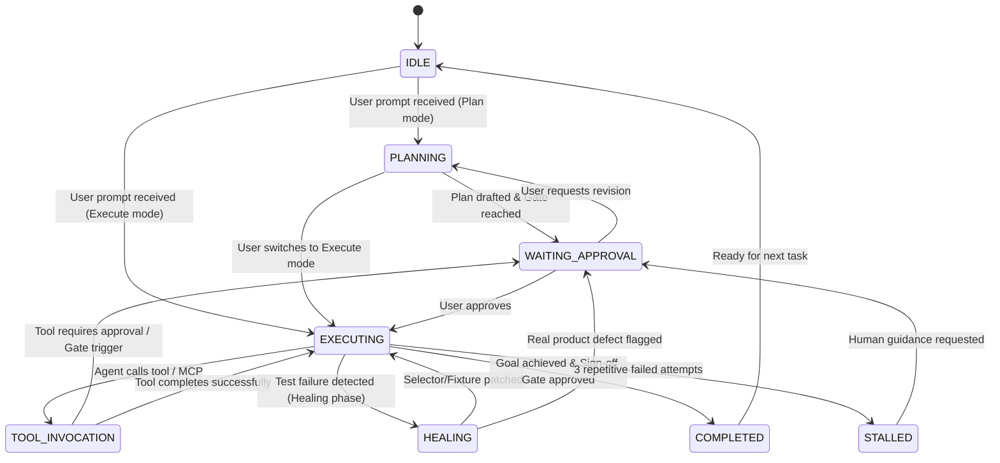

# Agentic QE Harness: User Stories & MAF Architecture Mapping

## 1. Executive Summary & Vision

The **Agentic QE Harness** is a next-generation, production-grade Quality Engineering chatbot and multi-agent orchestrator built with Next.js, React, and TypeScript. Inspired by the interactive developer ergonomics of **Claude Code Harness** and **Codex Harness**, and strictly adhering to the architectural foundations of the **Microsoft Agent Framework (MAF)** (documented in `agent-framework.pdf`), this system unifies autonomous test engineering, multi-agent workflows, and human-in-the-loop control.

The harness embeds the full quality engineering lifecycle defined in [`agentic-qe`](https://github.com/sarveshtalele/agentic-qe), delivering 8 specialized quality engineering agents, 8 verifiable quality gates, Magentic-One task ledger tracking, and DeepSeek-inspired per-session memory persistence.

---

## 2. MAF (Microsoft Agent Framework) Concept Mapping Matrix

Below is the strict mapping from the Microsoft Agent Framework documentation (`agent-framework.pdf`) to our harness implementation:

| MAF Concept / Pattern (`agent-framework.pdf`) | MAF Reference Section / Class | Harness Implementation Component | File Location | Purpose & Behavior in Harness |
| :--- | :--- | :--- | :--- | :--- |
| **HarnessAgent** | Page 45-60: Pre-configured scaffolding wrapping ChatClient with default providers | `HarnessAgent` | `src/lib/maf/core/HarnessAgent.ts` | Orchestrates planning loops, todo tracking, memory logging, and tool auto-approval policies. |
| **AgentModeProvider** | Page 82-89: Plan vs. Execute modes | `AgentModeProvider` | `src/lib/maf/core/AgentModeProvider.ts` | Enforces read-only exploratory planning before destructive or file-writing test generation execution. |
| **TodoProvider** | Page 90-105: `todos_add`, `todos_complete`, `todos_list`, `todos_update` | `TodoProvider` | `src/lib/maf/core/TodoProvider.ts` | Maintains real-time dynamic task list visible in UI side drawer; updates automatically as agents progress. |
| **AgentSession & StateBag** | Page 112-140: Multi-turn session state, session isolation, StateBag | `AgentSession`, `SessionStore` | `src/lib/maf/core/AgentSession.ts`, `src/lib/maf/memory/SessionStore.ts` | Per-session memory container (DeepSeek style) persisted to disk/JSON; isolates conversation, ledger, and working directory. |
| **FileMemoryProvider** | Page 145-160: Workspace file context provider | `FileMemoryProvider` | `src/lib/maf/core/FileMemoryProvider.ts` | Injects repository context, `.skillspector-baseline`, and QE history into system prompts dynamically. |
| **AgentSkillsProvider** | Page 162-180: Dynamic skill discovery and execution | `AgentSkillsProvider` | `src/lib/maf/core/AgentSkillsProvider.ts` | Loads skills from `agentic-qe` (`qe-discover`, `qe-plan`, `qe-design`, `qe-generate`, `qe-execute`, `qe-heal`, etc.). |
| **ApprovalRequiredAIFunction & ToolApprovalPolicy** | Page 210-235: Human-in-the-loop tool approvals | `ToolApprovalManager`, `ApprovalRequiredAIFunction` | `src/lib/maf/tools/ToolApprovalManager.ts` | Suspends execution and pushes interactive UI approval cards for critical tools and Quality Gates 1 through 8. |
| **MagenticWorkflowBuilder** | Page 320-365: Task ledger, progress ledger, stall detector, plan review | `MagenticQEOrchestrator` | `src/lib/maf/orchestrators/MagenticQEOrchestrator.ts` | Multi-agent orchestrator managing subgoals, stall detection (loop prevention), and cross-agent coordination. |
| **HandoffAgentExecutor** | Page 280-315: Explicit agent handoffs with transfer tokens | `QEHandoffExecutor` | `src/lib/maf/orchestrators/QEHandoffExecutor.ts` | Facilitates seamless transfer between specialized QE agents (e.g., Architect -> Case Designer -> Automation Engineer). |
| **AG-UI Protocol** | Page 510-545: Streaming SSE protocol for AI agent chat UIs | `AGUIProtocolHandler` | `src/lib/maf/protocol/agui.ts` | Streams real-time tokens, reasoning steps, tool calls, tool results, state deltas, and approval prompts. |
| **LocalMCPTool & HostedMCPTool** | Page 410-448: Model Context Protocol (MCP) tool integration | `MCPClientManager` | `src/lib/maf/tools/MCPClientManager.ts` | Connects stdio and SSE MCP servers dynamically to extend agents with external tools and databases. |
| **Compaction Strategy** | Page 185-205: Summarization, Sliding Window, Truncation | `CompactionEngine` | `src/lib/maf/memory/CompactionEngine.ts` | DeepSeek-style chat history compression preserving token limits while retaining vital QE state and decisions. |

---

## 3. Agentic QE Inbuilt Agents (Mapped from `agentic-qe`)

Our MAF Harness comes pre-loaded with the 8 specialized quality engineering agent personas defined in the `agentic-qe` repository:

1. **Principal Test Architect (`principal-test-architect`)**
   - *Role:* Cross-language test strategy architect & risk ranking strategist.
   - *Behavior:* Analyzes repo intelligence, allocates tests across Unit, Integration, API, and UI/E2E levels, and eliminates redundant scenarios.
2. **Test Design Architect (`test-design-architect`)**
   - *Role:* Specification & test case designer.
   - *Behavior:* Generates concrete, deterministic test case designs with inputs, mocks, fixtures, and exact expected outputs.
3. **Test Automation Engineer (`test-automation-engineer`)**
   - *Role:* Polyglot test source code generator.
   - *Behavior:* Produces compilable test code (Playwright, Vitest, PyTest, JUnit 5) with strictly 1:1 mapping to approved design cases.
4. **QA Execution Engineer (`qa-execution-engineer`)**
   - *Role:* Sandboxed test runner.
   - *Behavior:* Executes tests in isolated environments via authorized runners, capturing JUnit XML and console logs.
5. **Defect Diagnostician & Healer (`defect-diagnostician`)**
   - *Role:* Root-cause diagnostician and autonomous test healer.
   - *Behavior:* Distinguishes true application defects from selector/fixture drift; autonomously heals broken selectors without weakening assertions.
6. **Coverage Auditor (`coverage-auditor`)**
   - *Role:* Gap analysis and coverage auditor.
   - *Behavior:* Validates that all high-risk paths and acceptance criteria are tested; flags coverage holes.
7. **Confidence Reviewer (`confidence-reviewer`)**
   - *Role:* Independent validator and gatekeeper.
   - *Behavior:* Scores plans and generated code (0–100 scale) against ground-truth repository evidence; issues `APPROVED`, `REVISE`, or `REJECT`.
8. **Repo Intelligence Analyst (`repo-intelligence-analyst`)**
   - *Role:* Repository scanning and AST discovery engineer.
   - *Behavior:* Scans codebase, extracts endpoints, public APIs, database entities, and framework setups.

---

## 4. User Stories by Epic

### Epic 1: Conversational Harness Experience (Claude Code / Codex Inspired)

#### US-1.1: Multi-Turn Streaming Chat with Agent Thoughts
- **As a** Quality Engineer or Software Developer,
- **I want to** interact with an intelligent chat interface that streams responses token-by-token and exposes the agent's internal thought process and reasoning steps in collapsible blocks,
- **So that** I have full visibility into why and how the agent is making decisions before it takes action.
- **Acceptance Criteria:**
  - Chat responses stream via Server-Sent Events (SSE) following MAF's AG-UI protocol.
  - Thinking/reasoning tokens are rendered in a distinct collapsible container with live timer.
  - Markdown, code snippets, syntax highlighting, and file diffs render cleanly.

#### US-1.2: Harness Mode Switching (Plan vs. Execute)
- **As a** Developer,
- **I want to** switch between **Plan Mode** (exploratory, read-only, drafting strategies) and **Execute Mode** (generating files, running tests, healing defects),
- **So that** destructive or file-modifying tools cannot accidentally run while we are still exploring requirements.
- **Acceptance Criteria:**
  - UI provides an instant toggle pill in the header (`[Plan]` / `[Execute]`).
  - MAF `AgentModeProvider` intercepts tool calls: in `Plan` mode, write tools are disallowed or mocked with plan proposals.
  - Switching modes pushes a state delta through the AG-UI protocol to sync the client and server.

#### US-1.3: Interactive Todo Checklist Drawer
- **As a** Developer,
- **I want to** see an active, dynamic Todo Checklist panel updated in real time by the agent via MAF's `TodoProvider`,
- **So that** I can track multi-step QE progress (e.g., Repo Analysis -> Test Plan -> Case Design -> Code Gen -> Execution -> Sign-off).
- **Acceptance Criteria:**
  - The agent calls `todos_add`, `todos_complete`, `todos_update` during its execution loop.
  - The UI updates the checklist instantaneously without page reloads.
  - Users can also manually check off or add items if desired.

---

### Epic 2: Multi-Agent Orchestration & Magentic-One Ledger

#### US-2.1: Magentic Task & Progress Ledger
- **As a** Lead QA,
- **I want** the harness to maintain an explicit Magentic Task Ledger and Progress Ledger during complex multi-phase test campaigns,
- **So that** the orchestrator systematically tracks completed subgoals, next steps, and prevents infinite loops.
- **Acceptance Criteria:**
  - Harness orchestrator maintains `task_ledger` (overall objective, subgoals, constraints) and `progress_ledger` (completed milestones, blocker history).
  - UI displays the live Magentic Ledger in a dedicated collapsible tab.
  - Built-in Stall Detector triggers after 3 repetitive or unproductive turns, prompting for human clarification.

#### US-2.2: Autonomous Agent Handoffs
- **As a** Developer,
- **I want** the Principal Test Architect to automatically hand off approved test designs to the Test Automation Engineer, and subsequently to the QA Execution Engineer,
- **So that** complex workflows flow through specialized personas without manual prompt copy-pasting.
- **Acceptance Criteria:**
  - Handoffs use MAF's `HandoffAgentExecutor` pattern with typed transfer payloads.
  - The UI shows visual badges indicating which agent is currently speaking or executing (e.g., `[Principal Test Architect] -> [Test Automation Engineer]`).

---

### Epic 3: Human-in-the-Loop Quality Gates (Gates 1 to 8) & Guardrails

#### US-3.1: Quality Gate Approval Cards
- **As a** Release Manager or Senior QA,
- **I want** the harness to pause execution and present an interactive Quality Gate Approval Card when moving between phases (e.g., Gate 2: Test Plan, Gate 4: Test Code, Gate 6: Execution Sign-off),
- **So that** I can review artifacts, verify confidence scores, and either **Approve**, **Request Revision**, or **Reject**.
- **Acceptance Criteria:**
  - Gate triggers emit `TOOL_APPROVAL_REQUEST` through the AG-UI SSE stream.
  - The UI presents an approval modal/card showing:
    - Gate Name and Phase (1 to 8)
    - Confidence Reviewer score (0–100)
    - Artifact summary / file diff
    - Three action buttons: `[Approve & Proceed]`, `[Reject / Revise]`, `[Always Auto-Approve Gate]`.
  - Execution halts until the user submits a decision via the AG-UI approval response channel.

#### US-3.2: Destructive Command & Bash Guardrails
- **As a** System Administrator,
- **I want** test execution commands to be restricted strictly to authorized test runners (`playwright`, `vitest`, `pytest`, `mvn test`),
- **So that** agents cannot execute arbitrary, dangerous, or network-exfiltrating shell commands.
- **Acceptance Criteria:**
  - Guardrail middleware validates command syntax against whitelist before dispatch.
  - Unauthorized commands are blocked with explanatory error messages logged to the session audit trail.

---

### Epic 4: DeepSeek-Style Session Memory & Persistence

#### US-4.1: Persistent Multi-Session Workspace
- **As a** Developer,
- **I want** to create, switch, rename, and delete conversation sessions, with full state persistence across browser refreshes and server restarts,
- **So that** I can maintain independent test engineering sessions for different repositories, branches, or PRs.
- **Acceptance Criteria:**
  - Sessions are saved in structured storage (file-backed JSON store in `.gemini/antigravity/brain/...` or workspace `.sessions/`).
  - Switching sessions instantly reloads message history, StateBag, Magentic Ledger, and active todos.
  - DeepSeek-style sidebar displays sessions with timestamp, active agent, and message snippet.

#### US-4.2: Context Compaction & Sliding Window Memory
- **As a** User running a long QE campaign with hundreds of tool outputs,
- **I want** the harness to intelligently compact previous tool call outputs and summarize historical turns using MAF's `CompactionEngine`,
- **So that** the context window does not overflow and token consumption remains efficient.
- **Acceptance Criteria:**
  - When token limits approach configurable threshold (e.g. 80%), harness automatically compacts raw test logs into structured summaries.
  - Active todos, gate decisions, and architectural contracts are never pruned.

---

### Epic 5: Tools, Plugins, and MCP (Model Context Protocol) Integration

#### US-5.1: Dynamic MCP Server Connection
- **As a** Developer,
- **I want** to connect external MCP servers (stdio or SSE based, e.g., GitHub MCP, Postgres MCP, Playwright MCP) through a simple UI configuration drawer,
- **So that** my QE agents can query real databases, inspect live PRs, or control browser engines directly.
- **Acceptance Criteria:**
  - UI provides an **MCP & Plugins Hub** modal where users can add MCP server configs (command, args, env, or SSE endpoint).
  - `MCPClientManager` connects, lists tools via JSON-RPC 2.0, and registers them in the agent's tool registry.
  - Agents can invoke MCP tools alongside native MAF functions.

#### US-5.2: Inbuilt QE Tools Suite
- **As a** Developer,
- **I want** the harness to come pre-equipped with high-level Agentic QE tools:
  - `qe_discover_repo`: Scan directory, identify languages, test frameworks, and coverage setups.
  - `qe_extract_requirements`: Extract functional requirements and acceptance criteria.
  - `qe_plan_strategy`: Generate risk matrix and test level allocation.
  - `qe_design_cases`: Generate structured test cases with input/output fixtures.
  - `qe_generate_code`: Generate runnable test source files.
  - `qe_run_tests`: Execute test suites and parse results.
  - `qe_diagnose_and_heal`: Analyze failures, patch selectors/fixtures, and preserve assertions.
  - `qe_confidence_review`: Score artifacts from 0-100 against repository citations.
- **Acceptance Criteria:**
  - All tools are callable by both the orchestrator and individual agents.
  - Outputs are structured as JSON and formatted for rich UI display.

---

## 5. Harness State Machine

The Harness transitions through the following formal states:



---

## 6. Acceptance Verification Scenarios (BDD Gherkin)

### Scenario 1: Initial Repository Analysis & Gate 1 Test Planning
```gherkin
Given a user opens the Agentic QE Harness and connects a Next.js repository
And the harness mode is set to "Plan Mode"
When the user submits: "Analyze this repository and formulate a comprehensive test strategy"
Then the Repo Intelligence Analyst scans the directory AST and detects dependencies
And the Principal Test Architect generates a risk-prioritized test plan
And the TodoProvider populates 5 sequential milestones in the Todo drawer
And the Confidence Reviewer scores the plan (e.g. score: 92/100)
And the harness pauses at Quality Gate 1 displaying an interactive Approval Card
When the user clicks "Approve & Proceed"
Then the harness advances to Phase 2 (Test Design) and updates the Magentic Ledger
```

### Scenario 2: Autonomous Test Healing with Assertion Preservation
```gherkin
Given a generated Playwright test fails due to a changed button selector: 'data-testid="submit-btn"'
When the Defect Diagnostician inspects the failure log
Then the agent analyzes the DOM diff and identifies the new attribute: 'data-testid="confirm-action-btn"'
And the agent verifies that the assertion logic is unchanged
And the agent patches the test selector and re-runs the isolated test runner
When the healed test passes
Then the harness logs the healing audit record and updates the progress ledger
```
