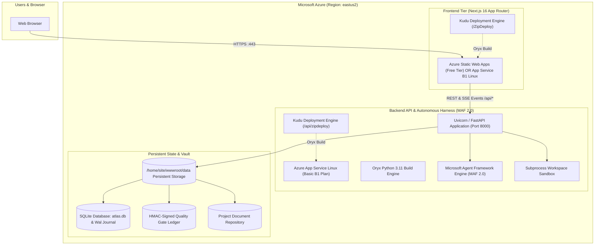

# Azure Cloud Deployment & Architecture Guide: Agentic QE Platform & Harness

> **Target Region:** `eastus2` (East US 2)  
> **Deployment Model:** Manual Kudu ZipDeploy (Zero GitHub Actions / Direct Zip Push)  
> **Cost Optimization:** Lowest Production-Grade Tier in `eastus2` (~**₹1,036 INR / $12.41 USD** per month)  
> **Source Reference:** [Azure Retail Prices API](https://prices.azure.com/api/retail/prices?%24filter=armRegionName%20eq%20%27eastus2%27)

---

## 1. Cloud Architecture Overview

The Agentic QE Platform & Harness is designed to run in Azure without external dependencies or mandatory managed database services. The architecture separates the **Next.js 16 Web Frontend** from the **Python FastAPI / MAF 2.0 Backend**, while guaranteeing that SQLite database ledgers, vector indexes, and repositories persist across container restarts.



---

## 2. Azure Retail Pricing Analysis (`eastus2`) & INR Cost Breakdown

Querying the official [Azure Retail Prices API](https://prices.azure.com/api/retail/prices?%24filter=armRegionName%20eq%20%27eastus2%27%20and%20serviceName%20eq%20%27Azure%20App%20Service%27) validates the exact live meter rates for `eastus2`:

| Azure Resource | Tier / SKU | Meter Rate (`eastus2`) | Monthly Cost (USD) | Monthly Cost (INR @ ₹83.5/$) |
|---|---|---|---|---|
| **FastAPI Backend App Service** | Basic `B1` (1 Core, 1.75 GB RAM) | `$0.017` / 1 Hour | **$12.41** / mo | **₹1,036 INR** / mo |
| **Next.js Frontend (Option A - Recommended)** | Azure Static Web Apps (Free) | `$0.00` / 1 Month | **$0.00** / mo | **₹0 INR** / mo |
| **Next.js Frontend (Option B - App Service)** | Shared App Service Plan with Backend | Included in B1 Plan | **$0.00** extra | **₹0 INR** extra |
| **Persistent Storage & Database** | App Service `/home` volume | Included (10 GB free) | **$0.00** extra | **₹0 INR** extra |
| **Standard Bandwidth (Egress)** | First 100 GB / month | Free | **$0.00** | **₹0 INR** |
| **Total Production Cost** | **Ultra-Budget Configuration** | — | **$12.41 USD** | **~₹1,036 INR** / mo |

> [!TIP]
> **Cheapest Viable Setup:** Host the FastAPI backend on **App Service Basic B1 Linux** ($12.41 / ~₹1,036 INR) and host the Next.js frontend on **Azure Static Web Apps (Free Tier)** ($0 / ₹0 INR). The total monthly bill remains strictly under **₹1,050 INR**.

---

## 3. Kudu ZipDeploy Packaging Automation

Because there is no GitHub Actions pipeline, the platform includes a local build and packaging script that generates self-contained zip archives formatted for the **Azure Kudu Oryx build system**.

### Step 1: Run the Packaging Script
Run the automated packaging script from the repository root:

```bash
python3 scripts/package_azure_kudu.py
```

Or using the shell wrapper:

```bash
chmod +x scripts/package_azure_kudu.sh
./scripts/package_azure_kudu.sh
```

### Generated Artifacts in `dist/`:
1. `dist/azure_backend.zip` (~0.7 MB):
   - Python backend source (`src/backend/`).
   - Core configuration, templates, skills, prompts, and evaluations.
   - `requirements.txt` with locked dependencies.
   - `startup.sh` executing Uvicorn with auto-port detection (`$PORT`), host `0.0.0.0`, and workers.
   - `.deployment` and `web.config` configuring Kudu's Oryx build engine.
2. `dist/azure_frontend.zip` (~0.4 MB):
   - Next.js application source (`src/frontend/`).
   - `package.json`, `next.config.ts`, `tsconfig.json`.
   - `startup.sh` and `startup.js` for standalone Node.js runtime.
   - `.deployment` and `staticwebapp.config.json` for routing and API proxies.

---

## 4. Step-by-Step Azure Portal UI Deployment Guide

Follow this click-by-click walkthrough in the [Azure Portal](https://portal.azure.com):

### Part 1: Create the Resource Group
1. Sign in to the Azure Portal.
2. In the top search bar, type **Resource groups** and click it.
3. Click **+ Create**.
4. Fill in:
   - **Subscription:** Select your active subscription.
   - **Resource group:** `rg-agentic-harness-eastus2`
   - **Region:** `(US) East US 2`
5. Click **Review + create** -> **Create**.

---

### Part 2: Create the Backend Azure App Service
1. In the search bar, type **App Services** and click **+ Create** -> **Web App**.
2. **Basics tab:**
   - **Resource Group:** `rg-agentic-harness-eastus2`
   - **Name:** `agentic-harness-api` *(must be globally unique, e.g. `agentic-harness-api-<yourname>`)*
   - **Publish:** `Code`
   - **Runtime stack:** `Python 3.11` (or `Python 3.12`)
   - **Operating System:** `Linux`
   - **Region:** `East US 2`
   - **Linux Plan:** Click **Create new** -> `asp-agentic-harness-b1`
   - **Pricing plan:** Click **Explore pricing plans** -> Select **Basic B1** (1.75 GB Memory, 1 vCPU) -> Click **Select**.
3. Click **Review + create** -> **Create**.

---

### Part 3: Configure Backend Environment Variables & Persistent SQLite Storage
1. Navigate to your new Web App (`agentic-harness-api`).
2. In the left menu under **Settings**, click **Environment variables** (or **Configuration**).
3. Under **App settings**, click **+ Add** for each of the following required variables:

| Setting Name | Value | Purpose |
|---|---|---|
| `WEBSITES_PORT` | `8000` | Informs Azure router that FastAPI listens on port 8000 |
| `ATLAS_DATA_DIR` | `/home/site/wwwroot/data` | **Crucial:** Forces SQLite & docs into persistent `/home` volume |
| `ATLAS_ADMIN_USERNAME` | `admin` | Initial admin username |
| `ATLAS_ADMIN_PASSWORD` | `<your-secure-password>` | Initial admin password for authentication |
| `ATLAS_SECRET_KEY` | `<generate-a-32-char-random-key>` | Cryptographic key for HMAC audit ledger signing |
| `SCM_DO_BUILD_DURING_DEPLOYMENT` | `true` | Instructs Kudu Oryx to run `pip install -r requirements.txt` |
| `PRE_BUILD_COMMAND` | `pip install --upgrade pip` | Ensures modern wheel builds |
| `STARTUP_COMMAND` | `bash startup.sh` | Launches uvicorn with production binding |

4. In the left menu under **Configuration** -> **General settings**:
   - Set **Startup Command** to: `bash startup.sh`
   - Ensure **Always On** is toggled to **On**.
5. Click **Apply** -> **Confirm**.

---

### Part 4: Upload Backend via Kudu ZipDeploy (No Git Required)
1. In your Web App's left menu, scroll down to **Development Tools** and click **Advanced Tools** -> Click **Go ->**.
2. This opens the Kudu management console:  
   `https://agentic-harness-api.scm.azurewebsites.net/`
3. In the top navigation bar, click **Tools** -> **Zip Push Deploy** (or navigate to `https://agentic-harness-api.scm.azurewebsites.net/ZipDeploy`).
4. Drag and drop `dist/azure_backend.zip` from your computer into the file list area.
5. Kudu will automatically:
   - Extract the zip file into `/home/site/wwwroot/`.
   - Run Oryx build: `pip install -r requirements.txt`.
   - Execute database migrations (`backend.db.migrate()`).
   - Run `startup.sh`.
6. Once deployment says `Deployment successful`:
   - Test in your browser: `https://agentic-harness-api.azurewebsites.net/api/health`
   - You should see: `{"status":"ok","llm":true,...}`.

---

### Part 5: Create and Deploy the Frontend
#### Option A: Azure Static Web Apps (Free Tier — ₹0 / month)
1. Search for **Static Web Apps** -> Click **+ Create**.
2. **Basics tab:**
   - **Resource Group:** `rg-agentic-harness-eastus2`
   - **Name:** `agentic-harness-ui`
   - **Plan type:** `Free`
   - **Region:** `East US 2`
   - **Deployment details:** Select **Other**.
3. Click **Review + create** -> **Create**.
4. In the Static Web App overview, copy the **Deployment token**.
5. Use SWA CLI or upload `dist/azure_frontend.zip`:
   ```bash
   npx @azure/static-web-apps-cli deploy ./src/frontend --env production --api-location https://agentic-harness-api.azurewebsites.net
   ```

#### Option B: Azure App Service (B1 Plan — Combined with Backend)
1. If hosting frontend on App Service:
   - Create App Service: `agentic-harness-ui` (Linux, Node 20 LTS, same B1 Plan `asp-agentic-harness-b1`).
   - Add App Setting: `NEXT_PUBLIC_API_URL=https://agentic-harness-api.azurewebsites.net`
   - Add App Setting: `SCM_DO_BUILD_DURING_DEPLOYMENT=true`
   - Add App Setting: `STARTUP_COMMAND=bash startup.sh`
2. Open Kudu: `https://agentic-harness-ui.scm.azurewebsites.net/ZipDeploy`.
3. Drag and drop `dist/azure_frontend.zip`.
4. Oryx runs `npm install && npm run build` and starts the Next.js server on port 3000.

---

## 5. Verification & Health Check Checklist

Once deployed, execute these sanity checks:

1. **Backend Health API:**
   ```bash
   curl -i https://<your-backend-app>.azurewebsites.net/api/health
   # Must return HTTP 200 OK
   ```
2. **SQLite Database Persistence Test:**
   - In Kudu **Bash Console** (`https://<your-backend-app>.scm.azurewebsites.net/DebugConsole`):
     ```bash
     ls -la /home/site/wwwroot/data/
     # Verify atlas.db and atlas.db-wal exist in persistent /home
     ```
   - Restart the App Service in Azure Portal.
   - Verify all projects, documents, and chat sessions remain intact.
3. **Frontend E2E Verification:**
   - Open `https://<your-frontend-app>.azurewebsites.net/login`.
   - Log in with `admin` and your configured `ATLAS_ADMIN_PASSWORD`.
   - Navigate to `/harness` and `/mcp` to confirm all 71 Playwright tools and agents load properly.
