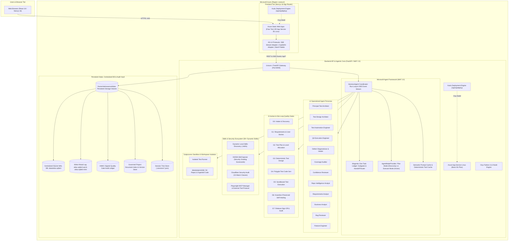
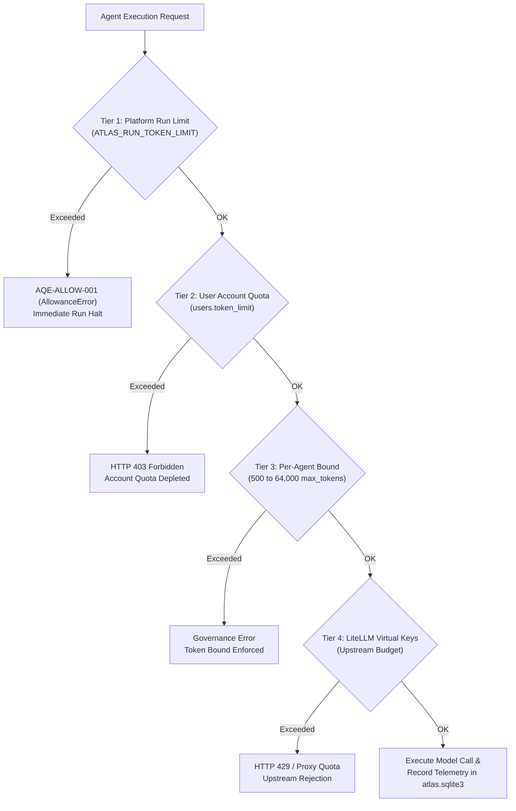

# Azure Cloud Deployment & Architecture Guide: Agentic QE Platform & Multi-Agent Harness

> **Target Region:** `eastus2` (East US 2)  
> **Deployment Models:**
> 1. Manual Kudu ZipDeploy (Direct ZIP upload via Kudu UI `/ZipDeploy` or REST API — Zero GitHub Actions required)
> 2. Automated Azure DevOps CI/CD Pipeline (`azure-pipelines.yml`)
> 3. Azure CLI Headless Deployment (`az webapp deploy`)
> 4. Containerized Azure App Service / Azure Container Apps (`Dockerfile.backend`, `Dockerfile.frontend`)  
> **Cost Optimization:** Lowest Production-Grade Tier in `eastus2` (~**₹1,036 INR / $12.41 USD** per month)  
> **Pricing Verification:** Live meter rates confirmed via [Azure Retail Prices API](https://prices.azure.com/api/retail/prices?%24filter=armRegionName%20eq%20%27eastus2%27)

---

## 1. System Architecture Overview

The Agentic QE Platform & Multi-Agent Autonomous Harness is an enterprise-grade quality engineering platform. The architecture cleanly decouples the **Next.js 16 Web Frontend** from the **Python FastAPI / Microsoft Agent Framework (MAF 2.0) Backend**, while guaranteeing that the **centralized SQLite database (`atlas.sqlite3`)**, Write-Ahead Log (WAL) journals, HMAC-signed audit ledgers, vector caches, and project workspaces persist indefinitely across restarts, slot swaps, and platform upgrades.



---

## 2. Azure Retail Pricing Analysis (`eastus2`) & INR Cost Breakdown

Querying the official [Azure Retail Prices API](https://prices.azure.com/api/retail/prices?%24filter=armRegionName%20eq%20%27eastus2%27%20and%20serviceName%20eq%20%27Azure%20App%20Service%27) validates the exact live meter rates for `eastus2` (effective November 2026):

| Azure Resource | Tier / SKU | Meter Rate (`eastus2`) | Monthly Cost (USD) | Monthly Cost (INR @ ₹83.5/$) |
|---|---|---|---|---|
| **FastAPI Backend App Service** | Basic `B1` (1 vCPU, 1.75 GB RAM) | `$0.017` / hour | **$12.41** / mo | **₹1,036 INR** / mo |
| **Next.js Frontend (Option A - Recommended)** | Azure Static Web Apps (Free) | `$0.00` / month | **$0.00** / mo | **₹0 INR** / mo |
| **Next.js Frontend (Option B - App Service)** | Shared App Service Plan with Backend | Included in B1 Plan | **$0.00** extra | **₹0 INR** extra |
| **Persistent Storage & Database** | App Service `/home` volume | Included (10 GB free) | **$0.00** extra | **₹0 INR** extra |
| **Standard Bandwidth (Egress)** | First 100 GB / month | Free | **$0.00** | **₹0 INR** |
| **Total Production Cost** | **Ultra-Budget Configuration** | — | **$12.41 USD** | **~₹1,036 INR** / mo |

> [!TIP]
> **Cheapest Production Setup:** Deploy the FastAPI backend on **App Service Basic B1 Linux** ($12.41 / ~₹1,036 INR) and host the Next.js frontend on **Azure Static Web Apps (Free Tier)** ($0 / ₹0 INR). The total monthly Azure infrastructure bill remains strictly under **₹1,050 INR**.

---

## 3. Centralized Database Architecture (`atlas.sqlite3`)

The platform implements a **Centralized Database Grounding** model. Rather than relying on ephemeral files, scattered JSON state, or mock responses, all platform entities are consolidated into a single centralized SQLite database: `data/atlas.sqlite3`.

### 3.1 Single Source of Truth
The centralized database stores:
- **Projects & Workspaces:** Registered repositories, commit SHAs, ingested source trees, and metadata (`projects` table).
- **Governed Documents:** Requirements (PRD), business rules (BRD), user stories, test plans, and architectural specifications (`documents` and `document_versions` tables).
- **Defect Findings:** Static analysis defects, bug scan findings, triage states, and branch fix commits (`findings` table).
- **Autonomous Runs & Telemetry:** Full workflow runs, stage transitions, token usage (`tokens_in`, `tokens_out`), model names, and timestamps (`runs`, `run_events`, `agent_calls` tables).
- **Human-in-the-Loop Gates:** Gate states (G0–G7), approval statuses, sign-off notes, and HMAC signatures (`gates` table).
- **User Accounts & RBAC:** Users, argon2/PBKDF2 salted hashes, session tokens, per-user token quotas, and model entitlements (`users`, `sessions`, `auth_events` tables).
- **NVIDIA Skill Specter & Cloudflare Security Scorecards:** Security checks, attack-surface coverage ledgers, and compliance audit results (`scorecards` table).

### 3.2 Deterministic Grounding Against `atlas.sqlite3`
To completely eliminate model hallucinations, the autonomous harness coordinator (`HarnessAgent`) and specialized agents perform **deterministic grounding queries** directly against `atlas.sqlite3`.
- When an agent reasons about defects, it queries `SELECT COUNT(*), severity FROM findings WHERE project_id=? GROUP BY severity`.
- When an agent evaluates quality gates, it queries `SELECT gate_id, status, approver FROM gates WHERE project_id=?`.
- When an agent navigates requirements, it inspects verified versions in `documents` joined with cryptographic SHA-256 hashes.
- Grounding facts are injected directly into the LLM context prompt under `[CENTRALIZED DATABASE FACTS (atlas.sqlite3)]`.

### 3.3 Automated Migrations
Database migrations are strictly version-controlled in `src/backend/migrations/` (e.g., `001_initial.sql`, `002_findings.sql`, `005_users.sql`, `008_governance.sql`). On startup, `backend.db.migrate()` inspects SQLite's `PRAGMA user_version` and executes pending migrations inside an atomic transaction.

---

## 4. SQLite Write-Ahead Log (WAL) Persistence on Azure

### 4.1 Why WAL Mode is Essential for Multi-Agent Architectures
In a multi-agent system, multiple agents execute concurrently:
- A user inspects the Observability dashboard in the UI.
- Background agents (e.g. Repo Intelligence Analyst and Test Design Architect) query AST entities and requirements.
- The QA Execution Engineer logs real-time JUnit run results.
- The AG-UI protocol streams SSE tokens and thought traces to the browser.

Under standard SQLite `DELETE` or `ROLLBACK` journal mode, database writers lock readers, causing `database is locked` (`sqlite3.OperationalError`) exceptions during parallel execution.

In **Write-Ahead Log (`WAL`) mode** (`PRAGMA journal_mode=WAL`):
1. **Readers Never Block Writers:** Agents and UI clients read from the database pages concurrently without taking locks.
2. **Writers Never Block Readers:** When a transaction commits, new pages are appended sequentially to the WAL log file (`atlas.sqlite3-wal`). Readers continue reading the snapshot from the main database and WAL index without interruption.
3. **High Throughput:** SQLite WAL yields significantly lower commit latency and higher I/O concurrency.

### 4.2 Triplet Database Files
When WAL mode is active, SQLite manages three companion files in `$ATLAS_DATA_DIR`:
1. `atlas.sqlite3`: The primary database containing the persistent B-tree tables and indexes.
2. `atlas.sqlite3-wal`: The Write-Ahead Log storing uncommitted and checkpoint-pending transactions.
3. `atlas.sqlite3-shm`: The shared-memory index file used by concurrent processes on the same host to coordinate reads from the WAL file.

### 4.3 Azure App Service Storage Persistence
On Azure App Service Linux:
- The persistent storage volume is mounted at `/home`.
- The platform configures `ATLAS_DATA_DIR=/home/site/wwwroot/data` (or `/home/atlas/data`).
- All SQLite database files (`atlas.sqlite3`, `atlas.sqlite3-wal`, `atlas.sqlite3-shm`), cryptographic key files (`.secret.key`), and project workspaces reside on this persistent mount.
- **Data survives restarts, deployments, slot swaps, and Azure container re-imaging.**

### 4.4 Filesystem Considerations & Fallback
Azure App Service mounts `/home` from Azure Files (CIFS/SMB) by default on some hosting plans:
- **Default:** `ATLAS_SQLITE_JOURNAL=WAL` (configured in `config.py` and `backend_startup.sh`).
- **POSIX Shared Memory:** If your App Service plan or custom mount lacks POSIX shared-memory (`-shm`) file-locking primitives, configure the App Setting `ATLAS_SQLITE_JOURNAL=DELETE` in the Azure Portal. The application will seamlessly fallback to traditional journaling with a 30-second busy timeout (`sqlite3.connect(timeout=30)`).
- **WAL Checkpointing:** The backend automatically runs SQLite checkpoints during migration and quiet periods. You can also trigger an explicit checkpoint via the API or Kudu console:
  ```bash
  python3 -c "import sqlite3; c=sqlite3.connect('/home/site/wwwroot/data/atlas.sqlite3'); c.execute('PRAGMA wal_checkpoint(TRUNCATE)'); c.close()"
  ```

---

## 5. Defense-in-Depth Secure Token Limits & Budget Governance

To prevent runaway recursive agent loops, prompt explosion, and "denial-of-wallet" attacks, the platform enforces a **4-tier token limit architecture**:



### 5.1 Tier 1: Platform-Wide Run Token Limit (`ATLAS_RUN_TOKEN_LIMIT`)
- **Default Value:** `50,000,000` tokens (configurable via environment variable / App Setting `ATLAS_RUN_TOKEN_LIMIT`).
- **Enforcement:** Enforced in `src/backend/maf/runtime.py` and `src/backend/maf/workflows/shared.py`.
- **Behavior:** Every LLM call tracks cumulative `tokens_in` and `tokens_out` for the run. If `cumulative_tokens >= RUN_TOKEN_LIMIT`, the execution halts immediately and raises `AllowanceError` (`AQE-ALLOW-001`). This provides an absolute circuit breaker against infinite agent recursion.

### 5.2 Tier 2: Per-User Account Quotas (`token_limit`)
- **Configuration:** Stored in the `users` table (`token_limit` integer column) and managed through the `/users` Admin UI.
- **Flexibility:** Can be set to a specific integer allocation (e.g. `1,000,000` tokens per developer) or left `NULL` for unlimited.
- **Time-Window Quotas:** Supports rolling periods (daily, weekly, monthly budgets) and per-model limits (`model_limits`).
- **Enforcement:** Inspected on every incoming authenticated request by `AuthGate` and `SessionGuard`. If depleted, returns `HTTP 403 Forbidden` with a message instructing the user to contact their administrator.

### 5.3 Tier 3: Per-Agent Model Bounds (500 to 64,000 Tokens)
- **Configuration:** Defined in `src/backend/maf/governance.py` and `POLICIES[agent].max_tokens`.
- **Enforcement:** In `update_settings(agent, ...)`:
  ```python
  if max_tokens is not None and not 500 <= max_tokens <= 64_000:
      raise ValueError("Token limit must be between 500 and 64000")
  ```
- **Behavior:** Ensures no individual agent persona can send or request an unbounded completion length, protecting context windows and reducing cost.

### 5.4 Tier 4: LiteLLM Virtual Key Integration
- When deployed with a LiteLLM proxy, each user can be assigned an upstream virtual key with strict monthly dollar budgets. The proxy acts as an independent out-of-band spend limiter.

### 5.5 Guardrails & Security Filters
Before tokens reach the model:
1. **Regex Prompt Injection Scanner (`INJECTION`):** Detects and strips adversarial jailbreaks, developer mode activations, and system prompt override attempts.
2. **Automated Secret Redactor (`scan_secrets`, `redact`):** Strips API keys, passwords, JWT tokens, and connection strings from agent thought traces before committing them to `atlas.sqlite3` or streaming over SSE.

---

## 6. Complete Azure App Service Configuration Reference

### 6.1 Backend App Service Environment Settings

Configure these in the Azure Portal under **Settings > Environment variables** (or **Configuration > Application settings**):

| Setting Name | Recommended Value | Purpose & Architectural Impact |
|---|---|---|
| `WEBSITES_PORT` | `8000` | Informs the Azure front-end load balancer that FastAPI / Uvicorn listens on port 8000. |
| `PORT` | `8000` | Application fallback listening port. |
| `ATLAS_DATA_DIR` | `/home/site/wwwroot/data` | **Crucial:** Directs SQLite (`atlas.sqlite3`), logs, and workspaces into persistent `/home` storage. |
| `ATLAS_SQLITE_JOURNAL` | `WAL` | Enables SQLite Write-Ahead Logging for high-concurrency multi-agent reads. Set to `DELETE` on legacy network shares. |
| `ATLAS_RUN_TOKEN_LIMIT` | `50000000` | Secure circuit breaker: maximum cumulative tokens allowed per workflow run before tripping `AQE-ALLOW-001`. |
| `ATLAS_ADMIN_USERNAME` | `admin` | Initial platform administrator username. Required for sign-in. |
| `ATLAS_ADMIN_PASSWORD` | `<secure-strong-password>` | Initial administrator password. Stored as salted PBKDF2/Argon2 hash in `atlas.sqlite3`. |
| `ATLAS_SECRET_KEY` | `<32-char-hex-or-fernet-key>` | Cryptographic secret for signing HMAC audit ledgers and encrypting session tokens. |
| `ATLAS_ALLOWED_ORIGINS` | `https://<frontend-app>.azurewebsites.net` | Strict CORS origin whitelist. Comma-separated list of allowed frontend domains. |
| `ATLAS_ALLOWED_HOSTS` | `<backend-app>.azurewebsites.net` | Host-header injection prevention. |
| `ATLAS_MAX_UPLOAD_MB` | `200` | Maximum size for repository zip uploads (in megabytes). |
| `ATLAS_LOG_RETENTION_DAYS` | `30` | Number of days to retain daily JSONL audit logs in `$ATLAS_DATA_DIR/logs`. |
| `ATLAS_MODEL_TIMEOUT` | `180` | Model request timeout in seconds before triggering automatic retry. |
| `ATLAS_MODEL_NO_CACHE` | `1` | Bypasses proxy prompt caching to guarantee non-stale test generations and audits. |
| `SCM_DO_BUILD_DURING_DEPLOYMENT` | `true` | Instructs Kudu's Oryx engine to build the Python environment (`pip install -r requirements.txt`). |
| `WEBSITES_CONTAINER_START_TIME_LIMIT` | `1800` | Extends startup grace period to 30 minutes for initial dependency installation. |

### 6.2 Frontend App Settings

| Setting Name | Recommended Value | Purpose |
|---|---|---|
| `PORT` | `3000` | Next.js server listening port. |
| `ATLAS_BACKEND_URL` | `https://<backend-app>.azurewebsites.net` | Backend API URL used by the Next.js API proxy and server components. |
| `NEXT_PUBLIC_API_URL` | `https://<backend-app>.azurewebsites.net` | Public API endpoint for client-side SSE and REST calls. |
| `NODE_OPTIONS` | `--max-old-space-size=1024` | Memory ceiling optimization to prevent V8 heap exhaustion on B1 (1.75 GB RAM). |
| `NEXT_TELEMETRY_DISABLED` | `1` | Disables telemetry to eliminate unnecessary outbound network requests. |
| `SCM_DO_BUILD_DURING_DEPLOYMENT` | `true` | Instructs Kudu to run `npm install && npm run build`. |

### 6.3 General Settings & App Service Flags
In the Azure Portal under **Settings > Configuration > General settings**:
- **Startup Command (Backend):** `bash startup.sh`
- **Startup Command (Frontend):** `node startup.js` (or `bash startup.sh`)
- **Always On:** `On` (ensures background agent workflows and SSE streams do not terminate when idle).
- **HTTPS Only:** `On` (forces TLS 1.2+ encryption for all inbound traffic).
- **Health Check Path:** `/api/health` (Backend) and `/` (Frontend).

---

## 7. Kudu Packaging & Deployment Hooks

The platform includes two automated packaging pipelines designed for zero-dependency deployments without requiring GitHub Actions:
1. `scripts/package_azure_kudu.py` (and wrapper `scripts/package_azure_kudu.sh`): Production packaging script with preflight bytecode syntax compilation, requirements validation, asset inclusion, and zip integrity verification.
2. `scripts/package_azure.py`: Lightweight packager.

### 7.1 Running the Packaging Automation
From the repository root:

```bash
chmod +x scripts/package_azure_kudu.sh
./scripts/package_azure_kudu.sh
```

Or execute directly with Python:

```bash
python3 scripts/package_azure_kudu.py
```

### 7.2 Generated Deployment Bundles in `dist/`
- **`dist/azure_backend.zip`** (~0.72 MB compressed / ~2.09 MB uncompressed):
  - Full Python backend source (`src/backend/` and alias `backend/`).
  - Production `requirements.txt`.
  - Platform assets: `prompts/`, `templates/`, `skills/` (59 dynamic local skills), and `evals/`.
  - `startup.sh`: Shell entrypoint with Oryx virtualenv detection, auto-pip installation, and Uvicorn runner.
  - `startup.py`: Python fallback entrypoint with dependency hashing (`.atlas-stamp`).
  - `.deployment`: Kudu configuration flag (`SCM_DO_BUILD_DURING_DEPLOYMENT=true`).
  - `web.config`: IIS / `httpPlatformHandler` bridge routing Azure App Service requests to Uvicorn.
- **`dist/azure_frontend.zip`** (~0.45 MB compressed / ~1.64 MB uncompressed):
  - Next.js 16 source code (`src/frontend/`).
  - `package.json`, `package-lock.json`, `next.config.ts`, `tsconfig.json`.
  - `startup.sh`: Shell entrypoint with automatic fallback between standalone Next.js and dev server.
  - `startup.js`: Node.js runner that builds standalone Next.js bundles on local disk and serves on port 3000.
  - `.deployment` and `web.config` (`iisnode` handler).
  - `staticwebapp.config.json`: Routing and security header rules for Azure Static Web Apps.

### 7.3 Kudu Deployment Hooks Explained
When a zip archive is pushed to Kudu's ZipDeploy endpoint:
1. **Unpack Hook:** Kudu unpacks the zip into `/home/site/wwwroot/`.
2. **Build Hook (`.deployment`):** Because `SCM_DO_BUILD_DURING_DEPLOYMENT=true`, Kudu invokes the Oryx build engine.
   - For Python: Oryx builds the virtual environment in `/antenv` or `/home/atlas/venv` and runs `pip install -r requirements.txt`.
   - For Node: Oryx runs `npm ci` and `npm run build`.
3. **Execution Hook (`startup.sh`):** Azure App Service launches the container startup command (`bash startup.sh`), which activates the virtualenv, ensures the centralized data directory `/home/site/wwwroot/data` exists, configures `ATLAS_SQLITE_JOURNAL=WAL`, runs migrations (`backend.db.migrate()`), and starts Uvicorn on `$PORT`.

---

## 8. Step-by-Step Azure Portal UI Deployment Guide

### Step 1: Create the Resource Group
1. Sign in to the [Azure Portal](https://portal.azure.com).
2. Navigate to **Resource groups** -> Click **+ Create**.
3. Configure:
   - **Subscription:** Select your subscription.
   - **Resource group:** `rg-agentic-harness-eastus2`
   - **Region:** `(US) East US 2`
4. Click **Review + create** -> **Create**.

---

### Step 2: Create the Backend App Service
1. Navigate to **App Services** -> Click **+ Create** -> **Web App**.
2. **Basics tab:**
   - **Resource Group:** `rg-agentic-harness-eastus2`
   - **Name:** `agentic-harness-api-<unique>` *(e.g. `agentic-harness-api-prod`)*
   - **Publish:** `Code`
   - **Runtime stack:** `Python 3.12` (or `Python 3.11`)
   - **Operating System:** `Linux`
   - **Region:** `East US 2`
   - **Linux Plan:** Click **Create new** -> `asp-agentic-harness-b1`
   - **Pricing plan:** Select **Basic B1** (1.75 GB RAM, 1 vCPU, ₹1,036/mo).
3. **Monitoring tab:** Turn **Application Insights** to **No** (to prevent unneeded costs).
4. Click **Review + create** -> **Create**.
5. Once created, open the Web App and copy the **Default domain** (e.g. `agentic-harness-api-prod.azurewebsites.net`).

---

### Step 3: Configure Backend Environment Variables
1. In your Backend App Service, navigate to **Settings > Environment variables**.
2. Under the **App settings** tab, add each of the following:
   - `WEBSITES_PORT`: `8000`
   - `ATLAS_DATA_DIR`: `/home/site/wwwroot/data`
   - `ATLAS_SQLITE_JOURNAL`: `WAL`
   - `ATLAS_RUN_TOKEN_LIMIT`: `50000000`
   - `ATLAS_ADMIN_USERNAME`: `admin`
   - `ATLAS_ADMIN_PASSWORD`: `<your-secure-admin-password>`
   - `ATLAS_SECRET_KEY`: `<generate-32-char-random-string>`
   - `SCM_DO_BUILD_DURING_DEPLOYMENT`: `true`
   - `WEBSITES_CONTAINER_START_TIME_LIMIT`: `1800`
3. Click **Apply** -> **Confirm**.

---

### Step 4: Configure Backend General Settings
1. Navigate to **Settings > Configuration** (or **General settings**).
2. Set **Startup Command** to:
   ```bash
   bash startup.sh
   ```
3. Set **Always On** to: `On`.
4. Set **HTTPS Only** to: `On`.
5. Under **Monitoring > Health check**, toggle **Enable** and set the path to:
   ```
   /api/health
   ```
6. Click **Save** -> **Continue**.

---

### Step 5: Deploy Backend via Kudu ZipDeploy
1. Under **Development Tools**, click **Advanced Tools** -> Click **Go ->**.
2. This opens the Kudu console:  
   `https://<your-backend-app>.scm.azurewebsites.net/`
3. In the top navigation bar, click **Tools > Zip Push Deploy** (or browse to `https://<your-backend-app>.scm.azurewebsites.net/ZipDeploy`).
4. Drag and drop `dist/azure_backend.zip` into the file browser area.
5. Watch the deployment log. Kudu unpacks the files, Oryx runs `pip install`, and the service launches.
6. Verify deployment by opening:  
   `https://<your-backend-app>.azurewebsites.net/api/health`  
   *Expected Response:* `{"status":"ok","llm":true,...}`

---

### Step 6: Create and Deploy the Frontend

#### Option A: Azure Static Web Apps (Free Tier — ₹0 / month — Recommended)
1. In the Azure Portal search bar, type **Static Web Apps** -> Click **+ Create**.
2. Set:
   - **Resource Group:** `rg-agentic-harness-eastus2`
   - **Name:** `agentic-harness-ui`
   - **Plan type:** `Free`
   - **Region:** `East US 2`
   - **Deployment details:** Select **Other**.
3. Click **Review + create** -> **Create**.
4. In the Static Web App overview, copy the **Deployment token**.
5. Deploy via the SWA CLI:
   ```bash
   npx @azure/static-web-apps-cli deploy ./src/frontend --env production --api-location https://<your-backend-app>.azurewebsites.net
   ```

#### Option B: Azure App Service (Shared Basic B1 Plan — ₹0 Extra)
1. Create a second Web App: `agentic-harness-ui` (Linux, Node 22 LTS, select the existing `asp-agentic-harness-b1` plan).
2. Under **Environment variables**, add:
   - `PORT`: `3000`
   - `ATLAS_BACKEND_URL`: `https://<your-backend-app>.azurewebsites.net`
   - `NEXT_PUBLIC_API_URL`: `https://<your-backend-app>.azurewebsites.net`
   - `NODE_OPTIONS`: `--max-old-space-size=1024`
   - `SCM_DO_BUILD_DURING_DEPLOYMENT`: `true`
3. Under **General settings**, set **Startup Command** to: `bash startup.sh` (or `node startup.js`) and toggle **Always On** to `On`.
4. Open Kudu ZipDeploy (`https://agentic-harness-ui.scm.azurewebsites.net/ZipDeploy`) and drag-and-drop `dist/azure_frontend.zip`.

---

### Step 7: Secure Backend Network Access
To ensure the backend is strictly reachable only by your frontend:
1. Open your Frontend App Service, navigate to **Settings > Properties**, and copy **Outbound IP addresses**.
2. Open your Backend App Service, navigate to **Settings > Networking > Access restriction**.
3. Set the default action for public traffic to **Deny**.
4. Add an **Allow** rule for each frontend outbound IP address (formatted as `x.x.x.x/32`).
5. Ensure Kudu (**Advanced tool site**) rules remain at default so administrative access is retained.

---

## 9. Direct CLI & REST API Deployment Methods

### 9.1 Headless Deployment via Azure CLI
You can deploy without touching the browser using the Azure CLI:

```bash
# 1. Login to Azure
az login

# 2. Deploy Backend ZIP
az webapp deploy \
  --resource-group rg-agentic-harness-eastus2 \
  --name agentic-harness-api-prod \
  --src-path dist/azure_backend.zip \
  --type zip \
  --async false

# 3. Deploy Frontend ZIP
az webapp deploy \
  --resource-group rg-agentic-harness-eastus2 \
  --name agentic-harness-ui-prod \
  --src-path dist/azure_frontend.zip \
  --type zip \
  --async false
```

### 9.2 Headless Deployment via Kudu REST API (`curl`)
If Azure CLI is not installed, use `curl` directly against Kudu's ZipDeploy endpoint with publishing credentials:

```bash
curl -X POST \
  -u "$DEPLOYMENT_USERNAME:$DEPLOYMENT_PASSWORD" \
  --data-binary @dist/azure_backend.zip \
  https://agentic-harness-api-prod.scm.azurewebsites.net/api/zipdeploy
```

---

## 10. Containerized Deployment (Docker / Azure Container Apps)

For organizations requiring containerized deployments, pre-configured production Dockerfiles are provided:
- **Backend Container:** `deploy/azure/Dockerfile.backend`
- **Frontend Container:** `deploy/azure/Dockerfile.frontend`

### 10.1 Building and Testing Containers Locally
```bash
# Build Backend
docker build -t agentic-harness-api:latest -f deploy/azure/Dockerfile.backend .

# Build Frontend
docker build -t agentic-harness-ui:latest -f deploy/azure/Dockerfile.frontend .

# Run Backend with persistent volume mount
docker run -d -p 8000:8000 \
  -v $(pwd)/data:/home/atlas/data \
  -e ATLAS_SQLITE_JOURNAL=WAL \
  -e ATLAS_RUN_TOKEN_LIMIT=50000000 \
  -e ATLAS_ADMIN_USERNAME=admin \
  -e ATLAS_ADMIN_PASSWORD=adminpassword \
  --name harness-backend agentic-harness-api:latest
```

### 10.2 Deploying Containers to Azure Container Apps (ACA)
```bash
# Create Azure Container Registry (ACR)
az acr create --resource-group rg-agentic-harness-eastus2 --name acrharness --sku Basic

# Build and Push in Cloud
az acr build --registry acrharness --image agentic-harness-api:latest -f deploy/azure/Dockerfile.backend .
az acr build --registry acrharness --image agentic-harness-ui:latest -f deploy/azure/Dockerfile.frontend .

# Deploy Backend Container App
az containerapp create \
  --name harness-api \
  --resource-group rg-agentic-harness-eastus2 \
  --environment cae-harness \
  --image acrharness.azurecr.io/agentic-harness-api:latest \
  --target-port 8000 \
  --ingress external \
  --cpu 1.0 --memory 2.0Gi
```

---

## 11. Verification, Validation & Health Check Checklist

Execute this verification runbook post-deployment:

### 1. Backend Health Check
```bash
curl -i https://<your-backend-app>.azurewebsites.net/api/health
```
**Verification Criteria:**
- HTTP status: `200 OK`
- JSON payload contains: `{"status": "ok", "llm": true, "version": ...}`

### 2. Centralized Database Grounding & WAL Verification
Open Kudu **Bash Debug Console** (`https://<your-backend-app>.scm.azurewebsites.net/DebugConsole`) or SSH:
```bash
cd /home/site/wwwroot/data
ls -la
```
**Verification Criteria:**
- `atlas.sqlite3` exists and is non-empty.
- `atlas.sqlite3-wal` exists during active reads and writes.
- `atlas.sqlite3-shm` exists as the shared-memory coordination index.

Verify database integrity and table count:
```bash
python3 -c "import sqlite3; c=sqlite3.connect('atlas.sqlite3'); print('Tables:', [r[0] for r in c.execute(\"SELECT name FROM sqlite_master WHERE type='table'\")]); print('Journal:', c.execute('PRAGMA journal_mode').fetchone()[0])"
```
**Expected Output:**
- `Journal: wal`
- Tables list includes: `projects`, `documents`, `document_versions`, `findings`, `runs`, `run_events`, `gates`, `users`, `sessions`, `agent_settings`, `guardrail_events`.

### 3. Token Limits Enforcement Check
Test token limit security in the Python console:
```bash
python3 -c "from backend.config import RUN_TOKEN_LIMIT; print('Active Token Limit:', RUN_TOKEN_LIMIT)"
```
**Expected Output:** `Active Token Limit: 50000000` (or your configured value).

### 4. End-to-End Frontend & Harness Validation
1. Browse to `https://<your-frontend-app>.azurewebsites.net/login`.
2. Sign in using `admin` and your configured `ATLAS_ADMIN_PASSWORD`.
3. Navigate to **Home** (`/harness`):
   - Confirm the **Claude Code Desktop Command Center** loads.
   - Verify all **12 Specialized QE Agent Personas** appear in the agent selector.
   - Test a slash command (e.g. `/plan` or `/mcp`).
   - Confirm **59 dynamic local skills** load on the Skills tab.
   - Ingest a test Git repository or zip archive and verify that Gate 0 through Gate 7 transition smoothly with HMAC signatures recorded in `atlas.sqlite3`.

---

## 12. Disaster Recovery, Backups & Troubleshooting

### 12.1 Backup Procedure
All platform state resides in `/home/site/wwwroot/data`. To take an atomic, consistent backup:
1. Trigger a WAL checkpoint to flush pending transactions:
   ```bash
   sqlite3 /home/site/wwwroot/data/atlas.sqlite3 ".backup /home/site/wwwroot/data/atlas_backup.sqlite3"
   ```
2. Download `atlas_backup.sqlite3` and `/home/site/wwwroot/data/.secret.key` using Kudu File Manager or SFTP.
3. Keep `.secret.key` in Azure Key Vault or offline encrypted storage.

### 12.2 Troubleshooting Common Issues

| Symptom | Root Cause | Remediation |
|---|---|---|
| `502 Bad Gateway` / `504 Gateway Timeout` | Oryx build took longer than default start timeout | Set `WEBSITES_CONTAINER_START_TIME_LIMIT=1800` in App Settings. |
| `sqlite3.OperationalError: disk I/O error` or `locking error` | SMB/CIFS share lacks POSIX shared memory (`-shm`) support | Add App Setting `ATLAS_SQLITE_JOURNAL=DELETE` and restart the App Service. |
| `AQE-ALLOW-001: Run stopped: it used X tokens` | Run exceeded configured token ceiling | This is an intended security circuit breaker. Review run efficiency or raise `ATLAS_RUN_TOKEN_LIMIT`. |
| Out of Memory (OOM) on Frontend Build | Next.js compilation exceeded 1.75 GB RAM on B1 plan | `startup.js` automatically optimizes with `--max-old-space-size=1024`. Alternatively, scale App Service plan temporarily to B2 during initial build, then scale back down to B1. |
| CORS refusal in browser console | Frontend domain not present in backend CORS whitelist | Add frontend domain to backend `ATLAS_ALLOWED_ORIGINS` setting (e.g. `https://agentic-harness-ui.azurewebsites.net`). |
