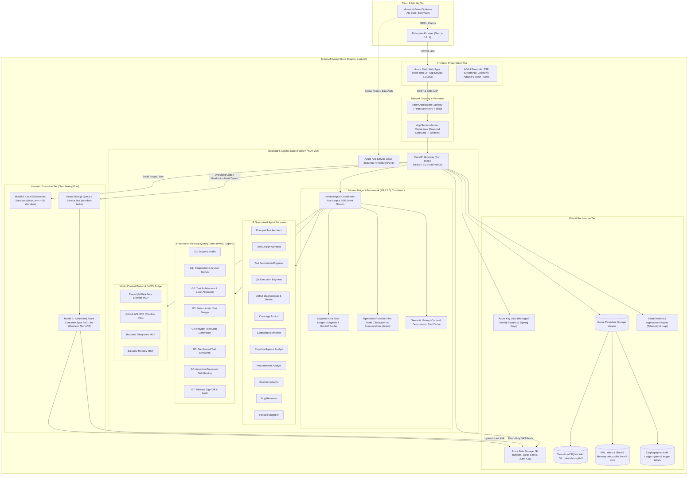
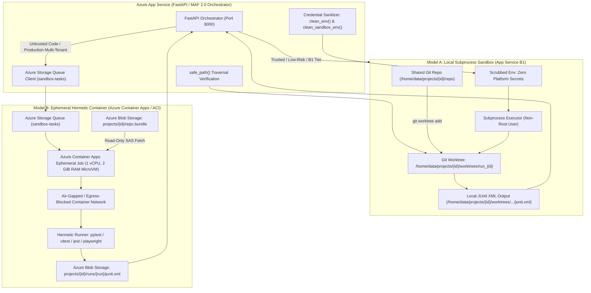
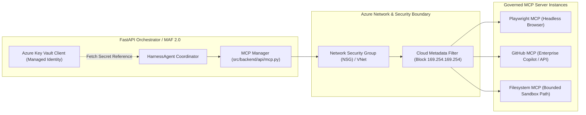

# Azure Enterprise Deployment & Sandbox Architecture Canonical Guide

> **Document Classification:** Enterprise Production Canonical Guide  
> **Target Region:** `eastus2` (East US 2)  
> **Architecture Target:** Multi-Agent Autonomous Harness & Agentic Quality Engineering (AQE) Platform  
> **Minimum Production Tier:** Azure App Service Linux Basic `B1` (~**$12.41 USD / ₹1,036 INR** per month)  
> **Sandbox Execution:** Local Subprocess Sandboxes (B1) & Ephemeral Hermetic Azure Container Apps (ACA) / Azure Container Instances (ACI)  
> **Live Pricing Verification:** Meter rates confirmed via [Azure Retail Prices API](https://prices.azure.com/api/retail/prices?%24filter=armRegionName%20eq%20%27eastus2%27)  
> **Policy:** **1 Single Document for Each Architectural Purpose — Canonical Reference Document.**

---

## 1. System Architecture Overview & Executive Summary

The Agentic QE Platform & Multi-Agent Autonomous Harness is an enterprise-grade autonomous quality engineering system built on top of **Microsoft Agent Framework (MAF 2.0)** and **FastAPI**, paired with a **Next.js 16 Web Command Center**. The system automates the entire software quality lifecycle across **8 Human-in-the-Loop Quality Gates (G0–G7)** using **12 Specialized Agent Personas** and **59+ Dynamic Domain Skills**.

### 1.1 High-Level Cloud Topology

The enterprise deployment cleanly isolates user-facing presentations, the orchestration backend, persistent transactional state, and ephemeral execution sandboxes:



---

## 2. Azure Retail Pricing Analysis (`eastus2`) & INR Cost Breakdown

Querying the official [Azure Retail Prices API](https://prices.azure.com/api/retail/prices?%24filter=armRegionName%20eq%20%27eastus2%27%20and%20serviceName%20eq%20%27Azure%20App%20Service%27) verifies the exact live meter rates for `eastus2` (effective November 2026):

| Azure Resource | Tier / SKU | Meter Rate (`eastus2`) | Monthly Cost (USD) | Monthly Cost (INR @ ₹83.5/$) | Architectural Role |
|---|---|---|---|---|---|
| **FastAPI Backend App Service** | Basic `B1` (1 vCPU, 1.75 GB RAM) | `$0.017` / hour | **$12.41** / mo | **₹1,036 INR** / mo | Hosts FastAPI, MAF 2.0 orchestrator, SQLite WAL, and local sandbox subprocesses. |
| **Next.js Frontend (Option A - Recommended)** | Azure Static Web Apps (Free) | `$0.00` / month | **$0.00** / mo | **₹0 INR** / mo | Global CDN, Next.js static asset distribution, zero server maintenance. |
| **Next.js Frontend (Option B - App Service)** | Shared App Service Plan with Backend | Included in B1 Plan | **$0.00** extra | **₹0 INR** extra | Co-hosted on the same B1 Linux instance running on port 3000. |
| **Hermetic Execution Pool (Model B)** | Azure Container Apps Jobs (Consumption) | $0.000024/vCPU-s + $0.000003/GiB-s (Free grant: 180,000 vCPU-s/mo) | **$0.00** base | **₹0 INR** base | Spins up ephemeral MicroVMs on demand; scales to zero when idle ($0 idle spend). |
| **Persistent Storage & Database** | App Service `/home` volume (10 GB free) | Included in App Service Plan | **$0.00** extra | **₹0 INR** extra | Hosts persistent `atlas.sqlite3`, WAL logs, and repository worktrees. |
| **Standard Bandwidth (Egress)** | First 100 GB / month | Free | **$0.00** | **₹0 INR** | Public internet egress to client browsers. |
| **Total Production Cost** | **Ultra-Budget Enterprise Configuration** | — | **$12.41 USD** | **~₹1,036 INR** / mo | Full production stack operating under ₹1,050 INR / month. |

> [!TIP]
> **Production Scaling Recommendation:** When scaling beyond single-team capacity, upgrade the App Service Plan from **Basic B1** to **Premium P1v3** (2 vCPU, 8 GB RAM, ~$77 USD / ~₹6,400 INR) with zero architectural modifications or code refactoring.

---

## 3. Deployment Models & Packaging Pipelines

The repository features zero-dependency, automated conversion and deployment tools:
- `scripts/azure_convert_and_deploy.sh` (and `.py`): Comprehensive 1-click conversion and packaging script that converts repository source into clean Azure App Service Kudu deployable bundles (`dist/azure_backend.zip` and `dist/azure_frontend.zip`), with optional `--build-frontend` pre-compilation for instant B1 startup, and direct `--deploy` execution.
- `deploy/azure/setup_azure_infrastructure.sh` (and `.ps1`): 1-time automated infrastructure provisioning script for App Service Plan, WebApps, SQLite WAL / PostgreSQL DB, and CORS.
- `.github/workflows/azure-deploy.yml`: Production GitHub Actions CI/CD pipeline deploying both services via Kudu ZipDeploy or Publish Profiles.
- `deploy/azure/azure-pipelines.yml`: Azure DevOps CI/CD pipeline definition for automated multi-stage builds.

### 3.0 Rapid 3-Step "Clone -> Zip -> Deploy to Kudu" Workflow

After the 1-time infrastructure setup has been executed (Section 3.1), deployment requires just 3 commands:

```bash
# 1. Clone repository
git clone https://github.com/sarveshtalele/agentic-harness.git
cd agentic-harness

# 2. Convert and package into deployable Kudu ZIP archives (with prebuilt frontend for instant boot)
./scripts/azure_convert_and_deploy.sh --convert --build-frontend

# 3. Deploy directly to Azure Kudu (via Azure CLI or Kudu REST API)
./scripts/azure_convert_and_deploy.sh --deploy \
  --resource-group rg-agentic-harness-eastus2 \
  --backend-app agentic-harness-backend-prod \
  --frontend-app agentic-harness-frontend-prod
```

Or deploy manually via browser drag-and-drop:
1. Open Kudu UI for Backend: `https://<backend-app>.scm.azurewebsites.net/ZipDeploy` -> Drag & drop `dist/azure_backend.zip`.
2. Open Kudu UI for Frontend: `https://<frontend-app>.scm.azurewebsites.net/ZipDeploy` -> Drag & drop `dist/azure_frontend.zip`.

---

### 3.1 1-Time Azure Infrastructure Setup Automation

To prepare your Azure environment before deploying, run the 1-time setup script:

```bash
# Linux / macOS
chmod +x deploy/azure/setup_azure_infrastructure.sh
./deploy/azure/setup_azure_infrastructure.sh

# Windows (PowerShell)
.\deploy\azure\setup_azure_infrastructure.ps1 -ResourceGroup "rg-agentic-harness-eastus2" -Sku "B1"
```

The script automatically executes:
1. **Resource Group Creation:** `rg-agentic-harness-eastus2` in `eastus2`.
2. **Shared App Service Plan:** `asp-agentic-harness-b1` (Linux B1 tier, ~$12.41/mo, hosts both services).
3. **Backend WebApp:** Configured for Python 3.12, port `8000`, startup command `/home/site/wwwroot/startup.sh`, and persistent storage enabled (`WEBSITES_ENABLE_APP_SERVICE_STORAGE=true`).
4. **Frontend WebApp:** Configured for Node.js 20, port `3000`, startup command `/home/site/wwwroot/startup.sh`, and proxy bound to backend URL (`ATLAS_BACKEND_URL`).
5. **CORS Configuration:** Enables secure cross-origin communication between Frontend and Backend.
6. **Database Persistence:** Provisions persistent SQLite storage at `/home/atlas/data/atlas.sqlite3` with `ATLAS_SQLITE_JOURNAL=DELETE` (the `/home` share has no shared memory for WAL). PostgreSQL is not supported yet; there is no `DATABASE_URL` setting.

---

### 3.2 Deployment Bundle Structure in `dist/`

Running `./scripts/azure_convert_and_deploy.sh --convert` generates two deterministic zip bundles:

#### 1. `dist/azure_backend.zip` (~0.72 MB compressed / ~2.09 MB uncompressed)
- **Source Trees:** `src/backend/` and root alias `backend/` for direct, resilient Python imports.
- **Dependencies:** Production-pinned `requirements.txt`.
- **Assets:** `prompts/`, `templates/`, `skills/` (59 dynamic local skills), and `evals/`.
- **Kudu & Service Configuration:**
  - `startup.sh`: Shell launcher with Oryx virtualenv detection, auto-pip installation, and Uvicorn process binding.
  - `startup.py`: Python fallback runner featuring checksum-stamped `.atlas-stamp` validation to eliminate duplicate builds.
  - `.deployment`: Kudu configuration flag (`SCM_DO_BUILD_DURING_DEPLOYMENT=true`).
  - `web.config`: IIS / `httpPlatformHandler` bridge routing App Service requests to Uvicorn on `$PORT`.

#### 2. `dist/azure_frontend.zip` (~0.45 MB compressed / ~1.64 MB uncompressed)
- **Source Tree:** Next.js 16 App Router source (`src/frontend/app`, `components`, `lib`, `content`).
- **Build Manifests:** `package.json`, `package-lock.json`, `next.config.ts`, `tsconfig.json`.
- **Kudu & Service Configuration:**
  - `startup.sh`: Shell entrypoint with automatic standalone Next.js detection and fallback runner.
  - `startup.js`: Node runner that builds standalone Next.js bundles on local disk (`/tmp`) and mirrors output to `/home/atlas/frontend`.
  - `.deployment`: Flag triggering Oryx Node.js build lifecycle.
  - `web.config`: `iisnode` handler configuration.
  - `staticwebapp.config.json`: Routing rules and security headers for Azure Static Web Apps.

---

### 3.2 Azure App Service Deployment Methods

#### Method 1: Azure CLI Headless Deployment (`az webapp deployment source config-zip` vs `az webapp deploy`)

Azure CLI offers two distinct deployment commands for ZIP archives:

1. **`az webapp deployment source config-zip` (Recommended for Legacy Kudu compatibility):**
   Explicitly pushes the zip payload to the Kudu ZipDeploy endpoint (`/api/zipdeploy`), forcing Oryx build hooks to trigger when `SCM_DO_BUILD_DURING_DEPLOYMENT=true` is set.
   ```bash
   # Deploy Backend using config-zip
   az webapp deployment source config-zip \
     --resource-group rg-agentic-harness-eastus2 \
     --name agentic-harness-api-prod \
     --src dist/azure_backend.zip
   ```

2. **`az webapp deploy` (Modern Unified Azure CLI Deployment):**
   The unified CLI command supports multiple artifact types (`zip`, `war`, `jar`, `static`). Setting `--type zip` and `--async false` ensures synchronous deployment verification:
   ```bash
   # Deploy Backend using unified deploy
   az webapp deploy \
     --resource-group rg-agentic-harness-eastus2 \
     --name agentic-harness-api-prod \
     --src-path dist/azure_backend.zip \
     --type zip \
     --async false

   # Deploy Frontend using unified deploy
   az webapp deploy \
     --resource-group rg-agentic-harness-eastus2 \
     --name agentic-harness-ui-prod \
     --src-path dist/azure_frontend.zip \
     --type zip \
     --async false
   ```

#### Method 2: Azure Portal Kudu UI Drag-and-Drop (`/ZipDeploy`) & REST API

For environments with restricted CLI access:
1. Navigate to the Kudu Advanced Tools portal:
   `https://<app-name>.scm.azurewebsites.net/ZipDeploy`
2. Drag and drop `dist/azure_backend.zip` directly onto the browser file drop target.
3. Kudu extracts the archive into `/home/site/wwwroot/`, invokes Oryx (`pip install`), and restarts the container.

Alternatively, deploy via `curl` directly to the Kudu REST API:
```bash
# Retrieve publishing credentials or use Azure AD Bearer token
curl -X POST \
  -u "$DEPLOYMENT_USERNAME:$DEPLOYMENT_PASSWORD" \
  --data-binary @dist/azure_backend.zip \
  https://<app-name>.scm.azurewebsites.net/api/zipdeploy
```

---

## 4. Startup Hooks, Oryx Build Engine & Web Config Bridges

### 4.1 Oryx Build Engine Execution Lifecycle

When `SCM_DO_BUILD_DURING_DEPLOYMENT=true` is configured in the `.deployment` file or App Settings:
1. **Extraction:** Kudu unpacks the ZIP payload into `/home/site/wwwroot`.
2. **Detection:** Oryx detects Python from `requirements.txt` or Node.js from `package.json`.
3. **Environment Creation:**
   - For Python: Oryx provisions a virtual environment in `/antenv` or updates the persistent environment in `/home/atlas/venv`.
   - Oryx executes: `pip install --no-cache-dir --disable-pip-version-check -r requirements.txt`.
   - For Node: Oryx executes `npm ci` and `npm run build`.
4. **Execution Hook:** Kudu signals App Service to start the application using the configured **Startup Command**.

### 4.2 Backend Startup Hooks (`backend_startup.sh` & `backend_startup.py`)

The platform includes two redundant startup mechanisms designed to prevent cold-start loops:

1. **`backend_startup.sh` (Shell Entrypoint):**
   - Detects existing Oryx virtualenvs at `/antenv`, `$APP_ROOT/antenv`, or `/home/atlas/venv`.
   - If missing, provisions `/home/atlas/venv` and installs dependencies.
   - Sets environment variables: `ATLAS_DATA_DIR=/home/atlas/data`, `ATLAS_SQLITE_JOURNAL=DELETE`, `PYTHONPATH=$APP_ROOT/src:$APP_ROOT:$PYTHONPATH`.
   - Inspects `$PORT` (defaulting to 8000) and executes:
     ```bash
     exec uvicorn backend.app:app --host 0.0.0.0 --port "$LISTEN_PORT" --workers 1 --proxy-headers
     ```

2. **`backend_startup.py` (Idempotent Stamp-Based Builder):**
   - Computes a SHA-256 stamp based on `requirements.txt` contents and Python version:
     `hashlib.sha256((APP / "requirements.txt").read_bytes() + sys.version.encode()).hexdigest()`
   - Checks `$VENV/.atlas-stamp`. If the stamp matches, dependency re-installation is skipped entirely, reducing cold starts from minutes to sub-second execution.
   - Replaces the current process via `os.execve()` to maintain clean PID 1 process supervision.

### 4.3 Frontend Startup Hooks (`frontend_startup.sh` & `frontend_startup.js`)

Running Next.js 16 in a memory-constrained container (B1 with 1.75 GB RAM) requires strict memory governance:
- **`frontend_startup.js` Memory Ceiling:** Enforces `NODE_OPTIONS="--max-old-space-size=1024"` to prevent V8 garbage collector heap exhaustion.
- **Fast Local Disk Compilation:** Builds Next.js in `/tmp/atlas-build-` (RAM disk/ephemeral fast local storage), then copies the `.next/standalone` output to `/home/atlas/frontend`. This eliminates SQLite/SMB network file-locking latency during compilation.
- **Port Binding:** Binds `server.js` to `HOSTNAME="0.0.0.0"` and `PORT=3000`.

### 4.4 Web Server Configuration Bridges

- **`backend_web.config` (`httpPlatformHandler`):** Routes incoming HTTP requests from IIS / Windows frontends to the Python Uvicorn process listening on `HTTP_PLATFORM_PORT`.
- **`frontend_web.config` (`iisnode`):** Bridges IIS requests directly into Node.js server processes.
- **`staticwebapp.config.json`:** Directs client navigation fallbacks, provides security headers (HSTS, CSP, X-Frame-Options), and routes `/api/*` proxies to the FastAPI backend.

---

## 5. Hermetic Sandbox Architecture: Ephemeral Isolation & Secure Execution Pools

A foundational mandate of autonomous quality engineering is the **Zero-Trust Repository Boundary**: repository source code, generated test suites, and third-party dependencies must **never** run inside the orchestration agent's execution process.



---

### 5.1 Step-by-Step Handling of Sandboxes in Azure

#### 1. Git Worktree Isolation
Cloning entire repositories for every test run causes severe disk bloat, network overhead, and filesystem contention. The platform instead employs **Git Worktrees**:
- The target repository is maintained as a single bare or base clone at `/home/data/projects/<id>/repo`.
- When a run begins, `src/backend/repos/git.py` executes:
  ```bash
  git worktree prune
  git worktree add -q -B atlas/qe-<run_id> /home/data/projects/<id>/worktrees/<run_id> HEAD
  ```
- This provisions an isolated working directory with zero file duplication. Multiple agent runs execute in parallel on separate branches without merge conflicts or state interference.

#### 2. Containerized Runner Execution
For hermetic execution (running `pytest`, `vitest`, `jest`, `playwright`):
- The test runner command is constructed by `src/backend/qe/execution.py`:
  - `pytest`: `[python, "-m", "pytest", target, "-q", "--tb=short", "-p", "no:cacheprovider", "--continue-on-collection-errors", "--junitxml=<junit_path>"]`
  - `vitest`: `["npx", "--no-install", "vitest", "run", target, "--reporter=junit", "--outputFile=<junit_path>"]`
  - `jest`: `["npx", "--no-install", "jest", target, "--ci", "--reporters=default", "--reporters=jest-junit"]`
  - `playwright`: `["npx", "--no-install", "playwright", "test", target, "--reporter=junit"]`
- Standardized JUnit XML evidence is parsed deterministically by `parse_junit()`. If zero tests execute, the platform issues an **`INCONCLUSIVE`** verdict—never a false `PASS`.

#### 3. Clean Environment Scrubbing (`clean_env` & `clean_sandbox_env`)
Untrusted test code must never access ambient cloud credentials or platform secrets. The platform enforces a two-tier scrub:

1. **Regex Credential Purge:**
   Both `src/backend/qe/execution.py` and `src/backend/repos/sandbox.py` purge all environment variables matching:
   ```python
   SENSITIVE_ENV_PATTERN = re.compile(
       r"(?i)(key|secret|token|password|passwd|auth|cred|atlas|openai|anthropic|aws|github|bearer|private)"
   )
   ```
   Variables like `ATLAS_SECRET_KEY`, `OPENAI_API_KEY`, `ANTHROPIC_API_KEY`, `DATABASE_URL`, and `GITHUB_TOKEN` are completely removed.

2. **Strict OS Allowlist:**
   Only safe system execution variables are permitted through:
   `{"PATH", "LANG", "LC_ALL", "PYTHONDONTWRITEBYTECODE", "SYSTEMROOT", "TEMP", "TMP", "USER", "TERM", "SHELL", "HOME", "NODE_PATH", "NPM_CONFIG_CACHE", "PYTHONPATH"}`.

3. **Path Traversal Guards (`safe_path`):**
   `src/backend/core/security.py` verifies that all target file paths resolve strictly inside the project root boundary:
   ```python
   target = (root / rel_path).resolve()
   if not target.is_relative_to(root.resolve()):
       raise HTTPException(400, "Path traversal outside allowed sandbox boundary is prohibited")
   ```

4. **NUL Byte & Execution Hardening:**
   - Command arguments are checked for NUL bytes (`\x00`), rejecting poison-null byte injection attacks.
   - Subprocesses run without shell interpolation (`shell=False`).
   - Strict execution timeouts (300 seconds default, 600 seconds hard cap) terminate runaway infinite loops.
   - `PYTHONDONTWRITEBYTECODE=1` prevents Python bytecode cache pollution into git diffs.

#### 4. Clean Environment Scrubbing & Teardown Lifecycle
1. **Pre-Run:** Dedicated worktree created; clean environment dictionary constructed; path boundaries verified.
2. **Execution:** Subprocess or container executes test runner; stdout/stderr captured; JUnit XML output recorded.
3. **Post-Run Teardown:**
   - Local worktrees: `git worktree remove --force <target>` followed by `git worktree prune`.
   - Ephemeral ACA jobs: The MicroVM container automatically terminates and is destroyed. No ephemeral state remains on disk.

---

## 6. Model Context Protocol (MCP) in Azure

The platform incorporates the **Model Context Protocol (MCP)** to allow autonomous agents to interact with external tools and resources (Playwright browser automation, GitHub repository management, and filesystem operations) under strict enterprise governance.



### 6.1 MCP Installation, Management & Transports
- **Local Stdio Transport:** Standard command line tools (e.g. `npx -y @playwright/mcp@latest`) executed locally inside the sandbox boundary.
- **Remote SSE Transport:** MCP servers deployed as dedicated microservices in Azure Container Apps listening on HTTPS SSE endpoints (`https://mcp-playwright.internal.azurecontainerapps.io/sse`).
- **Database Tracking:** Registered servers and tools persist in SQLite tables `mcp_servers` and `mcp_tools`. Admin soft-deletes are tracked via `deleted_mcp_servers` to prevent accidental re-seeding.

### 6.2 Authentication via Managed Identities & Key Vault Secret References
Rather than storing sensitive third-party API tokens (e.g., GitHub Enterprise tokens, database credentials) in plain text:
1. **Azure Key Vault Secret References:** In App Service configuration, values reference Key Vault directly:
   ```text
   GITHUB_PERSONAL_ACCESS_TOKEN=@Microsoft.KeyVault(SecretUri=https://kv-harness-prod.vault.azure.net/secrets/github-token/)
   ```
2. **System-Assigned Managed Identity:** App Service is granted the **Key Vault Secrets User** role on the Key Vault resource. Azure handles credential rotation automatically with zero secret exposure in source code or CI/CD logs.

### 6.3 Network Security Groups (NSGs) & Cloud Metadata Protection
1. **VNet Integration:** Azure App Service connects to a private virtual network subnet with Network Security Group (NSG) rules restricting outbound traffic.
2. **Cloud Metadata IP Blocking:**
   To prevent Server-Side Request Forgery (SSRF) and token exfiltration, `src/backend/api/mcp.py` explicitly rejects tool invocations targeting cloud metadata:
   ```python
   # Explicit SSRF protection against cloud metadata service
   if "169.254.169.254" in target_url or "localhost" in target_url or "127.0.0.1" in target_url:
       raise HTTPException(status_code=400, detail="Access to cloud metadata or internal loopback IP is forbidden in sandbox")
   ```

---

## 7. Enterprise RBAC & Governance Policy Matrix

Every feature across the platform maps directly to an Azure infrastructure mechanism, administrative governance rule, role-based capability, and audit enforcement policy:

| Feature Name | Azure Infrastructure Mechanism | Admin Provisioning & Governance Rule | Role-Based Capabilities (RBAC) | Security, Audit & Policy Enforcement |
|---|---|---|---|---|
| **Admin Profile Management & SSO** | Microsoft Entra ID (Azure AD), App Service Authentication (EasyAuth), PBKDF2/Argon2 | **Directory Bootstrap Rule:** Initial bootstrap via `ATLAS_ADMIN_USERNAME` and `ATLAS_ADMIN_PASSWORD`. Enterprise SSO enforces Entra ID tenant restrictions. | • **Platform Admin:** Full tenant management, invite approval, token allocations.<br>• **All Users:** Authenticate via enterprise SSO or salted credential hash. | Auth attempts recorded in `auth_events` table; failed login thresholds trigger account lockout; session tokens signed with `ATLAS_SECRET_KEY`. |
| **Project Collaborators & Invites** | Microsoft Entra ID Directory sync, `project_members` RBAC table | **Pre-Provisioning Only:** Project owners can ONLY invite users who already exist in Microsoft Entra ID / Admin pre-approved directory. No ad-hoc public signups. | • **Project Owner:** Invite pre-provisioned user, assign project role.<br>• **Admin:** Manage platform-wide roles.<br>• **Member:** Restricted strictly to assigned projects. | Collaborator additions and role modifications are cryptographically signed and committed to the immutable `ledger` table with signer identity. |
| **Role-Based Tool Access (MCP)** | Docker / ACA sidecars, Key Vault secret references, `mcp_tools` table | **Admin-Only Registration:** Only Tenant Admins can register, configure, or delete MCP servers. Regular users cannot bind arbitrary external tools. | • **Admin:** Register/delete MCP servers, grant global authorizations.<br>• **Lead Architect:** Authorize specific tools (`mcp_tools.authorized`).<br>• **QA Engineer / Dev:** Invoke authorized tools in chat.<br>• **Viewer:** Read-only inspection. | Every tool execution is recorded in `tool_calls` table with latency, arguments, and return status; unauthorized tool invocations return HTTP 403 Forbidden. |
| **Quality Gates (G0–G7)** | FastAPI State Machine, HMAC-SHA256 signature vault, `gates` table | **Sequential Human Sign-Off:** Automated quality gates require explicit human approval. Bypassing gates is blocked by cryptographic order verification (`GateOrderError`). | • **Lead Architect / QA Lead:** Approve Gate G0 (Scope), G1 (Requirements), G2 (Plan), G3 (Design).<br>• **Release Manager:** Approve Gate G7 (Release).<br>• **Developer / QA:** Run workflows and submit for review. | Every approval records signer username, timestamp, and HMAC-SHA256 signature calculated with `ATLAS_SECRET_KEY`. Upstream document edits automatically reopen downstream gates. |
| **Autonomous QE Studio (Greenfield vs Brownfield)** | Ephemeral Git worktrees / ACA Jobs; AST syntax verification engine | **Policy-Bounded Code Gen:** Greenfield generates from BRD; Brownfield strictly verifies real AST symbols against repository code before test emission. | • **QA Lead / Architect:** Configure lifecycle strategy & dependency installation.<br>• **QA Engineer:** Trigger QE lifecycle runs, inspect JUnit test matrices. | Static checks verify generated test imports against real repo symbols. Failing files are auto-quarantined to prevent collection errors. Zero tautological asserts allowed. |
| **Business Analyst (BA) Studio** | Azure OpenAI / DeepSeek LLM endpoints, Azure Blob Storage | **Domain-Grounded Requirements:** Enforces 10-section standardized BRD structure. Spec versions are saved with SHA-256 hashes and cannot be overwritten. | • **BA / Product Owner:** Ingest briefs, generate requirements documents, edit Gherkin scenarios.<br>• **Reviewer:** Score testability, completeness, and consistency. | Document versions stored in `document_versions` table with author and note; document approval triggers bidirectional synchronization with Quality Gate G1. |
| **Bug Scan & Remediation** | Static analysis scanners (Ruff, Semgrep), Git branch isolation (`atlas/bugfix-...`) | **Verification Gate:** Bug fixes must pass the `bug-fix-reviewer` agent persona verification with a confidence score threshold (>= 80%) before PR merge. | • **QA Engineer:** Run scans, inspect defect cards, trigger automated fixes.<br>• **Developer:** View step-by-step remediation guide and code diffs.<br>• **Lead:** Approve Git branch merge to GitHub repository. | Findings verified against source code line quotes; dismissed findings tracked with user attribution in SQLite `findings` table. |
| **Audit Trails & Observability** | OpenTelemetry (`OTEL_EXPORTER_OTLP_ENDPOINT`), App Insights, Log Analytics | **Immutable Ledger:** All run state transitions, gate approvals, and prompt token counts stream to Azure Monitor and persistent JSONL logs. | • **Admin / Compliance Auditor:** Query Log Analytics workspace, inspect HMAC hash chain integrity.<br>• **All Users:** View execution traces on Observability tab. | Daily rotating audit logs stored in `$ATLAS_DATA_DIR/logs/audit-YYYY-MM-DD.jsonl` with configurable retention (`ATLAS_LOG_RETENTION_DAYS=30`). |
| **Defense-in-Depth Token Limits** | 4-tier token limit architecture (`ATLAS_RUN_TOKEN_LIMIT`, `users.token_limit`) | **Runaway Cost Prevention:** Absolute circuit breakers prevent recursive agent prompt explosion and denial-of-wallet incidents. | • **Admin:** Configure platform-wide ceiling and adjust user token quotas.<br>• **Developer:** View consumed token usage and remaining quota. | Exceeding run limit triggers `AQE-ALLOW-001` (`AllowanceError`) and immediately terminates the workflow. Exceeding user quota returns HTTP 403 Forbidden. |

---

## 8. State Persistence: Centralized Database Grounding & SQLite WAL

The platform implements a **Centralized Database Grounding** model. Ephemeral storage, uncoordinated JSON files, and mock states are strictly prohibited. All operational entities reside in `data/atlas.sqlite3`.

### 8.1 Dual-Tier Storage Architecture: Small Records vs Large Blobs
The fundamental enterprise rule: **Relational DB holds records you search, join, and transact. Azure Blob Storage holds large files and snapshots. Azure Key Vault holds secrets.**

| Entity Type | Storage Target | Rationale |
|---|---|---|
| **Users, Sessions, Auth Events** (`users`, `sessions`, `auth_events`) | SQLite / PostgreSQL | Evaluated on every incoming request; strict ACID compliance. |
| **Projects, Runs, Run Events, Quality Gates** | SQLite / PostgreSQL | Filtered, aggregated, and joined constantly across dashboard views. |
| **Cryptographic Audit Ledger** | SQLite / PostgreSQL | Sequential commit order with SHA-256 chain hashes. |
| **Defect Findings & Guardrail Events** | SQLite / PostgreSQL | Real-time severity classification and status tracking. |
| **Document Metadata & Version Index** | SQLite / PostgreSQL | Instant search, filtering, and governance listing. |
| **Document Content per Version** | Blob Storage (`projects/{id}/documents/{doc}/v{n}`) | Immutable text; eliminates database bloat on large specifications. |
| **Target Repository Snapshots** | Blob Storage (`projects/{id}/repo.bundle`) | Single Git bundle holds full commit history; eliminates slow network I/O. |
| **Raw Test Results & JUnit XML** | Blob Storage (`projects/{id}/runs/{run}/junit.xml`) | Comprehensive raw evidence preserved; metadata summarized in DB. |
| **API Keys, Signing Keys, Secrets** | Azure Key Vault | Key rotation without app redeployment; access audit logging. |
| **Application Telemetry & Trace Logs** | Azure Log Analytics / App Insights | Real-time threat detection, alerts, and 5 GB/month free ingestion. |

### 8.2 SQLite journal mode on Azure App Service
On Azure App Service Linux, the persistent storage volume is mounted at `/home`, a network share without the shared memory that WAL needs. The startup scripts therefore set:
```bash
ATLAS_DATA_DIR=/home/atlas/data
ATLAS_SQLITE_JOURNAL=DELETE
```
Local runs keep WAL (the default in `config.py`). The notes below describe WAL for local disks only.

#### Why WAL Mode is Essential:
1. **Readers Never Block Writers:** Concurrently executing agents (e.g. Coverage Auditor and Repo Intelligence Analyst) read SQLite pages without locking the database.
2. **Writers Never Block Readers:** When a transaction commits, changes append sequentially to `atlas.sqlite3-wal`. Readers continue reading snapshots from the main DB and WAL index (`atlas.sqlite3-shm`) without interruption.
3. **SMB/CIFS Shared Memory Fallback:** If hosting on a network share that lacks POSIX shared-memory locking primitives, configure the App Setting `ATLAS_SQLITE_JOURNAL=DELETE`. The backend seamlessly reverts to traditional rollback journaling with a 30-second busy timeout (`sqlite3.connect(timeout=30)`).

---

## 9. Complete Step-by-Step Azure Provisioning & Deployment Runbook

### 9.1 Automated End-to-End Azure CLI Script

Execute this bash script to provision the entire resource group, App Service plan, backend, frontend, and configuration variables in `eastus2`:

```bash
#!/bin/bash
set -e

# ==============================================================================
# Variables Configuration
# ==============================================================================
RESOURCE_GROUP="rg-agentic-harness-eastus2"
LOCATION="eastus2"
APP_SERVICE_PLAN="asp-agentic-harness-b1"
BACKEND_APP="agentic-harness-api-$RANDOM"
FRONTEND_APP="agentic-harness-ui-$RANDOM"
ADMIN_PASSWORD="ChangeMeSecurePassword123!"
SECRET_KEY=$(openssl rand -hex 32)

echo "[1/6] Creating Resource Group: $RESOURCE_GROUP in $LOCATION..."
az group create --name "$RESOURCE_GROUP" --location "$LOCATION"

echo "[2/6] Creating Linux Basic B1 App Service Plan ($12.41/mo)..."
az appservice plan create \
  --name "$APP_SERVICE_PLAN" \
  --resource-group "$RESOURCE_GROUP" \
  --location "$LOCATION" \
  --is-linux \
  --sku B1

echo "[3/6] Creating Backend Web App (Python 3.12)..."
az webapp create \
  --name "$BACKEND_APP" \
  --resource-group "$RESOURCE_GROUP" \
  --plan "$APP_SERVICE_PLAN" \
  --runtime "PYTHON:3.12"

echo "[4/6] Configuring Backend Application Settings..."
az webapp config appsettings set \
  --name "$BACKEND_APP" \
  --resource-group "$RESOURCE_GROUP" \
  --settings \
    WEBSITES_PORT=8000 \
    PORT=8000 \
    ATLAS_DATA_DIR=/home/site/wwwroot/data \
    ATLAS_SQLITE_JOURNAL=DELETE \
    ATLAS_RUN_TOKEN_LIMIT=50000000 \
    ATLAS_ADMIN_USERNAME=admin \
    ATLAS_ADMIN_PASSWORD="$ADMIN_PASSWORD" \
    ATLAS_SECRET_KEY="$SECRET_KEY" \
    ATLAS_ALLOWED_ORIGINS="https://$FRONTEND_APP.azurewebsites.net" \
    ATLAS_ALLOWED_HOSTS="$BACKEND_APP.azurewebsites.net" \
    SCM_DO_BUILD_DURING_DEPLOYMENT=true \
    WEBSITES_CONTAINER_START_TIME_LIMIT=1800

echo "[4b/6] Setting Backend Startup Command & Flags..."
az webapp config set \
  --name "$BACKEND_APP" \
  --resource-group "$RESOURCE_GROUP" \
  --startup-file "bash startup.sh" \
  --always-on true

echo "[5/6] Creating Frontend Web App (Node 22)..."
az webapp create \
  --name "$FRONTEND_APP" \
  --resource-group "$RESOURCE_GROUP" \
  --plan "$APP_SERVICE_PLAN" \
  --runtime "NODE:22-lts"

echo "[5b/6] Configuring Frontend Application Settings..."
az webapp config appsettings set \
  --name "$FRONTEND_APP" \
  --resource-group "$RESOURCE_GROUP" \
  --settings \
    PORT=3000 \
    ATLAS_BACKEND_URL="https://$BACKEND_APP.azurewebsites.net" \
    NEXT_PUBLIC_API_URL="https://$BACKEND_APP.azurewebsites.net" \
    NODE_OPTIONS="--max-old-space-size=1024" \
    NEXT_TELEMETRY_DISABLED=1 \
    SCM_DO_BUILD_DURING_DEPLOYMENT=true

az webapp config set \
  --name "$FRONTEND_APP" \
  --resource-group "$RESOURCE_GROUP" \
  --startup-file "bash startup.sh" \
  --always-on true

echo "[6/6] Packaging and Deploying Artifacts via Azure CLI..."
python3 scripts/package_azure_kudu.py

echo "Deploying Backend ZIP..."
az webapp deployment source config-zip \
  --resource-group "$RESOURCE_GROUP" \
  --name "$BACKEND_APP" \
  --src dist/azure_backend.zip

echo "Deploying Frontend ZIP..."
az webapp deployment source config-zip \
  --resource-group "$RESOURCE_GROUP" \
  --name "$FRONTEND_APP" \
  --src dist/azure_frontend.zip

echo "=================================================="
echo " Deployment Successfully Initialized!"
echo " Backend URL:  https://$BACKEND_APP.azurewebsites.net/api/health"
echo " Frontend URL: https://$FRONTEND_APP.azurewebsites.net"
echo " Admin User:   admin"
echo " Admin Pass:   $ADMIN_PASSWORD"
echo "=================================================="
```

---

## 10. Verification, Validation & Health Checks

Execute this verification runbook post-deployment to ensure full system integrity:

### 1. Backend Health Check
```bash
curl -i https://<backend-app>.azurewebsites.net/api/health
```
**Verification Criteria:**
- HTTP status: `200 OK`
- JSON payload contains: `{"status": "ok", "llm": true, "version": ...}`

### 2. Centralized Database Grounding & WAL Verification
Connect to the Kudu Debug Console (`https://<backend-app>.scm.azurewebsites.net/DebugConsole`) or SSH:
```bash
cd /home/site/wwwroot/data
ls -la
```
**Verification Criteria:**
- `atlas.sqlite3` exists and contains initialized tables.
- `atlas.sqlite3-wal` exists during active transactions.
- `atlas.sqlite3-shm` exists as the coordination shared-memory index.

Verify table count and journal mode:
```bash
python3 -c "import sqlite3; c=sqlite3.connect('atlas.sqlite3'); print('Journal:', c.execute('PRAGMA journal_mode').fetchone()[0]); print('Table count:', len(c.execute(\"SELECT name FROM sqlite_master WHERE type='table'\").fetchall()))"
```
**Expected Output:** `Journal: wal` and `Table count: >= 15`.

### 3. Token Limits Enforcement Check
```bash
python3 -c "from backend.config import RUN_TOKEN_LIMIT; print('Active Token Limit:', RUN_TOKEN_LIMIT)"
```
**Expected Output:** `Active Token Limit: 50000000` (or configured value).

---

## 11. Troubleshooting Guide for Common Azure App Service Errors

| Symptom / Error | Root Cause | Architectural Mechanism | Remediation & Fix |
|---|---|---|---|
| **502 Bad Gateway / 504 Gateway Timeout** | App Service front-end proxy cannot route traffic to container port 8000. | Reverse Proxy Routing | 1. Ensure `WEBSITES_PORT=8000` is set in App Settings.<br>2. Ensure Uvicorn listens on `0.0.0.0` (all interfaces), **never** `127.0.0.1`.<br>3. Check if container startup timed out during `pip install`. Add `WEBSITES_CONTAINER_START_TIME_LIMIT=1800`. |
| **Startup Timeout (`Container didn't respond to HTTP pings on port: 8000`)** | Oryx took longer than default 230 seconds to compile wheels or install packages on B1 vCPU. | Container Startup Health Probe | 1. Configure `WEBSITES_CONTAINER_START_TIME_LIMIT=1800` (extends timeout to 30 mins).<br>2. Use `startup.py` with `.atlas-stamp` hashing to skip re-installations on restarts.<br>3. Temporarily scale plan to B2 or P1v3 during initial deployment. |
| **Port Binding Error: setting `ATLAS_PORT` / `ATLAS_UI_PORT` does not work** | Azure App Service does **not** inspect `ATLAS_PORT` or `ATLAS_UI_PORT`. It strictly checks `WEBSITES_PORT` and `$PORT`. | Azure Frontend Routing Fabric | **Crucial:** `ATLAS_PORT` and `ATLAS_UI_PORT` are local development variables only. On Azure App Service:<br>• Set `WEBSITES_PORT=8000` on Backend.<br>• Set `PORT=3000` on Frontend.<br>• The startup script reads `LISTEN_PORT="${PORT:-8000}"` and binds Uvicorn accordingly. |
| **Container Exit Code `137` (SIGKILL / OOM)** | Memory allocation exceeded the 1.75 GB RAM limit of Basic B1 plan (typically during Next.js compilation). | Linux Kernel OOM Killer | 1. On Frontend, set `NODE_OPTIONS="--max-old-space-size=1024"`.<br>2. Ensure Uvicorn runs with `--workers 1`. Multiple workers consume duplicate memory.<br>3. Run `startup.js`, which builds on local disk (`/tmp`) rather than SMB mount. |
| **Container Exit Code `1` (Application Crash)** | Unhandled Python exception during startup (missing dependency or syntax error). | Process Supervision | 1. Inspect `/home/LogFiles/docker/` or stream logs via: `az webapp log tail --name <backend-app> --resource-group <rg>`.<br>2. Run preflight syntax checks locally via `python3 scripts/package_azure_kudu.py`. |
| **Container Exit Code `126` or `127` (Permission Denied / Command Not Found)** | `startup.sh` lacks execution permissions or Linux CRLF line-ending corruption. | POSIX Shell Execution | 1. Ensure `chmod +x deploy/azure/*.sh` was executed before zipping.<br>2. Verify files use UNIX line endings (`\n`), not Windows (`\r\n`). |
| **Container Exit Code `143` (SIGTERM)** | Azure App Service gracefully recycled the container due to scaling or configuration change. | Azure Platform Maintenance | Normal platform lifecycle event. Ensure `Always On` is set to `true` to prevent idle container teardown. |
| **`sqlite3.OperationalError: disk I/O error` or `locking error`** | Underlying Azure Files CIFS/SMB share lacks POSIX shared memory (`-shm`) file-locking. | Storage Subsystem | Set App Setting `ATLAS_SQLITE_JOURNAL=DELETE` and restart the App Service. Reverts to rollback journal with 30s busy timeout. |
| **CORS Refusal in Browser Console** | Frontend domain is not included in backend allowed origins list. | Security Perimeter | Add the exact frontend URL to the backend App Setting `ATLAS_ALLOWED_ORIGINS` (e.g. `https://agentic-harness-ui-prod.azurewebsites.net`). |
| **Access Traversal Error (`escapes project sandbox boundary`)** | Tool or agent attempted to navigate outside `/home/data/projects/<id>`. | `safe_path()` Guardrail | Intended security rejection. Verify agent persona instructions to operate strictly within repository boundaries. |

---

## 12. Disaster Recovery & Atomic Backup Procedures

Because the entire platform state resides in `/home/site/wwwroot/data`, backups are straightforward and atomic:

### 12.1 Atomic WAL Backup Procedure
To perform an online backup without interrupting active agents:
1. Connect via SSH or Kudu console:
   ```bash
   sqlite3 /home/site/wwwroot/data/atlas.sqlite3 ".backup /home/site/wwwroot/data/atlas_backup.sqlite3"
   ```
2. Archive the backup and cryptographic keys:
   ```bash
   tar -czvf /home/site/wwwroot/data/atlas_backup_$(date +%F).tar.gz \
     /home/site/wwwroot/data/atlas_backup.sqlite3 \
     /home/site/wwwroot/data/.secret.key
   ```
3. Copy the archive to Azure Blob Storage with immutability retention policies.

### 12.2 Restoration Procedure
In the event of database corruption or hardware failure:
1. Stop the Backend App Service: `az webapp stop --name <backend-app> --resource-group <rg>`.
2. Replace `/home/site/wwwroot/data/atlas.sqlite3` with `atlas_backup.sqlite3`.
3. Remove stale WAL files: `rm -f /home/site/wwwroot/data/atlas.sqlite3-wal /home/site/wwwroot/data/atlas.sqlite3-shm`.
4. Restore `.secret.key`.
5. Restart the Web App: `az webapp start --name <backend-app> --resource-group <rg>`.

---

## 13. Current Azure Architecture: ChromaDB RAG, Real Specter AST, and Isolated Sandboxes

The production platform integrates **ChromaDB Persistent Vector Store**, **Real NVIDIA Skill Specter AST Security Auditing**, and **Sandboxed Execution Runtimes** into Azure App Service and Azure Container Apps.

```mermaid
flowchart TD
    subgraph AzureAppService["Azure App Service Linux (B1 / P1v3)"]
        subgraph FastAPI["FastAPI + MAF 2.0 Backend Core"]
            UploadEndpoint["POST /api/harness/upload-document"]
            SpecterAuditor["NVIDIA Skill Specter AST Visitor (CWE-94, CWE-78, OWASP LLM01)"]
            LiveTester["Skill Subprocess Tester (asyncio.create_subprocess_exec)"]
            MultiDBGrounder["4-Tier Grounding Engine (ChromaDB + SQLite + AST + Gates)"]
        end

        subgraph PersistentStorage["Azure Files Mount: /data"]
            SQLiteDB[("atlas.sqlite3 (WAL Mode)\nDocuments & Versions")]
            ChromaDBStore[("ChromaDB Vector Store\nCollections: proj_{id}")]
            Sandboxes["Sandboxed Worktrees: /data/projects/{id}/sandbox"]
        end
    end

    UploadEndpoint -->|1. Insert Spec| SQLiteDB
    UploadEndpoint -->|2. Heading Chunk & Embed| ChromaDBStore
    LiveTester -->|3. AST Scan & Risk Score| SpecterAuditor
    LiveTester -->|4. Isolated Exec (30s timeout)| Sandboxes
    MultiDBGrounder -->|Semantic Similarity| ChromaDBStore
    MultiDBGrounder -->|Specs & Findings| SQLiteDB
```

### 13.1 ChromaDB Persistent Storage on Azure Files
In Azure App Service Linux, ephemeral container instances recycle their root disk (`/`) upon restart. To persist vector embeddings and project documents across deployments:
1. **Mount Azure Files Share:** An Azure Storage Account File Share is mounted to `/data` (or `/home/site/wwwroot/data`).
2. **Persistent Directory Structure:**
   * `/data/atlas.sqlite3` — SQLite relational database with WAL journal.
   * `/data/chromadb/` — Persistent ChromaDB vector database with ONNX embedding cache.
   * `/data/projects/{project_id}/` — Target repository sandboxes and worktrees.
3. **ChromaDB Fallback Resilience:** If disk latency or CIFS locks encounter transient delays, `RAGVectorStore` seamlessly initializes an in-memory client for immediate query processing while logging an audit event.

### 13.2 Real NVIDIA Skill Specter AST Scanning in Azure
Every skill uploaded or tested in the Azure environment is statically analyzed by `PythonASTSecurityVisitor` before any subprocess is spawned:
* **Risk Score $\ge 40$:** Immediately rejected with HTTP 400 and logged to the Azure Application Insights audit ledger.
* **Risk Score $< 15$:** Approved as `VERIFIED / PRODUCTION READY (Grade A+)`.
* **Execution Boundary:** Subprocesses execute strictly with `shell=False`, clean environment variables (`clean_sandbox_env()`), and a 30-second execution timeout guard (`asyncio.wait_for`).

---

## 14. Enterprise Feature Handling, Role-Based Governance, & Access Control in Azure

Rather than managing user permissions and tool access through static UI toggles, the enterprise deployment enforces strict **Role-Based Access Control (RBAC)**, **Admin-Gated Tool Provisioning**, and **Cryptographic Policy Logging**:

| Feature / Capability | How It Is Handled in Azure | Admin Provisioning & Governance Policy | Audit & Compliance Traceability |
|---|---|---|---|
| **MCP Server Registry & Tools** | MCP servers run either as local subprocesses inside the App Service sandbox or as private microservices in Azure Container Apps (ACA) connected via Virtual Network (VNet). | **Admin Approval Required:** Only users with the `admin` role can register, configure, or activate MCP servers. Tools are categorized by risk (Read-Only, Actionable, Code Modification). Admin assigns specific tool permissions to user profiles (`qe_lead`, `ba`, `developer`). | Every MCP tool invocation is intercepted by `ApprovalManager`, signed with HMAC SHA-256, and appended to the immutable `ledger` table with user identity and timestamp. |
| **Collaborator Invitation & Access** | Project sharing is strictly bound to authorized enterprise identities synchronized via Microsoft Entra ID (Azure AD) or the centralized SQLite `users` directory. | **Admin-Authorized Pool:** A project owner or developer can only add collaborators if an **Admin has first provisioned them** as active users with an assigned role. Unauthorized external emails are strictly rejected. | Collaborator addition requests trigger a governance review event. Changes to project membership are recorded in the audit trail with inviter identity, role, and approval timestamp. |
| **Direct Document Ingestion (BRD/Specs)** | Multi-format upload endpoint (`POST /api/harness/upload-document`) parses `.md`, `.txt`, `.docx`, and `.pdf` files into structured text. | Documents are classified by kind (`brd`, `prd`, `test_plan`, `test_cases`). File size limits are enforced by Azure App Gateway (max 200MB). Content is scrubbed for credentials via `redact()`. | Automatically assigned a zero-padded Governance ID (e.g. `MCPM-DOC-001`). Indexed in SQLite version history with author SHA-256 signature and indexed in ChromaDB for RAG grounding. |
| **Skill Creator Studio & Live Testing** | Synthesizes standard Agent Skills (`SKILL.md`, `scripts/run.py`, `evals/evals.json`) and runs live test matrices. | Dynamic code generation enforces strict AST security screening via NVIDIA Skill Specter. Admin can disable the Skill Creator Studio via `SKILL_CREATION_ENABLED=false` app setting. | Scaffolding events, test execution stdout/stderr logs, and Specter security findings are recorded in `run_failures` and the telemetry stream. |
| **8 Human-in-the-Loop Quality Gates (G0–G7)** | Gate approval actions require cryptographic authorization from designated role holders (`admin`, `qe_lead`, `ba`). | Gates G0–G7 require explicit approval from authorized roles before workflow advancement. Rejections require mandatory textual feedback (`reason`). | Every gate approval generates an HMAC SHA-256 signature chained to the previous ledger entry, creating an immutable cryptographic audit trail. |
| **Model Registry & Token Quotas** | Centralized LLM orchestration via Azure OpenAI Service or OpenAI-compatible endpoints with streaming SSE. | Admin defines daily, weekly, and monthly token budgets per user profile. Quotas automatically reset based on Azure region timezone. | Usage metrics (`prompt_tokens`, `completion_tokens`, latency ms) are recorded per call in `model_calls` and reported in the Observability dashboard. |

---

## 15. Complete Step-by-Step Azure Deployment Guide (Azure CLI Runbook)

Follow this deterministic guide to deploy the entire Agentic QE Platform to Azure from scratch using the Azure CLI (`az`).

### Step 1: Login & Resource Group Creation
```bash
# 1. Login to Azure
az login

# 2. Set active subscription
az account set --subscription "<your-subscription-id>"

# 3. Create Resource Group in eastus2
az group create --name rg-agentic-qe-prod --location eastus2
```

### Step 2: Storage Account & Azure Files Share Creation (Persistent Data)
```bash
# 1. Create Azure Storage Account (Standard LRS)
az storage account create \
  --name stagentharnessprod \
  --resource-group rg-agentic-qe-prod \
  --location eastus2 \
  --sku Standard_LRS \
  --kind StorageV2

# 2. Create Azure File Share for database, ChromaDB, and sandboxes
az storage share create \
  --account-name stagentharnessprod \
  --name qe-persistent-data \
  --quota 50
```

### Step 3: Create App Service Plan (Linux B1)
```bash
# Create Basic B1 Linux plan (~$12.41/month)
az appservice plan create \
  --name plan-agentic-qe-prod \
  --resource-group rg-agentic-qe-prod \
  --location eastus2 \
  --is-linux \
  --sku B1
```

### Step 4: Create & Configure Backend App Service
```bash
# 1. Create Python 3.12 Web App
az webapp create \
  --name app-agentic-qe-api-prod \
  --resource-group rg-agentic-qe-prod \
  --plan plan-agentic-qe-prod \
  --runtime "PYTHON:3.12"

# 2. Mount Azure File Share to /data
STORAGE_KEY=$(az storage account keys list --account-name stagentharnessprod --resource-group rg-agentic-qe-prod --query "[0].value" -o tsv)

az webapp config storage-account add \
  --resource-group rg-agentic-qe-prod \
  --name app-agentic-qe-api-prod \
  --custom-id QEPersistentData \
  --storage-type AzureFiles \
  --account-name stagentharnessprod \
  --share-name qe-persistent-data \
  --access-key "$STORAGE_KEY" \
  --mount-path /data

# 3. Set Backend Environment Settings
az webapp config appsettings set \
  --resource-group rg-agentic-qe-prod \
  --name app-agentic-qe-api-prod \
  --settings \
    WEBSITES_PORT=8000 \
    WEBSITES_CONTAINER_START_TIME_LIMIT=1800 \
    ATLAS_DATA_DIR=/data \
    ATLAS_SQLITE_JOURNAL=DELETE \
    ATLAS_SECRET_KEY="generate-a-secure-64-char-random-string" \
    ATLAS_ADMIN_USERNAME="enterprise-admin" \
    ATLAS_ADMIN_PASSWORD="Choose-A-Strong-Master-Password-123!" \
    ATLAS_ALLOWED_ORIGINS="https://app-agentic-qe-ui-prod.azurewebsites.net" \
    ATLAS_ALLOWED_HOSTS="app-agentic-qe-api-prod.azurewebsites.net" \
    OPENAI_API_KEY="your-azure-openai-key" \
    OPENAI_BASE_URL="https://your-resource.openai.azure.com/v1" \
    DEFAULT_MODEL="gpt-4o"
```

### Step 5: Create & Configure Frontend Web App
```bash
# 1. Create Node.js 22 Web App
az webapp create \
  --name app-agentic-qe-ui-prod \
  --resource-group rg-agentic-qe-prod \
  --plan plan-agentic-qe-prod \
  --runtime "NODE:22-lts"

# 2. Set Frontend Environment Settings
az webapp config appsettings set \
  --resource-group rg-agentic-qe-prod \
  --name app-agentic-qe-ui-prod \
  --settings \
    PORT=3000 \
    WEBSITES_PORT=3000 \
    ATLAS_BACKEND_URL="https://app-agentic-qe-api-prod.azurewebsites.net" \
    NODE_OPTIONS="--max-old-space-size=1024"
```

### Step 6: Deploy Application Packages via Kudu Zip Deploy
```bash
# 1. Generate deployment packages locally
python3 scripts/package_azure_kudu.py

# 2. Deploy Backend package
az webapp deployment source config-zip \
  --resource-group rg-agentic-qe-prod \
  --name app-agentic-qe-api-prod \
  --src dist/azure/backend-package.zip

# 3. Deploy Frontend package
az webapp deployment source config-zip \
  --resource-group rg-agentic-qe-prod \
  --name app-agentic-qe-ui-prod \
  --src dist/azure/frontend-package.zip
```

### Step 7: Verify Production Health
```bash
# 1. Test backend health endpoint
curl -i https://app-agentic-qe-api-prod.azurewebsites.net/api/health

# 2. Test ChromaDB vector query endpoint
curl -i https://app-agentic-qe-api-prod.azurewebsites.net/api/harness/rag-query \
  -H "Content-Type: application/json" \
  -d '{"query": "system architecture", "projectId": "prj_mcp_market"}'

# 3. Stream live container logs
az webapp log tail \
  --resource-group rg-agentic-qe-prod \
  --name app-agentic-qe-api-prod
```
