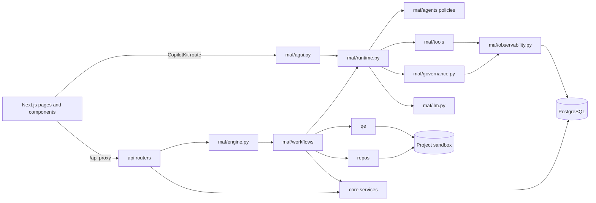

# Project structure

Generated by `python scripts/gen_structure.py`, so links come from the real imports. Run it again after adding files.

In this table, `ui/` means `src/frontend/`, and backend paths start from `src/backend/`.

## How the parts connect

The project has 1146 files, not counting screenshots.

## Backend application

| File | What it does | Uses | Used by |
|---|---|---|---|
| `src/backend/app.py` | FastAPI application: REST API for the UI, AG-UI for the chatbot, background MAF workflows. | `__init__.py`, `api/__init__.py`, `config.py`, `core/auth/__init__.py`, `core/auth/desktop.py`, `core/documents.py`, `core/errors.py`, `core/files.py`, and 18 more | `apps/desktop/backend_entry.py`, `tests/helpers_api.py`, `tests/helpers_audit.py`, `tests/helpers_doc_parsers.py`, `tests/test_access_routes.py`, `tests/test_api_access.py`, `tests/test_approvals_and_templates.py`, `tests/test_aqh_cli.py`, and 26 more |
| `src/backend/config.py` | Paths and environment. ATLAS_DATA_DIR lets tests run against a throwaway store. | `__init__.py`, `keyvault.py` | `scripts/sqlite_to_postgres.py`, `api/auth.py`, `api/chat.py`, `api/common.py`, `api/logs.py`, `api/mcp/oauth_routes.py`, `api/projects/crud.py`, `api/projects/export.py`, and 108 more |
| `src/backend/db.py` | PostgreSQL access (MASTER_PLAN Part 3, G5): one pooled connection per unit of work, numbered SQL migrations. | `__init__.py`, `config.py`, `core/security.py`, `sql_dialect.py` | `scripts/registry_report.py`, `scripts/sqlite_to_postgres.py`, `api/atlassian.py`, `api/chat.py`, `api/common.py`, `api/documents/brd.py`, `api/documents/crud.py`, `api/documents/templates.py`, and 133 more |

## REST API

| File | What it does | Uses | Used by |
|---|---|---|---|
| `src/backend/api/__init__.py` | REST API, one router per area. | `api/atlassian.py`, `api/auth.py`, `api/capabilities.py`, `api/chat.py`, `api/documents/__init__.py`, `api/features.py`, `api/findings.py`, `api/governance/__init__.py`, and 13 more | `app.py`, `tests/test_qe_trace_r5.py` |
| `src/backend/api/atlassian.py` | BA Studio's outside sources (docs/PHASE2_PLAN.md R4): Jira and Confluence through the Atlassian remote MCP, the only | `api/common.py`, `api/mcp/common.py`, `api/mcp/oauth_routes.py`, `core/auth/__init__.py`, `core/ledger.py`, `core/mcp/__init__.py`, `core/mcp/connect.py`, `core/mcp/grants.py`, and 4 more | `api/__init__.py` |
| `src/backend/api/auth.py` | Sign-in and user management. | `__init__.py`, `config.py`, `core/auth/__init__.py`, `core/auth/desktop.py` | `api/__init__.py` |
| `src/backend/api/capabilities.py` | Capability registry API (plan Phase R). Reads are per user: an admin sees every capability, anyone else the slice they | `api/mcp/common.py`, `core/auth/__init__.py`, `core/registry/__init__.py` | `api/__init__.py` |
| `src/backend/api/chat.py` | Chat API. | `__init__.py`, `api/common.py`, `config.py`, `core/auth/__init__.py`, `core/security.py`, `db.py`, `maf/agui.py`, `maf/engine/__init__.py`, and 9 more | `api/__init__.py` |
| `src/backend/api/common.py` | Helpers shared by routers. | `__init__.py`, `config.py`, `core/security.py`, `db.py` | `api/atlassian.py`, `api/chat.py`, `api/documents/crud.py`, `api/documents/templates.py`, `api/documents/upload.py`, `api/findings.py`, `api/governance/decisions.py`, `api/governance/eval_routes.py`, and 9 more |
| `src/backend/api/documents/__init__.py` | Documents API. | `api/documents/ai.py`, `api/documents/crud.py`, `api/documents/exports.py`, `api/documents/templates.py`, `api/documents/upload.py`, `api/documents/versions.py`, `maf/agui.py`, `maf/engine/__init__.py`, and 4 more | `api/__init__.py` |
| `src/backend/api/documents/ai.py` | Documents API: independent review and agent refinement. | `core/doc_checks.py`, `core/documents.py`, `core/files.py`, `maf/runtime/__init__.py`, `maf/workflows/__init__.py` | `api/documents/__init__.py` |
| `src/backend/api/documents/brd.py` | Default text of a BRD section that has no content of its own. | `db.py` | `api/documents/templates.py` |
| `src/backend/api/documents/crud.py` | Documents API: list, create, read, save and delete. | `api/common.py`, `core/auth/__init__.py`, `core/documents.py`, `core/files.py`, `core/gates.py`, `db.py` | `api/documents/__init__.py`, `api/documents/versions.py` |
| `src/backend/api/documents/exports.py` | Documents API: export as md, docx, feature, patch, csv or jira, and embedded images. | `core/auth/__init__.py`, `core/documents.py`, `core/files.py`, `core/security.py` | `api/documents/__init__.py` |
| `src/backend/api/documents/templates.py` | Documents API: BRD generation from a template. | `api/common.py`, `api/documents/brd.py`, `core/auth/__init__.py`, `core/documents.py`, `core/files.py`, `core/ledger.py`, `db.py`, `repos/doc_parser/__init__.py` | `api/documents/__init__.py` |
| `src/backend/api/documents/upload.py` | Documents API: upload a custom BRD template and register its structure. | `api/common.py`, `core/auth/__init__.py`, `core/documents.py`, `core/files.py`, `core/ledger.py`, `core/security.py`, `db.py`, `repos/doc_parser/__init__.py` | `api/documents/__init__.py` |
| `src/backend/api/documents/versions.py` | Documents API: versions, diff, restore and approve. | `api/documents/crud.py`, `core/auth/__init__.py`, `core/documents.py` | `api/documents/__init__.py` |
| `src/backend/api/features.py` | Governance of features (R2): role defaults, member overrides, and what the signed-in member may use. | `core/auth/__init__.py`, `core/auth/features.py` | `api/__init__.py` |
| `src/backend/api/findings.py` | Findings API. | `api/common.py`, `core/auth/__init__.py`, `core/ledger.py`, `db.py`, `maf/agui.py`, `maf/engine/__init__.py`, `maf/evals/__init__.py`, `maf/governance/__init__.py`, and 2 more | `api/__init__.py` |
| `src/backend/api/governance/__init__.py` | Governance API. | `api/governance/agent_routes.py`, `api/governance/decisions.py`, `api/governance/eval_routes.py`, `api/governance/prompt_routes.py`, `maf/agui.py`, `maf/engine/__init__.py`, `maf/evals/__init__.py`, `maf/governance/__init__.py`, and 2 more | `api/__init__.py` |
| `src/backend/api/governance/agent_routes.py` | Agent overview, settings, guardrail events, and eval runs. | `core/auth/__init__.py`, `maf/evals/__init__.py`, `maf/governance/__init__.py` | `api/governance/__init__.py` |
| `src/backend/api/governance/decisions.py` | Gates, approvals, and the project ledger: the human decision routes. | `api/common.py`, `core/auth/__init__.py`, `core/gates.py`, `core/ledger.py`, `db.py`, `maf/engine/__init__.py` | `api/governance/__init__.py` |
| `src/backend/api/governance/eval_routes.py` | Eval scores and cards, and the project metrics. | `api/common.py`, `db.py`, `maf/evals/__init__.py` | `api/governance/__init__.py` |
| `src/backend/api/governance/prompt_routes.py` | Prompt versions. | `core/auth/__init__.py`, `core/prompts.py` | `api/governance/__init__.py` |
| `src/backend/api/logs.py` | Admin download of one day's log: kind=app (requests, warnings, errors) or kind=errors (with stack traces). | `config.py`, `core/logs.py`, `core/security.py` | `api/__init__.py` |
| `src/backend/api/mcp/__init__.py` | MCP API: the server registry, install templates, real connect and call, and per-role grants. | `api/mcp/calls.py`, `api/mcp/common.py`, `api/mcp/grant_routes.py`, `api/mcp/oauth_routes.py`, `core/mcp/__init__.py`, `core/mcp/catalog.py`, `core/mcp/grants.py`, `core/mcp/registry.py` | `api/__init__.py` |
| `src/backend/api/mcp/calls.py` | Connect (admin) and call (granted roles). Both open a real MCP session through MAF and close it again. | `api/mcp/common.py`, `core/auth/__init__.py`, `core/ledger.py`, `core/mcp/__init__.py`, `core/mcp/connect.py`, `core/mcp/registry.py`, `db.py`, `maf/observability.py` | `api/mcp/__init__.py` |
| `src/backend/api/mcp/common.py` | Shared by the MCP routes: the admin check and turning a refusal into its HTTP status. | `core/auth/__init__.py`, `core/mcp/__init__.py` | `api/atlassian.py`, `api/capabilities.py`, `api/mcp/__init__.py`, `api/mcp/calls.py`, `api/mcp/grant_routes.py`, `api/mcp/oauth_routes.py`, `api/plugins.py` |
| `src/backend/api/mcp/grant_routes.py` | Grants: which role may call which MCP tool. Every route here is admin-only. | `api/mcp/common.py`, `core/mcp/__init__.py`, `core/mcp/grants.py` | `api/mcp/__init__.py` |
| `src/backend/api/mcp/oauth_routes.py` | OAuth sign-in to a remote MCP server, one member at a time (R4): start, the provider's callback, status, sign-out. | `__init__.py`, `api/mcp/common.py`, `config.py`, `core/auth/__init__.py`, `core/mcp/__init__.py`, `core/mcp/oauth.py`, `core/mcp/registry.py` | `api/atlassian.py`, `api/mcp/__init__.py` |
| `src/backend/api/observability.py` | Observability API: the log of agents, skills, tools, workflows, approvals, guardrails, and the ledger. | `api/common.py`, `core/auth/__init__.py`, `db.py`, `maf/observability.py` | `api/__init__.py` |
| `src/backend/api/plugins.py` | Plugins API: what is installed, what MAF loaded from it, which skills are slash commands, the MCP servers it declares. | `api/mcp/common.py`, `core/auth/__init__.py`, `core/mcp/__init__.py`, `core/mcp/registry.py`, `core/plugin_grants.py`, `core/plugin_install.py`, `core/plugins.py`, `core/skills.py` | `api/__init__.py` |
| `src/backend/api/projects/__init__.py` | Projects API. | `api/projects/crud.py`, `api/projects/export.py`, `api/projects/members.py`, `api/projects/overview.py`, `maf/agui.py`, `maf/engine/__init__.py`, `maf/evals/__init__.py`, `maf/governance/__init__.py`, and 3 more | `api/__init__.py` |
| `src/backend/api/projects/crud.py` | Projects API: list, create, read, update, archive and delete. | `api/common.py`, `config.py`, `core/auth/__init__.py`, `core/ledger.py`, `core/security.py`, `db.py`, `maf/harness.py`, `repos/ingest/__init__.py` | `api/projects/__init__.py`, `api/projects/members.py`, `api/projects/overview.py` |
| `src/backend/api/projects/export.py` | Projects API: export the project as a ZIP with source, documents and setup scripts. | `api/common.py`, `api/projects/scripts.py`, `config.py`, `core/documents.py` | `api/projects/__init__.py` |
| `src/backend/api/projects/members.py` | Projects API: members and ownership transfer. | `api/common.py`, `api/projects/crud.py`, `core/auth/__init__.py` | `api/projects/__init__.py` |
| `src/backend/api/projects/overview.py` | Projects API: the project overview. | `api/common.py`, `api/projects/crud.py`, `core/documents.py`, `core/gates.py`, `db.py`, `repos/ingest/__init__.py` | `api/projects/__init__.py` |
| `src/backend/api/projects/scripts.py` | The setup scripts and README written into a project export. | `db.py` | `api/projects/export.py` |
| `src/backend/api/qe_trace.py` | The QE cycle's traceability view (docs/PHASE2_PLAN.md R5, 12.5): requirement -> plan scenario -> designed case -> | `api/common.py`, `config.py`, `core/cli_workspaces.py`, `core/security.py` | `api/__init__.py`, `tests/test_qe_trace_r5.py` |
| `src/backend/api/repository.py` | Repository API. | `api/common.py`, `config.py`, `core/auth/__init__.py`, `core/cli_workspaces.py`, `core/security.py`, `maf/agui.py`, `maf/engine/__init__.py`, `maf/evals/__init__.py`, and 6 more | `api/__init__.py` |
| `src/backend/api/runs.py` | Workflows API. | `api/common.py`, `core/auth/__init__.py`, `core/auth/features.py`, `core/ledger.py`, `core/security.py`, `db.py`, `maf/agui.py`, `maf/engine/__init__.py`, and 7 more | `api/__init__.py` |
| `src/backend/api/settings/__init__.py` | Connections and settings API. | `api/settings/connections.py`, `api/settings/model_list.py`, `api/settings/preferences.py`, `api/settings/usage_report.py`, `maf/agui.py`, `maf/engine/__init__.py`, `maf/evals/__init__.py`, `maf/governance/__init__.py`, and 2 more | `api/__init__.py` |
| `src/backend/api/settings/connections.py` | GitHub connections and the LLM endpoint settings. | `core/auth/__init__.py`, `core/models/__init__.py`, `maf/llm.py`, `repos/github.py` | `api/settings/__init__.py` |
| `src/backend/api/settings/model_list.py` | The model list (admin) and the models each person may pick. | `core/auth/__init__.py`, `core/models/__init__.py`, `maf/llm.py` | `api/settings/__init__.py` |
| `src/backend/api/settings/preferences.py` | Which roles sign each gate, and the usage time zone. | `core/auth/__init__.py`, `core/models/__init__.py` | `api/settings/__init__.py` |
| `src/backend/api/settings/usage_report.py` | The admin token usage report. | `core/auth/__init__.py`, `core/models/__init__.py` | `api/settings/__init__.py` |
| `src/backend/api/skill_studio.py` | Skill Creator Studio API (plan M3). Every rule is enforced here or in core/skill_studio, not only in the UI. | `core/documents.py`, `core/skill_studio/__init__.py`, `core/skill_studio/access.py`, `core/skill_studio/author.py`, `core/skill_studio/models.py`, `core/skill_studio/plans.py`, `core/skill_studio/source.py`, `core/skill_studio/steps.py`, and 2 more | `api/__init__.py` |
| `src/backend/api/skills.py` | The skills catalog: read-only for any signed-in account. Creating, testing and publishing skills is the Skill Studio (api/skill_studio.py). | `config.py`, `core/script_health.py`, `core/skills.py` | `api/__init__.py` |
| `src/backend/api/templates.py` | Templates and source documents API. | `api/common.py`, `config.py`, `core/files.py`, `core/security.py`, `db.py`, `maf/agui.py`, `maf/engine/__init__.py`, `maf/evals/__init__.py`, and 3 more | `api/__init__.py` |
| `src/backend/api/traces.py` | Trace explorer API: runs (root spans) and one run's span tree. Admins see all; anyone else only their own runs (core/tracing/queries.py). | `core/auth/__init__.py`, `core/tracing/__init__.py`, `core/tracing/queries.py` | `api/__init__.py` |

## Agents

| File | What it does | Uses | Used by |
|---|---|---|---|
| `src/backend/maf/agents/__init__.py` | Agent registry. Each file in this folder declares one agent's POLICY, so adding an agent means adding a file. | `maf/agents/policy.py` | `core/registry/code_sources.py`, `core/skills.py`, `maf/governance/__init__.py`, `maf/governance/calls.py`, `maf/governance/policy.py`, `maf/governance/registry.py`, `tests/test_core_platform.py`, `tests/test_registry_sync.py`, and 1 more |
| `src/backend/maf/agents/bug_fix_reviewer.py` | Scores proposed bug fixes, verifies assertion preservation and AST integrity, and assigns a confidence score. | `maf/agents/policy.py` |  |
| `src/backend/maf/agents/bug_reviewer.py` | Finds defects in code it is given. Prompt: prompts/bug-reviewer.md. Evals: evals/bug-reviewer.json. | `maf/agents/policy.py` |  |
| `src/backend/maf/agents/business_analyst.py` | Writes requirements documents from a brief and sources, and converts them to validated Gherkin. Prompt: prompts/business-analyst.md. Evals: evals/business-analyst.json. | `maf/agents/policy.py` |  |
| `src/backend/maf/agents/confidence_reviewer.py` | Scores requirements documents, plans, and releases from evidence. Prompt: prompts/confidence-reviewer.md. Evals: evals/confidence-reviewer.json. | `maf/agents/policy.py` |  |
| `src/backend/maf/agents/defect_diagnostician.py` | Fixes defects and test drift on a branch. Prompt: prompts/defect-diagnostician.md. Evals: evals/defect-diagnostician.json. | `maf/agents/policy.py` |  |
| `src/backend/maf/agents/feature_engineer.py` | Implements features on a branch. Prompt: prompts/feature-engineer.md. Evals: evals/feature-engineer.json. | `maf/agents/policy.py` |  |
| `src/backend/maf/agents/harness.py` | Long multi-step project work on MAF's own harness (todos, modes, memory, skills). Built by maf/harness.py. | `maf/agents/policy.py` |  |
| `src/backend/maf/agents/policy.py` | What an agent is allowed to do. Each agent file declares one POLICY. |  | `maf/agents/__init__.py`, `maf/agents/bug_fix_reviewer.py`, `maf/agents/bug_reviewer.py`, `maf/agents/business_analyst.py`, `maf/agents/confidence_reviewer.py`, `maf/agents/defect_diagnostician.py`, `maf/agents/feature_engineer.py`, `maf/agents/harness.py`, and 8 more |
| `src/backend/maf/agents/principal_test_architect.py` | Plans tests by risk and level. Prompt: prompts/principal-test-architect.md. Evals: evals/principal-test-architect.json. | `maf/agents/policy.py` |  |
| `src/backend/maf/agents/project_copilot.py` | Answers from project data and starts workflows on request. Prompt: prompts/project-copilot.md. Evals: evals/project-copilot.json. | `maf/agents/policy.py` |  |
| `src/backend/maf/agents/qa_execution_engineer.py` | Explains test results from the evidence. Code runs the tests. Prompt: prompts/qa-execution-engineer.md. Evals: evals/qa-execution-engineer.json. | `maf/agents/policy.py` |  |
| `src/backend/maf/agents/repo_intelligence_analyst.py` | Summarizes a repository from scan facts and code. Prompt: prompts/repo-intelligence-analyst.md. Evals: evals/repo-intelligence-analyst.json. | `maf/agents/policy.py` |  |
| `src/backend/maf/agents/requirements_analyst.py` | Derives testable requirements with quoted evidence. Prompt: prompts/requirements-analyst.md. Evals: evals/requirements-analyst.json. | `maf/agents/policy.py` |  |
| `src/backend/maf/agents/skill_creator.py` | Plans and writes Agent Skills in the Skill Studio, and applies a draft skill to a sample. Prompt: prompts/skill-creator.md. Evals: evals/skill-creator.json. | `maf/agents/policy.py` |  |
| `src/backend/maf/agents/test_automation_engineer.py` | Generates executable tests for approved cases. Prompt: prompts/test-automation-engineer.md. Evals: evals/test-automation-engineer.json. | `maf/agents/policy.py` |  |
| `src/backend/maf/agents/test_design_architect.py` | Designs test cases with oracles. Prompt: prompts/test-design-architect.md. Evals: evals/test-design-architect.json. | `maf/agents/policy.py` |  |

## Tools

| File | What it does | Uses | Used by |
|---|---|---|---|
| `src/backend/maf/tools/__init__.py` | MAF function tools, one file each. Every set closes over a project, so an agent can only reach that project's data. | `config.py`, `maf/tools/create_skill.py`, `maf/tools/grep.py`, `maf/tools/list_documents.py`, `maf/tools/list_files.py`, `maf/tools/list_findings.py`, `maf/tools/project_status.py`, `maf/tools/read_document.py`, and 9 more | `maf/agui.py`, `maf/harness.py`, `maf/harness_kit/specialists.py`, `maf/runtime/factory.py`, `tests/test_agents_approve_nothing.py`, `tests/test_core_platform.py`, `tests/test_harness_create_skill.py`, `tests/test_maf_harness_tools.py` |
| `src/backend/maf/tools/common.py` | Helpers shared by tools. | `core/documents.py` | `maf/tools/create_skill.py`, `maf/tools/read_document.py`, `maf/tools/save_document.py` |
| `src/backend/maf/tools/create_skill.py` | The create_skill agent tool (HS-10): a Skill Studio draft plan from the chat. A human approves it in the Studio. | `core/errors.py`, `core/skill_studio/__init__.py`, `core/skill_studio/author.py`, `core/skill_studio/steps.py`, `maf/tools/common.py` | `maf/tools/__init__.py`, `tests/test_harness_create_skill.py` |
| `src/backend/maf/tools/find_tools.py` | The find_tools harness tool: search the governed tool catalogue. Names and one-line descriptions only, no schemas. |  | `maf/harness.py` |
| `src/backend/maf/tools/grep.py` | The grep agent tool. | `core/security.py`, `repos/scan.py` | `maf/tools/__init__.py` |
| `src/backend/maf/tools/list_documents.py` | The list_documents agent tool. | `core/documents.py` | `maf/tools/__init__.py` |
| `src/backend/maf/tools/list_files.py` | The list_files agent tool. | `repos/scan.py` | `maf/tools/__init__.py` |
| `src/backend/maf/tools/list_findings.py` | The list_findings agent tool. | `db.py` | `maf/tools/__init__.py` |
| `src/backend/maf/tools/load_tools.py` | The load_tools harness tool: add catalogue tools for the rest of the chat thread (MAF progressive tool exposure). |  | `maf/harness.py` |
| `src/backend/maf/tools/project_status.py` | The project_status agent tool. | `core/gates.py`, `db.py` | `maf/tools/__init__.py` |
| `src/backend/maf/tools/read_document.py` | The read_document agent tool. | `core/documents.py`, `maf/tools/common.py` | `maf/tools/__init__.py` |
| `src/backend/maf/tools/read_file.py` | The read_file agent tool. | `core/security.py` | `maf/tools/__init__.py` |
| `src/backend/maf/tools/remember.py` | The remember agent tool. | `maf/runtime/__init__.py` | `maf/tools/__init__.py` |
| `src/backend/maf/tools/run_tests.py` | The run_tests agent tool: the project's own tests, in its sandbox copy, with counts computed from JUnit. | `config.py`, `core/security.py`, `qe/execution/__init__.py`, `repos/ingest/__init__.py`, `repos/sandbox/__init__.py` | `maf/tools/__init__.py`, `tests/test_maf_harness_tools.py` |
| `src/backend/maf/tools/sandbox_status.py` | The sandbox_status agent tool: where this project's repository, sandbox and run worktrees are, read from disk. | `config.py`, `repos/sandbox/__init__.py` | `maf/tools/__init__.py`, `tests/test_maf_harness_tools.py` |
| `src/backend/maf/tools/save_document.py` | The save_document agent tool. | `core/documents.py`, `maf/tools/common.py` | `maf/tools/__init__.py` |
| `src/backend/maf/tools/scan_repository.py` | The scan_repository agent tool: the platform's static analyzers on the project's repository, read-only. | `config.py`, `repos/static_analysis.py` | `maf/tools/__init__.py`, `tests/test_maf_harness_tools.py` |
| `src/backend/maf/tools/search_documents.py` | The search_documents agent tool. | `core/documents.py` | `maf/tools/__init__.py` |
| `src/backend/maf/tools/start_workflow.py` | The start_workflow agent tool. |  | `maf/tools/__init__.py` |
| `src/backend/maf/tools/verify_ledger.py` | The verify_ledger agent tool. | `core/ledger.py` | `maf/tools/__init__.py` |

## Workflows

| File | What it does | Uses | Used by |
|---|---|---|---|
| `src/backend/maf/workflows/__init__.py` | Workflows, one file each. A file registers its definition in engine.REGISTRY, so adding a workflow means adding a file. | `maf/workflows/ba.py`, `maf/workflows/bug_scan.py`, `maf/workflows/edits.py`, `maf/workflows/qe.py`, `maf/workflows/qe/__init__.py` | `api/chat.py`, `api/documents/__init__.py`, `api/documents/ai.py`, `api/findings.py`, `api/governance/__init__.py`, `api/projects/__init__.py`, `api/repository.py`, `api/runs.py`, and 17 more |
| `src/backend/maf/workflows/ba.py` | BA workflow: brief to templated document, independent review, Gherkin, human approval. | `core/doc_checks.py`, `core/documents.py`, `core/files.py`, `core/gherkin.py`, `db.py`, `maf/engine/__init__.py`, `maf/runtime/__init__.py`, `maf/workflows/shared/__init__.py`, and 1 more | `maf/workflows/__init__.py`, `maf/workflows/brainstorm.py`, `maf/workflows/qe/discover.py` |
| `src/backend/maf/workflows/brainstorm.py` | Brainstorm workflow (docs/PHASE2_PLAN.md R3, 12.4): from a stated need and sources to a signed BRD, one question at a time. | `core/documents.py`, `maf/engine/__init__.py`, `maf/runtime/__init__.py`, `maf/workflows/ba.py`, `maf/workflows/shared/__init__.py`, `maf/workflows/shared/intake.py` |  |
| `src/backend/maf/workflows/bug_scan.py` | Bug scan workflow: fan-out static and agent review, fan-in with evidence checks. | `config.py`, `core/errors.py`, `core/security.py`, `db.py`, `maf/engine/__init__.py`, `maf/runtime/__init__.py`, `maf/workflows/shared/__init__.py`, `repos/git.py`, and 3 more | `maf/workflows/__init__.py`, `tests/test_core_review.py` |
| `src/backend/maf/workflows/change/__init__.py` | Change workflow: feature, bug fix, or traceback diagnosis on an isolated branch with real tests. | `maf/engine/__init__.py`, `maf/workflows/change/deliver.py`, `maf/workflows/change/implement.py`, `maf/workflows/change/prepare.py`, `maf/workflows/change/scope.py`, `maf/workflows/change/verify.py` | `tests/test_api_findings.py`, `tests/test_core_review.py` |
| `src/backend/maf/workflows/change/deliver.py` | Change workflow gate and delivery: the patch for a human to review, then the commit, finding marks and optional pull request. | `config.py`, `core/documents.py`, `db.py`, `maf/engine/__init__.py`, `repos/git.py`, `repos/github.py`, `repos/ingest/__init__.py` | `maf/workflows/change/__init__.py` |
| `src/backend/maf/workflows/change/implement.py` | Change workflow, implement stage: the agent edits the worktree, one file at a time when fixing several findings. | `core/errors.py`, `core/security.py`, `maf/engine/__init__.py`, `maf/runtime/__init__.py`, `maf/workflows/change/scope.py`, `maf/workflows/edits.py`, `maf/workflows/shared/__init__.py`, `repos/git.py`, and 1 more | `maf/workflows/change/__init__.py` |
| `src/backend/maf/workflows/change/prepare.py` | Change workflow, first stage: an isolated worktree on its own branch, and the test results before any edit. | `config.py`, `db.py`, `maf/engine/__init__.py`, `qe/execution/__init__.py`, `repos/git.py`, `repos/scan.py` | `maf/workflows/change/__init__.py`, `maf/workflows/change/verify.py` |
| `src/backend/maf/workflows/change/scope.py` | Which files a change needs, and the deterministic checks that the requested work exists. | `core/security.py`, `maf/engine/__init__.py`, `maf/runtime/__init__.py`, `maf/workflows/shared/__init__.py`, `repos/git.py`, `repos/scan.py`, `repos/static_analysis.py` | `maf/workflows/change/__init__.py`, `maf/workflows/change/implement.py`, `maf/workflows/change/verify.py` |
| `src/backend/maf/workflows/change/verify.py` | Change workflow, verify stage: tests and the independent review run together, and a failure goes back for a repair. | `maf/engine/__init__.py`, `maf/workflows/change/prepare.py`, `maf/workflows/change/scope.py`, `maf/workflows/shared/__init__.py`, `qe/execution/__init__.py`, `repos/git.py`, `repos/scan.py` | `maf/workflows/change/__init__.py` |
| `src/backend/maf/workflows/edits.py` | Structured edits from agents, applied by code through path, secret, and scope guards. | `core/security.py`, `qe/execution/__init__.py` | `maf/workflows/__init__.py`, `maf/workflows/change/implement.py`, `maf/workflows/qe/generate/repair.py`, `maf/workflows/qe/generate/review.py`, `maf/workflows/qe/heal.py` |
| `src/backend/maf/workflows/qe.py` | MAF Quality Engineering workflow entry point. | `maf/workflows/qe/definition.py` | `maf/workflows/__init__.py`, `maf/workflows/qe/design.py`, `tests/test_budget_quota.py`, `tests/test_errors_codes.py`, `tests/test_stages_classification.py`, `tests/test_stages_generated.py` |
| `src/backend/maf/workflows/qe/__init__.py` | Modular Autonomous Quality Engineering (QE) Lifecycle Workflow package. | `config.py`, `maf/workflows/qe/common.py`, `maf/workflows/qe/data.py`, `maf/workflows/qe/definition.py`, `maf/workflows/qe/design.py`, `maf/workflows/qe/discover.py`, `maf/workflows/qe/execute.py`, `maf/workflows/qe/generate/__init__.py`, and 6 more | `maf/workflows/__init__.py`, `maf/workflows/qe/design.py`, `tests/test_budget_quota.py`, `tests/test_errors_codes.py`, `tests/test_stages_classification.py`, `tests/test_stages_generated.py` |
| `src/backend/maf/workflows/qe/common.py` | Shared constants, helpers, and quality gate builders for Autonomous QE workflows. | `core/documents.py`, `core/errors.py`, `maf/engine/__init__.py`, `maf/workflows/shared/__init__.py`, `repos/git.py` | `maf/workflows/qe/__init__.py`, `maf/workflows/qe/definition.py`, `maf/workflows/qe/design.py`, `maf/workflows/qe/generate/batch.py`, `maf/workflows/qe/generate/review.py`, `maf/workflows/qe/plan.py`, `maf/workflows/qe/requirements.py`, `maf/workflows/qe/trace.py` |
| `src/backend/maf/workflows/qe/data.py` | QE Test Data Stage: Synthesizing deterministic fixtures and data contracts without model token costs. | `core/documents.py`, `maf/engine/__init__.py`, `qe/test_data.py` | `maf/workflows/qe/__init__.py`, `maf/workflows/qe/definition.py` |
| `src/backend/maf/workflows/qe/definition.py` | QE Workflow Definition: Autonomous Quality Engineering & AI SDLC Lifecycle Definition. | `core/errors.py`, `maf/engine/__init__.py`, `maf/workflows/qe/common.py`, `maf/workflows/qe/data.py`, `maf/workflows/qe/design.py`, `maf/workflows/qe/discover.py`, `maf/workflows/qe/execute.py`, `maf/workflows/qe/generate/__init__.py`, and 9 more | `maf/workflows/qe.py`, `maf/workflows/qe/__init__.py` |
| `src/backend/maf/workflows/qe/design.py` | QE Design Stage: Test Design Architect test case synthesis with confidence reviews. | `config.py`, `core/documents.py`, `core/errors.py`, `maf/engine/__init__.py`, `maf/runtime/__init__.py`, `maf/workflows/qe.py`, `maf/workflows/qe/__init__.py`, `maf/workflows/qe/common.py`, and 3 more | `maf/workflows/qe/__init__.py`, `maf/workflows/qe/definition.py` |
| `src/backend/maf/workflows/qe/discover.py` | QE Discovery Stage: AST repository analysis and architecture mapping. | `config.py`, `core/doc_checks.py`, `core/documents.py`, `maf/engine/__init__.py`, `maf/runtime/__init__.py`, `maf/workflows/ba.py`, `maf/workflows/shared/__init__.py`, `repos/scan.py`, and 1 more | `maf/workflows/qe/__init__.py`, `maf/workflows/qe/definition.py` |
| `src/backend/maf/workflows/qe/execute.py` | QE Execute Stage: Running deterministic test suites in the isolated worktree sandbox. | `core/errors.py`, `maf/engine/__init__.py`, `maf/runtime/__init__.py`, `qe/execution/__init__.py`, `qe/model/__init__.py` | `maf/workflows/qe/__init__.py`, `maf/workflows/qe/definition.py` |
| `src/backend/maf/workflows/qe/generate/__init__.py` | QE Test Generation Stage: Synthesizing executable deterministic test suites in isolated sandbox worktrees. | `maf/engine/__init__.py`, `maf/runtime/__init__.py`, `maf/workflows/qe/generate/batch.py`, `maf/workflows/qe/generate/env.py`, `maf/workflows/qe/generate/files.py`, `maf/workflows/qe/generate/repair.py`, `maf/workflows/qe/generate/review.py` | `maf/workflows/qe/__init__.py`, `maf/workflows/qe/definition.py` |
| `src/backend/maf/workflows/qe/generate/batch.py` | Asking the test author for batches of cases, checking every file it sends, and building the suite from the batches. | `core/errors.py`, `maf/engine/__init__.py`, `maf/runtime/__init__.py`, `maf/workflows/qe/common.py`, `maf/workflows/qe/generate/env.py`, `maf/workflows/qe/generate/files.py`, `maf/workflows/shared/__init__.py`, `qe/emit/__init__.py` | `maf/workflows/qe/generate/__init__.py` |
| `src/backend/maf/workflows/qe/generate/env.py` | What one generation stage knows: its worktree, the cases and requirements, and the facts about the target environment. | `config.py`, `maf/engine/__init__.py`, `maf/workflows/shared/__init__.py`, `qe/emit/__init__.py`, `qe/execution/__init__.py`, `repos/git.py` | `maf/workflows/qe/generate/__init__.py`, `maf/workflows/qe/generate/batch.py`, `maf/workflows/qe/generate/repair.py`, `maf/workflows/qe/generate/review.py` |
| `src/backend/maf/workflows/qe/generate/files.py` | The generated suite as typed data, and the code checks that refuse a generated test file. | `qe/emit/subject.py`, `qe/execution/__init__.py` | `maf/workflows/qe/generate/__init__.py`, `maf/workflows/qe/generate/batch.py`, `maf/workflows/qe/generate/repair.py`, `maf/workflows/qe/generate/review.py`, `tests/test_qe_correctness.py` |
| `src/backend/maf/workflows/qe/generate/repair.py` | Static-check send-back, quarantine of unusable files, and writing the suite into the worktree. | `core/errors.py`, `maf/runtime/__init__.py`, `maf/workflows/edits.py`, `maf/workflows/qe/generate/env.py`, `maf/workflows/qe/generate/files.py`, `qe/emit/__init__.py`, `qe/execution/__init__.py` | `maf/workflows/qe/generate/__init__.py` |
| `src/backend/maf/workflows/qe/generate/review.py` | Independent review of the generated tests with one send-back, and the saved test-code document. | `core/documents.py`, `maf/runtime/__init__.py`, `maf/workflows/edits.py`, `maf/workflows/qe/common.py`, `maf/workflows/qe/generate/env.py`, `maf/workflows/qe/generate/files.py`, `maf/workflows/shared/__init__.py`, `qe/confidence/__init__.py` | `maf/workflows/qe/generate/__init__.py` |
| `src/backend/maf/workflows/qe/heal.py` | QE Heal Stage: Automated defect diagnostics and selector/fixture self-healing. | `core/errors.py`, `core/security.py`, `maf/engine/__init__.py`, `maf/runtime/__init__.py`, `maf/workflows/edits.py`, `maf/workflows/shared/__init__.py`, `qe/execution/__init__.py` | `maf/workflows/qe/__init__.py`, `maf/workflows/qe/definition.py`, `maf/workflows/qe/trace.py` |
| `src/backend/maf/workflows/qe/plan.py` | QE Plan Stage: Principal Test Architect quality strategy and risk-weighted plan. | `config.py`, `core/documents.py`, `maf/engine/__init__.py`, `maf/runtime/__init__.py`, `maf/workflows/qe/common.py`, `maf/workflows/shared/__init__.py`, `qe/confidence/__init__.py`, `qe/model/__init__.py` | `maf/workflows/qe/__init__.py`, `maf/workflows/qe/definition.py` |
| `src/backend/maf/workflows/qe/prepare.py` | QE Prepare Stage: Environment setup, dependency installation, and pytest-asyncio detection. | `core/errors.py`, `maf/engine/__init__.py`, `maf/workflows/shared/__init__.py`, `qe/emit/__init__.py`, `qe/execution/__init__.py` | `maf/workflows/qe/__init__.py`, `maf/workflows/qe/definition.py` |
| `src/backend/maf/workflows/qe/requirements.py` | QE Requirements Stage: Reverse-engineering and verification of testable requirements. | `config.py`, `core/documents.py`, `core/errors.py`, `maf/engine/__init__.py`, `maf/runtime/__init__.py`, `maf/workflows/qe/common.py`, `maf/workflows/shared/__init__.py`, `qe/model/__init__.py`, and 1 more | `maf/workflows/qe/__init__.py`, `maf/workflows/qe/definition.py` |
| `src/backend/maf/workflows/qe/sign.py` | QE Sign Stage: Release readiness review and Gate 5 sign-off. | `core/documents.py`, `maf/engine/__init__.py`, `maf/runtime/__init__.py`, `maf/workflows/qe/trace.py`, `qe/model/__init__.py` | `maf/workflows/qe/__init__.py`, `maf/workflows/qe/definition.py` |
| `src/backend/maf/workflows/qe/trace.py` | QE Traceability Stage: Building requirement-to-test matrix, execution summary, and confidence capping. | `core/documents.py`, `maf/engine/__init__.py`, `maf/workflows/qe/common.py`, `maf/workflows/qe/heal.py`, `qe/confidence/__init__.py`, `qe/emit/subject.py`, `qe/execution/__init__.py`, `qe/trace.py` | `maf/workflows/qe/__init__.py`, `maf/workflows/qe/definition.py`, `maf/workflows/qe/sign.py` |
| `src/backend/maf/workflows/shared/__init__.py` | Helpers every workflow uses: repository facts, the code pack, and the Gate 0 intake. | `maf/workflows/shared/intake.py`, `maf/workflows/shared/pack.py`, `maf/workflows/shared/review.py`, `maf/workflows/shared/send_back.py` | `maf/workflows/ba.py`, `maf/workflows/brainstorm.py`, `maf/workflows/bug_scan.py`, `maf/workflows/change/implement.py`, `maf/workflows/change/scope.py`, `maf/workflows/change/verify.py`, `maf/workflows/qe/common.py`, `maf/workflows/qe/definition.py`, and 11 more |
| `src/backend/maf/workflows/shared/intake.py` | Gate 0 intake and the token lines a gate shows. | `config.py`, `core/gates.py`, `db.py`, `maf/engine/__init__.py`, `maf/workflows/shared/pack.py`, `repos/ingest/__init__.py` | `maf/workflows/ba.py`, `maf/workflows/brainstorm.py`, `maf/workflows/qe/definition.py`, `maf/workflows/shared/__init__.py` |
| `src/backend/maf/workflows/shared/pack.py` | Repository facts and the line-numbered code packs sent to agents. | `config.py`, `core/security.py`, `repos/ingest/__init__.py`, `repos/scan.py`, `repos/static_analysis.py` | `maf/workflows/shared/__init__.py`, `maf/workflows/shared/intake.py` |
| `src/backend/maf/workflows/shared/review.py` | Independent confidence review: one artifact, or items in batches with code-checked records. | `core/errors.py`, `db.py`, `maf/engine/__init__.py`, `maf/runtime/__init__.py`, `qe/confidence/__init__.py`, `qe/model/__init__.py` | `maf/workflows/shared/__init__.py`, `maf/workflows/shared/send_back.py` |
| `src/backend/maf/workflows/shared/send_back.py` | Review every item, send each REJECT back once to its agent, and review only those again. | `core/errors.py`, `maf/engine/__init__.py`, `maf/runtime/__init__.py`, `maf/workflows/shared/review.py` | `maf/workflows/shared/__init__.py` |

## Agent runtime and governance

| File | What it does | Uses | Used by |
|---|---|---|---|
| `src/backend/maf/agui.py` | AG-UI endpoint for the chatbot. MAF's AgentFrameworkAgent produces the protocol stream. | `config.py`, `core/auth/__init__.py`, `core/errors.py`, `core/ledger.py`, `core/plugins.py`, `core/security.py`, `core/skills.py`, `db.py`, and 13 more | `api/chat.py`, `api/documents/__init__.py`, `api/findings.py`, `api/governance/__init__.py`, `api/projects/__init__.py`, `api/repository.py`, `api/runs.py`, `api/settings/__init__.py`, and 3 more |
| `src/backend/maf/engine/__init__.py` | Run manager over real MAF workflows: typed stages, HITL via request_info, file checkpoints, durable events. | `config.py`, `core/auth/__init__.py`, `core/errors.py`, `core/gates.py`, `core/ledger.py`, `db.py`, `maf/engine/execution.py`, `maf/engine/queries.py`, and 7 more | `api/chat.py`, `api/documents/__init__.py`, `api/findings.py`, `api/governance/__init__.py`, `api/governance/decisions.py`, `api/projects/__init__.py`, `api/repository.py`, `api/runs.py`, and 44 more |
| `src/backend/maf/engine/execution.py` | Background execution of a run: its task, checkpoint storage, event consumption, approvals and final status. | `config.py`, `core/ledger.py`, `core/security.py`, `core/tracing/__init__.py`, `db.py`, `maf/engine/failures.py`, `maf/engine/run_context.py`, `maf/engine/specs.py`, and 1 more | `maf/engine/__init__.py`, `maf/engine/resume.py` |
| `src/backend/maf/engine/failures.py` | Failure records: one redacted diagnostic row per failure, and the hand-off from a stage to the run guard. | `config.py`, `core/errors.py`, `core/security.py`, `db.py`, `maf/engine/run_context.py` | `maf/engine/execution.py`, `maf/engine/stages.py` |
| `src/backend/maf/engine/queries.py` | Reading runs: who holds the slot, the run with its approvals and failure, its events, and restart recovery. | `db.py` | `maf/engine/__init__.py` |
| `src/backend/maf/engine/registry.py` | The workflow registry: workflow files add their definitions here, and it is filled on first use. | `maf/engine/specs.py`, `maf/workflows/__init__.py` | `core/registry/workflow_sources.py`, `maf/engine/__init__.py`, `maf/engine/resume.py` |
| `src/backend/maf/engine/resume.py` | Re-entering a run from its latest checkpoint, for a retry and for a decided approval. | `maf/engine/execution.py`, `maf/engine/registry.py`, `maf/engine/stages.py` | `maf/engine/__init__.py` |
| `src/backend/maf/engine/run_context.py` | RunContext, the handle a stage uses to log, emit and keep finished batches, and the run event writer. | `config.py`, `core/security.py`, `db.py` | `maf/engine/__init__.py`, `maf/engine/execution.py`, `maf/engine/failures.py`, `maf/engine/specs.py`, `maf/engine/stages.py` |
| `src/backend/maf/engine/specs.py` | Plain data types of the run engine: the approval payload, a stage spec, fan-out and a workflow definition. | `maf/engine/run_context.py` | `maf/engine/__init__.py`, `maf/engine/execution.py`, `maf/engine/registry.py`, `maf/engine/stages.py` |
| `src/backend/maf/engine/stages.py` | MAF executors for stages and fan-in, and the compiler from a Definition to a MAF workflow. | `core/tracing/__init__.py`, `db.py`, `maf/engine/failures.py`, `maf/engine/run_context.py`, `maf/engine/specs.py`, `maf/runtime/__init__.py` | `maf/engine/__init__.py`, `maf/engine/execution.py`, `maf/engine/resume.py` |
| `src/backend/maf/evals/__init__.py` | Agent evals on MAF's evaluation API. Each case runs the real active prompt, so prompt versions can be compared. | `core/prompts.py`, `db.py`, `maf/evals/aggregate.py`, `maf/evals/cases.py`, `maf/evals/checks.py`, `maf/evals/grader.py`, `maf/evals/metrics/__init__.py`, `maf/evals/ragas_evaluator.py`, and 2 more | `api/chat.py`, `api/documents/__init__.py`, `api/findings.py`, `api/governance/__init__.py`, `api/governance/agent_routes.py`, `api/governance/eval_routes.py`, `api/projects/__init__.py`, `api/repository.py`, and 16 more |
| `src/backend/maf/evals/aggregate.py` | Turning case results into one stored row per metric, including the model-graded RAGAS metrics. | `maf/evals/__init__.py`, `maf/evals/metrics/__init__.py`, `maf/evals/ragas_evaluator.py`, `maf/evals/store.py` | `maf/evals/__init__.py` |
| `src/backend/maf/evals/cases.py` | Where eval cases come from: the agent files, the plugin skills' cases, and the benchmarks with their labelled keys. | `config.py`, `core/skills.py` | `maf/evals/__init__.py`, `maf/evals/runner.py` |
| `src/backend/maf/evals/checks.py` | Eval rules turned into MAF checks. | `core/gherkin.py`, `maf/runtime/__init__.py`, `maf/workflows/__init__.py`, `qe/model/__init__.py` | `maf/evals/__init__.py`, `maf/evals/runner.py` |
| `src/backend/maf/evals/discovery.py` | Harness discovery eval scoring (docs/PHASE2_PLAN.md section 8, step 1 of section 16). |  | `tests/test_discovery_eval_scoring.py`, `tests/test_harness_discovery_eval.py` |
| `src/backend/maf/evals/grader.py` | Grades a skill case's `expected_behavior` sentences with the judge model. A PASS needs evidence quoted from the output, and code checks the quote is there. | `maf/llm.py`, `maf/runtime/__init__.py` | `maf/evals/__init__.py`, `maf/evals/runner.py`, `tests/test_evaluation_metrics_grader.py` |
| `src/backend/maf/evals/metrics/__init__.py` | Deterministic, free evaluation metrics. A metric with nothing to measure has the value None, never 0 and never 1. | `maf/evals/metrics/cites.py`, `maf/evals/metrics/mutants.py`, `maf/evals/metrics/ratios.py` | `maf/evals/__init__.py`, `maf/evals/aggregate.py`, `maf/evals/runner.py`, `maf/runtime/__init__.py`, `tests/test_evaluation_metrics_formulas.py` |
| `src/backend/maf/evals/metrics/cites.py` | Groundedness: the share of a reply's cited files, lines and quotes that really exist. | `core/security.py`, `maf/evals/metrics/ratios.py`, `maf/runtime/__init__.py`, `repos/static_analysis.py` | `maf/evals/metrics/__init__.py` |
| `src/backend/maf/evals/metrics/mutants.py` | Mutation score: plant each bug in a temporary copy of a repository and see whether the generated tests notice. | `core/security.py`, `maf/evals/metrics/ratios.py`, `qe/execution/__init__.py` | `maf/evals/metrics/__init__.py` |
| `src/backend/maf/evals/metrics/ratios.py` | The arithmetic of evaluation: ratios, one-to-one matching of found items to a key, and keyword coverage. Nothing to measure is None. |  | `maf/evals/metrics/__init__.py`, `maf/evals/metrics/cites.py`, `maf/evals/metrics/mutants.py` |
| `src/backend/maf/evals/ragas_evaluator.py` | RAGAS metrics as a MAF `Evaluator`. `ragas` is optional (requirements-evals.txt) and is imported only when a score is asked for. | `config.py`, `maf/llm.py` | `maf/evals/__init__.py`, `maf/evals/aggregate.py`, `maf/evals/runner.py`, `tests/test_evaluation_metrics_store.py` |
| `src/backend/maf/evals/runner.py` | Running one eval case against the real active prompt, and scoring its reply. | `core/errors.py`, `core/security.py`, `db.py`, `maf/evals/__init__.py`, `maf/evals/cases.py`, `maf/evals/checks.py`, `maf/evals/grader.py`, `maf/evals/metrics/__init__.py`, and 2 more | `maf/evals/__init__.py` |
| `src/backend/maf/evals/store.py` | Stored metric values and what the cards show. A value exists only when a metric really ran; otherwise a card says why not. | `core/prompts.py`, `db.py` | `core/skill_studio/steps.py`, `maf/evals/__init__.py`, `maf/evals/aggregate.py`, `maf/runtime/__init__.py`, `tests/test_evaluation_metrics_benchmark.py`, `tests/test_evaluation_metrics_store.py`, `tests/test_project_export.py` |
| `src/backend/maf/governance/__init__.py` | Agent governance: one registry, per-agent tool policy, an admin kill switch, guardrails, and call telemetry. | `core/prompts.py`, `maf/agents/__init__.py`, `maf/governance/calls.py`, `maf/governance/guards.py`, `maf/governance/policy.py`, `maf/governance/registry.py` | `api/chat.py`, `api/documents/__init__.py`, `api/findings.py`, `api/governance/__init__.py`, `api/governance/agent_routes.py`, `api/projects/__init__.py`, `api/repository.py`, `api/runs.py`, and 18 more |
| `src/backend/maf/governance/calls.py` | Call telemetry: MAF chat middleware that checks the allowance and records every model round. | `core/auth/__init__.py`, `core/prompts.py`, `core/security.py`, `core/tracing/__init__.py`, `db.py`, `maf/agents/__init__.py`, `maf/observability.py` | `maf/governance/__init__.py` |
| `src/backend/maf/governance/guards.py` | Guardrails: secret redaction, prompt-injection removal, typed errors, and the guardrail event log. | `core/errors.py`, `core/security.py`, `db.py` | `maf/governance/__init__.py` |
| `src/backend/maf/governance/policy.py` | Per-agent settings, the admin kill switch, token limit, and tool policy. | `core/errors.py`, `core/ledger.py`, `core/models/__init__.py`, `db.py`, `maf/agents/__init__.py` | `core/registry/code_sources.py`, `maf/governance/__init__.py`, `maf/governance/registry.py` |
| `src/backend/maf/governance/registry.py` | The agent registry joined with recorded calls, events, and evals. | `core/prompts.py`, `db.py`, `maf/agents/__init__.py`, `maf/governance/policy.py` | `maf/governance/__init__.py` |
| `src/backend/maf/harness.py` | The project harness: MAF's own `create_harness_agent`, wired into the platform's governance (plans P2 and M4). | `__init__.py`, `config.py`, `core/auth/__init__.py`, `core/mcp/__init__.py`, `core/mcp/harness.py`, `core/plugin_grants.py`, `core/plugins.py`, `core/prompts.py`, and 33 more | `api/chat.py`, `api/projects/__init__.py`, `api/projects/crud.py`, `core/registry/code_sources.py`, `maf/agui.py`, `maf/harness_kit/local_commands.py`, `tests/test_harness_create_skill.py`, `tests/test_harness_m4.py`, and 6 more |
| `src/backend/maf/harness_kit/__init__.py` | Parts of the project harness (maf/harness.py): tool catalogue, specialists as background agents, thread snapshots. |  | `src/aqh/doctor.py`, `api/chat.py`, `core/registry/code_sources.py`, `maf/agui.py`, `maf/harness.py`, `maf/harness_kit/active_command.py`, `maf/harness_kit/bg_tasks.py`, `maf/harness_kit/hook_middleware.py`, and 19 more |
| `src/backend/maf/harness_kit/active_command.py` | The thread's active plugin command (plan.md "Plugin command focus"). | `core/security.py`, `maf/harness_kit/__init__.py`, `maf/harness_kit/catalog.py`, `maf/harness_kit/hook_middleware.py`, `maf/harness_kit/verify.py` | `maf/agui.py`, `maf/harness.py`, `tests/test_harness_active_command.py`, `tests/test_harness_guards.py` |
| `src/backend/maf/harness_kit/bg_tasks.py` | Background commands for the harness shells (docs/PHASE2_PLAN.md section 5.2): servers, watchers and long jobs. | `core/ledger.py`, `core/security.py`, `maf/harness_kit/__init__.py`, `maf/harness_kit/shells.py` | `api/chat.py`, `maf/harness.py`, `maf/harness_kit/shell_tools.py`, `maf/harness_kit/shells.py`, `tests/test_harness_shells.py` |
| `src/backend/maf/harness_kit/budget.py` | A time budget per harness turn instead of a small round cap (FINAL_PLAN 5.3, decision D2). | `config.py` | `maf/agui.py`, `maf/harness.py`, `tests/test_harness_guards.py` |
| `src/backend/maf/harness_kit/catalog.py` | Progressive tool discovery for the harness (plan M4). | `core/ledger.py`, `core/mcp/__init__.py`, `core/mcp/registry.py` | `core/registry/code_sources.py`, `maf/harness.py`, `maf/harness_kit/active_command.py`, `maf/harness_kit/specialists.py`, `maf/harness_kit/workspace.py`, `tests/test_harness_create_skill.py`, `tests/test_harness_discovery_scopes.py` |
| `src/backend/maf/harness_kit/checkpoints.py` | File checkpoints and `/rewind` (docs/PHASE2_PLAN.md section 10), as in Claude Code. | `core/ledger.py`, `core/security.py` | `maf/harness.py`, `maf/harness_kit/local_commands.py`, `tests/test_harness_checkpoints.py` |
| `src/backend/maf/harness_kit/errors.py` | One error shape for a failed harness tool call (FINAL_PLAN 5.5): {code, message, action, retryable, trace_id}. | `core/security.py`, `core/tracing/__init__.py` | `maf/harness.py`, `tests/test_harness_guards.py` |
| `src/backend/maf/harness_kit/hook_middleware.py` | Plugin hooks and sandbox slots around the harness's write and shell tools (plan H2 and H3), as MAF function middleware. | `core/plugin_hooks.py`, `maf/harness_kit/__init__.py`, `maf/harness_kit/leases.py`, `maf/harness_kit/shell.py`, `maf/runtime/factory.py` | `maf/harness.py`, `maf/harness_kit/active_command.py`, `maf/harness_kit/plugin_agents.py`, `tests/test_harness_guards.py`, `tests/test_harness_hooks_settings.py` |
| `src/backend/maf/harness_kit/leases.py` | Platform-wide sandbox slots for the harness on the web profile (plan H2, decision D1). | `__init__.py`, `config.py`, `core/errors.py`, `db.py` | `maf/harness_kit/hook_middleware.py`, `tests/test_harness_world.py` |
| `src/backend/maf/harness_kit/local_commands.py` | Slash commands the platform answers itself, without the model or plugin prompt hooks: `/mode` and `/rewind`. | `core/auth/__init__.py`, `maf/harness.py`, `maf/harness_kit/__init__.py`, `maf/harness_kit/checkpoints.py`, `maf/harness_kit/permissions.py`, `maf/harness_kit/workspace.py` | `maf/agui.py` |
| `src/backend/maf/harness_kit/nudges.py` | Keep MAF's todo-loop nudges out of the user's reply. |  | `maf/agui.py`, `maf/harness.py` |
| `src/backend/maf/harness_kit/os_sandbox.py` | OS sandbox for harness shell commands (docs/PHASE2_PLAN.md section 5.3, tier T1), as Claude Code does it. | `core/settings_files.py` | `src/aqh/doctor.py`, `maf/harness.py`, `maf/harness_kit/shells.py`, `tests/test_os_sandbox.py` |
| `src/backend/maf/harness_kit/permissions.py` | Permission modes and rules for harness tools (docs/PHASE2_PLAN.md section 9.1 and 9.2), on MAF's tool approval. | `__init__.py`, `config.py`, `core/settings_files.py` | `src/aqh/headless.py`, `maf/harness.py`, `maf/harness_kit/local_commands.py`, `maf/harness_kit/plugin_agents.py`, `tests/test_harness_permissions.py`, `tests/test_harness_subagent_permissions.py`, `tests/test_os_sandbox.py` |
| `src/backend/maf/harness_kit/plugin_agents.py` | A plugin's `agents/*.md` (Claude Code sub-agents) as MAF background agents of the harness (plan H3). | `__init__.py`, `config.py`, `core/auth/__init__.py`, `core/plugin_grants.py`, `core/plugin_hooks.py`, `core/plugins.py`, `core/security.py`, `maf/governance/__init__.py`, and 7 more | `maf/harness.py`, `tests/test_harness_subagent_permissions.py` |
| `src/backend/maf/harness_kit/plugin_contract.py` | Plugin contracts and gate checks as typed tools (docs/PHASE2_PLAN.md section 8, R5). | `core/plugins.py`, `core/script_runtime.py` | `maf/harness.py`, `tests/test_plugin_contract_r5.py` |
| `src/backend/maf/harness_kit/prompt_hooks.py` | SessionStart and UserPromptSubmit hooks for the harness chat (plan H3), called by `maf/agui.py` for each new user message. | `core/plugin_hooks.py`, `db.py`, `maf/harness_kit/__init__.py`, `maf/harness_kit/workspace.py` | `maf/agui.py` |
| `src/backend/maf/harness_kit/shell.py` | The harness shell (plan H2, decisions D8 and D9) on MAF's own shell tooling (`agent-framework-tools`). | `config.py`, `core/ledger.py`, `core/security.py`, `repos/sandbox/__init__.py` | `core/registry/code_sources.py`, `maf/harness.py`, `maf/harness_kit/hook_middleware.py`, `tests/test_harness_world.py` |
| `src/backend/maf/harness_kit/shell_tools.py` | The harness's shell tools on CLI, desktop and local profiles (docs/PHASE2_PLAN.md section 5): `bash`, `powershell`, | `maf/harness_kit/__init__.py`, `maf/harness_kit/bg_tasks.py`, `maf/harness_kit/shells.py` | `maf/harness.py` |
| `src/backend/maf/harness_kit/shells.py` | Real Bash and PowerShell for the harness (docs/PHASE2_PLAN.md section 5; CLAUDE.md D-SHELL exception, 2026-11-12). | `core/ledger.py`, `core/script_runtime.py`, `core/security.py`, `maf/harness_kit/__init__.py`, `maf/harness_kit/bg_tasks.py`, `maf/harness_kit/os_sandbox.py`, `repos/sandbox/__init__.py` | `maf/harness_kit/bg_tasks.py`, `maf/harness_kit/plugin_agents.py`, `maf/harness_kit/shell_tools.py`, `tests/test_aqh_cli.py`, `tests/test_harness_discovery_scopes.py`, `tests/test_harness_permissions.py`, `tests/test_harness_shells.py`, `tests/test_os_sandbox.py` |
| `src/backend/maf/harness_kit/skill_runner.py` | MAF `script_runner` for skill scripts in every common language (docs/PHASE2_PLAN.md section 7.3 and 7.4). | `core/ledger.py`, `core/script_health.py`, `core/script_runtime.py`, `core/security.py`, `core/skill_studio/__init__.py`, `core/skill_studio/testing.py`, `repos/sandbox/__init__.py` | `maf/harness.py`, `tests/test_harness_skill_runner.py`, `tests/test_script_runtime.py` |
| `src/backend/maf/harness_kit/skill_scopes.py` | Where the harness finds skills (docs/PHASE2_PLAN.md section 7.1), in Claude Code's precedence: the person's own skills, | `__init__.py`, `config.py` | `maf/harness.py`, `tests/test_harness_discovery_scopes.py` |
| `src/backend/maf/harness_kit/snapshots.py` | Durable MAF AG-UI thread snapshots for the harness, so plan/execute mode and pending approvals outlive one request. | `core/security.py`, `db.py` | `maf/harness.py` |
| `src/backend/maf/harness_kit/specialists.py` | The governed specialists the harness delegates to through MAF's `BackgroundAgentsProvider` (HS-11). | `core/auth/__init__.py`, `core/errors.py`, `maf/governance/__init__.py`, `maf/harness_kit/catalog.py`, `maf/runtime/__init__.py`, `maf/tools/__init__.py` | `core/registry/code_sources.py`, `maf/harness.py` |
| `src/backend/maf/harness_kit/stop_hooks.py` | Claude Code's Stop hook in MAF's harness loop (docs/PHASE2_PLAN.md section 9.3). | `core/plugin_hooks.py` | `maf/harness.py`, `tests/test_harness_hooks_settings.py` |
| `src/backend/maf/harness_kit/strict_args.py` | Unknown tool arguments are an error the model can read, never silently dropped (found in the 2026-11-11 live cycle). |  | `maf/harness.py`, `tests/test_harness_active_command.py` |
| `src/backend/maf/harness_kit/tool_hygiene.py` | Two loop-hygiene guards from the strongest harnesses (FINAL_PLAN 5.3), as one MAF function middleware. | `maf/runtime/factory.py` | `maf/harness.py`, `tests/test_harness_guards.py` |
| `src/backend/maf/harness_kit/unknown_tools.py` | An invented tool name gets the nearest real names back (docs/PHASE2_PLAN.md section 8, guards). |  | `maf/harness.py`, `tests/test_harness_discovery_scopes.py` |
| `src/backend/maf/harness_kit/verify.py` | Done means the command's own check passes, not that a file exists (FINAL_PLAN 5.3; live cycle 2026-11-11). | `core/security.py`, `maf/runtime/factory.py`, `repos/sandbox/__init__.py` | `maf/harness.py`, `maf/harness_kit/active_command.py`, `maf/harness_kit/write_first.py`, `tests/test_harness_guards.py` |
| `src/backend/maf/harness_kit/workspace.py` | The harness's execution world (plan H2): one workspace per project and chat thread. | `config.py`, `core/cli_workspaces.py`, `core/errors.py`, `core/plugins.py`, `core/security.py`, `maf/harness_kit/catalog.py`, `repos/sandbox/__init__.py` | `api/chat.py`, `maf/harness.py`, `maf/harness_kit/local_commands.py`, `maf/harness_kit/plugin_agents.py`, `maf/harness_kit/prompt_hooks.py`, `tests/test_harness_world.py` |
| `src/backend/maf/harness_kit/write_first.py` | Reading must turn into writing while a plugin command still owes its files (live cycle, 2026-11-11). | `maf/harness_kit/__init__.py`, `maf/harness_kit/verify.py` | `maf/harness.py`, `tests/test_harness_active_command.py`, `tests/test_harness_guards.py` |
| `src/backend/maf/llm.py` | Model provider settings. Environment wins on first run; the Settings page can override and encrypts the key. | `config.py`, `core/errors.py`, `core/models/__init__.py`, `core/security.py`, `db.py` | `scripts/run_live.py`, `api/chat.py`, `api/documents/__init__.py`, `api/findings.py`, `api/governance/__init__.py`, `api/projects/__init__.py`, `api/repository.py`, `api/runs.py`, and 64 more |
| `src/backend/maf/observability.py` | One log of everything agents and workflows did, for a run, a project, or all projects. Reads stored records only. | `core/auth/__init__.py`, `core/ledger.py`, `core/security.py`, `db.py` | `api/mcp/calls.py`, `api/observability.py`, `maf/governance/calls.py`, `maf/runtime/factory.py`, `tests/test_access_members.py`, `tests/test_api_retries.py` |
| `src/backend/maf/runtime/__init__.py` | Agent construction on the real Microsoft Agent Framework, with middleware and JSON validation. | `config.py`, `core/auth/__init__.py`, `core/errors.py`, `core/ledger.py`, `core/prompts.py`, `core/security.py`, `core/skills.py`, `db.py`, and 10 more | `api/chat.py`, `api/documents/ai.py`, `core/skill_studio/author.py`, `maf/agui.py`, `maf/engine/__init__.py`, `maf/engine/stages.py`, `maf/evals/checks.py`, `maf/evals/grader.py`, and 41 more |
| `src/backend/maf/runtime/context.py` | MAF context provider that puts project facts in front of every agent run. | `core/documents.py`, `db.py`, `repos/ingest/__init__.py` | `maf/runtime/__init__.py`, `maf/runtime/factory.py` |
| `src/backend/maf/runtime/emit.py` | The live-activity emitter: a workflow run binds it so tool and agent activity lands on the run timeline. |  | `maf/runtime/__init__.py`, `maf/runtime/factory.py` |
| `src/backend/maf/runtime/factory.py` | Agent construction: the tool audit middleware and the MAF Agent with its policy, prompt, skills and providers. | `config.py`, `core/auth/__init__.py`, `core/prompts.py`, `core/security.py`, `core/skills.py`, `core/tracing/__init__.py`, `maf/governance/__init__.py`, `maf/llm.py`, and 5 more | `maf/harness_kit/hook_middleware.py`, `maf/harness_kit/tool_hygiene.py`, `maf/harness_kit/verify.py`, `maf/runtime/__init__.py` |
| `src/backend/maf/runtime/gate.py` | The process-wide model gate: bounds concurrent model calls. | `config.py` | `maf/runtime/__init__.py` |
| `src/backend/maf/runtime/json_reply.py` | Getting JSON out of a model reply: tolerant decoding, shape checks, the format rule, and the typed ask with retries. | `core/errors.py`, `core/security.py` | `maf/runtime/__init__.py` |
| `src/backend/maf/skill_chat.py` | Skills in chat. Tools are unreliable through the proxy, so by default code picks the skill and adds its text to the turn. | `config.py`, `core/models/__init__.py`, `core/prompts.py`, `core/skills.py`, `maf/governance/__init__.py`, `maf/llm.py`, `maf/runtime/__init__.py` | `maf/agui.py`, `maf/runtime/factory.py`, `tests/test_skills_chat.py`, `tests/test_skills_tool_check.py` |
| `src/backend/maf/skill_scan.py` | Static security scan of a skill folder: what it finds, file and line, and nothing graded. |  | `core/skill_studio/checks.py`, `tests/test_skill_evaluator.py` |

## Core services

| File | What it does | Uses | Used by |
|---|---|---|---|
| `src/backend/core/auth/__init__.py` | Accounts and access. The admin login comes from .env. Users are created by the admin. | `core/auth/allowance.py`, `core/auth/base.py`, `core/auth/passwords.py`, `core/auth/projects.py`, `core/auth/rules.py`, `core/auth/sessions.py`, `core/auth/signing.py`, `core/auth/users.py`, and 1 more | `api/atlassian.py`, `api/auth.py`, `api/capabilities.py`, `api/chat.py`, `api/documents/crud.py`, `api/documents/exports.py`, `api/documents/templates.py`, `api/documents/upload.py`, and 62 more |
| `src/backend/core/auth/allowance.py` | What a project's work may use: whose tokens, which model, and the limits. | `core/auth/base.py`, `core/auth/users.py`, `core/errors.py`, `core/models/__init__.py`, `db.py`, `maf/llm.py` | `core/auth/__init__.py` |
| `src/backend/core/auth/base.py` | Auth constants, the shared failure counter, errors, and small helpers every other auth module builds on. | `core/security.py`, `db.py` | `core/auth/__init__.py`, `core/auth/allowance.py`, `core/auth/desktop.py`, `core/auth/features.py`, `core/auth/passwords.py`, `core/auth/projects.py`, `core/auth/sessions.py`, `core/auth/signing.py`, and 2 more |
| `src/backend/core/auth/desktop.py` | Desktop sign-in through the central server (docs/PHASE2_PLAN.md R6, section 12.7). | `__init__.py`, `config.py`, `core/auth/base.py`, `core/auth/sessions.py`, `core/auth/users.py`, `core/security.py`, `db.py` | `api/auth.py`, `app.py`, `tests/test_desktop_signin.py` |
| `src/backend/core/auth/features.py` | Governance of features (docs/PHASE2_PLAN.md R2, 12.3): who may use which part of the platform. | `core/auth/base.py`, `core/ledger.py`, `db.py` | `api/features.py`, `api/runs.py`, `core/auth/rules.py`, `tests/test_access_routes.py`, `tests/test_features_r2.py` |
| `src/backend/core/auth/passwords.py` | Password hashing, the password rules, and the signed-in account's own password change. | `core/auth/base.py`, `core/security.py`, `db.py` | `scripts/admin_password.py`, `core/auth/__init__.py`, `core/auth/sessions.py`, `core/auth/users.py`, `tests/test_credentials_r6.py` |
| `src/backend/core/auth/projects.py` | Project roles, members, ownership transfer, and the project-visibility SQL. | `core/auth/base.py`, `core/ledger.py`, `core/security.py`, `db.py` | `core/auth/__init__.py`, `core/auth/rules.py`, `core/auth/signing.py` |
| `src/backend/core/auth/rules.py` | The route ownership rules: deny by default, admin-only, owned, and session-only paths. | `core/auth/__init__.py`, `core/auth/features.py`, `core/auth/projects.py`, `db.py` | `core/auth/__init__.py` |
| `src/backend/core/auth/sessions.py` | Sign-in, sign-out, and session lookup. | `core/auth/base.py`, `core/auth/passwords.py`, `db.py` | `core/auth/__init__.py`, `core/auth/desktop.py` |
| `src/backend/core/auth/signing.py` | Which roles may sign each gate. | `core/auth/base.py`, `core/auth/projects.py`, `db.py` | `core/auth/__init__.py` |
| `src/backend/core/auth/users.py` | Account records: create, read, update, list, and the audit events. | `core/auth/base.py`, `core/auth/passwords.py`, `core/models/__init__.py`, `core/security.py`, `db.py` | `core/auth/__init__.py`, `core/auth/allowance.py`, `core/auth/desktop.py` |
| `src/backend/core/cli_workspaces.py` | Projects bound to a folder on the person's own machine (the `aqh` CLI, docs/PHASE2_PLAN.md section 11.1). | `__init__.py`, `config.py` | `api/qe_trace.py`, `api/repository.py`, `maf/harness_kit/workspace.py`, `tests/test_aqh_cli.py` |
| `src/backend/core/command_args.py` | Claude Code's substitutions in plugin and skill commands (docs/PHASE2_PLAN.md section 7.2). |  | `core/plugins.py`, `tests/test_harness_discovery_scopes.py` |
| `src/backend/core/doc_checks.py` | Deterministic requirements checks. They cap the reviewer's score, so a model cannot pass a weak document. | `core/files.py` | `api/documents/ai.py`, `maf/workflows/ba.py`, `maf/workflows/qe/discover.py`, `tests/test_api_reviews.py`, `tests/test_core_agents.py`, `tests/test_core_platform.py`, `tests/test_core_review.py` |
| `src/backend/core/documents.py` | Versioned documents. Every save is an immutable version with SHA-256, author, and prompt reference. | `config.py`, `core/gates.py`, `core/gherkin.py`, `core/ledger.py`, `core/security.py`, `db.py`, `qe/model/__init__.py` | `api/documents/ai.py`, `api/documents/crud.py`, `api/documents/exports.py`, `api/documents/templates.py`, `api/documents/upload.py`, `api/documents/versions.py`, `api/projects/export.py`, `api/projects/overview.py`, and 28 more |
| `src/backend/core/errors.py` | Typed errors. Each says what happened, what to do next, and whether a plain retry may help. | `core/security.py` | `app.py`, `core/auth/__init__.py`, `core/auth/allowance.py`, `core/models/periods.py`, `core/skill_studio/author.py`, `maf/agui.py`, `maf/engine/__init__.py`, `maf/engine/failures.py`, and 30 more |
| `src/backend/core/files.py` | Uploaded-file text extraction, templates, and DOCX export. | `config.py`, `core/security.py`, `core/source_text.py`, `db.py` | `api/documents/ai.py`, `api/documents/crud.py`, `api/documents/exports.py`, `api/documents/templates.py`, `api/documents/upload.py`, `api/templates.py`, `app.py`, `core/doc_checks.py`, and 4 more |
| `src/backend/core/gates.py` | Quality gates G0-G5. Sequential approval, HMAC-signed records, human signer required. | `core/ledger.py`, `core/security.py`, `db.py` | `api/documents/crud.py`, `api/governance/decisions.py`, `api/projects/overview.py`, `app.py`, `core/documents.py`, `core/registry/workflow_sources.py`, `maf/engine/__init__.py`, `maf/tools/project_status.py`, and 4 more |
| `src/backend/core/gherkin.py` | Gherkin validation with the official Cucumber parser. |  | `core/documents.py`, `maf/evals/checks.py`, `maf/workflows/ba.py`, `tests/test_core_documents.py` |
| `src/backend/core/ledger.py` | Tamper-evident audit ledger: each entry hashes the previous entry, per project. | `core/security.py`, `db.py` | `scripts/sqlite_to_postgres.py`, `api/atlassian.py`, `api/documents/templates.py`, `api/documents/upload.py`, `api/findings.py`, `api/governance/decisions.py`, `api/mcp/calls.py`, `api/projects/crud.py`, and 30 more |
| `src/backend/core/logs.py` | Daily JSON-lines logs in data/logs/: | `__init__.py`, `config.py`, `core/security.py` | `api/logs.py`, `app.py`, `tests/test_ops_logs.py` |
| `src/backend/core/mcp/__init__.py` | Real MCP servers: registry, connect and call through MAF, per-role grants, and the harness bridge. | `core/mcp/harness.py`, `core/mcp/registry.py` | `api/atlassian.py`, `api/mcp/__init__.py`, `api/mcp/calls.py`, `api/mcp/common.py`, `api/mcp/grant_routes.py`, `api/mcp/oauth_routes.py`, `api/plugins.py`, `core/mcp/connect.py`, and 9 more |
| `src/backend/core/mcp/catalog.py` | Install templates an admin may add as servers. Templates only: nothing here is registered or connected. |  | `api/mcp/__init__.py` |
| `src/backend/core/mcp/connect.py` | Open real MCP sessions through MAF: connect and list tools, or call one tool. Every session is closed afterwards. | `core/auth/__init__.py`, `core/mcp/__init__.py`, `core/mcp/grants.py`, `core/mcp/oauth.py`, `core/mcp/registry.py`, `core/security.py`, `db.py`, `repos/sandbox/__init__.py` | `api/atlassian.py`, `api/mcp/calls.py`, `core/mcp/harness.py`, `tests/test_harness_discovery_scopes.py` |
| `src/backend/core/mcp/grants.py` | Which role may call which MCP tool. No grant means not callable: an admin grants each server or tool per role. | `core/auth/__init__.py`, `db.py` | `api/atlassian.py`, `api/mcp/__init__.py`, `api/mcp/grant_routes.py`, `core/mcp/connect.py`, `core/mcp/harness.py`, `core/registry/visibility.py`, `tests/test_registry_access.py` |
| `src/backend/core/mcp/harness.py` | MCP tools for the project harness: connected servers only, each filtered to the tools the user's role was granted. | `core/auth/__init__.py`, `core/mcp/__init__.py`, `core/mcp/connect.py`, `core/mcp/grants.py`, `core/mcp/registry.py` | `core/mcp/__init__.py`, `maf/harness.py`, `tests/test_harness_discovery_scopes.py` |
| `src/backend/core/mcp/oauth.py` | OAuth 2.1 with PKCE for remote MCP servers, one member at a time (docs/PHASE2_PLAN.md R4), as the MCP authorization spec | `core/auth/base.py`, `core/mcp/__init__.py`, `core/mcp/registry.py`, `core/security.py`, `db.py` | `api/atlassian.py`, `api/mcp/oauth_routes.py`, `core/mcp/connect.py` |
| `src/backend/core/mcp/registry.py` | MCP server registry: rows in mcp_servers, secrets encrypted at rest, tools only from a real list_tools. | `__init__.py`, `config.py`, `core/security.py`, `db.py` | `api/atlassian.py`, `api/mcp/__init__.py`, `api/mcp/calls.py`, `api/mcp/oauth_routes.py`, `api/plugins.py`, `core/mcp/__init__.py`, `core/mcp/connect.py`, `core/mcp/harness.py`, and 4 more |
| `src/backend/core/models/__init__.py` | The model list, who may use which model, and token limits per period. | `core/models/access.py`, `core/models/catalog.py`, `core/models/periods.py` | `api/settings/connections.py`, `api/settings/model_list.py`, `api/settings/preferences.py`, `api/settings/usage_report.py`, `app.py`, `core/auth/allowance.py`, `core/auth/users.py`, `maf/governance/policy.py`, and 8 more |
| `src/backend/core/models/access.py` | Who may use which model: the ticks per account and the checks on them. | `db.py` | `core/models/__init__.py` |
| `src/backend/core/models/catalog.py` | The model list: names, labels, the default, per-agent models, tool checks, and the config seed. | `db.py` | `core/models/__init__.py` |
| `src/backend/core/models/periods.py` | Token limits per period, the admin time zone, and the usage report. Periods follow one time zone. | `core/errors.py`, `db.py` | `core/models/__init__.py` |
| `src/backend/core/plugin_grants.py` | Which roles may use a plugin (HS-12). No grant rows means open to every role, so existing installs keep working. | `core/auth/__init__.py`, `core/ledger.py`, `db.py` | `api/plugins.py`, `core/plugin_hooks.py`, `core/plugins.py`, `core/registry/visibility.py`, `maf/harness.py`, `maf/harness_kit/plugin_agents.py`, `tests/test_plugins_grants.py`, `tests/test_registry_access.py` |
| `src/backend/core/plugin_hooks.py` | Claude Code hooks for the platform's plugins (plan H3): each enabled plugin's `hooks/hooks.json`, run the way Claude Code | `core/auth/__init__.py`, `core/ledger.py`, `core/plugin_grants.py`, `core/plugins.py`, `core/security.py`, `core/settings_files.py`, `core/settings_http.py`, `qe/execution/runners.py` | `core/registry/plugin_sources.py`, `maf/harness_kit/hook_middleware.py`, `maf/harness_kit/plugin_agents.py`, `maf/harness_kit/prompt_hooks.py`, `maf/harness_kit/stop_hooks.py`, `tests/test_harness_hooks_settings.py`, `tests/test_harness_plugin_hooks.py` |
| `src/backend/core/plugin_install.py` | Install a plugin from a zip into ROOT/plugins/<id>/. Every member is checked before anything is written. | `config.py`, `core/plugins.py`, `core/security.py` | `api/plugins.py`, `tests/test_plugins_state.py` |
| `src/backend/core/plugins.py` | Plugin discovery: `plugins/*/` folders plus the repo's own `skills/` as the implicit plugin "local-skills". | `config.py`, `core/auth/__init__.py`, `core/command_args.py`, `core/plugin_grants.py`, `core/security.py`, `db.py` | `api/plugins.py`, `core/plugin_hooks.py`, `core/plugin_install.py`, `core/registry/plugin_sources.py`, `core/registry/visibility.py`, `maf/agui.py`, `maf/harness.py`, `maf/harness_kit/plugin_agents.py`, and 8 more |
| `src/backend/core/prompts.py` | Versioned agent prompts. prompts/*.md seed v1; every edit is a new immutable version in the DB. | `config.py`, `core/security.py`, `db.py` | `api/governance/prompt_routes.py`, `app.py`, `maf/evals/__init__.py`, `maf/evals/store.py`, `maf/governance/__init__.py`, `maf/governance/calls.py`, `maf/governance/registry.py`, `maf/harness.py`, and 6 more |
| `src/backend/core/registry/__init__.py` | Capability registry (plan Phase R): every tool, agent, skill, command, workflow and how they connect, derived by a sync. | `core/registry/read.py`, `core/registry/search.py`, `core/registry/store.py`, `core/registry/sync.py` | `scripts/registry_report.py`, `api/capabilities.py`, `app.py`, `core/registry/read.py`, `core/registry/sync.py`, `tests/test_registry_search.py`, `tests/test_registry_sync.py` |
| `src/backend/core/registry/code_sources.py` | Registry sources in platform code: the tool files, MAF's own harness tools, the governed agents and the harness. | `config.py`, `core/registry/model.py`, `core/skills.py`, `maf/agents/__init__.py`, `maf/governance/policy.py`, `maf/harness.py`, `maf/harness_kit/__init__.py`, `maf/harness_kit/catalog.py`, and 2 more | `core/registry/sync.py`, `tests/test_registry_sync.py` |
| `src/backend/core/registry/model.py` | The registry in memory during one sync: capabilities by id, links by id, and links still to resolve by kind and name. | `config.py`, `core/security.py` | `core/registry/code_sources.py`, `core/registry/plugin_sources.py`, `core/registry/store.py`, `core/registry/sync.py`, `core/registry/workflow_sources.py` |
| `src/backend/core/registry/plugin_sources.py` | Registry sources in plugins and the MCP registry: manifests, skills and commands, the scripts their SKILL.md names, | `core/mcp/__init__.py`, `core/mcp/registry.py`, `core/plugin_hooks.py`, `core/plugins.py`, `core/registry/model.py`, `core/security.py` | `core/registry/sync.py` |
| `src/backend/core/registry/read.py` | Reading the registry for one user: the flat listing, one capability with its links up and down, and the nested tree. | `core/registry/__init__.py`, `core/registry/store.py`, `core/registry/visibility.py` | `scripts/registry_report.py`, `core/registry/__init__.py`, `core/registry/search.py` |
| `src/backend/core/registry/search.py` | What the harness calls: `find_capability` (BM25, standard library only), `describe_capability`, and `index_text`. | `core/registry/read.py` | `core/registry/__init__.py`, `tests/test_registry_search.py` |
| `src/backend/core/registry/store.py` | The registry tables: a sync replaces every row in one transaction and records the hash of the whole table. | `core/registry/model.py`, `db.py` | `core/registry/__init__.py`, `core/registry/read.py`, `core/registry/sync.py`, `tests/test_registry_sync.py` |
| `src/backend/core/registry/sync.py` | The sync: derive every capability from code and manifests, with no model call, and replace the registry tables. | `core/registry/__init__.py`, `core/registry/code_sources.py`, `core/registry/model.py`, `core/registry/plugin_sources.py`, `core/registry/store.py`, `core/registry/workflow_sources.py`, `core/security.py` | `core/registry/__init__.py` |
| `src/backend/core/registry/visibility.py` | Who sees which capability, decided when the registry is read. The table holds everything; an admin sees all of it. | `__init__.py`, `config.py`, `core/mcp/__init__.py`, `core/mcp/grants.py`, `core/plugin_grants.py`, `core/plugins.py`, `db.py` | `core/registry/read.py` |
| `src/backend/core/registry/workflow_sources.py` | Registry sources in the workflow engine: each workflow in `engine.REGISTRY`, its stages, who performs them, and gates. | `core/gates.py`, `core/registry/model.py`, `maf/engine/registry.py` | `core/registry/sync.py` |
| `src/backend/core/script_health.py` | Health of a skill's scripts (docs/PHASE2_PLAN.md section 7.4): can each script run here? Flag the skill when not. | `config.py`, `core/script_runtime.py`, `repos/sandbox/__init__.py` | `api/skills.py`, `core/skill_studio/checks.py`, `maf/harness_kit/skill_runner.py`, `tests/test_script_runtime.py` |
| `src/backend/core/script_runtime.py` | Skill scripts in every common language (docs/PHASE2_PLAN.md section 7.3): detect the language, find the interpreter, run. |  | `src/aqh/doctor.py`, `core/script_health.py`, `maf/harness.py`, `maf/harness_kit/plugin_contract.py`, `maf/harness_kit/shells.py`, `maf/harness_kit/skill_runner.py`, `tests/test_plugin_contract_r5.py`, `tests/test_script_runtime.py` |
| `src/backend/core/security.py` | Secrets at rest, secret detection, redaction, path confinement, and shell-free command policy. | `config.py` | `scripts/sqlite_to_postgres.py`, `api/atlassian.py`, `api/chat.py`, `api/common.py`, `api/documents/exports.py`, `api/documents/upload.py`, `api/logs.py`, `api/projects/crud.py`, and 85 more |
| `src/backend/core/settings_files.py` | Claude Code-style settings files for the harness (docs/PHASE2_PLAN.md section 9.4). | `__init__.py`, `config.py` | `core/plugin_hooks.py`, `maf/harness_kit/os_sandbox.py`, `maf/harness_kit/permissions.py`, `tests/test_harness_hooks_settings.py`, `tests/test_harness_permissions.py` |
| `src/backend/core/settings_http.py` | `http` hooks (Claude Code's hook type): POST the hook's JSON to a URL and read the answer like a command hook's output. |  | `core/plugin_hooks.py` |
| `src/backend/core/skill_studio/__init__.py` | Skill Creator Studio (plan M3): source, plan, approve, generate, check, test, evaluate, publish, version. |  | `skills/evaluator/scripts/evaluate_skill.py`, `api/skill_studio.py`, `core/skill_studio/access.py`, `core/skill_studio/author.py`, `core/skill_studio/steps.py`, `core/skill_studio/testing.py`, `core/skill_studio/versions.py`, `maf/harness_kit/skill_runner.py`, and 3 more |
| `src/backend/core/skill_studio/access.py` | Who may do what in the Skill Studio. A plan belongs to a project: unseen projects answer not found, viewers may only read. | `core/auth/__init__.py`, `core/skill_studio/__init__.py`, `core/skill_studio/plans.py` | `api/skill_studio.py`, `core/skill_studio/steps.py` |
| `src/backend/core/skill_studio/author.py` | Every Skill Studio model call, through MAF's AgentCall with the skill-creator policy and its versioned prompt. | `core/errors.py`, `core/security.py`, `core/skill_studio/__init__.py`, `core/skill_studio/models.py`, `core/skill_studio/plans.py`, `core/skill_studio/source.py`, `core/skills.py`, `db.py`, and 1 more | `api/skill_studio.py`, `core/skill_studio/steps.py`, `maf/tools/create_skill.py` |
| `src/backend/core/skill_studio/checks.py` | The checks every skill passes before it is published: generated, uploaded, or run through the evaluator script. | `config.py`, `core/script_health.py`, `core/skills.py`, `maf/skill_scan.py` | `skills/evaluator/scripts/evaluate_skill.py`, `core/skill_studio/models.py`, `core/skill_studio/plans.py`, `core/skill_studio/steps.py`, `core/skill_studio/testing.py`, `core/skill_studio/versions.py`, `tests/test_skill_studio_publish.py` |
| `src/backend/core/skill_studio/models.py` | The typed shapes the model must return, and the name, path and content rules the server enforces on them. | `core/skill_studio/checks.py` | `api/skill_studio.py`, `core/skill_studio/author.py`, `core/skill_studio/plans.py`, `tests/test_skill_studio_access.py`, `tests/test_skill_studio_publish.py` |
| `src/backend/core/skill_studio/plans.py` | Stored skill plans: a draft the user edits, then an approval that fixes its SHA-256, then a generated draft folder. | `__init__.py`, `config.py`, `core/ledger.py`, `core/security.py`, `core/skill_studio/checks.py`, `core/skill_studio/models.py`, `db.py` | `api/skill_studio.py`, `core/skill_studio/access.py`, `core/skill_studio/author.py`, `core/skill_studio/steps.py`, `tests/test_skill_studio.py` |
| `src/backend/core/skill_studio/source.py` | Where a skill's facts come from: a project document, an uploaded file, or typed requirements. | `core/auth/__init__.py`, `core/documents.py`, `core/security.py`, `repos/doc_parser/__init__.py` | `api/skill_studio.py`, `core/skill_studio/author.py`, `core/skill_studio/steps.py` |
| `src/backend/core/skill_studio/steps.py` | The Studio steps that combine a model call with server checks: generate, try on a sample, and evaluate with and without the skill. | `core/ledger.py`, `core/skill_studio/__init__.py`, `core/skill_studio/access.py`, `core/skill_studio/author.py`, `core/skill_studio/checks.py`, `core/skill_studio/plans.py`, `core/skill_studio/source.py`, `core/skill_studio/testing.py`, and 3 more | `api/skill_studio.py`, `maf/tools/create_skill.py` |
| `src/backend/core/skill_studio/testing.py` | Testing a draft for real: its own pytest files in a scratch copy, and deterministic eval assertions on model output. | `__init__.py`, `config.py`, `core/skill_studio/__init__.py`, `core/skill_studio/checks.py`, `repos/sandbox/__init__.py` | `api/skill_studio.py`, `core/skill_studio/steps.py`, `maf/harness_kit/skill_runner.py`, `tests/test_skill_studio_access.py` |
| `src/backend/core/skill_studio/versions.py` | Published skills: immutable versions in skill_versions, the installed folder under SKILLS_DIR, zip in and out. | `__init__.py`, `config.py`, `core/ledger.py`, `core/security.py`, `core/skill_studio/__init__.py`, `core/skill_studio/checks.py`, `core/skills.py`, `db.py` | `api/skill_studio.py`, `core/skill_studio/steps.py` |
| `src/backend/core/skills.py` | Plugin skills from skills/, validated by MAF's FileSkillsSource and read through safe_path. | `config.py`, `core/security.py`, `maf/agents/__init__.py` | `api/plugins.py`, `api/skills.py`, `app.py`, `core/registry/code_sources.py`, `core/skill_studio/author.py`, `core/skill_studio/checks.py`, `core/skill_studio/versions.py`, `maf/agui.py`, and 8 more |
| `src/backend/core/source_text.py` | Text of an uploaded source file, in sections that name where each part came from (docs/PHASE2_PLAN.md R3). | `qe/execution/runners.py`, `repos/doc_parser/__init__.py` | `core/files.py`, `tests/test_brainstorm_r3.py` |
| `src/backend/core/tracing/__init__.py` | OpenTelemetry tracing (plan H9): MAF's instrumentation, platform spans, the local span store, and optional OTLP. | `core/tracing/middleware.py`, `core/tracing/setup.py`, `core/tracing/spans.py` | `api/traces.py`, `app.py`, `core/tracing/setup.py`, `maf/engine/execution.py`, `maf/engine/stages.py`, `maf/governance/calls.py`, `maf/harness_kit/errors.py`, `maf/runtime/factory.py`, and 6 more |
| `src/backend/core/tracing/middleware.py` | ASGI middleware: one root span per API or chat request, named by its route template, never the raw path with ids. | `core/tracing/spans.py` | `core/tracing/__init__.py` |
| `src/backend/core/tracing/queries.py` | Reading the span store for the trace explorer, limited in SQL to what the caller may see. | `core/auth/__init__.py`, `db.py` | `api/traces.py` |
| `src/backend/core/tracing/setup.py` | One TracerProvider for the process: the local span store always, OTLP only when OTEL_EXPORTER_OTLP_ENDPOINT is set. | `__init__.py`, `config.py`, `core/tracing/__init__.py`, `core/tracing/store.py` | `core/tracing/__init__.py` |
| `src/backend/core/tracing/spans.py` | Spans the platform adds beside MAF's own: a span around a block, a new root for background work, and notes on the root. | `core/security.py` | `core/tracing/__init__.py`, `core/tracing/middleware.py`, `core/tracing/store.py` |
| `src/backend/core/tracing/store.py` | The local span store: a SpanExporter that writes finished spans to the `spans` table, and retention. | `core/tracing/spans.py`, `db.py` | `core/tracing/setup.py`, `tests/test_tracing_store.py` |

## Repositories

| File | What it does | Uses | Used by |
|---|---|---|---|
| `src/backend/repos/doc_parser/__init__.py` | Secure and intelligent document & template parser. |  | `api/documents/templates.py`, `api/documents/upload.py`, `core/skill_studio/source.py`, `core/source_text.py`, `tests/test_doc_parsers_formats.py`, `tests/test_redblue_documents.py` |
| `src/backend/repos/doc_parser/dispatch.py` | Universal document parser entry point. | `repos/doc_parser/markdown.py`, `repos/doc_parser/pdf.py`, `repos/doc_parser/word.py` |  |
| `src/backend/repos/doc_parser/markdown.py` | Markdown and plain text parsing, placeholders, frontmatter, tables. |  | `repos/doc_parser/dispatch.py`, `repos/doc_parser/pdf.py`, `repos/doc_parser/word.py`, `repos/doc_parser/word_fallback.py` |
| `src/backend/repos/doc_parser/pdf.py` | PDF parsing. | `repos/doc_parser/markdown.py` | `repos/doc_parser/dispatch.py` |
| `src/backend/repos/doc_parser/security.py` | Size, XXE and zip-bomb limits for uploaded documents. |  | `repos/doc_parser/word.py`, `repos/doc_parser/word_fallback.py` |
| `src/backend/repos/doc_parser/word.py` | Word (.docx) parsing. | `repos/doc_parser/markdown.py`, `repos/doc_parser/security.py`, `repos/doc_parser/word_fallback.py` | `repos/doc_parser/dispatch.py` |
| `src/backend/repos/doc_parser/word_fallback.py` | Fallback .docx parser that reads document.xml directly. | `repos/doc_parser/markdown.py`, `repos/doc_parser/security.py` | `repos/doc_parser/word.py` |
| `src/backend/repos/git.py` | Git via subprocess without a shell. Tokens travel in env-scoped config, never in argv, URLs, or .git/config. | `core/errors.py`, `core/security.py` | `api/runs.py`, `app.py`, `maf/workflows/bug_scan.py`, `maf/workflows/change/deliver.py`, `maf/workflows/change/implement.py`, `maf/workflows/change/prepare.py`, `maf/workflows/change/scope.py`, `maf/workflows/change/verify.py`, and 14 more |
| `src/backend/repos/github.py` | GitHub REST calls for private-repo connection. A token validates, lists repos, and opens PRs. | `core/errors.py`, `core/security.py`, `db.py` | `api/runs.py`, `api/settings/connections.py`, `app.py`, `maf/workflows/change/deliver.py`, `repos/ingest/sources.py`, `repos/sandbox/setup.py`, `tests/test_core_agents.py` |
| `src/backend/repos/ingest/__init__.py` | Bring code into a project: clone a git URL (public or with a saved token) or unpack a ZIP safely. |  | `api/projects/crud.py`, `api/projects/overview.py`, `api/repository.py`, `api/runs.py`, `app.py`, `maf/runtime/context.py`, `maf/tools/run_tests.py`, `maf/workflows/change/deliver.py`, and 6 more |
| `src/backend/repos/ingest/analysis.py` | Normalising stored repository analysis. | `repos/scan.py` | `repos/ingest/state.py` |
| `src/backend/repos/ingest/base.py` | Ingest error type and tree removal. | `core/errors.py` | `repos/ingest/sources.py`, `repos/ingest/state.py`, `repos/ingest/zips.py` |
| `src/backend/repos/ingest/sources.py` | Bring code in from git, ZIP or a local folder. | `config.py`, `core/ledger.py`, `db.py`, `repos/git.py`, `repos/github.py`, `repos/ingest/base.py`, `repos/ingest/state.py`, `repos/ingest/zips.py`, and 1 more |  |
| `src/backend/repos/ingest/state.py` | Read and clear a project's connected repository record. | `config.py`, `core/ledger.py`, `db.py`, `repos/git.py`, `repos/ingest/analysis.py`, `repos/ingest/base.py`, `repos/scan.py` | `repos/ingest/sources.py` |
| `src/backend/repos/ingest/zips.py` | Safe ZIP extraction. | `config.py`, `repos/ingest/base.py` | `repos/ingest/sources.py` |
| `src/backend/repos/sandbox/__init__.py` | Each project's sandbox: its own folder with a full clone, one worktree per run, its own Python environment. | `config.py` | `api/repository.py`, `core/mcp/connect.py`, `core/script_health.py`, `core/skill_studio/testing.py`, `maf/harness_kit/shell.py`, `maf/harness_kit/shells.py`, `maf/harness_kit/skill_runner.py`, `maf/harness_kit/verify.py`, and 9 more |
| `src/backend/repos/sandbox/commands.py` | Run commands and code in the project sandbox with no shell and a timeout. | `config.py`, `core/tracing/__init__.py`, `repos/sandbox/env.py`, `repos/sandbox/setup.py` |  |
| `src/backend/repos/sandbox/env.py` | Zero-trust environment allowlist for sandbox subprocesses. | `config.py` | `repos/sandbox/commands.py`, `repos/sandbox/runtime.py`, `tests/test_harness_skill_runner.py` |
| `src/backend/repos/sandbox/git_ops.py` | File, branch and commit operations inside the project sandbox. | `config.py`, `core/security.py`, `repos/git.py`, `repos/sandbox/setup.py` |  |
| `src/backend/repos/sandbox/runtime.py` | Run code and install dependencies in the project sandbox. | `core/tracing/__init__.py`, `repos/sandbox/env.py`, `repos/sandbox/setup.py` |  |
| `src/backend/repos/sandbox/setup.py` | Each project's sandbox setup: ensure, initialize, info, history. | `config.py`, `core/errors.py`, `db.py`, `repos/git.py`, `repos/github.py` | `repos/sandbox/commands.py`, `repos/sandbox/git_ops.py`, `repos/sandbox/runtime.py` |
| `src/backend/repos/scan.py` | Evidence-only repository analysis: every field comes from files on disk. Port of plugin scan-repo.ts, extended. |  | `api/repository.py`, `maf/tools/grep.py`, `maf/tools/list_files.py`, `maf/workflows/bug_scan.py`, `maf/workflows/change/implement.py`, `maf/workflows/change/prepare.py`, `maf/workflows/change/scope.py`, `maf/workflows/change/verify.py`, and 8 more |
| `src/backend/repos/static_analysis.py` | Deterministic scanners. A finding exists only with a file, a line, and the quoted line from disk. | `core/security.py`, `repos/scan.py` | `maf/evals/metrics/cites.py`, `maf/tools/scan_repository.py`, `maf/workflows/bug_scan.py`, `maf/workflows/change/scope.py`, `maf/workflows/qe/discover.py`, `maf/workflows/qe/requirements.py`, `maf/workflows/shared/pack.py`, `tests/test_core_repos.py`, and 1 more |

## Quality engineering

| File | What it does | Uses | Used by |
|---|---|---|---|
| `src/backend/qe/confidence/__init__.py` | Per-case confidence, ported from the plugin's confidence.ts. The reviewer model scores; this code decides. |  | `maf/engine/__init__.py`, `maf/workflows/qe/definition.py`, `maf/workflows/qe/design.py`, `maf/workflows/qe/generate/review.py`, `maf/workflows/qe/plan.py`, `maf/workflows/qe/trace.py`, `maf/workflows/shared/review.py`, `tests/test_confidence_evidence.py`, and 1 more |
| `src/backend/qe/confidence/check.py` | Checking cited evidence against the repository on disk. | `core/security.py`, `qe/confidence/rubric.py`, `qe/confidence/summary.py` |  |
| `src/backend/qe/confidence/rubric.py` | Confidence rubric, schemas and verdict thresholds. |  | `qe/confidence/check.py`, `qe/confidence/summary.py` |
| `src/backend/qe/confidence/summary.py` | Summarising reviews, capping failed tests, reject ids. | `qe/confidence/rubric.py` | `qe/confidence/check.py` |
| `src/backend/qe/emit/__init__.py` | Pre-run checks for generated tests. Port of the idea behind emit-tests.ts: nothing a model wrote is run to find out it was wrong. |  | `maf/workflows/qe/generate/batch.py`, `maf/workflows/qe/generate/env.py`, `maf/workflows/qe/generate/repair.py`, `maf/workflows/qe/prepare.py`, `qe/execution/environment.py`, `tests/test_emit.py`, `tests/test_qe_correctness.py` |
| `src/backend/qe/emit/checks.py` | JavaScript import checks and the language dispatcher. | `qe/emit/python.py` |  |
| `src/backend/qe/emit/inventory.py` | Installed and declared dependency inventory. | `qe/execution/__init__.py` | `qe/emit/project.py`, `qe/emit/python.py` |
| `src/backend/qe/emit/project.py` | Parsed project index and real signatures for prompts. | `qe/emit/inventory.py`, `qe/emit/sigs.py` | `qe/emit/python.py`, `qe/emit/subject.py` |
| `src/backend/qe/emit/python.py` | Static checks on generated Python test code. | `qe/emit/inventory.py`, `qe/emit/project.py`, `qe/emit/sigs.py` | `qe/emit/checks.py` |
| `src/backend/qe/emit/sigs.py` | Function and class signatures and call checking. |  | `qe/emit/project.py`, `qe/emit/python.py` |
| `src/backend/qe/emit/subject.py` | A generated test must exercise the repository's code, never a copy or a stub of its subject that the test defines itself. | `core/security.py`, `qe/emit/project.py` | `maf/workflows/qe/generate/files.py`, `maf/workflows/qe/trace.py`, `tests/test_qe_correctness.py` |
| `src/backend/qe/execution/__init__.py` | Registered test runners, JUnit parsing, honest verdicts. No shell, bounded time, scrubbed environment. |  | `maf/evals/metrics/mutants.py`, `maf/tools/run_tests.py`, `maf/workflows/change/prepare.py`, `maf/workflows/change/verify.py`, `maf/workflows/edits.py`, `maf/workflows/qe/execute.py`, `maf/workflows/qe/generate/env.py`, `maf/workflows/qe/generate/files.py`, and 13 more |
| `src/backend/qe/execution/code.py` | Checks on generated test code: syntax, assertions, imports. |  |  |
| `src/backend/qe/execution/environment.py` | Facts and notes about the repository's test environment. | `qe/emit/__init__.py`, `qe/execution/runners.py`, `repos/scan.py` |  |
| `src/backend/qe/execution/failures.py` | Failure classification, healing patterns and baseline comparison. | `core/security.py`, `qe/execution/runners.py` | `qe/execution/verdicts.py` |
| `src/backend/qe/execution/install.py` | Dependency installation in a run worktree. | `qe/execution/runners.py` |  |
| `src/backend/qe/execution/runners.py` | Registered test runners, JUnit parsing, honest verdicts. |  | `core/plugin_hooks.py`, `core/source_text.py`, `qe/execution/environment.py`, `qe/execution/failures.py`, `qe/execution/install.py` |
| `src/backend/qe/execution/verdicts.py` | Execution summary checks and heal permission. | `qe/execution/failures.py` |  |
| `src/backend/qe/model/__init__.py` | Structured QE artifacts and the plugin's validators, ported from TypeScript to Python. |  | `core/documents.py`, `maf/evals/checks.py`, `maf/workflows/qe/design.py`, `maf/workflows/qe/execute.py`, `maf/workflows/qe/plan.py`, `maf/workflows/qe/requirements.py`, `maf/workflows/qe/sign.py`, `maf/workflows/shared/review.py`, and 5 more |
| `src/backend/qe/model/cases.py` | Test case schema and table parsing. |  |  |
| `src/backend/qe/model/domain.py` | Checks of designed cases against what their requirement states: its input type and its error behaviour. |  | `qe/model/quota.py`, `qe/model/schemas.py` |
| `src/backend/qe/model/quota.py` | Coverage checks, plan confidence and case quotas. | `qe/model/domain.py` |  |
| `src/backend/qe/model/schemas.py` | Requirement, plan and review schemas. | `qe/model/domain.py` |  |
| `src/backend/qe/test_data.py` | Deterministic test data. Port of the generating-test-data skill's synthesize-data.ts, with its shapes unchanged. | `core/security.py`, `qe/model/__init__.py` | `maf/workflows/qe/data.py`, `tests/test_qe_correctness.py`, `tests/test_stages_classification.py` |
| `src/backend/qe/trace.py` | Traceability matrix and release score, ported from build-matrix.ts and the plugin's verdict rules. |  | `maf/workflows/qe/trace.py`, `tests/test_core_runs.py`, `tests/test_qe_correctness.py` |

## Database migrations

| File | What it does | Uses | Used by |
|---|---|---|---|
| `src/backend/migrations/postgres/0001_baseline.sql` | Database change: baseline |  |  |
| `src/backend/migrations/postgres/0002_mcp_oauth.sql` | Database change: mcp oauth |  |  |

## Agent prompts

| File | What it does | Uses | Used by |
|---|---|---|---|
| `prompts/bug-fix-reviewer.md` | System prompt for the bug-fix-reviewer agent |  |  |
| `prompts/bug-reviewer.md` | System prompt for the bug-reviewer agent |  |  |
| `prompts/business-analyst.md` | System prompt for the business-analyst agent |  |  |
| `prompts/confidence-reviewer.md` | System prompt for the confidence-reviewer agent |  |  |
| `prompts/defect-diagnostician.md` | System prompt for the defect-diagnostician agent |  |  |
| `prompts/feature-engineer.md` | System prompt for the feature-engineer agent |  |  |
| `prompts/harness.md` | System prompt for the harness agent |  |  |
| `prompts/principal-test-architect.md` | System prompt for the principal-test-architect agent |  |  |
| `prompts/project-copilot.md` | System prompt for the project-copilot agent |  |  |
| `prompts/qa-execution-engineer.md` | System prompt for the qa-execution-engineer agent |  |  |
| `prompts/repo-intelligence-analyst.md` | System prompt for the repo-intelligence-analyst agent |  |  |
| `prompts/requirements-analyst.md` | System prompt for the requirements-analyst agent |  |  |
| `prompts/skill-creator.md` | System prompt for the skill-creator agent |  |  |
| `prompts/test-automation-engineer.md` | System prompt for the test-automation-engineer agent |  |  |
| `prompts/test-design-architect.md` | System prompt for the test-design-architect agent |  |  |

## Agent evaluations

| File | What it does | Uses | Used by |
|---|---|---|---|
| `evals/benchmarks/finance/labels.json` | Quality and safety cases for the labels agent |  |  |
| `evals/benchmarks/shop/cases/bug-reviewer.json` | Quality and safety cases for the bug-reviewer agent |  |  |
| `evals/benchmarks/shop/cases/business-analyst.json` | Quality and safety cases for the business-analyst agent |  |  |
| `evals/benchmarks/shop/cases/requirements-analyst.json` | Quality and safety cases for the requirements-analyst agent |  |  |
| `evals/benchmarks/shop/cases/test-automation-engineer.json` | Quality and safety cases for the test-automation-engineer agent |  |  |
| `evals/benchmarks/shop/labels.json` | Quality and safety cases for the labels agent |  |  |
| `evals/benchmarks/shop/repo/cart.py` | Shopping cart: holds items and works out what the customer owes. |  |  |
| `evals/benchmarks/shop/repo/inventory.py` | Stock levels. A reservation must never take more than is on the shelf. |  |  |
| `evals/benchmarks/shop/repo/money.py` | Money helpers. Amounts are rounded to two decimals, half up. |  |  |
| `evals/benchmarks/shop/repo/orders.py` | Places an order: reserve stock, then price it. |  |  |
| `evals/benchmarks/shop/repo/pricing.py` | Tax and shipping for an order. Tax is 18 percent of the amount, kept to the paisa. Shipping is free from 500 and above. |  |  |
| `evals/benchmarks/shop/repo/pytest.ini` | Quality and safety cases for the pytest agent |  |  |
| `evals/benchmarks/shop/repo/tests/test_money.py` | Quality and safety cases for the test_money agent |  |  |
| `evals/benchmarks/shop/repo/validators.py` | Small input checks shared by the shop modules. |  |  |
| `evals/bug-fix-reviewer.json` | Quality and safety cases for the bug-fix-reviewer agent |  |  |
| `evals/bug-reviewer.json` | Quality and safety cases for the bug-reviewer agent |  |  |
| `evals/business-analyst.json` | Quality and safety cases for the business-analyst agent |  |  |
| `evals/confidence-reviewer.json` | Quality and safety cases for the confidence-reviewer agent |  |  |
| `evals/defect-diagnostician.json` | Quality and safety cases for the defect-diagnostician agent |  |  |
| `evals/feature-engineer.json` | Quality and safety cases for the feature-engineer agent |  |  |
| `evals/harness.json` | Quality and safety cases for the harness agent |  |  |
| `evals/harness/discovery.json` | Quality and safety cases for the discovery agent |  |  |
| `evals/principal-test-architect.json` | Quality and safety cases for the principal-test-architect agent |  |  |
| `evals/project-copilot.json` | Quality and safety cases for the project-copilot agent |  |  |
| `evals/qa-execution-engineer.json` | Quality and safety cases for the qa-execution-engineer agent |  |  |
| `evals/repo-intelligence-analyst.json` | Quality and safety cases for the repo-intelligence-analyst agent |  |  |
| `evals/requirements-analyst.json` | Quality and safety cases for the requirements-analyst agent |  |  |
| `evals/skill-creator.json` | Quality and safety cases for the skill-creator agent |  |  |
| `evals/skills/checks.json` | Quality and safety cases for the checks agent |  |  |
| `evals/test-automation-engineer.json` | Quality and safety cases for the test-automation-engineer agent |  |  |
| `evals/test-design-architect.json` | Quality and safety cases for the test-design-architect agent |  |  |

## Document templates

| File | What it does | Uses | Used by |
|---|---|---|---|
| `templates/brd.md` | Built-in brd template |  |  |
| `templates/prd.md` | Built-in prd template |  |  |
| `templates/stories.md` | Built-in stories template |  |  |

## Frontend pages

| File | What it does | Uses | Used by |
|---|---|---|---|
| `src/frontend/app/account/page.tsx` | Page at `/account` | `ui/components/AppShell.tsx`, `ui/components/ui/index.ts`, `ui/lib/api.ts` |  |
| `src/frontend/app/agents/[key]/page.tsx` | Page for one agent: details table, controls, evaluations | `ui/components/AppShell.tsx`, `ui/components/AuthGate.tsx`, `ui/components/EvalScores.tsx`, `ui/components/ui/index.ts`, `ui/features/agents/ActiveGuardrails.tsx`, `ui/features/agents/AgentCallsCard.tsx`, `ui/features/agents/AgentControlsCard.tsx`, `ui/features/agents/AgentDetailsCard.tsx`, and 3 more |  |
| `src/frontend/app/agents/page.tsx` | Page at `/agents` | `ui/components/AppShell.tsx`, `ui/components/AuthGate.tsx`, `ui/components/ui/index.ts`, `ui/features/agents/AgentCard.tsx`, `ui/features/agents/GuardrailEvents.tsx`, `ui/features/agents/GuardrailMatrix.tsx`, `ui/lib/api.ts` |  |
| `src/frontend/app/api/copilotkit/[[...path]]/route.ts` | CopilotKit runtime, connecting chat to the AG-UI endpoint |  |  |
| `src/frontend/app/api/downloads/route.ts` | Desktop installers for the Home page, read from the Blob `downloads` container's latest.json (docs/DESKTOP_RELEASE_GUIDE.md). |  |  |
| `src/frontend/app/approvals/page.tsx` | Page at `/approvals` | `ui/components/AppShell.tsx`, `ui/components/ApprovalsList.tsx`, `ui/components/ui/index.ts` |  |
| `src/frontend/app/capabilities/page.tsx` | Page at `/capabilities` | `ui/components/AppShell.tsx`, `ui/components/ui/index.ts`, `ui/features/capabilities/CapabilitiesPage.tsx` |  |
| `src/frontend/app/chat/[id]/page.tsx` | Page at `/chat/{id}` | `ui/features/chat/Chat.tsx` |  |
| `src/frontend/app/docs/[slug]/page.tsx` | Page at `/docs/{slug}` | `ui/components/ui/index.ts`, `ui/content/docs/index.ts` |  |
| `src/frontend/app/docs/layout.tsx` | Documentation site frame: search and sidebar | `ui/components/ui/index.ts`, `ui/content/docs/index.ts` |  |
| `src/frontend/app/docs/page.tsx` | Page at `/docs` |  |  |
| `src/frontend/app/documents/page.tsx` | Page at `/documents` | `ui/components/AppShell.tsx`, `ui/components/ui/index.ts`, `ui/lib/api.ts` |  |
| `src/frontend/app/error.tsx` | Page error screen with its error id and a retry button | `ui/components/ui/index.ts` |  |
| `src/frontend/app/findings/page.tsx` | Page at `/findings` | `ui/components/AppShell.tsx`, `ui/components/ui/index.ts`, `ui/lib/api.ts` |  |
| `src/frontend/app/global-error.tsx` | Last-resort error screen for a failure in the root layout |  |  |
| `src/frontend/app/globals.css` | Design tokens and document styles |  | `ui/app/layout.tsx` |
| `src/frontend/app/harness/page.tsx` | Page at `/harness` | `ui/components/AppShell.tsx`, `ui/components/MafHarness.tsx` |  |
| `src/frontend/app/home/page.tsx` | Page at `/home` | `ui/components/AppShell.tsx`, `ui/components/AuthGate.tsx`, `ui/components/ui/index.ts`, `ui/features/login/DesktopDownloads.tsx`, `ui/lib/api.ts`, `ui/lib/features.ts` |  |
| `src/frontend/app/layout.tsx` | Root HTML layout, theme, and toasts | `ui/app/globals.css`, `ui/components/AuthGate.tsx`, `ui/components/ui/index.ts` |  |
| `src/frontend/app/login/page.tsx` | Page at `/login` | `ui/components/ui/index.ts`, `ui/lib/api.ts` |  |
| `src/frontend/app/mcp/page.tsx` | Page at `/mcp` | `ui/components/AppShell.tsx`, `ui/components/ui/index.ts`, `ui/features/mcp/McpRegistry.tsx` |  |
| `src/frontend/app/observability/page.tsx` | Page at `/observability` | `ui/components/AppShell.tsx`, `ui/components/Observability.tsx`, `ui/components/ui/index.ts` |  |
| `src/frontend/app/page.tsx` | Page at `/` | `ui/features/landing/Landing.tsx` |  |
| `src/frontend/app/projects/[id]/approvals/page.tsx` | Page at `/projects/{id}/approvals` | `ui/components/ApprovalsList.tsx`, `ui/components/ProjectShell.tsx`, `ui/components/ui/index.ts` |  |
| `src/frontend/app/projects/[id]/ba/page.tsx` | Page at `/projects/{id}/ba` | `ui/features/ba/BaPage.tsx` |  |
| `src/frontend/app/projects/[id]/bugs/page.tsx` | Page at `/projects/{id}/bugs` | `ui/features/findings/BugsPage.tsx` |  |
| `src/frontend/app/projects/[id]/chat/page.tsx` | Page at `/projects/{id}/chat` | `ui/components/ProjectShell.tsx`, `ui/features/chat/Chat.tsx` |  |
| `src/frontend/app/projects/[id]/documents/[docId]/page.tsx` | Page at `/projects/{id}/documents/{docId}` | `ui/features/documents/DocumentPage.tsx` |  |
| `src/frontend/app/projects/[id]/documents/page.tsx` | Page at `/projects/{id}/documents` | `ui/features/documents/DocumentsPage.tsx` |  |
| `src/frontend/app/projects/[id]/feature/page.tsx` | Page at `/projects/{id}/feature` | `ui/components/ModelPicker.tsx`, `ui/components/ProjectShell.tsx`, `ui/components/ui/index.ts`, `ui/features/runs/RunDocuments.tsx`, `ui/features/runs/RunList.tsx`, `ui/features/runs/RunPanel.tsx`, `ui/lib/api.ts` |  |
| `src/frontend/app/projects/[id]/governance/page.tsx` | Page at `/projects/{id}/governance` | `ui/components/Approver.tsx`, `ui/components/AuthGate.tsx`, `ui/components/ProjectShell.tsx`, `ui/components/ui/index.ts`, `ui/lib/api.ts` |  |
| `src/frontend/app/projects/[id]/layout.tsx` | Wraps project pages in the project sidebar | `ui/components/ProjectShell.tsx` |  |
| `src/frontend/app/projects/[id]/observability/page.tsx` | Page at `/projects/{id}/observability` | `ui/components/Observability.tsx`, `ui/components/ProjectShell.tsx`, `ui/components/ui/index.ts` |  |
| `src/frontend/app/projects/[id]/page.tsx` | Page at `/projects/{id}` | `ui/features/projects/OverviewPage.tsx` |  |
| `src/frontend/app/projects/[id]/prompts/page.tsx` | Page at `/projects/{id}/prompts` | `ui/components/EvalScores.tsx`, `ui/components/ui/index.ts`, `ui/lib/api.ts` |  |
| `src/frontend/app/projects/[id]/qe/page.tsx` | Page at `/projects/{id}/qe` | `ui/features/qe/QePage.tsx` |  |
| `src/frontend/app/projects/[id]/repository/page.tsx` | Page at `/projects/{id}/repository` | `ui/features/repository/RepositoryPage.tsx` |  |
| `src/frontend/app/projects/[id]/runs/[runId]/page.tsx` | Page at `/projects/{id}/runs/{runId}` | `ui/components/ProjectShell.tsx`, `ui/features/runs/RunPanel.tsx` |  |
| `src/frontend/app/projects/[id]/runs/page.tsx` | Page at `/projects/{id}/runs` | `ui/components/ProjectShell.tsx`, `ui/components/ui/index.ts`, `ui/lib/api.ts` |  |
| `src/frontend/app/projects/page.tsx` | Page at `/projects` | `ui/features/home/ProjectsPage.tsx` |  |
| `src/frontend/app/settings/page.tsx` | Page at `/settings` | `ui/components/AppShell.tsx`, `ui/components/AuthGate.tsx`, `ui/components/ui/index.ts`, `ui/features/plugins/PluginsCard.tsx`, `ui/features/settings/ConnectionsCard.tsx`, `ui/features/settings/FeatureAccess.tsx`, `ui/features/settings/GateRoles.tsx`, `ui/features/settings/HealthCard.tsx`, and 3 more |  |
| `src/frontend/app/skills/page.tsx` | Page at `/skills` | `ui/components/AppShell.tsx`, `ui/components/AuthGate.tsx`, `ui/components/ui/index.ts`, `ui/features/skills/SkillCard.tsx`, `ui/features/skills/SkillFilters.tsx`, `ui/features/skills/SkillModal.tsx`, `ui/features/skills/lib.ts`, `ui/lib/api.ts` |  |
| `src/frontend/app/skills/studio/page.tsx` | Page at `/skills/studio` | `ui/components/AppShell.tsx`, `ui/components/ui/index.ts`, `ui/features/skills-studio/Studio.tsx` |  |
| `src/frontend/app/templates/page.tsx` | Page at `/templates` | `ui/components/AppShell.tsx`, `ui/components/ui/index.ts`, `ui/lib/api.ts` |  |
| `src/frontend/app/traces/page.tsx` | Page at `/traces` | `ui/components/AppShell.tsx`, `ui/components/ui/index.ts`, `ui/features/traces/TracesPage.tsx` |  |
| `src/frontend/app/usage/page.tsx` | Page at `/usage` | `ui/components/AppShell.tsx`, `ui/components/ui/index.ts`, `ui/lib/api.ts` |  |
| `src/frontend/app/users/page.tsx` | Page at `/users` | `ui/components/AppShell.tsx`, `ui/components/ui/index.ts`, `ui/lib/api.ts` |  |

## Frontend components and content

| File | What it does | Uses | Used by |
|---|---|---|---|
| `src/frontend/components/AppShell.tsx` | Workspace sidebar and header | `ui/components/AuthGate.tsx`, `ui/components/MobileMenu.tsx`, `ui/components/ui/index.ts`, `ui/lib/api.ts`, `ui/lib/features.ts` | `ui/app/account/page.tsx`, `ui/app/agents/[key]/page.tsx`, `ui/app/agents/page.tsx`, `ui/app/approvals/page.tsx`, `ui/app/capabilities/page.tsx`, `ui/app/documents/page.tsx`, `ui/app/findings/page.tsx`, `ui/app/harness/page.tsx`, and 11 more |
| `src/frontend/components/ApprovalsList.tsx` | List of pending approvals | `ui/components/ui/index.ts`, `ui/features/runs/ApprovalCard.tsx`, `ui/lib/api.ts` | `ui/app/approvals/page.tsx`, `ui/app/projects/[id]/approvals/page.tsx` |
| `src/frontend/components/Approver.tsx` | Who decided: "name (role)" and the mail id when the viewer may see it. |  | `ui/app/projects/[id]/governance/page.tsx`, `ui/features/projects/GatePipeline.tsx`, `ui/features/runs/RunPanel.tsx` |
| `src/frontend/components/AuthGate.tsx` | Sends people to sign in, and holds the sign-out menu | `ui/components/ui/index.ts`, `ui/lib/api.ts` | `ui/app/agents/[key]/page.tsx`, `ui/app/agents/page.tsx`, `ui/app/home/page.tsx`, `ui/app/layout.tsx`, `ui/app/projects/[id]/governance/page.tsx`, `ui/app/settings/page.tsx`, `ui/app/skills/page.tsx`, `ui/components/AppShell.tsx`, and 9 more |
| `src/frontend/components/ConfirmModal.tsx` | Handled by caller } finally { setLoading(false); } }; const isDanger = tone === "danger"; const isWarning = tone === "warning"; return ( <div className="fixed inset-0 z-50 flex items-center justify-ce |  | `ui/features/documents/DocumentPage.tsx`, `ui/features/documents/DocumentsPage.tsx`, `ui/features/home/ProjectsPage.tsx`, `ui/features/projects/GovernanceAccess.tsx`, `ui/features/projects/OverviewPage.tsx`, `ui/features/repository/Details.tsx` |
| `src/frontend/components/EvalScores.tsx` | What a tile or row reads. | `ui/components/ui/index.ts`, `ui/lib/api.ts` | `ui/app/agents/[key]/page.tsx`, `ui/app/projects/[id]/prompts/page.tsx`, `ui/features/agents/AgentCard.tsx` |
| `src/frontend/components/MafHarness.tsx` | The project harness on MAF's create_harness_agent: the MAF chat with the harness agent, beside the thread's own todo list. | `ui/components/TerminalPane.tsx`, `ui/components/ui/index.ts`, `ui/features/chat/Chat.tsx`, `ui/lib/api.ts` | `ui/app/harness/page.tsx` |
| `src/frontend/components/MobileMenu.tsx` | Below 768 px the sidebar is a drawer behind a menu button (UI audit U1); from 768 px it is the usual sticky sidebar. |  | `ui/components/AppShell.tsx`, `ui/components/ProjectShell.tsx` |
| `src/frontend/components/ModelPicker.tsx` | Menu to choose the model for a run or a chat thread | `ui/components/ui/index.ts`, `ui/lib/api.ts` | `ui/app/projects/[id]/feature/page.tsx`, `ui/features/ba/RequirementsForm.tsx`, `ui/features/chat/Conversation.tsx`, `ui/features/findings/BugsPage.tsx`, `ui/features/qe/StagePipeline.tsx` |
| `src/frontend/components/Observability.tsx` | Log with filters, run trace, and download | `ui/components/ui/index.ts`, `ui/lib/api.ts` | `ui/app/observability/page.tsx`, `ui/app/projects/[id]/observability/page.tsx` |
| `src/frontend/components/ProjectShell.tsx` | Project sidebar and header | `ui/components/AuthGate.tsx`, `ui/components/MobileMenu.tsx`, `ui/components/ui/index.ts`, `ui/lib/api.ts` | `ui/app/projects/[id]/approvals/page.tsx`, `ui/app/projects/[id]/chat/page.tsx`, `ui/app/projects/[id]/feature/page.tsx`, `ui/app/projects/[id]/governance/page.tsx`, `ui/app/projects/[id]/layout.tsx`, `ui/app/projects/[id]/observability/page.tsx`, `ui/app/projects/[id]/runs/[runId]/page.tsx`, `ui/app/projects/[id]/runs/page.tsx`, and 7 more |
| `src/frontend/components/TerminalPane.tsx` | The desktop app's Terminal pane (plan 11.2): your own shells in the project's workspace, and the harness's background tasks as read-only tabs. | `ui/components/ui/index.ts`, `ui/lib/api.ts` | `ui/components/MafHarness.tsx` |
| `src/frontend/components/ui/Badge.tsx` | Component `Badge` |  | `ui/components/ui/index.ts` |
| `src/frontend/components/ui/Button.tsx` | Component `Button` |  | `ui/components/ui/ConfirmModal.tsx`, `ui/components/ui/index.ts` |
| `src/frontend/components/ui/Card.tsx` | Component `Card` |  | `ui/components/ui/index.ts` |
| `src/frontend/components/ui/ConfirmModal.tsx` | Component `ConfirmModal` | `ui/components/ui/Button.tsx` | `ui/components/ui/index.ts` |
| `src/frontend/components/ui/ErrorNote.tsx` | a run page named in the message (for example the run that is already active) becomes a link const parts = message.split(/(\/projects\/[\w-]+\/runs\/[\w-]+)/); return <p role="alert" className="rounded |  | `ui/components/ui/index.ts` |
| `src/frontend/components/ui/Field.tsx` | Component `inputClass` |  | `ui/components/ui/index.ts` |
| `src/frontend/components/ui/Markdown.tsx` | document text is untrusted, and loading an outside image would tell that site who is reading function SafeImage({ src, alt }: { src?: unknown; alt?: string }) { const url = typeof src === "string" ? |  | `ui/components/ui/index.ts` |
| `src/frontend/components/ui/PageTitle.tsx` | Component `PageTitle` |  | `ui/components/ui/index.ts` |
| `src/frontend/components/ui/States.tsx` | Component `Empty` |  | `ui/components/ui/index.ts` |
| `src/frontend/components/ui/ThemeToggle.tsx` | Component `ThemeToggle` |  | `ui/components/ui/index.ts` |
| `src/frontend/components/ui/Toast.tsx` | Component `useToast` |  | `ui/components/ui/index.ts` |
| `src/frontend/components/ui/index.ts` | Exports the shared UI components (Button, Card, Field, and others) | `ui/components/ui/Badge.tsx`, `ui/components/ui/Button.tsx`, `ui/components/ui/Card.tsx`, `ui/components/ui/ConfirmModal.tsx`, `ui/components/ui/ErrorNote.tsx`, `ui/components/ui/Field.tsx`, `ui/components/ui/Markdown.tsx`, `ui/components/ui/PageTitle.tsx`, and 3 more | `ui/app/account/page.tsx`, `ui/app/agents/[key]/page.tsx`, `ui/app/agents/page.tsx`, `ui/app/approvals/page.tsx`, `ui/app/capabilities/page.tsx`, `ui/app/docs/[slug]/page.tsx`, `ui/app/docs/layout.tsx`, `ui/app/documents/page.tsx`, and 131 more |
| `src/frontend/content/docs/architecture.ts` | Module `architecture` | `ui/content/docs/types.ts` | `ui/content/docs/index.ts` |
| `src/frontend/content/docs/evaluations.ts` | Module `evaluationsPage` | `ui/content/docs/types.ts` | `ui/content/docs/reference.ts` |
| `src/frontend/content/docs/features.ts` | Module `features` | `ui/content/docs/types.ts` | `ui/content/docs/index.ts` |
| `src/frontend/content/docs/getStarted.ts` | Module `getStarted` | `ui/content/docs/types.ts` | `ui/content/docs/index.ts` |
| `src/frontend/content/docs/govern.ts` | Module `govern` | `ui/content/docs/types.ts` | `ui/content/docs/index.ts` |
| `src/frontend/content/docs/index.ts` | Module `groups` | `ui/content/docs/architecture.ts`, `ui/content/docs/features.ts`, `ui/content/docs/getStarted.ts`, `ui/content/docs/govern.ts`, `ui/content/docs/reference.ts`, `ui/content/docs/types.ts` | `ui/app/docs/[slug]/page.tsx`, `ui/app/docs/layout.tsx` |
| `src/frontend/content/docs/reference.ts` | Module `reference` | `ui/content/docs/evaluations.ts`, `ui/content/docs/types.ts` | `ui/content/docs/index.ts` |
| `src/frontend/content/docs/types.ts` | Documentation pages. |  | `ui/content/docs/architecture.ts`, `ui/content/docs/evaluations.ts`, `ui/content/docs/features.ts`, `ui/content/docs/getStarted.ts`, `ui/content/docs/govern.ts`, `ui/content/docs/index.ts`, `ui/content/docs/reference.ts` |
| `src/frontend/lib/api.ts` | Browser calls to the API |  | `ui/app/account/page.tsx`, `ui/app/agents/[key]/page.tsx`, `ui/app/agents/page.tsx`, `ui/app/documents/page.tsx`, `ui/app/findings/page.tsx`, `ui/app/home/page.tsx`, `ui/app/login/page.tsx`, `ui/app/projects/[id]/feature/page.tsx`, and 81 more |
| `src/frontend/lib/features.ts` | The signed-in member's features (R2): null while loading. | `ui/lib/api.ts` | `ui/app/home/page.tsx`, `ui/components/AppShell.tsx` |

## Frontend configuration

| File | What it does | Uses | Used by |
|---|---|---|---|
| `src/frontend/.gitignore` | Frontend files kept out of Git |  |  |
| `src/frontend/AGENTS.md` | Notes for coding agents about this Next.js version |  |  |
| `src/frontend/eslint.config.mjs` | Lint rules |  |  |
| `src/frontend/features/agents/ActiveGuardrails.tsx` | Component `ActiveGuardrails` | `ui/components/ui/index.ts` | `ui/app/agents/[key]/page.tsx` |
| `src/frontend/features/agents/AgentCallsCard.tsx` | Component `AgentCallsCard` | `ui/components/ui/index.ts`, `ui/lib/api.ts` | `ui/app/agents/[key]/page.tsx` |
| `src/frontend/features/agents/AgentCard.tsx` | Component `AgentCard` | `ui/components/EvalScores.tsx`, `ui/components/ui/index.ts` | `ui/app/agents/page.tsx` |
| `src/frontend/features/agents/AgentControlsCard.tsx` | Component `AgentControlsCard` | `ui/components/ui/index.ts` | `ui/app/agents/[key]/page.tsx` |
| `src/frontend/features/agents/AgentDetailsCard.tsx` | what contains an agent that changes code, so the badge reads as a description of its job and not a warning const CHANGE_CONTROLS: [string, string][] = [ ["No tools in workflows", "It can only return p | `ui/components/ui/index.ts` | `ui/app/agents/[key]/page.tsx` |
| `src/frontend/features/agents/AgentEvalsCard.tsx` | Component `AgentEvalsCard` | `ui/components/ui/index.ts`, `ui/lib/api.ts` | `ui/app/agents/[key]/page.tsx` |
| `src/frontend/features/agents/GuardrailEvents.tsx` | Component `GuardrailEvents` | `ui/components/ui/index.ts`, `ui/features/agents/guardrailFlags.ts`, `ui/lib/api.ts` | `ui/app/agents/page.tsx` |
| `src/frontend/features/agents/GuardrailMatrix.tsx` | Hover Tooltip | `ui/components/ui/index.ts`, `ui/features/agents/guardrailFlags.ts` | `ui/app/agents/page.tsx` |
| `src/frontend/features/agents/InterceptionEvents.tsx` | Component `InterceptionEvents` | `ui/components/ui/index.ts`, `ui/lib/api.ts` | `ui/app/agents/[key]/page.tsx` |
| `src/frontend/features/agents/guardrailFlags.ts` | Module `GUARDRAIL_FLAGS` |  | `ui/features/agents/GuardrailEvents.tsx`, `ui/features/agents/GuardrailMatrix.tsx` |
| `src/frontend/features/ba/AtlassianCard.tsx` | Jira and Confluence through the Atlassian remote MCP (R4): shown only when the admin added it and granted it to your role. | `ui/components/ui/index.ts`, `ui/lib/api.ts` | `ui/features/ba/BaPage.tsx` |
| `src/frontend/features/ba/BaPage.tsx` | Autonomous Multi-Agent BA Lifecycle Flowchart | `ui/components/ProjectShell.tsx`, `ui/components/ui/index.ts`, `ui/features/ba/AtlassianCard.tsx`, `ui/features/ba/BrainstormStart.tsx`, `ui/features/ba/LifecyclePipeline.tsx`, `ui/features/ba/RecentDocs.tsx`, `ui/features/ba/RequirementsForm.tsx`, `ui/features/ba/SourcesCard.tsx`, and 6 more | `ui/app/projects/[id]/ba/page.tsx` |
| `src/frontend/features/ba/BrainstormStart.tsx` | Step 1 of brainstorming (plan 12.4): what is needed, in a sentence or two, with the sources ticked on the right. | `ui/components/ui/index.ts` | `ui/features/ba/BaPage.tsx` |
| `src/frontend/features/ba/LifecyclePipeline.tsx` | Component `LifecyclePipeline` |  | `ui/features/ba/BaPage.tsx` |
| `src/frontend/features/ba/RecentDocs.tsx` | Component `RecentDocs` | `ui/components/ui/index.ts` | `ui/features/ba/BaPage.tsx` |
| `src/frontend/features/ba/RequirementsForm.tsx` | Component `RequirementsForm` | `ui/components/ModelPicker.tsx`, `ui/components/ui/index.ts` | `ui/features/ba/BaPage.tsx` |
| `src/frontend/features/ba/SourcesCard.tsx` | Component `SourcesCard` | `ui/components/ui/index.ts`, `ui/features/ba/lib.ts` | `ui/features/ba/BaPage.tsx` |
| `src/frontend/features/ba/lib.ts` | Module `getDomainPresets` |  | `ui/features/ba/BaPage.tsx`, `ui/features/ba/SourcesCard.tsx` |
| `src/frontend/features/ba/useBaData.ts` | Documents refresh when a run is initiated or finished (strictly zero interval polling) useEffect(() => { if (!runId) return; loadDocs(); }, [runId, loadDocs]); return { templates, sources, docs, loadT | `ui/lib/api.ts` | `ui/features/ba/BaPage.tsx` |
| `src/frontend/features/capabilities/CapDrawer.tsx` | One capability with what links to it (up) and what it links to (down). | `ui/components/ui/index.ts`, `ui/features/capabilities/types.ts`, `ui/lib/api.ts` | `ui/features/capabilities/CapabilitiesPage.tsx` |
| `src/frontend/features/capabilities/CapTable.tsx` | The registry grouped by kind, each group with its count and folded until opened (UI audit U9). | `ui/components/ui/index.ts`, `ui/features/capabilities/types.ts` | `ui/features/capabilities/CapabilitiesPage.tsx` |
| `src/frontend/features/capabilities/CapTree.tsx` | Plugin → commands, skills, agents, hooks, scripts; workflow → stages → agents → tools and skills; MCP server → tools. | `ui/components/ui/index.ts`, `ui/features/capabilities/types.ts` | `ui/features/capabilities/CapabilitiesPage.tsx` |
| `src/frontend/features/capabilities/CapabilitiesPage.tsx` | /capabilities: the registry as a table or a tree, filtered by kind and text, with a detail drawer. | `ui/components/AuthGate.tsx`, `ui/components/ui/index.ts`, `ui/features/capabilities/CapDrawer.tsx`, `ui/features/capabilities/CapTable.tsx`, `ui/features/capabilities/CapTree.tsx`, `ui/features/capabilities/types.ts`, `ui/lib/api.ts` | `ui/app/capabilities/page.tsx` |
| `src/frontend/features/capabilities/types.ts` | Shapes of /api/capabilities (backend/core/registry). |  | `ui/features/capabilities/CapDrawer.tsx`, `ui/features/capabilities/CapTable.tsx`, `ui/features/capabilities/CapTree.tsx`, `ui/features/capabilities/CapabilitiesPage.tsx` |
| `src/frontend/features/chat/Chat.tsx` | title and message count arrive after the assistant replies useEffect(() => { if (!thread) return; const timer = setInterval(loadThreads, 5000); return () => clearInterval(timer); }, [thread, loadThrea | `ui/components/ui/index.ts`, `ui/features/chat/Conversation.tsx`, `ui/lib/api.ts` | `ui/app/chat/[id]/page.tsx`, `ui/app/projects/[id]/chat/page.tsx`, `ui/components/MafHarness.tsx` |
| `src/frontend/features/chat/Conversation.tsx` | Headless CopilotKit over AG-UI: the UI waits until the agent is ready, so a send is never lost. | `ui/components/ModelPicker.tsx`, `ui/components/ui/index.ts`, `ui/features/chat/RunStatus.tsx`, `ui/features/chat/SlashMenu.tsx`, `ui/lib/api.ts` | `ui/features/chat/Chat.tsx` |
| `src/frontend/features/chat/RunStatus.tsx` | One live status line per run, from TOOL_CALL_START/END and TEXT_MESSAGE_CONTENT events, plus the lines it went through and the approval interrupts the run ended with (RUN_FINISHED outcome "interrupt", | `ui/components/ui/index.ts`, `ui/features/chat/status.ts` | `ui/features/chat/Conversation.tsx` |
| `src/frontend/features/chat/SlashMenu.tsx` | The "/" menu: typing "/" at the start of the message lists plugin commands and skills from /api/plugins/slash. | `ui/lib/api.ts` | `ui/features/chat/Conversation.tsx` |
| `src/frontend/features/chat/status.ts` | Plain-words status lines for the harness, derived only from real AG-UI events (plan M4, US-60). |  | `ui/features/chat/RunStatus.tsx` |
| `src/frontend/features/documents/AgentBar.tsx` | Component `AgentBar` | `ui/components/ui/index.ts` | `ui/features/documents/DocumentPage.tsx` |
| `src/frontend/features/documents/DocumentEditor.tsx` | The formatted document. | `ui/features/documents/editor/InsertButtons.tsx`, `ui/features/documents/editor/TableBlock.tsx`, `ui/features/documents/editor/TextBlock.tsx`, `ui/features/documents/editor/blocks.ts` | `ui/features/documents/DocumentPage.tsx` |
| `src/frontend/features/documents/DocumentFilters.tsx` | Component `DocumentFilters` | `ui/components/ui/index.ts` | `ui/features/documents/DocumentsPage.tsx` |
| `src/frontend/features/documents/DocumentHeader.tsx` | Component `DocumentHeader` | `ui/components/ui/index.ts`, `ui/features/documents/lib.ts` | `ui/features/documents/DocumentPage.tsx` |
| `src/frontend/features/documents/DocumentPage.tsx` | Confirmation Modal for Document Deletion | `ui/components/AuthGate.tsx`, `ui/components/ConfirmModal.tsx`, `ui/components/ProjectShell.tsx`, `ui/components/ui/index.ts`, `ui/features/documents/AgentBar.tsx`, `ui/features/documents/DocumentEditor.tsx`, `ui/features/documents/DocumentHeader.tsx`, `ui/features/documents/DocumentTabs.tsx`, and 4 more | `ui/app/projects/[id]/documents/[docId]/page.tsx` |
| `src/frontend/features/documents/DocumentTabs.tsx` | Component `DocumentTabs` |  | `ui/features/documents/DocumentPage.tsx` |
| `src/frontend/features/documents/DocumentsPage.tsx` | Confirmation Modal for Document Deletion | `ui/components/ConfirmModal.tsx`, `ui/components/ProjectShell.tsx`, `ui/components/ui/index.ts`, `ui/features/documents/DocumentFilters.tsx`, `ui/features/documents/DocumentsTable.tsx`, `ui/features/documents/NewDocumentCard.tsx`, `ui/features/documents/lib.ts`, `ui/features/documents/useDocuments.ts` | `ui/app/projects/[id]/documents/page.tsx` |
| `src/frontend/features/documents/DocumentsTable.tsx` | Component `DocumentsTable` | `ui/components/ui/index.ts`, `ui/features/documents/lib.ts`, `ui/lib/api.ts` | `ui/features/documents/DocumentsPage.tsx` |
| `src/frontend/features/documents/NewDocumentCard.tsx` | Component `NewDocumentCard` | `ui/components/ui/index.ts` | `ui/features/documents/DocumentsPage.tsx` |
| `src/frontend/features/documents/SaveBar.tsx` | Component `SaveBar` | `ui/components/ui/index.ts`, `ui/features/documents/lib.ts` | `ui/features/documents/DocumentPage.tsx` |
| `src/frontend/features/documents/VersionHistory.tsx` | Component `VersionHistory` | `ui/components/ui/index.ts`, `ui/lib/api.ts` | `ui/features/documents/DocumentPage.tsx` |
| `src/frontend/features/documents/editor/InsertButtons.tsx` | Component `Insert` | `ui/lib/api.ts` | `ui/features/documents/DocumentEditor.tsx` |
| `src/frontend/features/documents/editor/TableBlock.tsx` | Component `TableBlock` | `ui/features/documents/editor/blocks.ts` | `ui/features/documents/DocumentEditor.tsx` |
| `src/frontend/features/documents/editor/TextBlock.tsx` | Component `GherkinText` | `ui/components/ui/index.ts` | `ui/features/documents/DocumentEditor.tsx` |
| `src/frontend/features/documents/editor/blocks.ts` | Splits a document into blocks. |  | `ui/features/documents/DocumentEditor.tsx`, `ui/features/documents/editor/TableBlock.tsx` |
| `src/frontend/features/documents/gherkin/FeatureHeader.tsx` | Component `FeatureHeader` | `ui/features/documents/gherkin/parse.ts` | `ui/features/documents/gherkin/GherkinVisualizer.tsx` |
| `src/frontend/features/documents/gherkin/GherkinVisualizer.tsx` | Filter and Search Bar | `ui/features/documents/gherkin/FeatureHeader.tsx`, `ui/features/documents/gherkin/ScenarioCard.tsx`, `ui/features/documents/gherkin/parse.ts`, `ui/features/documents/gherkin/steps.tsx` | `ui/features/documents/DocumentPage.tsx` |
| `src/frontend/features/documents/gherkin/ScenarioCard.tsx` | Scenario Header | `ui/features/documents/gherkin/parse.ts`, `ui/features/documents/gherkin/steps.tsx` | `ui/features/documents/gherkin/GherkinVisualizer.tsx` |
| `src/frontend/features/documents/gherkin/parse.ts` | Tags if (trimmed.startsWith("@")) { const tags = trimmed.split(/\s+/).filter((t) => t.startsWith("@")); currentTags.push(...tags); continue; } // Feature if (/^Feature:/i.test(trimmed)) { featureFound |  | `ui/features/documents/gherkin/FeatureHeader.tsx`, `ui/features/documents/gherkin/GherkinVisualizer.tsx`, `ui/features/documents/gherkin/ScenarioCard.tsx` |
| `src/frontend/features/documents/gherkin/steps.tsx` | Highlights quoted strings and variables in step text export const formatStepText = (text: string) => { const parts = text.split(/("[^"]*"/<[^>]*>)/g); return parts.map((part, idx) => { if (part.starts |  | `ui/features/documents/gherkin/GherkinVisualizer.tsx`, `ui/features/documents/gherkin/ScenarioCard.tsx` |
| `src/frontend/features/documents/lib.ts` | Module `getGovernanceId` |  | `ui/features/documents/DocumentHeader.tsx`, `ui/features/documents/DocumentsPage.tsx`, `ui/features/documents/DocumentsTable.tsx`, `ui/features/documents/SaveBar.tsx`, `ui/features/documents/useDocument.ts`, `ui/features/projects/DocumentsCard.tsx` |
| `src/frontend/features/documents/useDocument.ts` | Module `useDocument` | `ui/components/ui/index.ts`, `ui/features/documents/lib.ts`, `ui/lib/api.ts` | `ui/features/documents/DocumentPage.tsx` |
| `src/frontend/features/documents/useDocuments.ts` | Strictly project-scoped document fetch api(`/projects/${project.id}/documents`) .then((res) => { const list = Array.isArray(res) ? | `ui/components/ui/index.ts`, `ui/lib/api.ts` | `ui/features/documents/DocumentsPage.tsx` |
| `src/frontend/features/findings/BugsPage.tsx` | Right Sidebar: Error Diagnosis & Past Runs | `ui/components/ModelPicker.tsx`, `ui/components/ProjectShell.tsx`, `ui/components/ui/index.ts`, `ui/features/findings/DiagnoseCard.tsx`, `ui/features/findings/FindingsList.tsx`, `ui/features/findings/GuideModal.tsx`, `ui/features/findings/useFindings.ts`, `ui/features/runs/RunDocuments.tsx`, and 4 more | `ui/app/projects/[id]/bugs/page.tsx` |
| `src/frontend/features/findings/DiagnoseCard.tsx` | Component `DiagnoseCard` | `ui/components/ui/index.ts` | `ui/features/findings/BugsPage.tsx` |
| `src/frontend/features/findings/FindingCard.tsx` | Card Header | `ui/components/ui/index.ts` | `ui/features/findings/FindingsList.tsx` |
| `src/frontend/features/findings/FindingsList.tsx` | Component `FindingsList` | `ui/components/ui/index.ts`, `ui/features/findings/FindingCard.tsx` | `ui/features/findings/BugsPage.tsx` |
| `src/frontend/features/findings/GuideModal.tsx` | Modal Header | `ui/components/ui/index.ts`, `ui/features/findings/lib.ts` | `ui/features/findings/BugsPage.tsx` |
| `src/frontend/features/findings/lib.ts` | Module `generateStepByStepGuide` |  | `ui/features/findings/GuideModal.tsx` |
| `src/frontend/features/findings/useFindings.ts` | Loads the open findings, and picks the active or latest scan or change run on mount. | `ui/lib/api.ts` | `ui/features/findings/BugsPage.tsx` |
| `src/frontend/features/home/NewProject.tsx` | Component `NewProject` | `ui/components/ui/index.ts`, `ui/lib/api.ts` | `ui/features/home/ProjectsPage.tsx` |
| `src/frontend/features/home/ProjectCard.tsx` | Component `ProjectCard` | `ui/components/ui/index.ts`, `ui/lib/api.ts` | `ui/features/home/ProjectsPage.tsx` |
| `src/frontend/features/home/ProjectsPage.tsx` | Confirmation Modal for Renaming Project | `ui/components/AppShell.tsx`, `ui/components/ConfirmModal.tsx`, `ui/components/ui/index.ts`, `ui/features/home/NewProject.tsx`, `ui/features/home/ProjectCard.tsx`, `ui/features/home/StatsRow.tsx`, `ui/lib/api.ts` | `ui/app/projects/page.tsx` |
| `src/frontend/features/home/StatsRow.tsx` | Component `StatsRow` |  | `ui/features/home/ProjectsPage.tsx` |
| `src/frontend/features/landing/Landing.tsx` | Public home page: what the platform does, the desktop downloads and the way in. | `ui/components/ui/index.ts`, `ui/lib/api.ts` | `ui/app/page.tsx` |
| `src/frontend/features/login/DesktopDownloads.tsx` | Desktop installers from the published manifest only. |  | `ui/app/home/page.tsx` |
| `src/frontend/features/mcp/Catalog.tsx` | Component `Catalog` | `ui/components/ui/index.ts`, `ui/features/mcp/types.ts` | `ui/features/mcp/McpRegistry.tsx` |
| `src/frontend/features/mcp/GrantsTable.tsx` | Which role may call which tool of one server. | `ui/components/ui/index.ts`, `ui/features/mcp/types.ts`, `ui/lib/api.ts` | `ui/features/mcp/ServerCard.tsx` |
| `src/frontend/features/mcp/KeyValueRows.tsx` | Name and value rows. | `ui/components/ui/index.ts`, `ui/features/mcp/types.ts` | `ui/features/mcp/ServerForm.tsx` |
| `src/frontend/features/mcp/McpRegistry.tsx` | Component `McpRegistry` | `ui/components/AuthGate.tsx`, `ui/components/ui/index.ts`, `ui/features/mcp/Catalog.tsx`, `ui/features/mcp/ServerCard.tsx`, `ui/features/mcp/ServerForm.tsx`, `ui/features/mcp/types.ts`, `ui/lib/api.ts` | `ui/app/mcp/page.tsx` |
| `src/frontend/features/mcp/ServerCard.tsx` | Component `ServerCard` | `ui/components/ui/index.ts`, `ui/features/mcp/GrantsTable.tsx`, `ui/features/mcp/TryTool.tsx`, `ui/features/mcp/types.ts`, `ui/lib/api.ts` | `ui/features/mcp/McpRegistry.tsx` |
| `src/frontend/features/mcp/ServerForm.tsx` | Add a server. | `ui/components/ui/index.ts`, `ui/features/mcp/KeyValueRows.tsx`, `ui/features/mcp/types.ts`, `ui/lib/api.ts` | `ui/features/mcp/McpRegistry.tsx` |
| `src/frontend/features/mcp/TryTool.tsx` | Calls one tool for real, as the signed-in user, on a project. | `ui/components/ui/index.ts`, `ui/features/mcp/types.ts`, `ui/lib/api.ts` | `ui/features/mcp/ServerCard.tsx` |
| `src/frontend/features/mcp/types.ts` | Type definitions |  | `ui/features/mcp/Catalog.tsx`, `ui/features/mcp/GrantsTable.tsx`, `ui/features/mcp/KeyValueRows.tsx`, `ui/features/mcp/McpRegistry.tsx`, `ui/features/mcp/ServerCard.tsx`, `ui/features/mcp/ServerForm.tsx`, `ui/features/mcp/TryTool.tsx` |
| `src/frontend/features/plugins/PluginCard.tsx` | Component `PluginCard` | `ui/components/ui/index.ts`, `ui/features/plugins/PluginGrants.tsx`, `ui/lib/api.ts` | `ui/features/plugins/PluginsCard.tsx` |
| `src/frontend/features/plugins/PluginGrants.tsx` | Which roles may use one plugin. | `ui/components/ui/index.ts`, `ui/lib/api.ts` | `ui/features/plugins/PluginCard.tsx` |
| `src/frontend/features/plugins/PluginsCard.tsx` | Installed plugins and their plugin grants. | `ui/components/AuthGate.tsx`, `ui/components/ui/index.ts`, `ui/features/plugins/PluginCard.tsx`, `ui/lib/api.ts` | `ui/app/settings/page.tsx` |
| `src/frontend/features/projects/AssignMemberForm.tsx` | Component `AssignMemberForm` | `ui/components/ui/index.ts`, `ui/lib/api.ts` | `ui/features/projects/GovernanceAccess.tsx` |
| `src/frontend/features/projects/DocumentsCard.tsx` | Component `DocumentsCard` | `ui/components/ui/index.ts`, `ui/features/documents/lib.ts` | `ui/features/projects/OverviewPage.tsx` |
| `src/frontend/features/projects/GatePipeline.tsx` | Component `GatePipeline` | `ui/components/Approver.tsx`, `ui/components/ui/index.ts` | `ui/features/projects/OverviewPage.tsx` |
| `src/frontend/features/projects/GovernanceAccess.tsx` | Enterprise Governance & RBAC Access Control. | `ui/components/AuthGate.tsx`, `ui/components/ConfirmModal.tsx`, `ui/components/ui/index.ts`, `ui/features/projects/AssignMemberForm.tsx`, `ui/features/projects/MembersTable.tsx`, `ui/features/projects/OwnershipTransfer.tsx`, `ui/lib/api.ts` | `ui/features/projects/OverviewPage.tsx` |
| `src/frontend/features/projects/KpiCards.tsx` | Card 1: Repository Codebase Health |  | `ui/features/projects/OverviewPage.tsx` |
| `src/frontend/features/projects/MembersTable.tsx` | Component `MembersTable` | `ui/components/ui/index.ts` | `ui/features/projects/GovernanceAccess.tsx` |
| `src/frontend/features/projects/NextStepBanner.tsx` | Component `NextStepBanner` |  | `ui/features/projects/OverviewPage.tsx` |
| `src/frontend/features/projects/OverviewPage.tsx` | 4. | `ui/components/ConfirmModal.tsx`, `ui/components/ProjectShell.tsx`, `ui/components/ui/index.ts`, `ui/features/projects/DocumentsCard.tsx`, `ui/features/projects/GatePipeline.tsx`, `ui/features/projects/GovernanceAccess.tsx`, `ui/features/projects/KpiCards.tsx`, `ui/features/projects/NextStepBanner.tsx`, and 4 more | `ui/app/projects/[id]/page.tsx` |
| `src/frontend/features/projects/OwnershipTransfer.tsx` | Component `OwnershipTransfer` | `ui/components/ui/index.ts` | `ui/features/projects/GovernanceAccess.tsx` |
| `src/frontend/features/projects/RepoCard.tsx` | Component `RepoCard` | `ui/components/ui/index.ts` | `ui/features/projects/OverviewPage.tsx` |
| `src/frontend/features/projects/RunsCard.tsx` | Component `RunsCard` | `ui/components/ui/index.ts`, `ui/lib/api.ts` | `ui/features/projects/OverviewPage.tsx` |
| `src/frontend/features/projects/lib.ts` | Module `nextStep` |  | `ui/features/projects/OverviewPage.tsx` |
| `src/frontend/features/qe/ModeSelector.tsx` | Component `ModeSelector` |  | `ui/features/qe/QePage.tsx` |
| `src/frontend/features/qe/QePage.tsx` | Project Mode Selector (Greenfield vs Brownfield) | `ui/components/ProjectShell.tsx`, `ui/components/ui/index.ts`, `ui/features/qe/ModeSelector.tsx`, `ui/features/qe/SandboxStatus.tsx`, `ui/features/qe/SetupPackageCard.tsx`, `ui/features/qe/StagePipeline.tsx`, `ui/features/qe/TraceView.tsx`, `ui/features/qe/useQeData.ts`, and 5 more | `ui/app/projects/[id]/qe/page.tsx` |
| `src/frontend/features/qe/SandboxStatus.tsx` | Component `SandboxStatus` | `ui/components/ui/index.ts` | `ui/features/qe/QePage.tsx` |
| `src/frontend/features/qe/SetupPackageCard.tsx` | Component `SetupPackageCard` |  | `ui/features/qe/QePage.tsx` |
| `src/frontend/features/qe/StagePipeline.tsx` | Component `StagePipeline` | `ui/components/ModelPicker.tsx`, `ui/components/ui/index.ts`, `ui/features/qe/lib.ts` | `ui/features/qe/QePage.tsx` |
| `src/frontend/features/qe/TraceView.tsx` | Requirement -> scenario -> case -> test -> result, gaps first (plan 12.5), from the coverage map the agentic-qe plugin writes in the workspace. | `ui/components/ui/index.ts`, `ui/lib/api.ts` | `ui/features/qe/QePage.tsx` |
| `src/frontend/features/qe/lib.ts` | Module `STAGES` |  | `ui/features/qe/StagePipeline.tsx` |
| `src/frontend/features/qe/useQeData.ts` | Project documents, plus picking the active or latest qe run on mount. | `ui/lib/api.ts` | `ui/features/qe/QePage.tsx` |
| `src/frontend/features/repository/Connect.tsx` | Component `Connect` | `ui/components/ui/index.ts`, `ui/lib/api.ts` | `ui/features/repository/RepositoryPage.tsx` |
| `src/frontend/features/repository/Details.tsx` | Confirmation Modal for Disconnecting Repository | `ui/components/ConfirmModal.tsx`, `ui/components/ui/index.ts`, `ui/lib/api.ts` | `ui/features/repository/RepositoryPage.tsx` |
| `src/frontend/features/repository/RepositoryPage.tsx` | Component `RepositoryPage` | `ui/components/ProjectShell.tsx`, `ui/components/ui/index.ts`, `ui/features/repository/Connect.tsx`, `ui/features/repository/Details.tsx`, `ui/lib/api.ts` | `ui/app/projects/[id]/repository/page.tsx` |
| `src/frontend/features/runs/ApprovalCard.tsx` | The server is the real check; this only hides what it would refuse const allowed = !project // (approval.gate === null // approval.gate === undefined ? | `ui/components/AuthGate.tsx`, `ui/components/ui/index.ts`, `ui/features/runs/BrainstormStep.tsx`, `ui/features/runs/ConfidenceNote.tsx`, `ui/features/runs/lib.ts`, `ui/lib/api.ts` | `ui/components/ApprovalsList.tsx`, `ui/features/runs/RunPanel.tsx` |
| `src/frontend/features/runs/BrainstormStep.tsx` | A brainstorm step in BA Studio (plan 12.4): a question with its reason and source and an editable play-back; the approaches to pick from; or the builder check's questions. | `ui/components/ui/index.ts`, `ui/lib/api.ts` | `ui/features/runs/ApprovalCard.tsx` |
| `src/frontend/features/runs/ConfidenceNote.tsx` | One row per case, as code judged it: the total is the sum of the scores and the verdict follows the rule, whatever the reviewer wrote. | `ui/components/ui/index.ts`, `ui/features/runs/lib.ts` | `ui/features/runs/ApprovalCard.tsx` |
| `src/frontend/features/runs/FailureCard.tsx` | What happened, what to do, and the technical detail collapsed. | `ui/components/ui/index.ts`, `ui/lib/api.ts` | `ui/features/runs/RunPanel.tsx` |
| `src/frontend/features/runs/LiveLog.tsx` | Component `LiveLog` |  | `ui/features/runs/RunPanel.tsx` |
| `src/frontend/features/runs/RunDocuments.tsx` | Component `RunDocuments` | `ui/components/ui/index.ts`, `ui/lib/api.ts` | `ui/app/projects/[id]/feature/page.tsx`, `ui/features/ba/BaPage.tsx`, `ui/features/findings/BugsPage.tsx`, `ui/features/qe/QePage.tsx` |
| `src/frontend/features/runs/RunList.tsx` | eslint-disable-next-line react-hooks/exhaustive-deps }, [projectId, refreshKey]); if (!runs.length) return null; return ( <ul className="divide-y divide-slate-200 text-sm dark:divide-slate-800"> {runs | `ui/components/ui/index.ts`, `ui/lib/api.ts` | `ui/app/projects/[id]/feature/page.tsx`, `ui/features/ba/BaPage.tsx`, `ui/features/findings/BugsPage.tsx`, `ui/features/qe/QePage.tsx` |
| `src/frontend/features/runs/RunPanel.tsx` | Component `RunPanel` | `ui/components/Approver.tsx`, `ui/components/ui/index.ts`, `ui/features/runs/ApprovalCard.tsx`, `ui/features/runs/FailureCard.tsx`, `ui/features/runs/LiveLog.tsx`, `ui/features/runs/lib.ts`, `ui/features/runs/useRunStream.ts`, `ui/lib/api.ts` | `ui/app/projects/[id]/feature/page.tsx`, `ui/app/projects/[id]/runs/[runId]/page.tsx`, `ui/features/ba/BaPage.tsx`, `ui/features/findings/BugsPage.tsx`, `ui/features/qe/QePage.tsx` |
| `src/frontend/features/runs/lib.ts` | Module `verdictTone` |  | `ui/features/runs/ApprovalCard.tsx`, `ui/features/runs/ConfidenceNote.tsx`, `ui/features/runs/RunPanel.tsx` |
| `src/frontend/features/runs/usePersistedRunId.ts` | The active run id, kept across tab switches in local and session storage. |  | `ui/features/findings/BugsPage.tsx`, `ui/features/qe/QePage.tsx` |
| `src/frontend/features/runs/useRunStream.ts` | Loads a run, streams its events, and follows it again after a retry or decision. | `ui/lib/api.ts` | `ui/features/runs/RunPanel.tsx` |
| `src/frontend/features/settings/ConnectionsCard.tsx` | Component `ConnectionsCard` | `ui/components/ui/index.ts`, `ui/lib/api.ts` | `ui/app/settings/page.tsx` |
| `src/frontend/features/settings/FeatureAccess.tsx` | Governance of features (R2, plan 12.3): role defaults, member overrides, and a member's effective access. | `ui/components/ui/index.ts`, `ui/lib/api.ts` | `ui/app/settings/page.tsx` |
| `src/frontend/features/settings/GateRoles.tsx` | Which roles may sign each gate. | `ui/components/ui/index.ts`, `ui/lib/api.ts` | `ui/app/settings/page.tsx` |
| `src/frontend/features/settings/HealthCard.tsx` | Component `HealthCard` | `ui/components/ui/index.ts`, `ui/lib/api.ts` | `ui/app/settings/page.tsx` |
| `src/frontend/features/settings/LogCard.tsx` | Component `LogCard` | `ui/components/ui/index.ts` | `ui/app/settings/page.tsx` |
| `src/frontend/features/settings/ModelList.tsx` | The models on the one endpoint. | `ui/components/ui/index.ts`, `ui/lib/api.ts` | `ui/app/settings/page.tsx` |
| `src/frontend/features/settings/ModelProviderCard.tsx` | Component `ModelProviderCard` | `ui/components/ui/index.ts`, `ui/lib/api.ts` | `ui/app/settings/page.tsx` |
| `src/frontend/features/skills-studio/ChecksList.tsx` | Component `ChecksList` | `ui/components/ui/index.ts`, `ui/features/skills-studio/types.ts` | `ui/features/skills-studio/GenerateStep.tsx`, `ui/features/skills-studio/PublishStep.tsx`, `ui/features/skills-studio/UploadCard.tsx` |
| `src/frontend/features/skills-studio/EvalCasesEditor.tsx` | Component `EvalCases` | `ui/components/ui/index.ts`, `ui/features/skills-studio/ListEditors.tsx`, `ui/features/skills-studio/types.ts` | `ui/features/skills-studio/PlanEditor.tsx` |
| `src/frontend/features/skills-studio/EvaluateStep.tsx` | Component `EvaluateStep` | `ui/components/ui/index.ts`, `ui/features/skills-studio/types.ts`, `ui/features/skills-studio/useCall.tsx`, `ui/lib/api.ts` | `ui/features/skills-studio/Studio.tsx` |
| `src/frontend/features/skills-studio/GenerateStep.tsx` | Component `GenerateStep` | `ui/components/ui/index.ts`, `ui/features/skills-studio/ChecksList.tsx`, `ui/features/skills-studio/types.ts`, `ui/features/skills-studio/useCall.tsx`, `ui/lib/api.ts` | `ui/features/skills-studio/Studio.tsx` |
| `src/frontend/features/skills-studio/KindStep.tsx` | Component `KindStep` | `ui/components/ui/index.ts`, `ui/features/skills-studio/types.ts` | `ui/features/skills-studio/Studio.tsx` |
| `src/frontend/features/skills-studio/ListEditors.tsx` | Component `move` | `ui/components/ui/index.ts` | `ui/features/skills-studio/EvalCasesEditor.tsx`, `ui/features/skills-studio/PlanLists.tsx` |
| `src/frontend/features/skills-studio/PlanEditor.tsx` | Component `PlanEditor` | `ui/components/ui/index.ts`, `ui/features/skills-studio/EvalCasesEditor.tsx`, `ui/features/skills-studio/PlanLists.tsx`, `ui/features/skills-studio/types.ts`, `ui/features/skills-studio/useCall.tsx`, `ui/lib/api.ts` | `ui/features/skills-studio/Studio.tsx` |
| `src/frontend/features/skills-studio/PlanLists.tsx` | Component `Tasks` | `ui/components/ui/index.ts`, `ui/features/skills-studio/ListEditors.tsx`, `ui/features/skills-studio/types.ts` | `ui/features/skills-studio/PlanEditor.tsx` |
| `src/frontend/features/skills-studio/PublishStep.tsx` | Component `Versions` | `ui/components/ui/index.ts`, `ui/features/skills-studio/ChecksList.tsx`, `ui/features/skills-studio/types.ts`, `ui/features/skills-studio/useCall.tsx`, `ui/lib/api.ts` | `ui/features/skills-studio/Studio.tsx` |
| `src/frontend/features/skills-studio/RequestStep.tsx` | Component `RequestStep` | `ui/components/ui/index.ts`, `ui/features/skills-studio/useCall.tsx` | `ui/features/skills-studio/Studio.tsx` |
| `src/frontend/features/skills-studio/SourceStep.tsx` | Component `SourceStep` | `ui/components/ui/index.ts`, `ui/features/skills-studio/types.ts`, `ui/features/skills-studio/useCall.tsx`, `ui/lib/api.ts` | `ui/features/skills-studio/Studio.tsx` |
| `src/frontend/features/skills-studio/Studio.tsx` | Component `Studio` | `ui/components/AuthGate.tsx`, `ui/components/ui/index.ts`, `ui/features/skills-studio/EvaluateStep.tsx`, `ui/features/skills-studio/GenerateStep.tsx`, `ui/features/skills-studio/KindStep.tsx`, `ui/features/skills-studio/PlanEditor.tsx`, `ui/features/skills-studio/PublishStep.tsx`, `ui/features/skills-studio/RequestStep.tsx`, and 6 more | `ui/app/skills/studio/page.tsx` |
| `src/frontend/features/skills-studio/TestStep.tsx` | Component `TestStep` | `ui/components/ui/index.ts`, `ui/features/skills-studio/types.ts`, `ui/features/skills-studio/useCall.tsx`, `ui/lib/api.ts` | `ui/features/skills-studio/Studio.tsx` |
| `src/frontend/features/skills-studio/UploadCard.tsx` | Component `UploadCard` | `ui/components/ui/index.ts`, `ui/features/skills-studio/ChecksList.tsx`, `ui/features/skills-studio/types.ts`, `ui/features/skills-studio/useCall.tsx`, `ui/lib/api.ts` | `ui/features/skills-studio/Studio.tsx` |
| `src/frontend/features/skills-studio/types.ts` | Type definitions |  | `ui/features/skills-studio/ChecksList.tsx`, `ui/features/skills-studio/EvalCasesEditor.tsx`, `ui/features/skills-studio/EvaluateStep.tsx`, `ui/features/skills-studio/GenerateStep.tsx`, `ui/features/skills-studio/KindStep.tsx`, `ui/features/skills-studio/PlanEditor.tsx`, `ui/features/skills-studio/PlanLists.tsx`, `ui/features/skills-studio/PublishStep.tsx`, and 4 more |
| `src/frontend/features/skills-studio/useCall.tsx` | A rejected model reply comes back as detail {message, reply_file}; the message is shown, and the kept reply's file name. | `ui/components/ui/index.ts` | `ui/features/skills-studio/EvaluateStep.tsx`, `ui/features/skills-studio/GenerateStep.tsx`, `ui/features/skills-studio/PlanEditor.tsx`, `ui/features/skills-studio/PublishStep.tsx`, `ui/features/skills-studio/RequestStep.tsx`, `ui/features/skills-studio/SourceStep.tsx`, `ui/features/skills-studio/Studio.tsx`, `ui/features/skills-studio/TestStep.tsx`, and 1 more |
| `src/frontend/features/skills/SkillCard.tsx` | Header: name, version and content hash | `ui/features/skills/lib.ts` | `ui/app/skills/page.tsx` |
| `src/frontend/features/skills/SkillFilters.tsx` | Component `SkillFilters` |  | `ui/app/skills/page.tsx` |
| `src/frontend/features/skills/SkillModal.tsx` | Modal Header | `ui/components/ui/index.ts`, `ui/features/skills/lib.ts` | `ui/app/skills/page.tsx` |
| `src/frontend/features/skills/lib.ts` | Helpers for the skills pages: filters and labels |  | `ui/app/skills/page.tsx`, `ui/features/skills/SkillCard.tsx`, `ui/features/skills/SkillModal.tsx` |
| `src/frontend/features/traces/RunView.tsx` | One run: a collapsible span tree beside a waterfall timeline whose bars are scaled to each span's duration. | `ui/components/ui/index.ts`, `ui/features/traces/SpanDetail.tsx`, `ui/features/traces/lib.ts`, `ui/lib/api.ts` | `ui/features/traces/TracesPage.tsx` |
| `src/frontend/features/traces/RunsTable.tsx` | The runs list: one row per root span, newest first, filtered and paged on the server. | `ui/components/AuthGate.tsx`, `ui/components/ui/index.ts`, `ui/features/traces/lib.ts`, `ui/lib/api.ts` | `ui/features/traces/TracesPage.tsx` |
| `src/frontend/features/traces/SpanDetail.tsx` | One span: what it took in and gave out (redacted on the server), tokens, duration, and any error with its error id. | `ui/components/ui/index.ts`, `ui/features/traces/lib.ts` | `ui/features/traces/RunView.tsx` |
| `src/frontend/features/traces/TracesPage.tsx` | /traces lists runs; /traces?trace=<id> opens one, so a run can be linked to from anywhere. | `ui/features/traces/RunView.tsx`, `ui/features/traces/RunsTable.tsx` | `ui/app/traces/page.tsx` |
| `src/frontend/features/traces/lib.ts` | Trace explorer types and helpers. |  | `ui/features/traces/RunView.tsx`, `ui/features/traces/RunsTable.tsx`, `ui/features/traces/SpanDetail.tsx` |
| `src/frontend/next.config.ts` | Next.js settings and the API proxy |  |  |
| `src/frontend/package-lock.json` | Exact Node dependency versions |  |  |
| `src/frontend/package.json` | Node dependencies and scripts |  |  |
| `src/frontend/postcss.config.mjs` | CSS build settings |  |  |
| `src/frontend/tsconfig.json` | TypeScript settings |  |  |

## Tests

| File | What it does | Uses | Used by |
|---|---|---|---|
| `tests/__init__.py` | Marks the tests package |  | `tests/helpers_confidence.py`, `tests/test_budget_review.py`, `tests/test_confidence_evidence.py`, `tests/test_harness_create_skill.py`, `tests/test_skill_studio.py`, `tests/test_skill_studio_access.py`, `tests/test_skill_studio_publish.py` |
| `tests/conftest.py` | Every test run uses a throwaway data directory and a throwaway PostgreSQL cluster. The app's real data is never touched. | `scripts/pg_local.py`, `__init__.py`, `config.py`, `core/files.py`, `core/prompts.py`, `db.py`, `repos/git.py` | `tests/test_agents_approve_nothing.py`, `tests/test_redblue_sandbox.py`, `tests/test_repository_endpoints_and_ingest.py`, `tests/test_sandbox_environment.py` |
| `tests/desktop/test_desktop_app.py` | Drives the dev-mode Electron app with Playwright against a real platform server on loopback (the team's server in |  |  |
| `tests/e2e/__init__.py` | Marks the end-to-end tests package |  |  |
| `tests/e2e/conftest.py` | Real servers on separate ports with their own build folder, so a running copy of the app is never touched. |  | `tests/e2e/test_app_1_projects.py`, `tests/e2e/test_app_2_documents.py`, `tests/e2e/test_app_3_workflows.py`, `tests/e2e/test_app_4_governance.py`, `tests/e2e/test_finance_repo.py`, `tests/e2e/test_harness_status.py`, `tests/e2e/test_harness_stories.py`, `tests/e2e/test_skill_studio.py`, and 2 more |
| `tests/e2e/helpers_app.py` | Shared constants and helpers for the end-to-end app tests. |  | `tests/e2e/test_app_1_projects.py`, `tests/e2e/test_app_2_documents.py`, `tests/e2e/test_app_3_workflows.py`, `tests/e2e/test_app_4_governance.py`, `tests/e2e/test_ba_atlassian.py`, `tests/e2e/test_ba_brainstorm.py`, `tests/e2e/test_finance_repo.py` |
| `tests/e2e/test_app_1_projects.py` | End-to-end, part 1: projects, repository, clone, rename and settings. | `tests/e2e/conftest.py`, `tests/e2e/helpers_app.py` |  |
| `tests/e2e/test_app_2_documents.py` | End-to-end, part 2: BA workflow, Gherkin and document editing. | `tests/e2e/conftest.py`, `tests/e2e/helpers_app.py` |  |
| `tests/e2e/test_app_3_workflows.py` | End-to-end, part 3: bug scan, feature builder, QE lifecycle, chat and harness. | `tests/e2e/conftest.py`, `tests/e2e/helpers_app.py` |  |
| `tests/e2e/test_app_4_governance.py` | End-to-end, part 4: governance, prompts, agents, users, observability and theme. | `tests/e2e/conftest.py`, `tests/e2e/helpers_app.py` |  |
| `tests/e2e/test_ba_atlassian.py` | End to end (R4): the admin adds an OAuth MCP server and signs in from the MCP page; BA Studio connects with the member's | `tests/e2e/helpers_app.py`, `tests/test_atlassian_r4.py` |  |
| `tests/e2e/test_ba_brainstorm.py` | End to end on the real model (R3, plan 12.4): BA Studio's brainstorm in the browser. Upload a slide deck, describe the | `tests/e2e/helpers_app.py`, `tests/test_brainstorm_r3.py` |  |
| `tests/e2e/test_finance_repo.py` | Every feature on a real repository, sarveshtalele/personal-finance-mcp, adding a new MCP tool. Nothing is mocked. | `tests/e2e/conftest.py`, `tests/e2e/helpers_app.py` |  |
| `tests/e2e/test_harness_status.py` | E2E US-60: while the harness works, the chat shows one live status line from real AG-UI events, and the finished | `tests/e2e/conftest.py`, `tests/e2e/test_harness_stories.py` |  |
| `tests/e2e/test_harness_stories.py` | E2E: every harness user story (docs/HARNESS_USER_STORIES.md) in the real browser, on the real model and repository. | `tests/e2e/conftest.py` | `tests/e2e/test_harness_status.py` |
| `tests/e2e/test_skill_studio.py` | E2E: Skill Creator Studio, US-51 (instructions skill from requirements) and US-53 (evaluate on the model). | `tests/e2e/conftest.py` |  |
| `tests/e2e/test_smoke.py` | Browser smoke test with no model: a built app, an empty throwaway data folder, and a real browser. | `tests/e2e/conftest.py` |  |
| `tests/e2e/test_ui_audit.py` | UI audit (owner request, 2026-11-12): every page, signed out and as admin, desktop and phone, light and dark. | `tests/e2e/conftest.py` |  |
| `tests/fabrication_baseline.json` | fabrication_baseline data |  |  |
| `tests/file_size_baseline.json` | file_size_baseline data |  |  |
| `tests/fixtures/mcp_echo_server.py` | A real MCP server over stdio for the MCP tests: two tools, `echo` and `add`. Run: python mcp_echo_server.py |  |  |
| `tests/fixtures/mcp_oauth_server.py` | A real MCP server behind OAuth 2.1 with PKCE, for the R4 tests: the stand-in for the Atlassian remote MCP (tests only). |  | `tests/test_atlassian_r4.py` |
| `tests/helpers_access.py` | Shared world for the access tests: one project, one item of every kind, and an account of each kind around it. | `core/auth/__init__.py`, `db.py`, `tests/helpers_api.py` | `tests/test_access_account.py`, `tests/test_access_gates.py`, `tests/test_access_members.py`, `tests/test_access_routes.py`, `tests/test_user_email.py` |
| `tests/helpers_api.py` | Shared fixtures, constants and helpers for the API workflow tests. | `app.py`, `core/models/__init__.py`, `maf/llm.py` | `tests/helpers_access.py`, `tests/helpers_confidence.py`, `tests/helpers_errors.py`, `tests/helpers_models.py`, `tests/test_access_account.py`, `tests/test_access_gates.py`, `tests/test_access_members.py`, `tests/test_access_routes.py`, and 53 more |
| `tests/helpers_audit.py` | Fixture for the backend API audit: an authenticated admin client and the four enterprise projects. | `app.py`, `db.py` | `tests/test_backend_api_audit_general.py`, `tests/test_backend_api_audit_project_data.py`, `tests/test_backend_api_audit_projects.py` |
| `tests/helpers_confidence.py` | Shared fixtures and helpers for the confidence tests. | `maf/llm.py`, `tests/__init__.py`, `tests/helpers_api.py`, `tests/reviewing.py`, `tests/scripted_client.py` | `tests/test_budget_quota.py`, `tests/test_budget_review.py`, `tests/test_confidence_evidence.py`, `tests/test_confidence_gates.py`, `tests/test_confidence_rubric.py`, `tests/test_confidence_sendback.py`, `tests/test_qe_correctness.py`, `tests/test_stages_classification.py`, and 1 more |
| `tests/helpers_core.py` | Shared fixtures and constants for the core unit tests. | `db.py` | `tests/test_core_documents.py`, `tests/test_core_repos.py`, `tests/test_core_security.py` |
| `tests/helpers_db.py` | PostgreSQL helpers for tests: every table's rows (to prove a secret reached none) and a fresh empty database. | `__init__.py`, `db.py` | `tests/test_access_account.py`, `tests/test_api_access.py`, `tests/test_errors_records.py`, `tests/test_models_usage.py` |
| `tests/helpers_doc_parsers.py` | Fixture for the doc parser and template tests: an authenticated admin client. | `app.py` | `tests/test_doc_templates_and_mcp_catalog.py` |
| `tests/helpers_errors.py` | Shared helpers for the error and retry tests. | `maf/llm.py`, `tests/helpers_api.py`, `tests/reviewing.py`, `tests/scripted_client.py` | `tests/test_errors_records.py`, `tests/test_errors_retry.py`, `tests/test_models_limits.py` |
| `tests/helpers_harness.py` | Shared steps for the harness execution-world and plugin tests: a project with a real git repository (uploaded as a zip, | `db.py` | `tests/test_aqh_cli.py`, `tests/test_harness_active_command.py`, `tests/test_harness_checkpoints.py`, `tests/test_harness_discovery_scopes.py`, `tests/test_harness_guards.py`, `tests/test_harness_hooks_settings.py`, `tests/test_harness_permissions.py`, `tests/test_harness_plugin_hooks.py`, and 2 more |
| `tests/helpers_models.py` | Shared helpers for the model-access and limits tests. | `core/auth/__init__.py`, `core/models/__init__.py`, `db.py`, `tests/helpers_api.py` | `tests/test_evaluation_metrics_benchmark.py`, `tests/test_models_access.py`, `tests/test_models_limits.py`, `tests/test_models_usage.py` |
| `tests/helpers_ops.py` | Shared helpers for the operations tests. | `db.py` | `tests/test_ops_logs.py`, `tests/test_ops_runs.py` |
| `tests/helpers_skills.py` | Shared constants for the skills tests. |  | `tests/test_skills_chat.py`, `tests/test_skills_evals_api.py`, `tests/test_skills_loading.py` |
| `tests/helpers_stages.py` | Shared helpers for the execution stage tests. |  | `tests/test_stages_classification.py`, `tests/test_stages_generated.py` |
| `tests/helpers_target_repo.py` | Session fixture and constants for the live target repository sandbox tests. | `config.py`, `db.py`, `repos/git.py`, `repos/ingest/__init__.py`, `repos/sandbox/__init__.py` | `tests/test_target_repo_exec.py`, `tests/test_target_repo_setup.py` |
| `tests/reviewing.py` | A scripted confidence reviewer for tests. It answers the per-case review requests the QE workflow sends, standing in for the model. |  | `tests/helpers_confidence.py`, `tests/helpers_errors.py`, `tests/test_api_change.py`, `tests/test_api_chat.py`, `tests/test_api_guards.py`, `tests/test_api_observability.py`, `tests/test_api_reviews.py`, `tests/test_budget_review.py`, and 4 more |
| `tests/scripted_client.py` | Test double only. A real MAF chat client whose replies come from a script, so workflow logic runs offline. |  | `tests/helpers_confidence.py`, `tests/helpers_errors.py`, `tests/test_api_access.py`, `tests/test_api_agents.py`, `tests/test_api_ba.py`, `tests/test_api_change.py`, `tests/test_api_chat.py`, `tests/test_api_guards.py`, and 43 more |
| `tests/skill_studio_fixtures.py` | Shared pieces for the Skill Studio tests: a typed source, and ScriptedClient replies that stand in for the model. |  | `tests/test_harness_create_skill.py`, `tests/test_skill_studio.py`, `tests/test_skill_studio_access.py`, `tests/test_skill_studio_publish.py` |
| `tests/test_access_account.py` | The account page, the idle timeout, and the upgrade from a phase 2 database. | `__init__.py`, `core/auth/__init__.py`, `db.py`, `tests/helpers_access.py`, `tests/helpers_api.py`, `tests/helpers_db.py` |  |
| `tests/test_access_gates.py` | Roles: gate signing by role. | `db.py`, `tests/helpers_access.py`, `tests/helpers_api.py` |  |
| `tests/test_access_members.py` | Roles: project members, viewer accounts, and project transfer. | `core/auth/__init__.py`, `db.py`, `maf/observability.py`, `tests/helpers_access.py`, `tests/helpers_api.py` |  |
| `tests/test_access_routes.py` | Roles: every route has a rule, the access matrix, and what a viewer may do. | `app.py`, `core/auth/__init__.py`, `core/auth/features.py`, `maf/engine/__init__.py`, `maf/workflows/__init__.py`, `tests/helpers_access.py`, `tests/helpers_api.py` |  |
| `tests/test_agentic_qe_evidence.py` | The agentic-qe Gate 1 check reads the evidence fields its own rules name, and checks each quote on disk (live cycle 2026-11-12). |  |  |
| `tests/test_agents_approve_nothing.py` | CI gate 4 (plan Section 3.2): agents approve nothing. | `db.py`, `maf/tools/__init__.py`, `tests/conftest.py` |  |
| `tests/test_api_access.py` | Sign-in, sessions, isolation and per-user limits. | `app.py`, `core/auth/__init__.py`, `core/security.py`, `db.py`, `maf/llm.py`, `maf/runtime/__init__.py`, `tests/helpers_api.py`, `tests/helpers_db.py`, and 1 more |  |
| `tests/test_api_agents.py` | Agent evals, policies, guardrails and typed replies. | `maf/evals/__init__.py`, `maf/governance/__init__.py`, `maf/llm.py`, `maf/runtime/__init__.py`, `maf/workflows/__init__.py`, `tests/helpers_api.py`, `tests/scripted_client.py` |  |
| `tests/test_api_ba.py` | BA workflow gates and the bug scan through the real API. | `maf/llm.py`, `tests/helpers_api.py`, `tests/scripted_client.py` |  |
| `tests/test_api_change.py` | Change workflow and the QE lifecycle through the real API. | `config.py`, `maf/llm.py`, `repos/git.py`, `tests/helpers_api.py`, `tests/reviewing.py`, `tests/scripted_client.py` |  |
| `tests/test_api_chat.py` | AG-UI chat, memory, prompts, repository endpoints and manual gates. | `maf/llm.py`, `tests/helpers_api.py`, `tests/reviewing.py`, `tests/scripted_client.py` |  |
| `tests/test_api_documents.py` | Document images, document lists and rollback of broken edits. | `core/documents.py`, `db.py`, `maf/workflows/__init__.py`, `tests/helpers_api.py` |  |
| `tests/test_api_findings.py` | Fix-all on findings and the editable case table. | `core/documents.py`, `db.py`, `maf/engine/__init__.py`, `maf/workflows/__init__.py`, `maf/workflows/change/__init__.py`, `repos/git.py`, `tests/helpers_api.py` |  |
| `tests/test_api_guards.py` | Guarded edits, token budget, fixes and approvals. | `maf/governance/__init__.py`, `maf/llm.py`, `maf/runtime/__init__.py`, `maf/workflows/__init__.py`, `tests/helpers_api.py`, `tests/reviewing.py`, `tests/scripted_client.py` |  |
| `tests/test_api_observability.py` | Tool-call records, batches, scans and fixes. | `db.py`, `maf/llm.py`, `maf/runtime/__init__.py`, `tests/helpers_api.py`, `tests/reviewing.py`, `tests/scripted_client.py` |  |
| `tests/test_api_projects.py` | Projects, settings, documents and templates through the real API. | `db.py`, `tests/helpers_api.py` |  |
| `tests/test_api_retries.py` | Retries, environment failures, model limits and observability records. | `db.py`, `maf/llm.py`, `maf/observability.py`, `maf/runtime/__init__.py`, `maf/workflows/__init__.py`, `tests/helpers_api.py`, `tests/scripted_client.py` |  |
| `tests/test_api_reviews.py` | Confidence reviews and QE design and test batches. | `core/doc_checks.py`, `maf/llm.py`, `tests/helpers_api.py`, `tests/reviewing.py`, `tests/scripted_client.py` |  |
| `tests/test_approvals_and_templates.py` | Project approval decisions come only from the approvals table; template upload. Kept from the retired legacy suite. | `app.py`, `db.py`, `tests/helpers_api.py` |  |
| `tests/test_aqh_cli.py` | The aqh CLI (docs/PHASE2_PLAN.md section 11.1): headless turns over AG-UI in a folder bound in place, output formats, | `__init__.py`, `app.py`, `config.py`, `core/cli_workspaces.py`, `maf/harness_kit/__init__.py`, `maf/harness_kit/shells.py`, `maf/llm.py`, `tests/helpers_harness.py`, and 1 more |  |
| `tests/test_atlassian_r4.py` | R4 (docs/PHASE2_PLAN.md): an MCP server behind OAuth 2.1 with PKCE, each member signed in on their own, and BA Studio's | `db.py`, `tests/fixtures/mcp_oauth_server.py`, `tests/helpers_api.py` | `tests/e2e/test_ba_atlassian.py` |
| `tests/test_azure_kudu_packaging.py` | Tests for Azure App Service & Kudu packaging and conversion script. | `scripts/azure_convert_and_deploy.py` |  |
| `tests/test_azure_package_runs.py` | Each Azure backend package, extracted as App Service would, must import the app from the package and find its | `scripts/azure_convert_and_deploy.py`, `scripts/package_azure.py`, `scripts/package_azure_kudu.py` |  |
| `tests/test_backend_api_audit_general.py` | Backend API audit: MCP, settings, skills, governance, observability, and 404 handling. | `config.py`, `tests/helpers_audit.py` |  |
| `tests/test_backend_api_audit_project_data.py` | Backend API audit: documents, findings, runs, observability, and overview endpoints per project. | `tests/helpers_audit.py` |  |
| `tests/test_backend_api_audit_projects.py` | Backend API audit: health and the per-project read endpoints. | `tests/helpers_audit.py` |  |
| `tests/test_brainstorm_live.py` | Live: brainstorming on the real model (R3, plan 12.4). Run with  python scripts/dev.py live tests/test_brainstorm_live.py | `app.py`, `tests/test_brainstorm_r3.py` |  |
| `tests/test_brainstorm_r3.py` | R3 (docs/PHASE2_PLAN.md 12.4): sources with their places, and brainstorming one question at a time to a signed BRD. | `core/source_text.py`, `maf/llm.py`, `tests/helpers_api.py`, `tests/scripted_client.py` | `tests/e2e/test_ba_brainstorm.py`, `tests/test_brainstorm_live.py` |
| `tests/test_budget_quota.py` | The case budget before design. | `maf/workflows/__init__.py`, `maf/workflows/qe.py`, `maf/workflows/qe/__init__.py`, `maf/workflows/shared/__init__.py`, `qe/model/__init__.py`, `tests/helpers_api.py`, `tests/helpers_confidence.py` |  |
| `tests/test_budget_review.py` | Review evidence size, review retries and token limits between batches. | `db.py`, `maf/engine/__init__.py`, `maf/llm.py`, `maf/runtime/__init__.py`, `maf/workflows/__init__.py`, `maf/workflows/shared/__init__.py`, `tests/__init__.py`, `tests/helpers_api.py`, and 3 more |  |
| `tests/test_cli.py` | The terminal harness is a client of the real AG-UI route: same harness, same sign-in, same audit. | `__init__.py`, `app.py`, `cli.py`, `maf/llm.py`, `tests/scripted_client.py` |  |
| `tests/test_confidence_evidence.py` | Evidence checks, weak assertions and record types. | `qe/confidence/__init__.py`, `tests/__init__.py`, `tests/helpers_confidence.py`, `tests/reviewing.py` |  |
| `tests/test_confidence_gates.py` | Test-file review and gate reopening after edits. | `config.py`, `core/documents.py`, `core/gates.py`, `core/ledger.py`, `tests/helpers_api.py`, `tests/helpers_confidence.py` |  |
| `tests/test_confidence_rubric.py` | Rubrics, totals and verdicts of per-case confidence. | `qe/confidence/__init__.py`, `tests/helpers_confidence.py` |  |
| `tests/test_confidence_sendback.py` | Send-back of rejected cases and review batches. | `tests/helpers_api.py`, `tests/helpers_confidence.py` |  |
| `tests/test_core_agents.py` | Migrations, JSON extraction, tool policy, guards, checks and GitHub connect. | `__init__.py`, `core/doc_checks.py`, `db.py`, `maf/governance/__init__.py`, `maf/llm.py`, `maf/runtime/__init__.py`, `repos/github.py`, `tests/scripted_client.py` |  |
| `tests/test_core_documents.py` | Document versions, Gherkin, prompts, templates and uploads. | `config.py`, `core/documents.py`, `core/files.py`, `core/gherkin.py`, `core/prompts.py`, `db.py`, `tests/helpers_core.py` |  |
| `tests/test_core_platform.py` | Measures, baselines, layout, packaging, launchers and generated-test checks. | `config.py`, `core/doc_checks.py`, `maf/agents/__init__.py`, `maf/engine/__init__.py`, `maf/llm.py`, `maf/runtime/__init__.py`, `maf/tools/__init__.py`, `maf/workflows/__init__.py`, and 2 more |  |
| `tests/test_core_repos.py` | Zip ingest, git, scanners and quote checks. | `repos/git.py`, `repos/ingest/__init__.py`, `repos/scan.py`, `repos/static_analysis.py`, `tests/helpers_core.py` |  |
| `tests/test_core_review.py` | Review targets, replies, discovery checks and test-file isolation. | `core/doc_checks.py`, `maf/runtime/__init__.py`, `maf/workflows/bug_scan.py`, `maf/workflows/change/__init__.py`, `qe/execution/__init__.py`, `repos/static_analysis.py` |  |
| `tests/test_core_runs.py` | JUnit parsing, runners, healing and traceability. | `qe/execution/__init__.py`, `qe/model/__init__.py`, `qe/trace.py` |  |
| `tests/test_core_security.py` | Secrets, safe paths, the ledger and gates. | `core/gates.py`, `core/ledger.py`, `core/security.py`, `db.py`, `tests/helpers_core.py` |  |
| `tests/test_credentials_r6.py` | R6 credentials (docs/PHASE2_PLAN.md section 13): pepper, recorded cost and rehash at sign-in, password rules, and the | `core/auth/__init__.py`, `core/auth/passwords.py`, `db.py`, `tests/helpers_api.py` |  |
| `tests/test_desktop_signin.py` | Desktop sign-in through the server (docs/PHASE2_PLAN.md R6, 12.7): signed grants, the desktop backend's start gate, | `__init__.py`, `app.py`, `config.py`, `core/auth/__init__.py`, `core/auth/desktop.py`, `tests/helpers_api.py` |  |
| `tests/test_dev_launcher.py` | `dev.py db` and `dev.py up` keep .env's database URL right (Windows setup, 2026-11-13): a stale or empty local URL is |  |  |
| `tests/test_discovery_eval_scoring.py` | The discovery eval's scoring is deterministic: same trace, same numbers (docs/PHASE2_PLAN.md step 1). | `maf/evals/discovery.py` |  |
| `tests/test_doc_parsers_formats.py` | Doc parsers: Markdown and Word parsing. | `repos/doc_parser/__init__.py` |  |
| `tests/test_doc_templates_and_mcp_catalog.py` | Doc templates: the MCP catalog entry for Playwright, template upload, and BRD generation. | `tests/helpers_doc_parsers.py` |  |
| `tests/test_emit.py` | Static pre-run checks of generated tests (qe/emit.py), on small real modules in tmp_path. Nothing is mocked and nothing is run. | `qe/emit/__init__.py`, `qe/execution/__init__.py` |  |
| `tests/test_errors_codes.py` | Broken JSON, error codes and evidence failures. | `core/auth/__init__.py`, `core/errors.py`, `db.py`, `maf/engine/__init__.py`, `maf/llm.py`, `maf/runtime/__init__.py`, `maf/workflows/__init__.py`, `maf/workflows/qe.py`, and 6 more |  |
| `tests/test_errors_records.py` | Secret redaction, error shape and failure records. | `__init__.py`, `app.py`, `config.py`, `db.py`, `maf/engine/__init__.py`, `maf/llm.py`, `maf/runtime/__init__.py`, `tests/helpers_db.py`, and 2 more |  |
| `tests/test_errors_retry.py` | Failed design batches and retry from the failed stage. | `__init__.py`, `app.py`, `config.py`, `db.py`, `maf/engine/__init__.py`, `maf/llm.py`, `tests/helpers_api.py`, `tests/helpers_errors.py`, and 1 more |  |
| `tests/test_eval_check_keys.py` | Every check key used in evals/*.json must be implemented, or the case passes without testing anything. | `maf/evals/__init__.py` |  |
| `tests/test_evaluation_metrics_benchmark.py` | Evaluation metrics: a benchmark run with known answers, the cards API, and live groundedness. | `config.py`, `core/auth/__init__.py`, `core/prompts.py`, `db.py`, `maf/evals/__init__.py`, `maf/evals/store.py`, `maf/governance/__init__.py`, `maf/llm.py`, and 4 more |  |
| `tests/test_evaluation_metrics_formulas.py` | Evaluation metrics: formulas, groundedness, and mutation score with real pytest. | `maf/evals/__init__.py`, `maf/evals/metrics/__init__.py` |  |
| `tests/test_evaluation_metrics_grader.py` | Evaluation metrics: the grader for plugin skill cases. | `maf/evals/__init__.py`, `maf/evals/grader.py`, `maf/llm.py`, `tests/helpers_api.py`, `tests/scripted_client.py` |  |
| `tests/test_evaluation_metrics_store.py` | Evaluation metrics: the n/a table, stored scores, the judge model, and benchmark labels. | `db.py`, `maf/evals/__init__.py`, `maf/evals/ragas_evaluator.py`, `maf/evals/store.py`, `maf/governance/__init__.py`, `maf/llm.py`, `tests/helpers_api.py`, `tests/scripted_client.py` |  |
| `tests/test_evidence_report.py` | The evidence report computes verdicts from JUnit counts: nothing executed is INCONCLUSIVE, never PASS. |  |  |
| `tests/test_features_r2.py` | R2 governance of features (docs/PHASE2_PLAN.md 12.3): role defaults, member overrides, the effective preview, the | `core/auth/__init__.py`, `core/auth/features.py`, `core/ledger.py`, `tests/helpers_api.py` |  |
| `tests/test_file_size.py` | CI gate: source files stay at 200 lines or fewer (CLAUDE.md, owner rule 2026-11-10). |  |  |
| `tests/test_harness_active_command.py` | A typed plugin command stays the thread's active command (plan.md "Plugin command focus"): its instructions are in the | `app.py`, `config.py`, `core/plugins.py`, `maf/agui.py`, `maf/harness_kit/__init__.py`, `maf/harness_kit/active_command.py`, `maf/harness_kit/strict_args.py`, `maf/harness_kit/write_first.py`, and 3 more |  |
| `tests/test_harness_checkpoints.py` | File checkpoints and /rewind (docs/PHASE2_PLAN.md section 10). | `app.py`, `config.py`, `maf/harness_kit/__init__.py`, `maf/harness_kit/checkpoints.py`, `maf/llm.py`, `tests/helpers_harness.py`, `tests/scripted_client.py` |  |
| `tests/test_harness_create_skill.py` | HS-10: the harness create_skill tool writes a Skill Studio draft plan only after the user approves the call in chat. | `core/auth/__init__.py`, `core/documents.py`, `db.py`, `maf/engine/__init__.py`, `maf/harness.py`, `maf/harness_kit/catalog.py`, `maf/llm.py`, `maf/tools/__init__.py`, and 5 more |  |
| `tests/test_harness_discovery.py` | H1: the model sees every loadable tool by name and purpose from its first call, and one way to make a skill. | `app.py`, `maf/llm.py`, `tests/scripted_client.py` |  |
| `tests/test_harness_discovery_eval.py` | Live: the harness discovery eval (docs/PHASE2_PLAN.md section 8, step 1) on the real model and the real harness. | `app.py`, `config.py`, `maf/evals/discovery.py` |  |
| `tests/test_harness_discovery_scopes.py` | Tool and skill discovery (docs/PHASE2_PLAN.md section 8, step 4): skill scopes, the tool index's arguments, nearest | `__init__.py`, `app.py`, `config.py`, `core/command_args.py`, `core/mcp/__init__.py`, `core/mcp/connect.py`, `core/mcp/harness.py`, `maf/harness_kit/__init__.py`, and 7 more |  |
| `tests/test_harness_guards.py` | Harness guards (FINAL_PLAN 5.3): the command's own check after writes, the turn budget, repeat reminders and trimmed | `core/plugins.py`, `maf/harness_kit/__init__.py`, `maf/harness_kit/active_command.py`, `maf/harness_kit/budget.py`, `maf/harness_kit/errors.py`, `maf/harness_kit/hook_middleware.py`, `maf/harness_kit/tool_hygiene.py`, `maf/harness_kit/verify.py`, and 3 more |  |
| `tests/test_harness_hooks_settings.py` | Settings files and hooks (docs/PHASE2_PLAN.md section 9.3 and 9.4): layers and trust, hooks from the user's settings, | `__init__.py`, `config.py`, `core/plugin_hooks.py`, `core/settings_files.py`, `maf/harness_kit/__init__.py`, `maf/harness_kit/hook_middleware.py`, `maf/harness_kit/stop_hooks.py`, `tests/helpers_harness.py`, and 1 more |  |
| `tests/test_harness_m4.py` | Plan M4 harness features on the real MAF stack, with only the model replaced by ScriptedClient: the web profile (D1), | `__init__.py`, `app.py`, `config.py`, `db.py`, `maf/engine/__init__.py`, `maf/governance/__init__.py`, `maf/harness.py`, `maf/llm.py`, and 1 more | `tests/test_harness_create_skill.py` |
| `tests/test_harness_permissions.py` | Permission modes and rules (docs/PHASE2_PLAN.md section 9), and the shells in a real harness turn. | `app.py`, `core/settings_files.py`, `maf/harness_kit/__init__.py`, `maf/harness_kit/permissions.py`, `maf/harness_kit/shells.py`, `maf/llm.py`, `tests/helpers_harness.py`, `tests/scripted_client.py` |  |
| `tests/test_harness_plugin_hooks.py` | Plan H3 with the installed agentic-qe plugin's real hooks (Node 22.18+), a real git repository and only the model | `app.py`, `config.py`, `core/plugin_hooks.py`, `maf/engine/__init__.py`, `maf/harness.py`, `maf/llm.py`, `tests/helpers_harness.py`, `tests/scripted_client.py` |  |
| `tests/test_harness_shells.py` | Real shells for the harness (docs/PHASE2_PLAN.md section 5): persistent Bash and PowerShell sessions, background tasks. | `maf/harness_kit/__init__.py`, `maf/harness_kit/bg_tasks.py`, `maf/harness_kit/shells.py` |  |
| `tests/test_harness_skill_runner.py` | The harness runs a Studio skill's scripts/run.py (found live 2026-11-11: MAF answered "requires a runner"). | `__init__.py`, `config.py`, `maf/harness_kit/skill_runner.py`, `repos/sandbox/env.py` |  |
| `tests/test_harness_stories_live.py` | Live: harness user stories (docs/HARNESS_USER_STORIES.md) on the real model, real repository and real tools. | `app.py`, `config.py`, `db.py` |  |
| `tests/test_harness_subagent_permissions.py` | Routed permissions for helper agents (docs/PHASE2_PLAN.md section 10): writes and commands run only where a rule or the | `maf/harness_kit/__init__.py`, `maf/harness_kit/permissions.py`, `maf/harness_kit/plugin_agents.py`, `tests/helpers_harness.py`, `tests/scripted_client.py` |  |
| `tests/test_harness_world.py` | Plan H2 on the real MAF stack (only the model is ScriptedClient), with a real git repository: the allowlisted shell asks | `__init__.py`, `app.py`, `config.py`, `core/security.py`, `maf/harness.py`, `maf/harness_kit/__init__.py`, `maf/harness_kit/leases.py`, `maf/harness_kit/shell.py`, and 4 more |  |
| `tests/test_keyvault.py` | Key Vault secrets at startup (MASTER_PLAN Part 3, G7). Azure's two HTTP endpoints are played by httpx's own test | `__init__.py`, `keyvault.py` |  |
| `tests/test_log_mask.py` | The log mask redacts secrets without breaking formatters that read record.args (uvicorn's access log). | `core/security.py` |  |
| `tests/test_maf_harness.py` | The project harness (plan P2): MAF's create_harness_agent behind the existing AG-UI route, with the model replaced | `app.py`, `config.py`, `core/plugins.py`, `db.py`, `maf/harness.py`, `maf/llm.py`, `tests/scripted_client.py` | `tests/test_tracing_tools.py` |
| `tests/test_maf_harness_live.py` | Live: the project harness on the real model (plan P2). Run with  pytest -m live tests/test_maf_harness_live.py | `app.py`, `db.py`, `maf/harness.py` |  |
| `tests/test_maf_harness_tools.py` | Harness sandbox and scan tools on a real uploaded repository: real pytest in the sandbox copy, real analyzers, | `app.py`, `maf/llm.py`, `maf/tools/__init__.py`, `maf/tools/run_tests.py`, `maf/tools/sandbox_status.py`, `maf/tools/scan_repository.py`, `tests/scripted_client.py` |  |
| `tests/test_mcp_real_connect.py` | Real MCP over stdio: the fixture server in tests/fixtures is started through MAF's MCPStdioTool. Nothing is mocked. | `__init__.py`, `config.py`, `core/auth/__init__.py`, `core/mcp/__init__.py`, `db.py`, `tests/helpers_api.py` |  |
| `tests/test_mcp_servers.py` | MCP registry API: nothing is seeded, input is validated, writes are admin-only, and secrets never come back. | `config.py`, `db.py`, `tests/helpers_api.py` |  |
| `tests/test_models_access.py` | Which models a user may use and the order a call picks one. | `core/auth/__init__.py`, `core/models/__init__.py`, `db.py`, `maf/llm.py`, `maf/runtime/__init__.py`, `tests/helpers_api.py`, `tests/helpers_models.py`, `tests/scripted_client.py` |  |
| `tests/test_models_limits.py` | Token limits per period, per model and per run. | `__init__.py`, `config.py`, `core/auth/__init__.py`, `core/models/__init__.py`, `maf/llm.py`, `tests/helpers_api.py`, `tests/helpers_errors.py`, `tests/helpers_models.py`, and 2 more |  |
| `tests/test_models_usage.py` | Chat limits, admin work, usage export, secrets and migration 009. | `__init__.py`, `config.py`, `core/auth/__init__.py`, `core/models/__init__.py`, `db.py`, `maf/evals/__init__.py`, `maf/llm.py`, `maf/runtime/__init__.py`, and 5 more |  |
| `tests/test_no_fabrication.py` | CI gate 1 (CLAUDE.md, "No fabricated data"): no fabricated values in production code. |  |  |
| `tests/test_ops_logs.py` | Daily logs, retention, run folders and error groups. | `__init__.py`, `app.py`, `config.py`, `core/logs.py`, `db.py`, `maf/harness.py`, `tests/helpers_api.py`, `tests/helpers_ops.py` |  |
| `tests/test_ops_runs.py` | Observability paging, one active run and run slots. | `db.py`, `maf/engine/__init__.py`, `maf/llm.py`, `tests/helpers_api.py`, `tests/helpers_ops.py`, `tests/scripted_client.py` |  |
| `tests/test_os_sandbox.py` | OS sandbox tier T1 (docs/PHASE2_PLAN.md section 5.3): Seatbelt on macOS, bubblewrap on Linux, none on Windows. | `maf/harness_kit/__init__.py`, `maf/harness_kit/os_sandbox.py`, `maf/harness_kit/permissions.py`, `maf/harness_kit/shells.py` |  |
| `tests/test_pick_runner.py` | The QE runner is decided by code, not by the model's free-text framework label (live run: "python" ran nothing). | `qe/execution/__init__.py` |  |
| `tests/test_plugin_contract_r5.py` | R5 / section 8: plugin contracts and the gate check as typed tools, read from the agentic-qe plugin in plugins/. | `core/script_runtime.py`, `maf/harness_kit/__init__.py`, `maf/harness_kit/plugin_contract.py`, `tests/helpers_api.py` |  |
| `tests/test_plugins.py` | Plugin discovery on fake plugin folders, and the read-only API against the real repo. | `app.py`, `core/plugins.py` |  |
| `tests/test_plugins_grants.py` | HS-12 plugin grants per role: no grant means open; a grant limits skills, the "/" menu and the harness to that role | `core/auth/__init__.py`, `core/ledger.py`, `core/plugin_grants.py`, `core/plugins.py`, `core/skills.py`, `maf/harness.py`, `tests/helpers_api.py`, `tests/test_plugins_state.py` |  |
| `tests/test_plugins_state.py` | Plugin enable and disable, zip install (with zip-slip and symlink refusals), and .mcp.json server registration. | `config.py`, `core/plugin_install.py`, `core/plugins.py`, `db.py`, `tests/helpers_api.py` | `tests/test_plugins_grants.py` |
| `tests/test_project_export.py` | Project export zip and agent metrics with no eval run. Kept from the retired legacy suite, now on fresh projects. | `app.py`, `db.py`, `maf/evals/store.py` |  |
| `tests/test_qe_correctness.py` | QE workflow correctness fixes from the Markdown-HTML-converter trace (docs/analysis/2026-11-11-markdown-html-converter-trace.md, bugs B1 to B18). | `core/documents.py`, `core/gates.py`, `db.py`, `maf/engine/__init__.py`, `maf/llm.py`, `maf/workflows/qe/generate/files.py`, `qe/emit/__init__.py`, `qe/emit/subject.py`, and 6 more |  |
| `tests/test_qe_cycle_live.py` | Live: the agentic-qe cycle to Gate 5 on a real repository with the real model (docs/PHASE2_PLAN.md R5, FINAL_PLAN item 2). | `app.py`, `config.py` |  |
| `tests/test_qe_trace_r5.py` | R5 traceability view (docs/PHASE2_PLAN.md 12.5): read from the agentic-qe plugin's coverage-map.json in the workspace, | `api/__init__.py`, `api/qe_trace.py`, `tests/helpers_api.py` |  |
| `tests/test_redblue_documents.py` | Red and blue team: XML and zip attacks and upload limits. | `core/files.py`, `repos/doc_parser/__init__.py`, `repos/ingest/__init__.py` |  |
| `tests/test_redblue_isolation.py` | Red and blue team: prompt injection, tenant isolation and ledger tamper-proofing. | `core/ledger.py`, `core/security.py`, `db.py`, `maf/governance/__init__.py`, `tests/helpers_api.py` |  |
| `tests/test_redblue_sandbox.py` | Red and blue team: sandbox escape, argument safety and environment secrets. | `core/security.py`, `repos/sandbox/__init__.py`, `tests/conftest.py` |  |
| `tests/test_registry_access.py` | Phase R registry reads per user: a member sees only granted plugins and granted MCP tools; an admin sees all; only an admin syncs. | `core/mcp/__init__.py`, `core/mcp/grants.py`, `core/mcp/registry.py`, `core/plugin_grants.py`, `tests/helpers_api.py` |  |
| `tests/test_registry_search.py` | Phase R harness search: BM25 over the visible registry, describe with links, and the compact index. | `core/registry/__init__.py`, `core/registry/search.py` |  |
| `tests/test_registry_sync.py` | Phase R registry sync: every row comes from a real source, links are derived from code, and two syncs give one hash. | `config.py`, `core/registry/__init__.py`, `core/registry/code_sources.py`, `core/registry/store.py`, `maf/agents/__init__.py` |  |
| `tests/test_repository_endpoints_and_ingest.py` | Tests for repository backend endpoints, data ingestion, and analysis normalization. | `app.py`, `db.py`, `repos/ingest/__init__.py`, `tests/conftest.py` |  |
| `tests/test_sandbox_environment.py` | Unit and integration tests for the Project Sandbox Environment. | `core/errors.py`, `core/security.py`, `repos/sandbox/__init__.py`, `tests/conftest.py` |  |
| `tests/test_script_runtime.py` | Skill scripts in every common language, with health checks and flags (docs/PHASE2_PLAN.md section 7.3 and 7.4). | `app.py`, `core/script_health.py`, `core/script_runtime.py`, `maf/harness_kit/__init__.py`, `maf/harness_kit/skill_runner.py` |  |
| `tests/test_secret_masking.py` | Owner report 2026-11-11: with ATLAS_ADMIN_PASSWORD equal to the username "admin", every "admin" became *** ("Approved by ***"). | `core/security.py` |  |
| `tests/test_skill_evaluator.py` | The skill evaluator is a thin caller of core/skill_studio/checks.py: measured checks only, and no script is executed. | `config.py`, `maf/skill_scan.py` |  |
| `tests/test_skill_studio.py` | Skill Studio end to end on a real store, real skills folder and real pytest, with ScriptedClient as the only stand-in (for the model). | `config.py`, `core/security.py`, `core/skill_studio/plans.py`, `core/skills.py`, `db.py`, `maf/llm.py`, `tests/__init__.py`, `tests/helpers_api.py`, and 2 more |  |
| `tests/test_skill_studio_access.py` | Skill Studio refusals: viewers, unseen projects and documents, the web profile, core skills, zip-slip, and zero tests run. | `__init__.py`, `config.py`, `core/auth/__init__.py`, `core/documents.py`, `core/skill_studio/__init__.py`, `core/skill_studio/models.py`, `core/skill_studio/testing.py`, `maf/llm.py`, and 4 more |  |
| `tests/test_skill_studio_publish.py` | A script skill is published only after its own tests pass on exactly the files being published (live run 2026-11-11: | `config.py`, `core/skill_studio/__init__.py`, `core/skill_studio/checks.py`, `core/skill_studio/models.py`, `maf/llm.py`, `tests/__init__.py`, `tests/helpers_api.py`, `tests/scripted_client.py`, and 1 more |  |
| `tests/test_skills_chat.py` | Plugin skills on MAF: the chat pick. | `db.py`, `maf/llm.py`, `maf/skill_chat.py`, `tests/helpers_api.py`, `tests/helpers_skills.py`, `tests/scripted_client.py` |  |
| `tests/test_skills_evals_api.py` | Plugin skills on MAF: skill evals, the API and its access rule, and the Azure package. | `app.py`, `core/auth/__init__.py`, `core/skills.py`, `maf/evals/__init__.py`, `maf/llm.py`, `tests/helpers_api.py`, `tests/helpers_skills.py`, `tests/scripted_client.py` |  |
| `tests/test_skills_loading.py` | Plugin skills on MAF: loading, the agent mapping, injection into the message, and what is recorded. | `core/skills.py`, `db.py`, `maf/agents/__init__.py`, `maf/governance/__init__.py`, `maf/llm.py`, `maf/runtime/__init__.py`, `tests/helpers_api.py`, `tests/helpers_skills.py`, and 1 more |  |
| `tests/test_skills_tool_check.py` | Plugin skills on MAF: the live tool check. | `core/models/__init__.py`, `maf/llm.py`, `maf/runtime/__init__.py`, `maf/skill_chat.py`, `tests/helpers_api.py`, `tests/scripted_client.py` |  |
| `tests/test_stages_classification.py` | Classification, setup facts, case limits, test data and defect records. | `maf/workflows/__init__.py`, `maf/workflows/qe.py`, `maf/workflows/qe/__init__.py`, `qe/execution/__init__.py`, `qe/model/__init__.py`, `qe/test_data.py`, `tests/helpers_api.py`, `tests/helpers_confidence.py`, and 1 more |  |
| `tests/test_stages_generated.py` | Generated test keywords, execution summaries and async mode. | `db.py`, `maf/engine/__init__.py`, `maf/llm.py`, `maf/workflows/__init__.py`, `maf/workflows/qe.py`, `maf/workflows/qe/__init__.py`, `qe/execution/__init__.py`, `tests/helpers_api.py`, and 3 more |  |
| `tests/test_target_repo_exec.py` | Live: sandbox commands, the health endpoint and git. | `config.py`, `repos/git.py`, `repos/sandbox/__init__.py`, `tests/helpers_target_repo.py` |  |
| `tests/test_target_repo_setup.py` | Live: target project, repository and sandbox creation. | `config.py`, `core/errors.py`, `core/security.py`, `db.py`, `repos/sandbox/__init__.py`, `tests/helpers_target_repo.py` |  |
| `tests/test_tracing_access.py` | H9 access: a member sees only their own runs, in projects they can see; another member's trace answers 404; the admin sees all. | `app.py`, `core/auth/__init__.py`, `core/tracing/__init__.py`, `db.py`, `tests/helpers_api.py` |  |
| `tests/test_tracing_store.py` | H9 span store: retention deletes only old spans, attributes are redacted on write, and OTLP exists only with its endpoint set. | `core/tracing/__init__.py`, `core/tracing/store.py`, `db.py` |  |
| `tests/test_tracing_tools.py` | H9: a harness tool call produces a span with the same id as its tool_calls row, and a secret in its arguments never reaches a span. | `core/tracing/__init__.py`, `db.py`, `maf/llm.py`, `tests/scripted_client.py`, `tests/test_maf_harness.py` |  |
| `tests/test_tracing_workflow.py` | H9: a background workflow run is its own trace, with a span per stage and the run's project, user and tokens on its root. | `core/tracing/__init__.py`, `db.py`, `maf/llm.py`, `tests/helpers_api.py`, `tests/scripted_client.py` |  |
| `tests/test_user_email.py` | Account email: stored encrypted, shown only to the admin and the owner, and carried on approvals. | `config.py`, `core/auth/__init__.py`, `db.py`, `tests/helpers_access.py`, `tests/helpers_api.py` |  |

## Scripts and deployment

| File | What it does | Uses | Used by |
|---|---|---|---|
| `deploy/azure/Dockerfile.backend` | ============================================================================== |  |  |
| `deploy/azure/Dockerfile.frontend` | ============================================================================== |  |  |
| `deploy/azure/backend_startup.py` | App Service startup for the backend. Builds the Python environment once per requirements change, then serves. |  |  |
| `deploy/azure/backend_startup.sh` | API startup for App Service (shell form of backend_startup.py) |  |  |
| `deploy/azure/backend_web.config` | IIS settings for the API on Windows App Service |  |  |
| `deploy/azure/frontend_startup.js` | App Service startup for the frontend: builds when needed, then serves |  |  |
| `deploy/azure/frontend_startup.sh` | Optimize memory consumption for Basic B1 (1.75 GB RAM) |  |  |
| `deploy/azure/frontend_web.config` | IIS settings for the UI on Windows App Service |  |  |
| `deploy/azure/kudu.deployment` | Kudu deployment settings shipped in each zip |  |  |
| `deploy/azure/setup_azure_infrastructure.ps1` | ============================================================================== |  |  |
| `deploy/azure/setup_azure_infrastructure.sh` | ============================================================================== |  |  |
| `deploy/azure/staticwebapp.config.json` | staticwebapp.config data |  |  |
| `deploy/environments/azure.appsettings.example` | AZURE environment (web profile): enter these as App Service "Environment variables" in the portal. |  |  |
| `deploy/environments/local.env.example` | LOCAL environment: develop and test the whole project on your own machine. |  |  |
| `scripts/admin_password.py` | Make the first admin's password (docs/PHASE2_PLAN.md R6): random, printed once, only its hash kept. | `core/auth/passwords.py` |  |
| `scripts/azure/__init__.py` | Shared pieces of the Azure packaging scripts in scripts/. Each entry script keeps its own behaviour and wording. |  |  |
| `scripts/azure/archive.py` | Create and verify the deployment zips. | `scripts/azure/files.py` | `scripts/azure_convert_and_deploy.py`, `scripts/package_azure_kudu.py` |
| `scripts/azure/deploy.py` | Pre-build the Next.js standalone bundle and deploy the zips with the Azure CLI. |  | `scripts/azure_convert_and_deploy.py` |
| `scripts/azure/files.py` | Skip rules and the file sets for the backend and frontend packages. |  | `scripts/azure/archive.py`, `scripts/azure_convert_and_deploy.py`, `scripts/package_azure_kudu.py` |
| `scripts/azure/logs.py` | Prefixed loggers. The entry scripts print different prefixes, so each builds its own. |  | `scripts/azure_convert_and_deploy.py`, `scripts/package_azure_kudu.py` |
| `scripts/azure/preflight.py` | Pre-flight checks. The two scripts check slightly different things and word their errors differently. |  | `scripts/azure_convert_and_deploy.py`, `scripts/package_azure_kudu.py` |
| `scripts/azure/setup_script.py` | The one-time Azure infrastructure setup script (bash) that azure_convert_and_deploy.py prints or writes. |  | `scripts/azure_convert_and_deploy.py` |
| `scripts/azure_convert_and_deploy.py` | azure_convert_and_deploy.py - End-to-End Azure App Service / Kudu Conversion & Deployment Automation | `scripts/azure/archive.py`, `scripts/azure/deploy.py`, `scripts/azure/files.py`, `scripts/azure/logs.py`, `scripts/azure/preflight.py`, `scripts/azure/setup_script.py` | `tests/test_azure_kudu_packaging.py`, `tests/test_azure_package_runs.py` |
| `scripts/azure_convert_and_deploy.sh` | ============================================================================== |  |  |
| `scripts/azure_local.py` | Run the two Azure zips locally, through their own startup scripts, in the web profile (docs/AZURE_DEPLOYMENT_GUIDE.md section 4). | `scripts/pg_local.py` |  |
| `scripts/capture_evidence.py` | Captures UI screenshots for the evidence folder |  |  |
| `scripts/desktop_build.py` | Build the desktop app: UI standalone, backend with PyInstaller, then installers with electron-builder. |  |  |
| `scripts/dev.py` | One cross-platform entry point. Standard library only, so it runs before any install. |  |  |
| `scripts/env_check.py` | Check an environment's settings without printing any value. | `__init__.py`, `keyvault.py` |  |
| `scripts/evidence_html.py` | HTML evidence report: one section per user story with its test results and screenshots. Standard library only. |  |  |
| `scripts/evidence_report.py` | Evidence report from what actually ran. Standard library only. |  |  |
| `scripts/evidence_run.py` | `python scripts/dev.py evidence [--e2e]`: run each test level into JUnit XML (failures recorded, not raised), then |  |  |
| `scripts/gen_structure.py` | Write docs/PROJECT_STRUCTURE.md from the code itself: each file's purpose and its real import links. |  |  |
| `scripts/hooks/activity_log.py` | Append timestamped activity to data/activity-log.md. Stdlib only; works on Windows, macOS, Linux. |  |  |
| `scripts/package_azure.py` | Make the Azure ZIPs and a clean production repository in dist/. Nothing outside dist/ changes. |  | `tests/test_azure_package_runs.py` |
| `scripts/package_azure_kudu.py` | package_azure_kudu.py - Packaging automation for Azure App Service & Kudu ZipDeploy | `scripts/azure/archive.py`, `scripts/azure/files.py`, `scripts/azure/logs.py`, `scripts/azure/preflight.py` | `tests/test_azure_package_runs.py` |
| `scripts/package_azure_kudu.sh` | Ensure Python 3 is available |  |  |
| `scripts/pg_local.py` | `python scripts/dev.py db`: local PostgreSQL in data/postgres for development; its URL goes into .env once, never on | `local_postgres.py` | `scripts/azure_local.py`, `tests/conftest.py` |
| `scripts/registry_report.py` | Write docs/CAPABILITY_REGISTRY.md from a real registry sync against a throwaway store (plan Phase R). | `__init__.py`, `core/registry/__init__.py`, `core/registry/read.py`, `db.py` |  |
| `scripts/run_live.py` | Run live tests with the model configured in your local store (Settings page), without printing or exporting the key. | `maf/llm.py` |  |
| `scripts/sqlite_to_postgres.py` | Copy an existing SQLite store into PostgreSQL once (MASTER_PLAN Part 3, G5). The SQLite file is only read. | `__init__.py`, `config.py`, `core/ledger.py`, `core/security.py`, `db.py` |  |
| `scripts/verify_branch_isolation.sh` | ============================================================================== |  |  |
| `start-mac.command` | Double-click launcher for macOS |  |  |
| `start-windows.bat` | Double-click launcher for Windows |  |  |

## Documentation

| File | What it does | Uses | Used by |
|---|---|---|---|
| `docs/AGENT_SKILLS_AND_MAF_SPECIFICATION.md` | Master canonical guide: MAF 2.0 conformance, Progressive Disclosure, Harness Patterns, Skill Studio, and 13 skills inventory |  |  |
| `docs/ARCHITECTURE.md` | Architecture pointer and inventory index |  |  |
| `docs/AZURE_DEPLOYMENT_GUIDE.md` | The one Azure guide: cost, zipping, portal steps, UI tour |  |  |
| `docs/CAPABILITY_REGISTRY.md` | Capability registry |  |  |
| `docs/DATA_ARCHITECTURE.md` | Data architecture |  |  |
| `docs/DESKTOP_APP_GUIDE.md` | Desktop App Guide |  |  |
| `docs/DESKTOP_RELEASE_GUIDE.md` | Desktop release guide: build, publish to Blob, show on the login page |  |  |
| `docs/EVALUATIONS.md` | Evaluations |  |  |
| `docs/FINAL_PLAN.md` | Final plan: Agentic QE Harness (`aqh`), Skill Studio, Azure (for approval) |  |  |
| `docs/HARNESS_USER_STORIES.md` | Project Harness User Stories |  |  |
| `docs/PHASE2_PLAN.md` | Phase 2 plan: a Claude Code-class harness on Microsoft Agent Framework, and the product changes around it |  |  |
| `docs/PHASE3_PLAN.md` | Phase 3: final review, harness accuracy, size, naming, full testing, guides |  |  |
| `docs/PROJECT_STRUCTURE.md` | This file |  |  |
| `docs/SECURITY_GOVERNANCE_AND_AUDIT.md` | Master Security Governance, Threat Remediation & Audit Specification |  |  |
| `docs/SYSTEM_ARCHITECTURE_AND_DESIGN.md` | Canonical architecture, Next.js/FastAPI full-stack design, MAF 2.0 orchestration, AST code packs, and QE specifications |  |  |
| `docs/THIRD_PARTY_NOTICES.md` | Third-party notices |  |  |
| `docs/USER_STORIES.md` | User stories for the whole application |  |  |
| `docs/analysis/2026-11-11-markdown-html-converter-trace.md` | Trace and root-cause analysis: project "Markdown-HTML-converter" (`prj_015c85df23f2`) |  |  |
| `docs/proposal/Agentic_QE_Azure_Proposal.xlsx` |  |  |  |
| `docs/proposal/csv/01_proposal.csv` |  |  |  |
| `docs/proposal/csv/02_cost_estimate.csv` |  |  |  |
| `docs/proposal/csv/03_assumptions.csv` |  |  |  |
| `docs/proposal/csv/04_price_evidence.csv` |  |  |  |
| `docs/proposal/csv/05_architecture.csv` |  |  |  |
| `docs/proposal/csv/06_deployment_steps.csv` |  |  |  |
| `docs/proposal/csv/07_ui_guide.csv` |  |  |  |
| `docs/proposal/csv/08_gaps_and_fixes.csv` |  |  |  |
| `docs/proposal/source/build_proposal.py` | Build the Azure proposal workbook (and one CSV per sheet) from the live Azure Retail Prices fetch. |  |  |
| `docs/proposal/source/export_csv.py` | One plain CSV per sheet, from the recalculated workbook's values. python export_csv.py <xlsx> <dir> |  |  |
| `docs/proposal/source/fetch_prices.py` | Fetch Azure Retail Prices (East US 2) for every meter the proposal uses, in USD and INR. Uses curl (system trust store). |  |  |
| `docs/proposal/source/proposal_content.py` | The proposal workbook's text tables (split from build_proposal.py to keep both files short). |  |  |
| `docs/proposal/source/retail_prices_2026-11-12.json` | retail_prices_2026-11-12 data |  |  |

## Project root

| File | What it does | Uses | Used by |
|---|---|---|---|
| `.claude/settings.json` | Hooks that write progress.md |  |  |
| `.env.example` | Settings template |  |  |
| `.gitattributes` | Line endings for launcher scripts |  |  |
| `.github/BRANCH_PROTECTION.md` | 🔒 Strict Branch Protection & Isolation Policy |  |  |
| `.github/workflows/azure-deploy.yml` | Workflow: Azure Kudu Deployment |  |  |
| `.github/workflows/branch-lock-check.yml` | Workflow: Branch Isolation & Merge Lock Policy |  |  |
| `.github/workflows/ci.yml` | Tests on Windows, macOS, and Linux |  |  |
| `.github/workflows/desktop.yml` | Workflow: desktop |  |  |
| `.gitignore` | Files kept out of Git |  |  |
| `.mcp.json` | Developer MCP servers for Claude Code |  |  |
| `CLAUDE.md` | Rules for changing this project |  |  |
| `PROGRESS.md` | Progress and activity log |  |  |
| `README.md` | Project overview, setup, and links |  |  |
| `apps/desktop/assets/icon.ico` |  |  |  |
| `apps/desktop/assets/icon.png` |  |  |  |
| `apps/desktop/backend_entry.py` | PyInstaller entry point: runs the FastAPI app on loopback. The port comes from the Electron shell. | `__init__.py`, `app.py`, `local_postgres.py` |  |
| `apps/desktop/lib/central.js` | Central sign-in (docs/PHASE2_PLAN.md R6, 12.7): the member signs in to the team's server, which returns a signed grant. |  |  |
| `apps/desktop/lib/layout.js` | Where the backend and UI live: inside the installed app (packaged) or in the repository (dev). |  |  |
| `apps/desktop/lib/procs.js` | Child processes: argument lists only, never a shell. |  |  |
| `apps/desktop/lib/secrets.js` | The server sign-in (grant and server key) and the local data key live in userData as OS-encrypted blobs (safeStorage). |  |  |
| `apps/desktop/lib/terminal.js` | The desktop Terminal pane (docs/PHASE2_PLAN.md 11.2): real PTYs (node-pty; ConPTY on Windows) where the person runs // their own commands. |  |  |
| `apps/desktop/lib/windows.js` | Windows: the sign-in form and the main app window, both locked down. |  |  |
| `apps/desktop/main.js` | Electron main: starts the local backend and UI on loopback, then opens the app. |  |  |
| `apps/desktop/package-lock.json` | package-lock data |  |  |
| `apps/desktop/package.json` | Agentic QE Platform desktop app: Electron shell around the local MAF backend and Next.js UI |  |  |
| `apps/desktop/preload-main.js` | The main window's only bridge: the Terminal pane (lib/terminal.js). |  |  |
| `apps/desktop/preload.js` | Exposes one call to the setup page. |  |  |
| `apps/desktop/setup.html` | error { color: #b00020; margin-top: 12px; min-height: 18px; } |  |  |
| `plan.md` | Design decisions and reuse audit |  |  |
| `plugins/agentic-qe/.claude-plugin/marketplace.json` | Agentic Quality Engineering Platform: autonomous testing lifecycle from repository intelligence to test design, polyglot test generation, isolated execution, self-healing, and release proof pack. |  |  |
| `plugins/agentic-qe/.claude-plugin/plugin.json` | Full test engineering lifecycle for greenfield and brownfield projects: repository analysis or BA user stories, risk-based planning, test design, test generation, isolated execution, healing, traceabi |  |  |
| `plugins/agentic-qe/PINNED` | Upstream branch and commit of the bundled agentic-qe plugin |  |  |
| `plugins/agentic-qe/agents/confidence-reviewer.md` | Independent confidence reviewer scoring test plans, test designs, and generated test code against actual repository evidence. |  |  |
| `plugins/agentic-qe/agents/coverage-auditor.md` | Independent auditor checking that every designed test case covers the plan scenario it names, and that every generated test exercises its case, against the real repository. |  |  |
| `plugins/agentic-qe/agents/defect-diagnostician.md` | Analyzes test failure logs, distinguishes genuine application defects from flaky test bugs, and repairs broken selectors and fixtures. |  |  |
| `plugins/agentic-qe/agents/principal-test-architect.md` | Formulates cross-language test strategies, risk rankings, test plan area decomposition, and level allocations without scenario duplication. |  |  |
| `plugins/agentic-qe/agents/qa-execution-engineer.md` | Deterministic runner that executes approved test commands in isolated environments and produces evidence-backed JUnit/TAP reports. |  |  |
| `plugins/agentic-qe/agents/repo-intelligence-analyst.md` | Inspects codebases, identifies stack technology, analyzes AST structures, dependencies, build manifests, and existing test inventory. |  |  |
| `plugins/agentic-qe/agents/requirements-analyst.md` | Reverse-engineers observable repository requirements, API contracts, and user personas from code and documentation. |  |  |
| `plugins/agentic-qe/agents/test-automation-engineer.md` | Generates compilable, idiomatic test source code (Playwright, Vitest, PyTest, JUnit 5) strictly mapped 1:1 with approved design cases. |  |  |
| `plugins/agentic-qe/agents/test-design-architect.md` | Designs structured test cases covering positive, negative, exception, and boundary value scenarios with 4 deterministic test oracles. |  |  |
| `plugins/agentic-qe/hooks/hooks.json` | Agentic QE quality gates, mutation monitoring, and live terminal progress pane |  |  |
| `plugins/agentic-qe/hooks/pane.test.tsx` | Run with: npm run test:pane (claude plugin test on a copy that holds only the mod) import { expect, test } from "claude-code/testing"; const PANE = { plugin: "agentic-qe", component: "Pane", requestId |  |  |
| `plugins/agentic-qe/hooks/pane.tsx` | The QE pane beside the transcript: a Claude Code mod (https://code.claude.com/docs/en/plugins/mods/overview). |  |  |
| `plugins/agentic-qe/hooks/src/approval-hook.ts` | Validator checks the coverage map already reports in its own words (shown once, not twice). | `plugins/agentic-qe/hooks/src/coverage.ts`, `plugins/agentic-qe/hooks/src/fingerprint.ts`, `plugins/agentic-qe/hooks/src/hook-common.ts`, `plugins/agentic-qe/hooks/src/memory-logger.ts`, `plugins/agentic-qe/hooks/src/on-decision.ts`, `plugins/agentic-qe/hooks/src/phase-lease.ts`, `plugins/agentic-qe/hooks/src/validate.ts` | `plugins/agentic-qe/skills/qe-panel/scripts/dashboard-server.ts`, `plugins/agentic-qe/skills/qe-panel/scripts/panel.ts` |
| `plugins/agentic-qe/hooks/src/confidence.ts` | Per-case confidence scores from the independent confidence-reviewer agent, and the checks that keep them honest: // the arithmetic and verdict follow the rubric, and every cited file:line exists in th | `plugins/agentic-qe/hooks/src/hook-common.ts` | `plugins/agentic-qe/skills/building-qe-dashboard/scripts/build-trace-report.ts`, `plugins/agentic-qe/skills/building-qe-dashboard/scripts/gate-report-md.ts`, `plugins/agentic-qe/skills/designing-test-cases/scripts/check-confidence.ts` |
| `plugins/agentic-qe/hooks/src/coverage.ts` | Created 2026-11-03 13:00 IST by agentic-qe 1.5.0. | `plugins/agentic-qe/hooks/src/hook-common.ts`, `plugins/agentic-qe/hooks/src/inventory.ts`, `plugins/agentic-qe/hooks/src/layout.ts`, `plugins/agentic-qe/skills/building-qe-dashboard/scripts/build-trace-report.ts` | `plugins/agentic-qe/hooks/src/approval-hook.ts`, `plugins/agentic-qe/hooks/src/ledger-hook.ts`, `plugins/agentic-qe/hooks/src/review-capture.ts`, `plugins/agentic-qe/hooks/src/validate.ts`, `plugins/agentic-qe/skills/qe-panel/scripts/dashboard-server.ts`, `plugins/agentic-qe/skills/qe-panel/scripts/export-session.ts`, `plugins/agentic-qe/skills/tracing-coverage/scripts/check-gate.ts` |
| `plugins/agentic-qe/hooks/src/file-changed.ts` | Created 2026-11-03 16:40 IST by agentic-qe 1.6.0. | `plugins/agentic-qe/hooks/src/hook-common.ts`, `plugins/agentic-qe/hooks/src/ledger-hook.ts` |  |
| `plugins/agentic-qe/hooks/src/fingerprint.ts` | Created 2026-11-03 13:35 IST by agentic-qe 1.5.0. | `plugins/agentic-qe/hooks/src/layout.ts` | `plugins/agentic-qe/hooks/src/approval-hook.ts`, `plugins/agentic-qe/hooks/src/on-decision.ts` |
| `plugins/agentic-qe/hooks/src/guard-bash.ts` | Shell keywords and grouping words that start a command but are not the command (if x; then rm ...; fi). | `plugins/agentic-qe/hooks/src/guard-write.ts`, `plugins/agentic-qe/hooks/src/hook-common.ts`, `plugins/agentic-qe/hooks/src/memory-logger.ts` |  |
| `plugins/agentic-qe/hooks/src/guard-write.ts` | True if the target's real path is inside the ledger anchor directory (outside the project, hook-owned). | `plugins/agentic-qe/hooks/src/hook-common.ts`, `plugins/agentic-qe/hooks/src/layout.ts`, `plugins/agentic-qe/hooks/src/memory-logger.ts`, `plugins/agentic-qe/hooks/src/phase-lease.ts` | `plugins/agentic-qe/hooks/src/guard-bash.ts` |
| `plugins/agentic-qe/hooks/src/hook-common.ts` | Plugin install dir: Claude Code sets CLAUDE_PLUGIN_ROOT, Codex sets PLUGIN_ROOT. | `plugins/agentic-qe/hooks/src/memory-logger.ts` | `plugins/agentic-qe/hooks/src/approval-hook.ts`, `plugins/agentic-qe/hooks/src/confidence.ts`, `plugins/agentic-qe/hooks/src/coverage.ts`, `plugins/agentic-qe/hooks/src/file-changed.ts`, `plugins/agentic-qe/hooks/src/guard-bash.ts`, `plugins/agentic-qe/hooks/src/guard-write.ts`, `plugins/agentic-qe/hooks/src/ledger-hook.ts`, `plugins/agentic-qe/hooks/src/phase-lease.ts`, and 18 more |
| `plugins/agentic-qe/hooks/src/inventory.ts` | Created 2026-11-03 15:30 IST by agentic-qe 1.6.0. |  | `plugins/agentic-qe/hooks/src/coverage.ts`, `plugins/agentic-qe/hooks/src/phase-lease.ts`, `plugins/agentic-qe/hooks/src/session-check.ts`, `plugins/agentic-qe/skills/qe-panel/scripts/dashboard-server.ts` |
| `plugins/agentic-qe/hooks/src/layout.ts` | Output layout of a QE run: one folder per phase under docs/qe/<app>/, plus readers that accept every document shape // the plugin has written (bare arrays, {_meta, …} objects, old flat file names, and |  | `plugins/agentic-qe/hooks/src/coverage.ts`, `plugins/agentic-qe/hooks/src/fingerprint.ts`, `plugins/agentic-qe/hooks/src/guard-write.ts`, `plugins/agentic-qe/hooks/src/phase-lease.ts`, `plugins/agentic-qe/hooks/src/review-capture.ts`, `plugins/agentic-qe/skills/building-qe-dashboard/scripts/build-trace-report.ts`, `plugins/agentic-qe/skills/building-qe-dashboard/scripts/gate-report-md.ts`, `plugins/agentic-qe/skills/qe-panel/scripts/dashboard-server.ts`, and 2 more |
| `plugins/agentic-qe/hooks/src/ledger-hook.ts` | After a change, rebuild the coverage map so the dashboard, the pane and the next phase see what is still missing. | `plugins/agentic-qe/hooks/src/coverage.ts`, `plugins/agentic-qe/hooks/src/hook-common.ts`, `plugins/agentic-qe/hooks/src/memory-logger.ts`, `plugins/agentic-qe/hooks/src/on-decision.ts` | `plugins/agentic-qe/hooks/src/file-changed.ts` |
| `plugins/agentic-qe/hooks/src/memory-logger.ts` | Ledger lives at <root>/.qe/ledger.jsonl; for any other layout the project root is the ledger's own dir. |  | `plugins/agentic-qe/hooks/src/approval-hook.ts`, `plugins/agentic-qe/hooks/src/guard-bash.ts`, `plugins/agentic-qe/hooks/src/guard-write.ts`, `plugins/agentic-qe/hooks/src/hook-common.ts`, `plugins/agentic-qe/hooks/src/ledger-hook.ts`, `plugins/agentic-qe/hooks/src/on-decision.ts`, `plugins/agentic-qe/hooks/src/session-check.ts`, `plugins/agentic-qe/hooks/src/validate.ts`, and 4 more |
| `plugins/agentic-qe/hooks/src/on-decision.ts` | Project root for a workspace dir (<root>/.qe, or the dir itself for other layouts), same rule as the ledger. | `plugins/agentic-qe/hooks/src/fingerprint.ts`, `plugins/agentic-qe/hooks/src/memory-logger.ts` | `plugins/agentic-qe/hooks/src/approval-hook.ts`, `plugins/agentic-qe/hooks/src/ledger-hook.ts`, `plugins/agentic-qe/skills/building-qe-dashboard/scripts/build-trace-report.ts`, `plugins/agentic-qe/skills/building-qe-dashboard/scripts/gate-report-md.ts`, `plugins/agentic-qe/skills/qe-panel/scripts/dashboard-server.ts`, `plugins/agentic-qe/skills/qe-panel/scripts/export-session.ts`, `plugins/agentic-qe/skills/qe-panel/scripts/panel.ts` |
| `plugins/agentic-qe/hooks/src/phase-lease.ts` | Created 2026-11-03 17:10 IST by agentic-qe 1.6.0. | `plugins/agentic-qe/hooks/src/hook-common.ts`, `plugins/agentic-qe/hooks/src/inventory.ts`, `plugins/agentic-qe/hooks/src/layout.ts` | `plugins/agentic-qe/hooks/src/approval-hook.ts`, `plugins/agentic-qe/hooks/src/guard-write.ts` |
| `plugins/agentic-qe/hooks/src/review-capture.ts` | Created 2026-11-03 13:20 IST by agentic-qe 1.5.0. | `plugins/agentic-qe/hooks/src/coverage.ts`, `plugins/agentic-qe/hooks/src/hook-common.ts`, `plugins/agentic-qe/hooks/src/layout.ts` |  |
| `plugins/agentic-qe/hooks/src/session-check.mjs` | Plain JavaScript (no TypeScript syntax) so it still runs on Node 16+, where session-check.ts cannot load. |  |  |
| `plugins/agentic-qe/hooks/src/session-check.ts` | Old Node cannot load this file (no type stripping); hooks.json registers session-check.mjs, which checks the version first. | `plugins/agentic-qe/hooks/src/hook-common.ts`, `plugins/agentic-qe/hooks/src/inventory.ts`, `plugins/agentic-qe/hooks/src/memory-logger.ts`, `plugins/agentic-qe/hooks/src/validate.ts` |  |
| `plugins/agentic-qe/hooks/src/stamp-metadata.ts` | Strips anything that could break out of a YAML/JSON/HTML-comment context. | `plugins/agentic-qe/hooks/src/hook-common.ts` | `plugins/agentic-qe/skills/authoring-user-stories/scripts/export-cases.ts`, `plugins/agentic-qe/skills/qe-panel/scripts/dashboard-server.ts` |
| `plugins/agentic-qe/hooks/src/validate.ts` | Created 2026-11-03 16:10 IST by agentic-qe 1.6.0. | `plugins/agentic-qe/hooks/src/coverage.ts`, `plugins/agentic-qe/hooks/src/hook-common.ts`, `plugins/agentic-qe/hooks/src/memory-logger.ts` | `plugins/agentic-qe/hooks/src/approval-hook.ts`, `plugins/agentic-qe/hooks/src/session-check.ts`, `plugins/agentic-qe/skills/qe-doctor/scripts/agentic-qe.ts`, `plugins/agentic-qe/skills/tracing-coverage/scripts/check-gate.ts` |
| `plugins/agentic-qe/package.json` | Claude Code plugin for the full test engineering lifecycle on greenfield and brownfield projects, with human approval gates and enforced guardrails. |  |  |
| `plugins/agentic-qe/plugin.json` | Full test engineering lifecycle for greenfield and brownfield projects: repository analysis or BA user stories, risk-based planning, test design, test generation, isolated execution, healing, traceabi |  |  |
| `plugins/agentic-qe/scripts/agentic-qe.ts` | Wrapper so `node scripts/agentic-qe.ts ...` keeps working; the CLI lives with the qe-doctor skill. |  |  |
| `plugins/agentic-qe/scripts/parse-junit.ts` | agentic-qe: reads JUnit XML results into the plugin's result format | `plugins/agentic-qe/skills/executing-tests/scripts/parse-junit.ts` | `plugins/agentic-qe/skills/qe-panel/scripts/panel.ts` |
| `plugins/agentic-qe/scripts/test-pane.ts` | Created 2026-11-03 00:20 IST by agentic-qe 1.4.1. |  |  |
| `plugins/agentic-qe/scripts/verify-commands.ts` | Claude Code shows plugin commands namespaced (/agentic-qe:qe-start); Codex uses $qe-start. |  |  |
| `plugins/agentic-qe/skills/analyzing-repositories/SKILL.md` | Analyzes repository structures, detects programming languages, frameworks, package managers, and existing test inventory. |  |  |
| `plugins/agentic-qe/skills/analyzing-repositories/evals/evals.json` | Evaluation cases |  |  |
| `plugins/agentic-qe/skills/analyzing-repositories/references/STACK_SIGNALS.md` | Stack Detection Signals & Rules |  |  |
| `plugins/agentic-qe/skills/analyzing-repositories/scripts/scan-repo.ts` | .NET manifests met while walking: solution files and project files. | `plugins/agentic-qe/hooks/src/hook-common.ts` |  |
| `plugins/agentic-qe/skills/authoring-user-stories/SKILL.md` | Writes BA-style user stories with Given/When/Then acceptance criteria and a test cases table (positive, negative, exception), exportable to CSV and Jira import format. |  |  |
| `plugins/agentic-qe/skills/authoring-user-stories/evals/evals.json` | Evaluation cases |  |  |
| `plugins/agentic-qe/skills/authoring-user-stories/references/TEMPLATE.md` | User Story and Test Case Template |  |  |
| `plugins/agentic-qe/skills/authoring-user-stories/scripts/export-cases.ts` | Optional test level; kept in JSON only (not a CSV/MD column). | `plugins/agentic-qe/hooks/src/hook-common.ts`, `plugins/agentic-qe/hooks/src/stamp-metadata.ts` |  |
| `plugins/agentic-qe/skills/building-qe-dashboard/SKILL.md` | Explains and opens the live QE dashboard, the single browser view of every phase document, gate, test result, defect and the next command, with in-browser editing and ZIP download. |  |  |
| `plugins/agentic-qe/skills/building-qe-dashboard/evals/evals.json` | Evaluation cases |  |  |
| `plugins/agentic-qe/skills/building-qe-dashboard/scripts/build-trace-report.ts` | Run data for the live dashboard: reads every phase document of docs/qe/<app>/ (phase folders, or the flat names written // before 1.4.0), the results/ folder and the ledger, and returns one normalized | `plugins/agentic-qe/hooks/src/confidence.ts`, `plugins/agentic-qe/hooks/src/hook-common.ts`, `plugins/agentic-qe/hooks/src/layout.ts`, `plugins/agentic-qe/hooks/src/on-decision.ts`, `plugins/agentic-qe/skills/executing-tests/scripts/parse-junit.ts` | `plugins/agentic-qe/hooks/src/coverage.ts`, `plugins/agentic-qe/skills/building-qe-dashboard/scripts/gate-report-md.ts`, `plugins/agentic-qe/skills/qe-panel/scripts/dashboard-server.ts` |
| `plugins/agentic-qe/skills/building-qe-dashboard/scripts/gate-report-md.ts` | Markdown gate reports: one per gate, written next to the documents it approves (docs/qe/<app>/<phase>/gate-<N>-report.md). | `plugins/agentic-qe/hooks/src/confidence.ts`, `plugins/agentic-qe/hooks/src/hook-common.ts`, `plugins/agentic-qe/hooks/src/layout.ts`, `plugins/agentic-qe/hooks/src/on-decision.ts`, `plugins/agentic-qe/skills/building-qe-dashboard/scripts/build-trace-report.ts` | `plugins/agentic-qe/skills/qe-panel/scripts/dashboard-server.ts` |
| `plugins/agentic-qe/skills/building-qe-dashboard/scripts/html.ts` | HTML-escapes any value for text and attribute contexts. |  | `plugins/agentic-qe/skills/qe-panel/scripts/dashboard-server.ts` |
| `plugins/agentic-qe/skills/designing-test-cases/SKILL.md` | Designs structured test cases across positive, negative, exception, and boundary value scenarios with deterministic oracles. |  |  |
| `plugins/agentic-qe/skills/designing-test-cases/evals/evals.json` | Evaluation cases |  |  |
| `plugins/agentic-qe/skills/designing-test-cases/references/ORACLE_TYPES.md` | Deterministic Test Oracle Types |  |  |
| `plugins/agentic-qe/skills/designing-test-cases/scripts/check-confidence.ts` | CLI for the confidence-reviewer's per-case record: checks the arithmetic and the verdict rule, and that every cited // file:line exists in the repository under test. | `plugins/agentic-qe/hooks/src/confidence.ts`, `plugins/agentic-qe/hooks/src/hook-common.ts` |  |
| `plugins/agentic-qe/skills/designing-test-cases/scripts/generate-cases.ts` | CLI: node generate-cases.ts <cases.json> (array of cases) -> JSON {count, errors} if (isCli) { const file = process.argv[2]; if (!file) { console.error("usage: node generate-cases.ts <cases.json>"); p |  |  |
| `plugins/agentic-qe/skills/executing-tests/SKILL.md` | Dispatches test execution to local isolated runner adapters, capturing traces, standard streams, and JUnit XML reports. |  |  |
| `plugins/agentic-qe/skills/executing-tests/evals/evals.json` | Evaluation cases |  |  |
| `plugins/agentic-qe/skills/executing-tests/references/RUNNER_REGISTRY.md` | Runner Adapter Command Registry |  |  |
| `plugins/agentic-qe/skills/executing-tests/references/VERSIONS.md` | Pinned versions |  |  |
| `plugins/agentic-qe/skills/executing-tests/scripts/collect-evidence.ts` | Copies the screenshots of a Playwright JSON report into docs/qe/<app>/06-execution/evidence/e2e/, one file per // image named by case and step, so reports and the dashboard can show them after test-re | `plugins/agentic-qe/hooks/src/hook-common.ts`, `plugins/agentic-qe/skills/executing-tests/scripts/parse-junit.ts` |  |
| `plugins/agentic-qe/skills/executing-tests/scripts/mcp-evidence.ts` | One JSON-RPC message per line (MCP stdio transport). | `plugins/agentic-qe/hooks/src/hook-common.ts` |  |
| `plugins/agentic-qe/skills/executing-tests/scripts/parse-junit.ts` | Set when INCONCLUSIVE because the input was refused (too large). |  | `plugins/agentic-qe/scripts/parse-junit.ts`, `plugins/agentic-qe/skills/building-qe-dashboard/scripts/build-trace-report.ts`, `plugins/agentic-qe/skills/executing-tests/scripts/collect-evidence.ts` |
| `plugins/agentic-qe/skills/executing-tests/scripts/run-isolated.ts` | CLI: node run-isolated.ts <total> <passed> <failed> <durationMs> -> JSON verdict (INCONCLUSIVE when total is 0) if (isCli) { const [t, p, f, d] = process.argv.slice(2).map(Number); if ([t, p, f, d].so |  |  |
| `plugins/agentic-qe/skills/extracting-requirements/SKILL.md` | Inverts codebases, public interfaces, and documentation into observable, testable requirements with verifiable evidence quotes. |  |  |
| `plugins/agentic-qe/skills/extracting-requirements/evals/evals.json` | Evaluation cases |  |  |
| `plugins/agentic-qe/skills/extracting-requirements/references/REQUIREMENT_RULES.md` | Requirements Reverse-Engineering Rules |  |  |
| `plugins/agentic-qe/skills/extracting-requirements/scripts/extract-contracts.ts` | Brownfield check: the evidence quote must appear verbatim in the cited source file under root. |  |  |
| `plugins/agentic-qe/skills/generating-test-code/SKILL.md` | Synthesizes compilable, idiomatic test source code (Playwright TS, Vitest, PyTest, JUnit 5, NUnit/xUnit/MSTest) with 1:1 case traceability. |  |  |
| `plugins/agentic-qe/skills/generating-test-code/assets/playwright.config.ts` | Template: copy to the project root as playwright.config.ts for every generated UI suite. |  |  |
| `plugins/agentic-qe/skills/generating-test-code/evals/evals.json` | Evaluation cases |  |  |
| `plugins/agentic-qe/skills/generating-test-code/references/LANGUAGE_RULES.md` | Language & Framework Specific Generation Rules |  |  |
| `plugins/agentic-qe/skills/generating-test-code/references/VERSIONS.md` | Pinned versions |  |  |
| `plugins/agentic-qe/skills/generating-test-code/scripts/emit-tests.ts` | Emits a Playwright test. |  |  |
| `plugins/agentic-qe/skills/generating-test-data/SKILL.md` | Generates deterministic synthetic test fixtures, schema mocks, and boundary edge datasets. |  |  |
| `plugins/agentic-qe/skills/generating-test-data/assets/schema-templates.json` | schema-templates data |  |  |
| `plugins/agentic-qe/skills/generating-test-data/evals/evals.json` | Evaluation cases |  |  |
| `plugins/agentic-qe/skills/generating-test-data/scripts/synthesize-data.ts` | Generates repetitive edge and boundary datasets (strings, numbers, payloads). |  |  |
| `plugins/agentic-qe/skills/healing-tests/SKILL.md` | Diagnoses execution failures, distinguishes true defects from flaky test bugs, and repairs selectors and fixtures while preserving assertions. |  |  |
| `plugins/agentic-qe/skills/healing-tests/evals/evals.json` | Evaluation cases |  |  |
| `plugins/agentic-qe/skills/healing-tests/references/HEALING_PATTERNS.md` | Remediation & Healing Patterns |  |  |
| `plugins/agentic-qe/skills/healing-tests/scripts/apply-healing.ts` | Surgically replaces fragile/broken selectors in test source code while verifying that assertion statements (expect, assert) remain 100% unaltered. |  |  |
| `plugins/agentic-qe/skills/healing-tests/scripts/diagnose-failure.ts` | CLI: node diagnose-failure.ts <failure.json> ({errorMessage, stackTrace}) -> JSON classification if (isCli) { const file = process.argv[2]; if (!file) { console.error("usage: node diagnose-failure.ts  |  |  |
| `plugins/agentic-qe/skills/planning-tests/SKILL.md` | Formulates risk-weighted test strategies, decomposing requirements across Unit, Integration, API, and UI/E2E levels without duplication. |  |  |
| `plugins/agentic-qe/skills/planning-tests/evals/evals.json` | Evaluation cases |  |  |
| `plugins/agentic-qe/skills/planning-tests/references/LEVEL_GUIDELINES.md` | Test Level Allocation Guidelines |  |  |
| `plugins/agentic-qe/skills/planning-tests/scripts/calculate-risk.ts` | CLI: node calculate-risk.ts <scores.json> ({controlsCovered, levelFit, scenariosDerivable}) -> JSON {score, verdict} if (isCli) { const file = process.argv[2]; if (!file) { console.error("usage: node  |  |  |
| `plugins/agentic-qe/skills/qe-data/SKILL.md` | Generate deterministic synthetic test fixtures, schema mocks, and boundary edge datasets. |  |  |
| `plugins/agentic-qe/skills/qe-data/agents/openai.yaml` | Codex agent settings for this skill |  |  |
| `plugins/agentic-qe/skills/qe-data/evals/evals.json` | Evaluation cases |  |  |
| `plugins/agentic-qe/skills/qe-design/SKILL.md` | Design structured test cases with positive, negative, exception, and boundary value scenarios using 4 deterministic test oracles. |  |  |
| `plugins/agentic-qe/skills/qe-design/agents/openai.yaml` | Codex agent settings for this skill |  |  |
| `plugins/agentic-qe/skills/qe-design/evals/evals.json` | Evaluation cases |  |  |
| `plugins/agentic-qe/skills/qe-discover/SKILL.md` | Perform deep repository intelligence, stack detection, AST parsing, and test inventory analysis. |  |  |
| `plugins/agentic-qe/skills/qe-discover/agents/openai.yaml` | Codex agent settings for this skill |  |  |
| `plugins/agentic-qe/skills/qe-discover/evals/evals.json` | Evaluation cases |  |  |
| `plugins/agentic-qe/skills/qe-doctor/SKILL.md` | Check agentic-qe health: Node version, installed plugin version against this repository, scope, registered hooks, foreign folders in the installed copy, ledger integrity, Playwright and MCP availabili |  |  |
| `plugins/agentic-qe/skills/qe-doctor/agents/openai.yaml` | Codex agent settings for this skill |  |  |
| `plugins/agentic-qe/skills/qe-doctor/evals/evals.json` | Evaluation cases |  |  |
| `plugins/agentic-qe/skills/qe-doctor/scripts/agentic-qe.ts` | Install / update / uninstall / doctor / plan / gitignore for the agentic-qe plugin (Claude Code and Codex). | `plugins/agentic-qe/hooks/src/hook-common.ts`, `plugins/agentic-qe/hooks/src/memory-logger.ts`, `plugins/agentic-qe/hooks/src/validate.ts` |  |
| `plugins/agentic-qe/skills/qe-execute/SKILL.md` | Execute generated and repository test suites in isolated runner environments, capturing structured logs and evidence. |  |  |
| `plugins/agentic-qe/skills/qe-execute/agents/openai.yaml` | Codex agent settings for this skill |  |  |
| `plugins/agentic-qe/skills/qe-execute/evals/evals.json` | Evaluation cases |  |  |
| `plugins/agentic-qe/skills/qe-generate/SKILL.md` | Synthesize compilable, idiomatic test source code (Playwright TS, Vitest, PyTest, JUnit 5, NUnit/xUnit/MSTest) with 1:1 case traceability. |  |  |
| `plugins/agentic-qe/skills/qe-generate/agents/openai.yaml` | Codex agent settings for this skill |  |  |
| `plugins/agentic-qe/skills/qe-generate/evals/evals.json` | Evaluation cases |  |  |
| `plugins/agentic-qe/skills/qe-heal/SKILL.md` | Automatically diagnose test execution failures and heal broken selectors, fixtures, or mocks while strictly preserving assertions. |  |  |
| `plugins/agentic-qe/skills/qe-heal/agents/openai.yaml` | Codex agent settings for this skill |  |  |
| `plugins/agentic-qe/skills/qe-heal/evals/evals.json` | Evaluation cases |  |  |
| `plugins/agentic-qe/skills/qe-panel/SKILL.md` | Show QE progress in one view: phases in order, gates 0-5, test counts per level, blockers, ledger trust and the next command; with --serve, the link to the live browser dashboard; with --export, a rea |  |  |
| `plugins/agentic-qe/skills/qe-panel/agents/openai.yaml` | Codex agent settings for this skill |  |  |
| `plugins/agentic-qe/skills/qe-panel/evals/evals.json` | Evaluation cases |  |  |
| `plugins/agentic-qe/skills/qe-panel/scripts/dashboard-server.ts` | Live QE dashboard: a local server that shows, edits and exports one project's QE run. | `plugins/agentic-qe/hooks/src/approval-hook.ts`, `plugins/agentic-qe/hooks/src/coverage.ts`, `plugins/agentic-qe/hooks/src/hook-common.ts`, `plugins/agentic-qe/hooks/src/inventory.ts`, `plugins/agentic-qe/hooks/src/layout.ts`, `plugins/agentic-qe/hooks/src/memory-logger.ts`, `plugins/agentic-qe/hooks/src/on-decision.ts`, `plugins/agentic-qe/hooks/src/stamp-metadata.ts`, and 5 more |  |
| `plugins/agentic-qe/skills/qe-panel/scripts/dashboard-ui.ts` | The dashboard's browser side: page, stylesheet and script as strings, served by dashboard-server.ts. |  | `plugins/agentic-qe/skills/qe-panel/scripts/dashboard-server.ts` |
| `plugins/agentic-qe/skills/qe-panel/scripts/export-session.ts` | Created 2026-11-03 16:50 IST by agentic-qe 1.6.0. | `plugins/agentic-qe/hooks/src/coverage.ts`, `plugins/agentic-qe/hooks/src/hook-common.ts`, `plugins/agentic-qe/hooks/src/layout.ts`, `plugins/agentic-qe/hooks/src/memory-logger.ts`, `plugins/agentic-qe/hooks/src/on-decision.ts` |  |
| `plugins/agentic-qe/skills/qe-panel/scripts/panel-split.ts` | every cmd part is AppleScript-quoted and shell-quoted in one pass; app is regex-validated, paths are quoted const sh = cmd.map((c) => `'${c.replace(/'/g, "'\\''")}'`).join(" "); return { strategy: "it | `plugins/agentic-qe/hooks/src/hook-common.ts` |  |
| `plugins/agentic-qe/skills/qe-panel/scripts/panel.ts` | live dashboard URL, while its server runs | `plugins/agentic-qe/hooks/src/approval-hook.ts`, `plugins/agentic-qe/hooks/src/hook-common.ts`, `plugins/agentic-qe/hooks/src/layout.ts`, `plugins/agentic-qe/hooks/src/memory-logger.ts`, `plugins/agentic-qe/hooks/src/on-decision.ts`, `plugins/agentic-qe/scripts/parse-junit.ts` |  |
| `plugins/agentic-qe/skills/qe-panel/scripts/zip.ts` | Minimal ZIP writer (deflate, UTF-8 names, no ZIP64): standard library only. |  | `plugins/agentic-qe/skills/qe-panel/scripts/dashboard-server.ts` |
| `plugins/agentic-qe/skills/qe-plan/SKILL.md` | Formulate a risk-weighted test strategy across Unit, Integration, API, and UI/E2E levels without cross-level duplication. |  |  |
| `plugins/agentic-qe/skills/qe-plan/agents/openai.yaml` | Codex agent settings for this skill |  |  |
| `plugins/agentic-qe/skills/qe-plan/evals/evals.json` | Evaluation cases |  |  |
| `plugins/agentic-qe/skills/qe-requirements/SKILL.md` | Reverse-engineer observable testable requirements, API contracts, and user roles with verifiable source evidence quotes. |  |  |
| `plugins/agentic-qe/skills/qe-requirements/agents/openai.yaml` | Codex agent settings for this skill |  |  |
| `plugins/agentic-qe/skills/qe-requirements/evals/evals.json` | Evaluation cases |  |  |
| `plugins/agentic-qe/skills/qe-sign/SKILL.md` | Formally capture QE Lead and Platform Admin digital sign-off and seal the release verification proof pack. |  |  |
| `plugins/agentic-qe/skills/qe-sign/agents/openai.yaml` | Codex agent settings for this skill |  |  |
| `plugins/agentic-qe/skills/qe-sign/evals/evals.json` | Evaluation cases |  |  |
| `plugins/agentic-qe/skills/qe-start/SKILL.md` | Initialize autonomous Agentic QE intake with explicit scope, boundary rules, and target framework setup. |  |  |
| `plugins/agentic-qe/skills/qe-start/agents/openai.yaml` | Codex agent settings for this skill |  |  |
| `plugins/agentic-qe/skills/qe-start/evals/evals.json` | Evaluation cases |  |  |
| `plugins/agentic-qe/skills/qe-stories/SKILL.md` | Author BA-style user stories with Given/When/Then acceptance criteria and a positive/negative/exception test case table, exportable to CSV and Jira import format. |  |  |
| `plugins/agentic-qe/skills/qe-stories/agents/openai.yaml` | Codex agent settings for this skill |  |  |
| `plugins/agentic-qe/skills/qe-stories/evals/evals.json` | Evaluation cases |  |  |
| `plugins/agentic-qe/skills/qe-sync/SKILL.md` | Bring the run's documents in line with the tests that are in the repository now: map tests added or changed by hand to designed cases, update the generation manifest and the traceability matrix, and r |  |  |
| `plugins/agentic-qe/skills/qe-sync/agents/openai.yaml` | Codex agent settings for this skill |  |  |
| `plugins/agentic-qe/skills/qe-sync/evals/evals.json` | Evaluation cases |  |  |
| `plugins/agentic-qe/skills/qe-trace/SKILL.md` | Build the requirements-to-tests-to-results traceability matrix and flag unmapped P0/P1 requirements and orphan tests. |  |  |
| `plugins/agentic-qe/skills/qe-trace/agents/openai.yaml` | Codex agent settings for this skill |  |  |
| `plugins/agentic-qe/skills/qe-trace/evals/evals.json` | Evaluation cases |  |  |
| `plugins/agentic-qe/skills/tracing-coverage/SKILL.md` | Computes requirements-to-test traceability, surfaces unmapped critical requirements and orphan tests, and reports executed results per case. |  |  |
| `plugins/agentic-qe/skills/tracing-coverage/evals/evals.json` | Evaluation cases |  |  |
| `plugins/agentic-qe/skills/tracing-coverage/scripts/build-matrix.ts` | CLI: <requirements.json> <cases.json> <results.json> -> JSON on stdout // requirements: [{id}/string] ; cases: [{caseId/tc_id, requirementId/story_id}] ; results: [{caseId/tc_id, status}] if (isMain(i | `plugins/agentic-qe/hooks/src/hook-common.ts` |  |
| `plugins/agentic-qe/skills/tracing-coverage/scripts/check-gate.ts` | Created 2026-11-03 14:10 IST by agentic-qe 1.5.0. | `plugins/agentic-qe/hooks/src/coverage.ts`, `plugins/agentic-qe/hooks/src/hook-common.ts`, `plugins/agentic-qe/hooks/src/validate.ts` |  |
| `plugins/agentic-qe/types/index.d.ts` | Values the pane keeps in $.state (claude plugin validate holds hooks/pane.tsx to this contract). |  |  |
| `plugins/agentic-qe/validators/qe_validate.py` | Validates a QE run with pandas and numpy: plan, design, generated tests and results, gate by gate. |  |  |
| `plugins/security-audit/AI-AND-LLM.md` | AI, LLM, and Agent Hunting |  |  |
| `plugins/security-audit/ATTACK-CLASSES.md` | Attack Classes |  |  |
| `plugins/security-audit/CLIENT-SIDE.md` | Client-Side and Browser Hunting |  |  |
| `plugins/security-audit/CLOUD-AND-DEPLOYMENT.md` | Cloud and Deployment Hunting |  |  |
| `plugins/security-audit/DATA-ISOLATION-AND-LIFECYCLE.md` | Data Isolation and Lifecycle Hunting |  |  |
| `plugins/security-audit/DESKTOP-MOBILE-AND-LOCAL-IPC.md` | Desktop, Mobile, and Local IPC Hunting |  |  |
| `plugins/security-audit/HUNTING.md` | Vulnerability Hunting |  |  |
| `plugins/security-audit/MEMORY-SAFETY-AND-BINARY.md` | Memory Safety, Binary, and Kernel Hunting |  |  |
| `plugins/security-audit/PROTOCOLS-RPC-AND-MESSAGING.md` | Protocols, RPC, and Messaging Hunting |  |  |
| `plugins/security-audit/RECONNAISSANCE.md` | Reconnaissance |  |  |
| `plugins/security-audit/RESOURCE-EXHAUSTION-AND-AVAILABILITY.md` | Resource Exhaustion and Availability Hunting |  |  |
| `plugins/security-audit/SKILL.md` | Security guidance and vulnerability review for codebases, APIs, services, CLI tools, libraries, and daemons. |  |  |
| `plugins/security-audit/SUPPLY-CHAIN-AND-RELEASE.md` | Supply Chain and Release Hunting |  |  |
| `plugins/security-audit/VALIDATION-AND-REPORTING.md` | Validation, Structured Output, Verification, and Reporting |  |  |
| `plugins/security-audit/WEB-PROTOCOL-AND-AUTH.md` | HTTP-Protocol and Authentication Hunting |  |  |
| `plugins/security-audit/report-schema.json` | A source-grounded vulnerability that was independently demonstrated. |  |  |
| `plugins/security-audit/validate-coverage-ledger.cjs` | Validates coverage-ledger.json and its canonical coverage IDs. |  |  |
| `plugins/security-audit/validate-coverage-ledger.test.cjs` | Tests for the security-audit coverage ledger validator |  |  |
| `plugins/security-audit/validate-findings.cjs` | Validates findings.json against report-schema.json. |  |  |
| `plugins/security-audit/validate-findings.test.cjs` | Tests for the security-audit findings validator |  |  |
| `pyproject.toml` |  |  |  |
| `pytest.ini` | Test settings |  |  |
| `requirements-evals.txt` | Optional. |  |  |
| `requirements.txt` | Python dependencies |  |  |
| `skills/README.md` | Overview of the plugin skills copied here |  |  |
| `skills/analyzing-repositories/SKILL.md` | Analyzes repository structures, detects programming languages, frameworks, package managers, and existing test inventory. Use when assessing a new codebase or preparing for test generation. |  |  |
| `skills/analyzing-repositories/evals/evals.json` | Evaluation cases for the analyzing-repositories skill |  |  |
| `skills/analyzing-repositories/references/STACK_SIGNALS.md` | Reference for the analyzing-repositories skill: Stack Detection Signals & Rules |  |  |
| `skills/analyzing-repositories/scripts/scan-repo.ts` | Asset of the analyzing-repositories skill: scan-repo.ts |  |  |
| `skills/authoring-user-stories/SKILL.md` | Writes BA-style user stories with Given/When/Then acceptance criteria and a test cases table (positive, negative, exception), exportable to CSV and Jira import format. Use when the user asks for user stories, acceptance criteria, a Jira story, or a test cases table, and for greenfield apps with no code yet. |  |  |
| `skills/authoring-user-stories/evals/evals.json` | Evaluation cases for the authoring-user-stories skill |  |  |
| `skills/authoring-user-stories/references/TEMPLATE.md` | Reference for the authoring-user-stories skill: User Story and Test Case Template |  |  |
| `skills/authoring-user-stories/scripts/export-cases.ts` | Asset of the authoring-user-stories skill: export-cases.ts |  |  |
| `skills/building-qe-dashboard/SKILL.md` | Explains and opens the live QE dashboard, the single browser view of every phase document, gate, test result, defect and the next command, with in-browser editing and ZIP download. Use when the user asks for a report, dashboard, release evidence page, or where the QE outputs are. |  |  |
| `skills/building-qe-dashboard/evals/evals.json` | Evaluation cases for the building-qe-dashboard skill |  |  |
| `skills/building-qe-dashboard/scripts/build-trace-report.ts` | Asset of the building-qe-dashboard skill: build-trace-report.ts | `skills/executing-tests/scripts/parse-junit.ts` | `skills/building-qe-dashboard/scripts/gate-report-md.ts` |
| `skills/building-qe-dashboard/scripts/gate-report-md.ts` | Asset of the building-qe-dashboard skill: gate-report-md.ts | `skills/building-qe-dashboard/scripts/build-trace-report.ts` |  |
| `skills/building-qe-dashboard/scripts/html.ts` | Asset of the building-qe-dashboard skill: html.ts |  |  |
| `skills/designing-html-to-pdf-test-scenarios/SKILL.md` | > |  |  |
| `skills/designing-html-to-pdf-test-scenarios/assets/scenario-matrix-template.md` | Asset of the designing-html-to-pdf-test-scenarios skill: scenario-matrix-template.md |  |  |
| `skills/designing-html-to-pdf-test-scenarios/assets/test-case-detail-template.md` | Asset of the designing-html-to-pdf-test-scenarios skill: test-case-detail-template.md |  |  |
| `skills/designing-html-to-pdf-test-scenarios/references/feature-boundaries.md` | Reference for the designing-html-to-pdf-test-scenarios skill: Feature Boundaries |  |  |
| `skills/designing-html-to-pdf-test-scenarios/references/test-design-rules.md` | Reference for the designing-html-to-pdf-test-scenarios skill: Test Design Rules |  |  |
| `skills/designing-test-cases/SKILL.md` | Designs structured test cases across positive, negative, exception, and boundary value scenarios with deterministic oracles. Use when detailing test case specifications. |  |  |
| `skills/designing-test-cases/evals/evals.json` | Evaluation cases for the designing-test-cases skill |  |  |
| `skills/designing-test-cases/references/ORACLE_TYPES.md` | Reference for the designing-test-cases skill: Deterministic Test Oracle Types |  |  |
| `skills/designing-test-cases/scripts/check-confidence.ts` | Asset of the designing-test-cases skill: check-confidence.ts |  |  |
| `skills/designing-test-cases/scripts/generate-cases.ts` | Asset of the designing-test-cases skill: generate-cases.ts |  |  |
| `skills/docx-to-pptx-converter/SKILL.md` | Converts a Word DOCX document into a PowerPoint PPTX presentation. It creates one slide per top-level heading with its associated bullet points, a title slide from the document title, and a simple bar-chart infographic slide for every table whose second column holds numbers. It reports any headings or tables it could not place. Use when a DOCX document with structured headings, bullet lists, and numeric tables needs transformation into a presentation file. |  |  |
| `skills/docx-to-pptx-converter/assets/chart_slide.pptx` | Asset of the docx-to-pptx-converter skill: chart_slide.pptx |  |  |
| `skills/docx-to-pptx-converter/assets/content_slide.pptx` | Asset of the docx-to-pptx-converter skill: content_slide.pptx |  |  |
| `skills/docx-to-pptx-converter/assets/title_slide.pptx` | Asset of the docx-to-pptx-converter skill: title_slide.pptx |  |  |
| `skills/docx-to-pptx-converter/assets/warning_report.txt` | Asset of the docx-to-pptx-converter skill: warning_report.txt |  |  |
| `skills/docx-to-pptx-converter/references/structure.md` | Reference for the docx-to-pptx-converter skill: Document Structure Parsing |  |  |
| `skills/docx-to-pptx-converter/scripts/converter.py` | Asset of the docx-to-pptx-converter skill: converter.py |  |  |
| `skills/docx-to-pptx-converter/scripts/run.py` | Asset of the docx-to-pptx-converter skill: run.py |  |  |
| `skills/docx-to-pptx-converter/scripts/test_converter.py` | Asset of the docx-to-pptx-converter skill: test_converter.py |  |  |
| `skills/evaluator/SKILL.md` | "Evaluates agent skills and prompts against benchmark evaluation cases, scoring groundedness, faithfulness, precision, recall, and safety. Use to benchmark or grade agent performance." |  |  |
| `skills/evaluator/evals/evals.json` | Evaluation cases for the evaluator skill |  |  |
| `skills/evaluator/scripts/evaluate_skill.py` | Skill evaluator: the platform's skill checks (backend/core/skill_studio/checks.py) on one folder. | `core/skill_studio/__init__.py`, `core/skill_studio/checks.py` |  |
| `skills/executing-tests/SKILL.md` | Dispatches test execution to local isolated runner adapters, capturing traces, standard streams, and JUnit XML reports. Use when executing automated tests. |  |  |
| `skills/executing-tests/evals/evals.json` | Evaluation cases for the executing-tests skill |  |  |
| `skills/executing-tests/references/RUNNER_REGISTRY.md` | Reference for the executing-tests skill: Runner Adapter Command Registry |  |  |
| `skills/executing-tests/references/VERSIONS.md` | Reference for the executing-tests skill: Pinned versions |  |  |
| `skills/executing-tests/scripts/collect-evidence.ts` | Asset of the executing-tests skill: collect-evidence.ts | `skills/executing-tests/scripts/parse-junit.ts` |  |
| `skills/executing-tests/scripts/mcp-evidence.ts` | Asset of the executing-tests skill: mcp-evidence.ts |  |  |
| `skills/executing-tests/scripts/parse-junit.ts` | Asset of the executing-tests skill: parse-junit.ts |  | `skills/building-qe-dashboard/scripts/build-trace-report.ts`, `skills/executing-tests/scripts/collect-evidence.ts` |
| `skills/executing-tests/scripts/run-isolated.ts` | Asset of the executing-tests skill: run-isolated.ts |  |  |
| `skills/extracting-requirements/SKILL.md` | Inverts codebases, public interfaces, and documentation into observable, testable requirements with verifiable evidence quotes. Use when extracting test requirements or preparing for test planning. |  |  |
| `skills/extracting-requirements/evals/evals.json` | Evaluation cases for the extracting-requirements skill |  |  |
| `skills/extracting-requirements/references/REQUIREMENT_RULES.md` | Reference for the extracting-requirements skill: Requirements Reverse-Engineering Rules |  |  |
| `skills/extracting-requirements/scripts/extract-contracts.ts` | Asset of the extracting-requirements skill: extract-contracts.ts |  |  |
| `skills/generating-test-code/SKILL.md` | Synthesizes compilable, idiomatic test source code (Playwright TS, Vitest, PyTest, JUnit 5, NUnit/xUnit/MSTest) with 1:1 case traceability. Use when generating automated test suites. |  |  |
| `skills/generating-test-code/assets/playwright.config.ts` | Asset of the generating-test-code skill: playwright.config.ts |  |  |
| `skills/generating-test-code/evals/evals.json` | Evaluation cases for the generating-test-code skill |  |  |
| `skills/generating-test-code/references/LANGUAGE_RULES.md` | Reference for the generating-test-code skill: Language & Framework Specific Generation Rules |  |  |
| `skills/generating-test-code/references/VERSIONS.md` | Reference for the generating-test-code skill: Pinned versions |  |  |
| `skills/generating-test-code/scripts/emit-tests.ts` | Asset of the generating-test-code skill: emit-tests.ts |  |  |
| `skills/generating-test-data/SKILL.md` | Generates deterministic synthetic test fixtures, schema mocks, and boundary edge datasets. Use when preparing test data for test execution. |  |  |
| `skills/generating-test-data/assets/schema-templates.json` | Asset of the generating-test-data skill: schema-templates.json |  |  |
| `skills/generating-test-data/evals/evals.json` | Evaluation cases for the generating-test-data skill |  |  |
| `skills/generating-test-data/scripts/synthesize-data.ts` | Asset of the generating-test-data skill: synthesize-data.ts |  |  |
| `skills/healing-tests/SKILL.md` | Diagnoses execution failures, distinguishes true defects from flaky test bugs, and repairs selectors and fixtures while preserving assertions. Use when tests fail or need healing. |  |  |
| `skills/healing-tests/evals/evals.json` | Evaluation cases for the healing-tests skill |  |  |
| `skills/healing-tests/references/HEALING_PATTERNS.md` | Reference for the healing-tests skill: Remediation & Healing Patterns |  |  |
| `skills/healing-tests/scripts/apply-healing.ts` | Asset of the healing-tests skill: apply-healing.ts |  |  |
| `skills/healing-tests/scripts/diagnose-failure.ts` | Asset of the healing-tests skill: diagnose-failure.ts |  |  |
| `skills/markdown-to-docx-converter/SKILL.md` | Converts a Markdown file into a Word DOCX document while preserving headings, paragraphs, bulleted and numbered lists, bold and italic text, tables and code blocks. Produces a valid .docx file and reports any Markdown elements that could not be converted. Use when a Markdown file needs to be transformed into a formatted Word document for sharing, printing, or further editing. |  |  |
| `skills/markdown-to-docx-converter/assets/output_report_template.txt` | Asset of the markdown-to-docx-converter skill: output_report_template.txt |  |  |
| `skills/markdown-to-docx-converter/references/formatting_notes.md` | Reference for the markdown-to-docx-converter skill: Markdown to DOCX Formatting Notes |  |  |
| `skills/markdown-to-docx-converter/scripts/md_to_docx.py` | Markdown to DOCX converter. |  |  |
| `skills/markdown-to-docx-converter/scripts/test_md_to_docx.py` | Pytest tests for the markdown-to-docx converter. |  |  |
| `skills/planning-quality-strategy/SKILL.md` | Creates a comprehensive quality strategy and test plan for a software project from its requirements. Use when a list of requirements exists and a structured plan is needed that includes scope, risks, test levels, entry/exit criteria, environments, data, and a traceability table. |  |  |
| `skills/planning-quality-strategy/assets/quality-strategy-output.md` | Asset of the planning-quality-strategy skill: quality-strategy-output.md |  |  |
| `skills/planning-quality-strategy/assets/traceability-table.csv` | Asset of the planning-quality-strategy skill: traceability-table.csv |  |  |
| `skills/planning-quality-strategy/references/quality-strategy-template.md` | Reference for the planning-quality-strategy skill: Quality Strategy & Test Plan |  |  |
| `skills/planning-quality-strategy/references/risk-ranking-guide.md` | Reference for the planning-quality-strategy skill: Risk Ranking Guide |  |  |
| `skills/planning-quality-strategy/references/test-levels-guide.md` | Reference for the planning-quality-strategy skill: Test Levels Guide |  |  |
| `skills/planning-tests/SKILL.md` | Formulates risk-weighted test strategies, decomposing requirements across Unit, Integration, API, and UI/E2E levels without duplication. Use when organizing testing strategy. |  |  |
| `skills/planning-tests/evals/evals.json` | Evaluation cases for the planning-tests skill |  |  |
| `skills/planning-tests/references/LEVEL_GUIDELINES.md` | Reference for the planning-tests skill: Test Level Allocation Guidelines |  |  |
| `skills/planning-tests/scripts/calculate-risk.ts` | Asset of the planning-tests skill: calculate-risk.ts |  |  |
| `skills/settlement-idempotency-verifier/SKILL.md` | Verifies settlement idempotency in a list of payment settlement records (JSON). Every idempotency key settles at most once. A retried request with the same key and the same amount is a duplicate and is reported. The same key with a different amount is a conflict and is reported. The total settled per merchant equals the sum of unique settlements. Prints every duplicate and conflict with its record ids. Use when a JSON array of settlement records needs verification for duplicate or conflicting uses of idempotency keys. |  |  |
| `skills/settlement-idempotency-verifier/assets/report_template.txt` | Asset of the settlement-idempotency-verifier skill: report_template.txt |  |  |
| `skills/settlement-idempotency-verifier/scripts/run.py` | Asset of the settlement-idempotency-verifier skill: run.py |  |  |
| `skills/settlement-idempotency-verifier/scripts/test_verify_settlement_idempotency.py` | Asset of the settlement-idempotency-verifier skill: test_verify_settlement_idempotency.py |  |  |
| `skills/settlement-idempotency-verifier/scripts/verify_settlement_idempotency.py` | Asset of the settlement-idempotency-verifier skill: verify_settlement_idempotency.py |  |  |
| `skills/skill-creator/SKILL.md` | "Guides the creation, testing, iteration, and packaging of agent skills from requirements, BRDs, and user stories. Use when creating or updating agent skills." |  |  |
| `skills/skill-creator/evals/evals.json` | Evaluation cases for the skill-creator skill |  |  |
| `skills/skill-creator/scripts/create_skill.py` | Autonomous Skill Scaffolding Engine for Agentic QE Platform & MAF Harness. |  |  |
| `skills/skill-creator/scripts/package_skill.py` | Packaging tool for Agent Skills. Validates structure and creates distribution ZIP. |  |  |
| `skills/tabular-data-converter/SKILL.md` | "Converts CSV, JSON (list of objects), or pipe-delimited text into Markdown and HTML tables. Detects the header row, right-aligns numeric columns, and reports rows with an incorrect number of fields. Use when raw tabular data in these formats needs to be presented as a formatted table in documentation or a web context." |  |  |
| `skills/tabular-data-converter/assets/error_report.md` | Asset of the tabular-data-converter skill: error_report.md |  |  |
| `skills/tabular-data-converter/assets/html_table.html` | Asset of the tabular-data-converter skill: html_table.html |  |  |
| `skills/tabular-data-converter/assets/markdown_table.md` | Asset of the tabular-data-converter skill: markdown_table.md |  |  |
| `skills/tabular-data-converter/references/error_reporting.md` | Reference for the tabular-data-converter skill: Error Reporting Format |  |  |
| `skills/tabular-data-converter/scripts/table_converter.py` | Asset of the tabular-data-converter skill: table_converter.py |  |  |
| `skills/tabular-data-converter/scripts/test_table_converter.py` | Asset of the tabular-data-converter skill: test_table_converter.py |  |  |
| `skills/tracing-coverage/SKILL.md` | Computes requirements-to-test traceability, surfaces unmapped critical requirements and orphan tests, and reports executed results per case. Use when auditing test coverage or checking the traceability gate. |  |  |
| `skills/tracing-coverage/evals/evals.json` | Evaluation cases for the tracing-coverage skill |  |  |
| `skills/tracing-coverage/scripts/build-matrix.ts` | Asset of the tracing-coverage skill: build-matrix.ts |  |  |
| `skills/tracing-coverage/scripts/check-gate.ts` | Asset of the tracing-coverage skill: check-gate.ts |  |  |
| `src/aqh/__init__.py` | aqh: the Agentic QE Harness in a terminal (see aqh/cli.py). |  |  |
| `src/aqh/__main__.py` |  |  |  |
| `src/aqh/cli.py` | `aqh`, the Agentic QE Harness in a terminal (docs/PHASE2_PLAN.md section 11.1) on macOS, Windows and Linux. |  |  |
| `src/aqh/client.py` | The aqh client: signs in, finds the project for the current folder, and drives harness turns over AG-UI. |  |  |
| `src/aqh/doctor.py` | `aqh doctor`: what this machine gives the harness (docs/PHASE2_PLAN.md section 11.1). Names sources, never values. | `core/script_runtime.py`, `maf/harness_kit/__init__.py`, `maf/harness_kit/os_sandbox.py` |  |
| `src/aqh/headless.py` | `aqh -p "prompt"`: one turn without a person at the keyboard (docs/PHASE2_PLAN.md section 11.1), for scripts and CI. | `maf/harness_kit/permissions.py` |  |
| `src/aqh/repl.py` | Interactive `aqh` (docs/PHASE2_PLAN.md section 11.1): type a request, watch the answer stream, approve each card. |  |  |
| `src/aqh/server.py` | The local backend `aqh` talks to (docs/PHASE2_PLAN.md section 11.1, local mode). | `local_postgres.py` |  |
| `src/aqh/settings.py` | aqh settings (docs/PHASE2_PLAN.md section 17, D-CLI): the model proxy's base URL, model name and key. |  |  |
| `src/backend/__init__.py` | Marks the backend package |  | `apps/desktop/backend_entry.py`, `scripts/env_check.py`, `scripts/registry_report.py`, `scripts/sqlite_to_postgres.py`, `api/auth.py`, `api/chat.py`, `api/common.py`, `api/mcp/oauth_routes.py`, and 38 more |
| `src/backend/cli.py` | Terminal harness: the same MAF harness as the web and desktop app, reached through the running backend's AG-UI route. |  | `tests/test_cli.py` |
| `src/backend/keyvault.py` | Secrets from Azure Key Vault (MASTER_PLAN Part 3, G7), read once at startup before any setting is read. |  | `scripts/env_check.py`, `config.py`, `tests/test_keyvault.py` |
| `src/backend/local_postgres.py` | A local PostgreSQL cluster in a folder (MASTER_PLAN Part 3, G5): the desktop app's database, the developer's |  | `apps/desktop/backend_entry.py`, `scripts/pg_local.py`, `src/aqh/server.py` |
| `src/backend/sql_dialect.py` | The platform's SQL text, made PostgreSQL (MASTER_PLAN Part 3, G5). |  | `db.py` |
| `tasks.md` | Status of all work |  |  |
