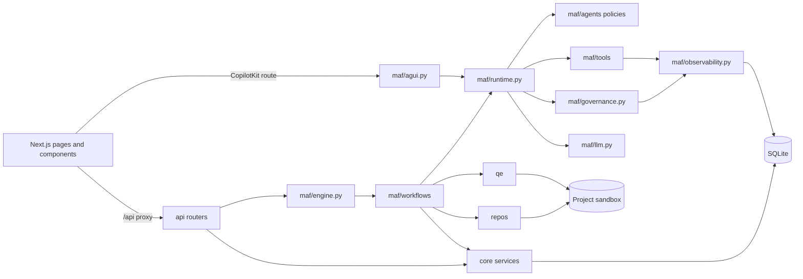

# Project structure

Generated by `python scripts/gen_structure.py`, so links come from the real imports. Run it again after adding files.

In this table, `ui/` means `src/frontend/`, and backend paths start from `src/backend/`.

## How the parts connect

The project has 543 files, not counting screenshots.

## Backend application

| File | What it does | Uses | Used by |
|---|---|---|---|
| `src/backend/app.py` | FastAPI application: REST API for the UI, AG-UI for the chatbot, background MAF workflows. | `__init__.py`, `api/__init__.py`, `api/mcp.py`, `config.py`, `core/auth.py`, `core/documents.py`, `core/errors.py`, `core/files.py`, and 17 more | `scripts/verify_repo_endpoints.py`, `tests/test_access.py`, `tests/test_api_workflows.py`, `tests/test_backend_api_complete_audit.py`, `tests/test_errors.py`, `tests/test_harness_project_scoped_features.py`, `tests/test_harness_universal_hitl.py`, `tests/test_maf_backend.py`, and 5 more |
| `src/backend/config.py` | Paths and environment. ATLAS_DATA_DIR lets tests run against a throwaway store. |  | `scripts/verify_repo_endpoints.py`, `api/common.py`, `api/harness.py`, `api/logs.py`, `api/projects.py`, `api/repository.py`, `api/skills.py`, `api/templates.py`, and 39 more |
| `src/backend/db.py` | SQLite access: one short connection per unit of work, numbered SQL migrations via user_version. | `config.py` | `api/chat.py`, `api/common.py`, `api/documents.py`, `api/findings.py`, `api/governance.py`, `api/mcp.py`, `api/observability.py`, `api/projects.py`, and 55 more |

## REST API

| File | What it does | Uses | Used by |
|---|---|---|---|
| `src/backend/api/__init__.py` | REST API, one router per area. | `api/auth.py`, `api/chat.py`, `api/documents.py`, `api/findings.py`, `api/governance.py`, `api/harness.py`, `api/logs.py`, `api/mcp.py`, and 7 more | `app.py` |
| `src/backend/api/auth.py` | Sign-in and user management. | `core/auth.py` | `api/__init__.py` |
| `src/backend/api/chat.py` | Chat API. | `api/common.py`, `core/auth.py`, `db.py`, `maf/agui.py`, `maf/engine.py`, `maf/evals/__init__.py`, `maf/governance.py`, `maf/llm.py`, and 2 more | `api/__init__.py` |
| `src/backend/api/common.py` | Helpers shared by routers. | `__init__.py`, `config.py`, `db.py` | `api/chat.py`, `api/documents.py`, `api/findings.py`, `api/governance.py`, `api/harness.py`, `api/observability.py`, `api/projects.py`, `api/repository.py`, and 2 more |
| `src/backend/api/documents.py` | Documents API. | `api/common.py`, `core/auth.py`, `core/doc_checks.py`, `core/documents.py`, `core/files.py`, `core/gates.py`, `core/ledger.py`, `core/security.py`, and 9 more | `api/__init__.py` |
| `src/backend/api/findings.py` | Findings API. | `api/common.py`, `core/auth.py`, `core/ledger.py`, `db.py`, `maf/agui.py`, `maf/engine.py`, `maf/evals/__init__.py`, `maf/governance.py`, and 2 more | `api/__init__.py` |
| `src/backend/api/governance.py` | Governance API. | `api/common.py`, `core/auth.py`, `core/gates.py`, `core/ledger.py`, `core/prompts.py`, `db.py`, `harness/approval_manager.py`, `maf/agui.py`, and 5 more | `api/__init__.py` |
| `src/backend/api/harness.py` | Enterprise QE Harness API Router. | `api/common.py`, `config.py`, `core/documents.py`, `harness/agent_evals.py`, `harness/cache.py`, `harness/discovery.py`, `harness/harness_agent.py`, `harness/llm_config.py`, and 5 more | `api/__init__.py`, `tests/test_maf_backend.py` |
| `src/backend/api/logs.py` | Admin download of one day's application log. | `config.py`, `core/logs.py`, `core/security.py` | `api/__init__.py` |
| `src/backend/api/mcp.py` | Model Context Protocol (MCP) Management API and Server Registry. | `api/mcp_playwright_tools.py`, `core/security.py`, `db.py`, `repos/sandbox.py` | `api/__init__.py`, `app.py`, `tests/test_playwright_mcp_and_doc_parsers.py` |
| `src/backend/api/mcp_playwright_tools.py` | Official Playwright MCP Tools Specifications (70+ tools). |  | `api/mcp.py`, `tests/test_playwright_mcp_and_doc_parsers.py` |
| `src/backend/api/observability.py` | Observability API: the log of agents, skills, tools, workflows, approvals, guardrails, and the ledger. | `api/common.py`, `core/auth.py`, `db.py`, `maf/observability.py` | `api/__init__.py` |
| `src/backend/api/projects.py` | Projects API. | `api/common.py`, `config.py`, `core/auth.py`, `core/documents.py`, `core/gates.py`, `core/ledger.py`, `core/security.py`, `db.py`, and 7 more | `api/__init__.py` |
| `src/backend/api/repository.py` | Repository API. | `api/common.py`, `config.py`, `core/auth.py`, `core/security.py`, `maf/agui.py`, `maf/engine.py`, `maf/evals/__init__.py`, `maf/governance.py`, and 5 more | `api/__init__.py` |
| `src/backend/api/runs.py` | Workflows API. | `api/common.py`, `core/auth.py`, `core/ledger.py`, `core/security.py`, `db.py`, `harness/approval_manager.py`, `maf/agui.py`, `maf/engine.py`, and 7 more | `api/__init__.py` |
| `src/backend/api/settings.py` | Connections and settings API. | `core/auth.py`, `core/models.py`, `maf/agui.py`, `maf/engine.py`, `maf/evals/__init__.py`, `maf/governance.py`, `maf/llm.py`, `maf/workflows/__init__.py`, and 1 more | `api/__init__.py` |
| `src/backend/api/skills.py` | Skills API and Skill Creator Studio. | `config.py`, `core/auth.py`, `core/documents.py`, `core/skills.py`, `db.py` | `api/__init__.py` |
| `src/backend/api/templates.py` | Templates and source documents API. | `api/common.py`, `config.py`, `core/files.py`, `core/security.py`, `db.py`, `maf/agui.py`, `maf/engine.py`, `maf/evals/__init__.py`, and 3 more | `api/__init__.py` |

## Agents

| File | What it does | Uses | Used by |
|---|---|---|---|
| `src/backend/maf/agents/__init__.py` | Agent registry. Each file in this folder declares one agent's POLICY, so adding an agent means adding a file. | `maf/agents/policy.py` | `core/skills.py`, `maf/governance.py`, `tests/test_core.py`, `tests/test_migration_006.py`, `tests/test_skills.py` |
| `src/backend/maf/agents/bug_fix_reviewer.py` | Scores proposed bug fixes, verifies assertion preservation and AST integrity, and assigns a confidence score. | `maf/agents/policy.py` |  |
| `src/backend/maf/agents/bug_reviewer.py` | Finds defects in code it is given. Prompt: prompts/bug-reviewer.md. Evals: evals/bug-reviewer.json. | `maf/agents/policy.py` |  |
| `src/backend/maf/agents/business_analyst.py` | Writes requirements documents from a brief and sources, and converts them to validated Gherkin. Prompt: prompts/business-analyst.md. Evals: evals/business-analyst.json. | `maf/agents/policy.py` |  |
| `src/backend/maf/agents/confidence_reviewer.py` | Scores requirements documents, plans, and releases from evidence. Prompt: prompts/confidence-reviewer.md. Evals: evals/confidence-reviewer.json. | `maf/agents/policy.py` |  |
| `src/backend/maf/agents/defect_diagnostician.py` | Fixes defects and test drift on a branch. Prompt: prompts/defect-diagnostician.md. Evals: evals/defect-diagnostician.json. | `maf/agents/policy.py` |  |
| `src/backend/maf/agents/feature_engineer.py` | Implements features on a branch. Prompt: prompts/feature-engineer.md. Evals: evals/feature-engineer.json. | `maf/agents/policy.py` |  |
| `src/backend/maf/agents/policy.py` | What an agent is allowed to do. Each agent file declares one POLICY. |  | `maf/agents/__init__.py`, `maf/agents/bug_fix_reviewer.py`, `maf/agents/bug_reviewer.py`, `maf/agents/business_analyst.py`, `maf/agents/confidence_reviewer.py`, `maf/agents/defect_diagnostician.py`, `maf/agents/feature_engineer.py`, `maf/agents/principal_test_architect.py`, and 6 more |
| `src/backend/maf/agents/principal_test_architect.py` | Plans tests by risk and level. Prompt: prompts/principal-test-architect.md. Evals: evals/principal-test-architect.json. | `maf/agents/policy.py` |  |
| `src/backend/maf/agents/project_copilot.py` | Answers from project data and starts workflows on request. Prompt: prompts/project-copilot.md. Evals: evals/project-copilot.json. | `maf/agents/policy.py` |  |
| `src/backend/maf/agents/qa_execution_engineer.py` | Explains test results from the evidence. Code runs the tests. Prompt: prompts/qa-execution-engineer.md. Evals: evals/qa-execution-engineer.json. | `maf/agents/policy.py` |  |
| `src/backend/maf/agents/repo_intelligence_analyst.py` | Summarizes a repository from scan facts and code. Prompt: prompts/repo-intelligence-analyst.md. Evals: evals/repo-intelligence-analyst.json. | `maf/agents/policy.py` |  |
| `src/backend/maf/agents/requirements_analyst.py` | Derives testable requirements with quoted evidence. Prompt: prompts/requirements-analyst.md. Evals: evals/requirements-analyst.json. | `maf/agents/policy.py` |  |
| `src/backend/maf/agents/test_automation_engineer.py` | Generates executable tests for approved cases. Prompt: prompts/test-automation-engineer.md. Evals: evals/test-automation-engineer.json. | `maf/agents/policy.py` |  |
| `src/backend/maf/agents/test_design_architect.py` | Designs test cases with oracles. Prompt: prompts/test-design-architect.md. Evals: evals/test-design-architect.json. | `maf/agents/policy.py` |  |

## Tools

| File | What it does | Uses | Used by |
|---|---|---|---|
| `src/backend/maf/tools/__init__.py` | MAF function tools, one file each. Every set closes over a project, so an agent can only reach that project's data. | `config.py`, `maf/tools/grep.py`, `maf/tools/list_documents.py`, `maf/tools/list_files.py`, `maf/tools/list_findings.py`, `maf/tools/project_status.py`, `maf/tools/read_document.py`, `maf/tools/read_file.py`, and 5 more | `maf/agui.py`, `maf/runtime.py`, `tests/test_core.py` |
| `src/backend/maf/tools/common.py` | Helpers shared by tools. | `core/documents.py` | `maf/tools/read_document.py`, `maf/tools/save_document.py` |
| `src/backend/maf/tools/grep.py` | The grep agent tool. | `core/security.py`, `repos/scan.py` | `maf/tools/__init__.py` |
| `src/backend/maf/tools/list_documents.py` | The list_documents agent tool. | `core/documents.py` | `maf/tools/__init__.py` |
| `src/backend/maf/tools/list_files.py` | The list_files agent tool. | `repos/scan.py` | `maf/tools/__init__.py` |
| `src/backend/maf/tools/list_findings.py` | The list_findings agent tool. | `db.py` | `maf/tools/__init__.py` |
| `src/backend/maf/tools/project_status.py` | The project_status agent tool. | `core/gates.py`, `db.py` | `maf/tools/__init__.py` |
| `src/backend/maf/tools/read_document.py` | The read_document agent tool. | `core/documents.py`, `maf/tools/common.py` | `maf/tools/__init__.py` |
| `src/backend/maf/tools/read_file.py` | The read_file agent tool. | `core/security.py` | `maf/tools/__init__.py` |
| `src/backend/maf/tools/remember.py` | The remember agent tool. | `maf/runtime.py` | `maf/tools/__init__.py` |
| `src/backend/maf/tools/save_document.py` | The save_document agent tool. | `core/documents.py`, `maf/tools/common.py` | `maf/tools/__init__.py` |
| `src/backend/maf/tools/search_documents.py` | The search_documents agent tool. | `core/documents.py` | `maf/tools/__init__.py` |
| `src/backend/maf/tools/start_workflow.py` | The start_workflow agent tool. |  | `maf/tools/__init__.py` |
| `src/backend/maf/tools/verify_ledger.py` | The verify_ledger agent tool. | `core/ledger.py` | `maf/tools/__init__.py` |

## Workflows

| File | What it does | Uses | Used by |
|---|---|---|---|
| `src/backend/maf/workflows/__init__.py` | Workflows, one file each. A file registers its definition in engine.REGISTRY, so adding a workflow means adding a file. | `maf/workflows/ba.py`, `maf/workflows/bug_scan.py`, `maf/workflows/edits.py`, `maf/workflows/qe.py` | `api/chat.py`, `api/documents.py`, `api/findings.py`, `api/governance.py`, `api/projects.py`, `api/repository.py`, `api/runs.py`, `api/settings.py`, and 9 more |
| `src/backend/maf/workflows/ba.py` | BA workflow: brief to templated document, independent review, Gherkin, human approval. | `core/doc_checks.py`, `core/documents.py`, `core/files.py`, `core/gherkin.py`, `db.py`, `maf/engine.py`, `maf/runtime.py`, `maf/workflows/shared.py` | `maf/workflows/__init__.py`, `maf/workflows/qe.py`, `maf/workflows/qe/discover.py` |
| `src/backend/maf/workflows/bug_scan.py` | Bug scan workflow: fan-out static and agent review, fan-in with evidence checks. | `config.py`, `core/errors.py`, `core/security.py`, `db.py`, `maf/engine.py`, `maf/runtime.py`, `maf/workflows/shared.py`, `repos/git.py`, and 3 more | `maf/workflows/__init__.py`, `tests/test_core.py` |
| `src/backend/maf/workflows/change.py` | Change workflow: feature, bug fix, or traceback diagnosis on an isolated branch with real tests. | `config.py`, `core/documents.py`, `core/errors.py`, `core/security.py`, `db.py`, `maf/engine.py`, `maf/runtime.py`, `maf/workflows/edits.py`, and 7 more | `tests/test_api_workflows.py`, `tests/test_core.py` |
| `src/backend/maf/workflows/edits.py` | Structured edits from agents, applied by code through path, secret, and scope guards. | `core/security.py`, `qe/execution.py` | `maf/workflows/__init__.py`, `maf/workflows/change.py`, `maf/workflows/qe.py`, `maf/workflows/qe/generate.py`, `maf/workflows/qe/heal.py` |
| `src/backend/maf/workflows/qe.py` | QE lifecycle: requirements to signed release, with human gates G0 to G5. | `config.py`, `core/doc_checks.py`, `core/documents.py`, `core/errors.py`, `core/security.py`, `maf/engine.py`, `maf/runtime.py`, `maf/workflows/ba.py`, and 11 more | `maf/workflows/__init__.py`, `tests/test_errors.py`, `tests/test_execution_stages.py`, `tests/test_token_budget.py` |
| `src/backend/maf/workflows/qe/common.py` | Shared constants, helpers, and quality gate builders for Autonomous QE workflows. | `core/documents.py`, `core/errors.py`, `maf/engine.py`, `maf/workflows/shared.py`, `repos/git.py` | `maf/workflows/qe/design.py`, `maf/workflows/qe/generate.py`, `maf/workflows/qe/plan.py`, `maf/workflows/qe/requirements.py` |
| `src/backend/maf/workflows/qe/data.py` | QE Test Data Stage: Synthesizing deterministic fixtures and data contracts without model token costs. | `core/documents.py`, `maf/engine.py`, `qe/test_data.py` |  |
| `src/backend/maf/workflows/qe/design.py` | QE Design Stage: Test Design Architect test case synthesis with confidence reviews. | `config.py`, `core/documents.py`, `core/errors.py`, `maf/engine.py`, `maf/runtime.py`, `maf/workflows/qe/common.py`, `maf/workflows/shared.py`, `qe/confidence.py`, and 1 more |  |
| `src/backend/maf/workflows/qe/discover.py` | QE Discovery Stage: AST repository analysis and architecture mapping. | `config.py`, `core/doc_checks.py`, `core/documents.py`, `maf/engine.py`, `maf/runtime.py`, `maf/workflows/ba.py`, `maf/workflows/shared.py`, `repos/scan.py`, and 1 more |  |
| `src/backend/maf/workflows/qe/execute.py` | QE Execute Stage: Running deterministic test suites in the isolated worktree sandbox. | `core/errors.py`, `maf/engine.py`, `maf/runtime.py`, `qe/execution.py`, `qe/model.py` |  |
| `src/backend/maf/workflows/qe/generate.py` | QE Test Generation Stage: Synthesizing executable deterministic test suites in isolated sandbox worktrees. | `config.py`, `core/documents.py`, `core/errors.py`, `maf/engine.py`, `maf/runtime.py`, `maf/workflows/edits.py`, `maf/workflows/qe/common.py`, `maf/workflows/shared.py`, and 4 more |  |
| `src/backend/maf/workflows/qe/heal.py` | QE Heal Stage: Automated defect diagnostics and selector/fixture self-healing. | `core/errors.py`, `core/security.py`, `maf/engine.py`, `maf/runtime.py`, `maf/workflows/edits.py`, `maf/workflows/shared.py`, `qe/execution.py` |  |
| `src/backend/maf/workflows/qe/plan.py` | QE Plan Stage: Principal Test Architect quality strategy and risk-weighted plan. | `config.py`, `core/documents.py`, `maf/engine.py`, `maf/runtime.py`, `maf/workflows/qe/common.py`, `maf/workflows/shared.py`, `qe/confidence.py`, `qe/model.py` |  |
| `src/backend/maf/workflows/qe/prepare.py` | QE Prepare Stage: Environment setup, dependency installation, and pytest-asyncio detection. | `core/errors.py`, `maf/engine.py`, `maf/workflows/shared.py`, `qe/emit.py`, `qe/execution.py` |  |
| `src/backend/maf/workflows/qe/requirements.py` | QE Requirements Stage: Reverse-engineering and verification of testable requirements. | `config.py`, `core/documents.py`, `core/errors.py`, `maf/engine.py`, `maf/runtime.py`, `maf/workflows/qe/common.py`, `maf/workflows/shared.py`, `qe/model.py`, and 1 more |  |
| `src/backend/maf/workflows/shared.py` | Helpers every workflow uses: repository facts, the code pack, and the Gate 0 intake. | `config.py`, `core/errors.py`, `core/gates.py`, `core/security.py`, `db.py`, `maf/engine.py`, `maf/runtime.py`, `qe/confidence.py`, and 4 more | `maf/workflows/ba.py`, `maf/workflows/bug_scan.py`, `maf/workflows/change.py`, `maf/workflows/qe.py`, `maf/workflows/qe/common.py`, `maf/workflows/qe/design.py`, `maf/workflows/qe/discover.py`, `maf/workflows/qe/generate.py`, and 5 more |

## Agent runtime and governance

| File | What it does | Uses | Used by |
|---|---|---|---|
| `src/backend/maf/agui.py` | AG-UI endpoint for the chatbot. MAF's AgentFrameworkAgent produces the protocol stream. | `core/auth.py`, `core/errors.py`, `core/ledger.py`, `core/security.py`, `core/skills.py`, `db.py`, `maf/engine.py`, `maf/governance.py`, and 4 more | `api/chat.py`, `api/documents.py`, `api/findings.py`, `api/governance.py`, `api/projects.py`, `api/repository.py`, `api/runs.py`, `api/settings.py`, and 2 more |
| `src/backend/maf/engine.py` | Run manager over real MAF workflows: typed stages, HITL via request_info, file checkpoints, durable events. | `config.py`, `core/auth.py`, `core/errors.py`, `core/gates.py`, `core/ledger.py`, `core/security.py`, `db.py`, `maf/runtime.py`, and 2 more | `api/chat.py`, `api/documents.py`, `api/findings.py`, `api/governance.py`, `api/projects.py`, `api/repository.py`, `api/runs.py`, `api/settings.py`, and 24 more |
| `src/backend/maf/evals/__init__.py` | Agent evals on MAF's evaluation API. Each case runs the real active prompt, so prompt versions can be compared. | `config.py`, `core/errors.py`, `core/gherkin.py`, `core/prompts.py`, `core/security.py`, `core/skills.py`, `db.py`, `maf/evals/grader.py`, and 6 more | `api/chat.py`, `api/documents.py`, `api/findings.py`, `api/governance.py`, `api/projects.py`, `api/repository.py`, `api/runs.py`, `api/settings.py`, and 7 more |
| `src/backend/maf/evals/grader.py` | Grades a skill case's `expected_behavior` sentences with the judge model. A PASS needs evidence quoted from the output, and code checks the quote is there. | `maf/llm.py`, `maf/runtime.py` | `maf/evals/__init__.py`, `tests/test_evaluation_metrics.py` |
| `src/backend/maf/evals/metrics.py` | Deterministic, free evaluation metrics. A metric with nothing to measure has the value None, never 0 and never 1. | `core/security.py`, `maf/runtime.py`, `qe/execution.py`, `repos/static_analysis.py` | `maf/evals/__init__.py`, `maf/runtime.py`, `tests/test_evaluation_metrics.py` |
| `src/backend/maf/evals/ragas_evaluator.py` | RAGAS metrics as a MAF `Evaluator`. `ragas` is optional (requirements-evals.txt) and is imported only when a score is asked for. | `config.py`, `maf/llm.py` | `maf/evals/__init__.py`, `tests/test_evaluation_metrics.py` |
| `src/backend/maf/evals/store.py` | Stored metric values and what the cards show. A value exists only when a metric really ran; otherwise a card says why not. | `core/prompts.py`, `db.py` | `core/seed_data.py`, `maf/evals/__init__.py`, `maf/runtime.py`, `tests/test_evaluation_metrics.py`, `tests/test_harness_project_scoped_features.py` |
| `src/backend/maf/governance.py` | Agent governance: one registry, per-agent tool policy, an admin kill switch, guardrails, and call telemetry. | `core/auth.py`, `core/errors.py`, `core/ledger.py`, `core/models.py`, `core/prompts.py`, `core/security.py`, `db.py`, `maf/agents/__init__.py`, and 1 more | `api/chat.py`, `api/documents.py`, `api/findings.py`, `api/governance.py`, `api/projects.py`, `api/repository.py`, `api/runs.py`, `api/settings.py`, and 10 more |
| `src/backend/maf/llm.py` | Model provider settings. Environment wins on first run; the Settings page can override and encrypts the key. | `config.py`, `core/errors.py`, `core/models.py`, `core/security.py`, `db.py` | `api/chat.py`, `api/documents.py`, `api/findings.py`, `api/governance.py`, `api/harness.py`, `api/projects.py`, `api/repository.py`, `api/runs.py`, and 19 more |
| `src/backend/maf/observability.py` | One log of everything agents and workflows did, for a run, a project, or all projects. Reads stored records only. | `core/auth.py`, `core/ledger.py`, `core/security.py`, `db.py` | `api/observability.py`, `harness/qe_tools.py`, `maf/governance.py`, `maf/runtime.py`, `tests/test_access.py`, `tests/test_api_workflows.py` |
| `src/backend/maf/runtime.py` | Agent construction on the real Microsoft Agent Framework, with middleware and JSON validation. | `config.py`, `core/auth.py`, `core/documents.py`, `core/errors.py`, `core/ledger.py`, `core/prompts.py`, `core/security.py`, `core/skills.py`, and 10 more | `api/chat.py`, `api/documents.py`, `maf/agui.py`, `maf/engine.py`, `maf/evals/__init__.py`, `maf/evals/grader.py`, `maf/evals/metrics.py`, `maf/skill_chat.py`, and 20 more |
| `src/backend/maf/skill_chat.py` | Skills in chat. Tools are unreliable through the proxy, so by default code picks the skill and adds its text to the turn. | `config.py`, `core/models.py`, `core/prompts.py`, `core/skills.py`, `maf/governance.py`, `maf/llm.py`, `maf/runtime.py` | `maf/agui.py`, `maf/runtime.py`, `tests/test_skills.py` |

## Core services

| File | What it does | Uses | Used by |
|---|---|---|---|
| `src/backend/core/auth.py` | Accounts and access. The admin login comes from .env. Users are created by the admin. | `core/errors.py`, `core/ledger.py`, `core/models.py`, `core/security.py`, `db.py`, `maf/llm.py` | `api/auth.py`, `api/chat.py`, `api/documents.py`, `api/findings.py`, `api/governance.py`, `api/observability.py`, `api/projects.py`, `api/repository.py`, and 17 more |
| `src/backend/core/doc_checks.py` | Deterministic requirements checks. They cap the reviewer's score, so a model cannot pass a weak document. | `core/files.py` | `api/documents.py`, `maf/workflows/ba.py`, `maf/workflows/qe.py`, `maf/workflows/qe/discover.py`, `tests/test_api_workflows.py`, `tests/test_core.py` |
| `src/backend/core/documents.py` | Versioned documents. Every save is an immutable version with SHA-256, author, and prompt reference. | `config.py`, `core/gates.py`, `core/gherkin.py`, `core/ledger.py`, `core/security.py`, `db.py`, `qe/model.py` | `api/documents.py`, `api/harness.py`, `api/projects.py`, `api/skills.py`, `app.py`, `harness/domain_brd_generator.py`, `harness/qe_tools.py`, `maf/runtime.py`, and 21 more |
| `src/backend/core/errors.py` | Typed errors. Each says what happened, what to do next, and whether a plain retry may help. | `core/security.py` | `app.py`, `core/auth.py`, `core/models.py`, `maf/agui.py`, `maf/engine.py`, `maf/evals/__init__.py`, `maf/governance.py`, `maf/llm.py`, and 18 more |
| `src/backend/core/files.py` | Uploaded-file text extraction, templates, and DOCX export. | `config.py`, `core/security.py`, `db.py`, `repos/doc_parser.py` | `api/documents.py`, `api/templates.py`, `app.py`, `core/doc_checks.py`, `harness/domain_brd_generator.py`, `maf/workflows/ba.py`, `tests/conftest.py`, `tests/test_core.py`, and 1 more |
| `src/backend/core/gates.py` | Quality gates G0-G5. Sequential approval, HMAC-signed records, human signer required. | `core/ledger.py`, `core/security.py`, `db.py` | `api/documents.py`, `api/governance.py`, `api/projects.py`, `app.py`, `core/documents.py`, `harness/qe_tools.py`, `maf/engine.py`, `maf/tools/project_status.py`, and 5 more |
| `src/backend/core/gherkin.py` | Gherkin validation with the official Cucumber parser. |  | `core/documents.py`, `harness/domain_brd_generator.py`, `maf/evals/__init__.py`, `maf/workflows/ba.py`, `tests/test_core.py` |
| `src/backend/core/ledger.py` | Tamper-evident audit ledger: each entry hashes the previous entry, per project. | `core/security.py`, `db.py` | `api/documents.py`, `api/findings.py`, `api/governance.py`, `api/projects.py`, `api/runs.py`, `core/auth.py`, `core/documents.py`, `core/gates.py`, and 14 more |
| `src/backend/core/logs.py` | Daily JSON-lines application log: data/logs/app-YYYY-MM-DD.jsonl. | `__init__.py`, `config.py`, `core/security.py` | `api/logs.py`, `app.py`, `tests/test_ops.py` |
| `src/backend/core/models.py` | The model list, who may use which model, and token limits per period. | `core/errors.py`, `db.py` | `api/settings.py`, `app.py`, `core/auth.py`, `maf/governance.py`, `maf/llm.py`, `maf/skill_chat.py`, `tests/test_api_workflows.py`, `tests/test_models.py`, and 1 more |
| `src/backend/core/prompts.py` | Versioned agent prompts. prompts/*.md seed v1; every edit is a new immutable version in the DB. | `config.py`, `core/security.py`, `db.py` | `api/governance.py`, `app.py`, `core/seed_data.py`, `maf/evals/__init__.py`, `maf/evals/store.py`, `maf/governance.py`, `maf/runtime.py`, `maf/skill_chat.py`, and 4 more |
| `src/backend/core/security.py` | Secrets at rest, secret detection, redaction, path confinement, and shell-free command policy. | `config.py` | `api/documents.py`, `api/logs.py`, `api/mcp.py`, `api/projects.py`, `api/repository.py`, `api/runs.py`, `api/templates.py`, `app.py`, and 39 more |
| `src/backend/core/seed_data.py` | Initial seed data for Agentic QE Platform & Harness. | `config.py`, `core/prompts.py`, `core/security.py`, `db.py`, `maf/evals/store.py`, `repos/git.py`, `repos/ingest.py`, `repos/scan.py` | `app.py`, `cli.py`, `tests/test_harness_ba_studio_real_generation.py`, `tests/test_harness_project_scoped_features.py` |
| `src/backend/core/skills.py` | Plugin skills from skills/, validated by MAF's FileSkillsSource and read through safe_path. | `config.py`, `core/security.py`, `maf/agents/__init__.py` | `api/skills.py`, `app.py`, `maf/agui.py`, `maf/evals/__init__.py`, `maf/runtime.py`, `maf/skill_chat.py`, `tests/test_skills.py` |

## Repositories

| File | What it does | Uses | Used by |
|---|---|---|---|
| `src/backend/repos/doc_parser.py` | Secure and intelligent document & template parser. |  | `api/documents.py`, `core/files.py`, `tests/test_playwright_mcp_and_doc_parsers.py`, `tests/test_red_blue_security_hardening.py` |
| `src/backend/repos/git.py` | Git via subprocess without a shell. Tokens travel in env-scoped config, never in argv, URLs, or .git/config. | `core/errors.py`, `core/security.py` | `scripts/populate_seeded_repos.py`, `api/runs.py`, `app.py`, `core/seed_data.py`, `maf/workflows/bug_scan.py`, `maf/workflows/change.py`, `maf/workflows/qe.py`, `maf/workflows/qe/common.py`, and 7 more |
| `src/backend/repos/github.py` | GitHub REST calls for private-repo connection. A token validates, lists repos, and opens PRs. | `core/errors.py`, `core/security.py`, `db.py` | `api/runs.py`, `api/settings.py`, `app.py`, `maf/workflows/change.py`, `repos/ingest.py`, `repos/sandbox.py`, `tests/test_core.py` |
| `src/backend/repos/ingest.py` | Bring code into a project: clone a git URL (public or with a saved token) or unpack a ZIP safely. | `config.py`, `core/errors.py`, `core/ledger.py`, `db.py`, `repos/git.py`, `repos/github.py`, `repos/scan.py` | `scripts/verify_repo_endpoints.py`, `api/projects.py`, `api/repository.py`, `api/runs.py`, `app.py`, `core/seed_data.py`, `maf/runtime.py`, `maf/workflows/change.py`, and 5 more |
| `src/backend/repos/sandbox.py` | Each project's sandbox: its own folder with a full clone, one worktree per run, its own Python environment. | `config.py`, `core/ledger.py`, `core/security.py`, `db.py`, `repos/git.py`, `repos/github.py` | `api/mcp.py`, `api/repository.py`, `harness/harness_agent.py`, `maf/workflows/bug_scan.py`, `tests/test_e2e_full_scenarios.py`, `tests/test_red_blue_security_hardening.py`, `tests/test_sandbox_environment.py`, `tests/test_target_repo_sandbox_pipeline.py` |
| `src/backend/repos/scan.py` | Evidence-only repository analysis: every field comes from files on disk. Port of plugin scan-repo.ts, extended. |  | `scripts/populate_seeded_repos.py`, `api/repository.py`, `core/seed_data.py`, `maf/tools/grep.py`, `maf/tools/list_files.py`, `maf/workflows/bug_scan.py`, `maf/workflows/change.py`, `maf/workflows/qe.py`, and 6 more |
| `src/backend/repos/static_analysis.py` | Deterministic scanners. A finding exists only with a file, a line, and the quoted line from disk. | `core/security.py`, `repos/scan.py` | `harness/harness_agent.py`, `maf/evals/metrics.py`, `maf/workflows/bug_scan.py`, `maf/workflows/change.py`, `maf/workflows/qe.py`, `maf/workflows/qe/discover.py`, `maf/workflows/qe/requirements.py`, `maf/workflows/shared.py`, and 1 more |

## Quality engineering

| File | What it does | Uses | Used by |
|---|---|---|---|
| `src/backend/qe/confidence.py` | Per-case confidence, ported from the plugin's confidence.ts. The reviewer model scores; this code decides. | `core/security.py` | `maf/engine.py`, `maf/workflows/qe.py`, `maf/workflows/qe/design.py`, `maf/workflows/qe/generate.py`, `maf/workflows/qe/plan.py`, `maf/workflows/shared.py`, `tests/test_confidence.py` |
| `src/backend/qe/emit.py` | Pre-run checks for generated tests. Port of the idea behind emit-tests.ts: nothing a model wrote is run to find out it was wrong. | `qe/execution.py` | `maf/workflows/qe.py`, `maf/workflows/qe/generate.py`, `maf/workflows/qe/prepare.py`, `qe/execution.py`, `tests/test_emit.py` |
| `src/backend/qe/execution.py` | Registered test runners, JUnit parsing, honest verdicts. No shell, bounded time, scrubbed environment. | `core/security.py`, `qe/emit.py`, `repos/scan.py` | `maf/evals/metrics.py`, `maf/workflows/change.py`, `maf/workflows/edits.py`, `maf/workflows/qe.py`, `maf/workflows/qe/execute.py`, `maf/workflows/qe/generate.py`, `maf/workflows/qe/heal.py`, `maf/workflows/qe/prepare.py`, and 5 more |
| `src/backend/qe/model.py` | Structured QE artifacts and the plugin's validators, ported from TypeScript to Python. |  | `core/documents.py`, `maf/evals/__init__.py`, `maf/workflows/qe.py`, `maf/workflows/qe/design.py`, `maf/workflows/qe/execute.py`, `maf/workflows/qe/plan.py`, `maf/workflows/qe/requirements.py`, `maf/workflows/shared.py`, and 3 more |
| `src/backend/qe/test_data.py` | Deterministic test data. Port of the generating-test-data skill's synthesize-data.ts, with its shapes unchanged. | `core/security.py` | `maf/workflows/qe.py`, `maf/workflows/qe/data.py`, `tests/test_execution_stages.py` |
| `src/backend/qe/trace.py` | Traceability matrix and release score, ported from build-matrix.ts and the plugin's verdict rules. |  | `maf/workflows/qe.py`, `tests/test_core.py` |

## Database migrations

| File | What it does | Uses | Used by |
|---|---|---|---|
| `src/backend/migrations/001_init.sql` | Database change: init |  |  |
| `src/backend/migrations/002_evaluations.sql` | Database change: evaluations |  |  |
| `src/backend/migrations/003_agent_governance.sql` | Database change: agent governance |  |  |
| `src/backend/migrations/004_tool_calls.sql` | Database change: tool calls |  |  |
| `src/backend/migrations/005_users.sql` | Database change: users |  |  |
| `src/backend/migrations/006_agent_plugin_names.sql` | Database change: agent plugin names |  |  |
| `src/backend/migrations/007_run_failures.sql` | Database change: run failures |  |  |
| `src/backend/migrations/008_observability_indexes.sql` | Database change: observability indexes |  |  |
| `src/backend/migrations/009_models_limits.sql` | Database change: models limits |  |  |
| `src/backend/migrations/010_roles_members.sql` | Database change: roles members |  |  |
| `src/backend/migrations/011_skills_tool_check.sql` | Database change: skills tool check |  |  |
| `src/backend/migrations/012_evaluation_metrics.sql` | Database change: evaluation metrics |  |  |
| `src/backend/migrations/013_mcp_servers.sql` | Database change: mcp servers |  |  |
| `src/backend/migrations/014_playwright_mcp_sync.sql` | Database change: playwright mcp sync |  |  |
| `src/backend/migrations/015_deleted_mcp_servers.sql` | Database change: deleted mcp servers |  |  |

## Agent prompts

| File | What it does | Uses | Used by |
|---|---|---|---|
| `prompts/bug-fix-reviewer.md` | System prompt for the bug-fix-reviewer agent |  |  |
| `prompts/bug-reviewer.md` | System prompt for the bug-reviewer agent |  |  |
| `prompts/business-analyst.md` | System prompt for the business-analyst agent |  |  |
| `prompts/confidence-reviewer.md` | System prompt for the confidence-reviewer agent |  |  |
| `prompts/defect-diagnostician.md` | System prompt for the defect-diagnostician agent |  |  |
| `prompts/feature-engineer.md` | System prompt for the feature-engineer agent |  |  |
| `prompts/principal-test-architect.md` | System prompt for the principal-test-architect agent |  |  |
| `prompts/project-copilot.md` | System prompt for the project-copilot agent |  |  |
| `prompts/qa-execution-engineer.md` | System prompt for the qa-execution-engineer agent |  |  |
| `prompts/repo-intelligence-analyst.md` | System prompt for the repo-intelligence-analyst agent |  |  |
| `prompts/requirements-analyst.md` | System prompt for the requirements-analyst agent |  |  |
| `prompts/test-automation-engineer.md` | System prompt for the test-automation-engineer agent |  |  |
| `prompts/test-design-architect.md` | System prompt for the test-design-architect agent |  |  |

## Agent evaluations

| File | What it does | Uses | Used by |
|---|---|---|---|
| `evals/benchmarks/finance/labels.json` | Quality and safety cases for the labels agent |  |  |
| `evals/benchmarks/shop/cases/bug-reviewer.json` | Quality and safety cases for the bug-reviewer agent |  |  |
| `evals/benchmarks/shop/cases/business-analyst.json` | Quality and safety cases for the business-analyst agent |  |  |
| `evals/benchmarks/shop/cases/requirements-analyst.json` | Quality and safety cases for the requirements-analyst agent |  |  |
| `evals/benchmarks/shop/cases/test-automation-engineer.json` | Quality and safety cases for the test-automation-engineer agent |  |  |
| `evals/benchmarks/shop/labels.json` | Quality and safety cases for the labels agent |  |  |
| `evals/benchmarks/shop/repo/cart.py` | Shopping cart: holds items and works out what the customer owes. |  |  |
| `evals/benchmarks/shop/repo/inventory.py` | Stock levels. A reservation must never take more than is on the shelf. |  |  |
| `evals/benchmarks/shop/repo/money.py` | Money helpers. Amounts are rounded to two decimals, half up. |  |  |
| `evals/benchmarks/shop/repo/orders.py` | Places an order: reserve stock, then price it. |  |  |
| `evals/benchmarks/shop/repo/pricing.py` | Tax and shipping for an order. Tax is 18 percent of the amount, kept to the paisa. Shipping is free from 500 and above. |  |  |
| `evals/benchmarks/shop/repo/pytest.ini` | Quality and safety cases for the pytest agent |  |  |
| `evals/benchmarks/shop/repo/tests/test_money.py` | Quality and safety cases for the test_money agent |  |  |
| `evals/benchmarks/shop/repo/validators.py` | Small input checks shared by the shop modules. |  |  |
| `evals/bug-fix-reviewer.json` | Quality and safety cases for the bug-fix-reviewer agent |  |  |
| `evals/bug-reviewer.json` | Quality and safety cases for the bug-reviewer agent |  |  |
| `evals/business-analyst.json` | Quality and safety cases for the business-analyst agent |  |  |
| `evals/confidence-reviewer.json` | Quality and safety cases for the confidence-reviewer agent |  |  |
| `evals/defect-diagnostician.json` | Quality and safety cases for the defect-diagnostician agent |  |  |
| `evals/feature-engineer.json` | Quality and safety cases for the feature-engineer agent |  |  |
| `evals/principal-test-architect.json` | Quality and safety cases for the principal-test-architect agent |  |  |
| `evals/project-copilot.json` | Quality and safety cases for the project-copilot agent |  |  |
| `evals/qa-execution-engineer.json` | Quality and safety cases for the qa-execution-engineer agent |  |  |
| `evals/repo-intelligence-analyst.json` | Quality and safety cases for the repo-intelligence-analyst agent |  |  |
| `evals/requirements-analyst.json` | Quality and safety cases for the requirements-analyst agent |  |  |
| `evals/skills/checks.json` | Quality and safety cases for the checks agent |  |  |
| `evals/test-automation-engineer.json` | Quality and safety cases for the test-automation-engineer agent |  |  |
| `evals/test-design-architect.json` | Quality and safety cases for the test-design-architect agent |  |  |

## Document templates

| File | What it does | Uses | Used by |
|---|---|---|---|
| `templates/brd.md` | Built-in brd template |  |  |
| `templates/prd.md` | Built-in prd template |  |  |
| `templates/stories.md` | Built-in stories template |  |  |

## Frontend pages

| File | What it does | Uses | Used by |
|---|---|---|---|
| `src/frontend/app/account/page.tsx` | Page at `/account` | `ui/components/AppShell.tsx`, `ui/components/ui.tsx`, `ui/lib/api.ts` |  |
| `src/frontend/app/agents/[key]/page.tsx` | Page for one agent: details table, controls, evaluations | `ui/components/AppShell.tsx`, `ui/components/AuthGate.tsx`, `ui/components/EvalScores.tsx`, `ui/components/ui.tsx`, `ui/lib/api.ts` |  |
| `src/frontend/app/agents/page.tsx` | Page at `/agents` | `ui/components/AppShell.tsx`, `ui/components/AuthGate.tsx`, `ui/components/EvalScores.tsx`, `ui/components/ui.tsx`, `ui/lib/api.ts` |  |
| `src/frontend/app/api/copilotkit/[[...path]]/route.ts` | CopilotKit runtime, connecting chat to the AG-UI endpoint |  |  |
| `src/frontend/app/approvals/page.tsx` | Page at `/approvals` | `ui/components/AppShell.tsx`, `ui/components/ApprovalsList.tsx`, `ui/components/ui.tsx` |  |
| `src/frontend/app/chat/[id]/page.tsx` | Page at `/chat/{id}` | `ui/components/Chat.tsx` |  |
| `src/frontend/app/docs/[slug]/page.tsx` | Page at `/docs/{slug}` | `ui/components/ui.tsx`, `ui/content/docs.ts` |  |
| `src/frontend/app/docs/layout.tsx` | Documentation site frame: search and sidebar | `ui/components/ui.tsx`, `ui/content/docs.ts` |  |
| `src/frontend/app/docs/page.tsx` | Page at `/docs` |  |  |
| `src/frontend/app/documents/page.tsx` | Page at `/documents` | `ui/components/AppShell.tsx`, `ui/components/ui.tsx`, `ui/lib/api.ts` |  |
| `src/frontend/app/error.tsx` | Page error screen with its error id and a retry button | `ui/components/ui.tsx` |  |
| `src/frontend/app/findings/page.tsx` | Page at `/findings` | `ui/components/AppShell.tsx`, `ui/components/ui.tsx`, `ui/lib/api.ts` |  |
| `src/frontend/app/global-error.tsx` | Last-resort error screen for a failure in the root layout |  |  |
| `src/frontend/app/globals.css` | Design tokens and document styles |  | `ui/app/layout.tsx` |
| `src/frontend/app/harness/page.tsx` | Page at `/harness` | `ui/components/AppShell.tsx`, `ui/components/HarnessView.tsx` |  |
| `src/frontend/app/layout.tsx` | Root HTML layout, theme, and toasts | `ui/app/globals.css`, `ui/components/AuthGate.tsx`, `ui/components/ui.tsx` |  |
| `src/frontend/app/login/page.tsx` | Page at `/login` | `ui/components/ui.tsx`, `ui/lib/api.ts` |  |
| `src/frontend/app/mcp/page.tsx` | Page at `/mcp` | `ui/components/AppShell.tsx`, `ui/components/ConfirmModal.tsx`, `ui/components/ui.tsx`, `ui/lib/api.ts` |  |
| `src/frontend/app/observability/page.tsx` | Page at `/observability` | `ui/components/AppShell.tsx`, `ui/components/Observability.tsx`, `ui/components/ui.tsx` |  |
| `src/frontend/app/page.tsx` | Page at `/` | `ui/components/AppShell.tsx`, `ui/components/ConfirmModal.tsx`, `ui/components/ui.tsx`, `ui/lib/api.ts` |  |
| `src/frontend/app/projects/[id]/approvals/page.tsx` | Page at `/projects/{id}/approvals` | `ui/components/ApprovalsList.tsx`, `ui/components/ProjectShell.tsx`, `ui/components/ui.tsx` |  |
| `src/frontend/app/projects/[id]/ba/page.tsx` | Page at `/projects/{id}/ba` | `ui/components/ModelPicker.tsx`, `ui/components/ProjectShell.tsx`, `ui/components/RunPanel.tsx`, `ui/components/ui.tsx`, `ui/lib/api.ts` |  |
| `src/frontend/app/projects/[id]/bugs/page.tsx` | Page at `/projects/{id}/bugs` | `ui/components/ModelPicker.tsx`, `ui/components/ProjectShell.tsx`, `ui/components/RunPanel.tsx`, `ui/components/ui.tsx`, `ui/lib/api.ts` |  |
| `src/frontend/app/projects/[id]/chat/page.tsx` | Page at `/projects/{id}/chat` |  |  |
| `src/frontend/app/projects/[id]/documents/[docId]/page.tsx` | Page at `/projects/{id}/documents/{docId}` | `ui/components/AuthGate.tsx`, `ui/components/ConfirmModal.tsx`, `ui/components/DocumentEditor.tsx`, `ui/components/GherkinVisualizer.tsx`, `ui/components/ProjectShell.tsx`, `ui/components/ui.tsx`, `ui/lib/api.ts` |  |
| `src/frontend/app/projects/[id]/documents/page.tsx` | Page at `/projects/{id}/documents` | `ui/components/ConfirmModal.tsx`, `ui/components/ProjectShell.tsx`, `ui/components/ui.tsx`, `ui/lib/api.ts` |  |
| `src/frontend/app/projects/[id]/feature/page.tsx` | Page at `/projects/{id}/feature` | `ui/components/ModelPicker.tsx`, `ui/components/ProjectShell.tsx`, `ui/components/RunPanel.tsx`, `ui/components/ui.tsx`, `ui/lib/api.ts` |  |
| `src/frontend/app/projects/[id]/governance/page.tsx` | Page at `/projects/{id}/governance` | `ui/components/AuthGate.tsx`, `ui/components/ProjectShell.tsx`, `ui/components/ui.tsx`, `ui/lib/api.ts` |  |
| `src/frontend/app/projects/[id]/layout.tsx` | Wraps project pages in the project sidebar | `ui/components/ProjectShell.tsx` |  |
| `src/frontend/app/projects/[id]/observability/page.tsx` | Page at `/projects/{id}/observability` | `ui/components/Observability.tsx`, `ui/components/ProjectShell.tsx`, `ui/components/ui.tsx` |  |
| `src/frontend/app/projects/[id]/page.tsx` | Page at `/projects/{id}` | `ui/components/AuthGate.tsx`, `ui/components/ConfirmModal.tsx`, `ui/components/ProjectShell.tsx`, `ui/components/ui.tsx`, `ui/lib/api.ts` |  |
| `src/frontend/app/projects/[id]/prompts/page.tsx` | Page at `/projects/{id}/prompts` | `ui/components/EvalScores.tsx`, `ui/components/ui.tsx`, `ui/lib/api.ts` |  |
| `src/frontend/app/projects/[id]/qe/page.tsx` | Page at `/projects/{id}/qe` | `ui/components/ModelPicker.tsx`, `ui/components/ProjectShell.tsx`, `ui/components/RunPanel.tsx`, `ui/components/ui.tsx`, `ui/lib/api.ts` |  |
| `src/frontend/app/projects/[id]/repository/page.tsx` | Page at `/projects/{id}/repository` | `ui/components/ConfirmModal.tsx`, `ui/components/ProjectShell.tsx`, `ui/components/ui.tsx`, `ui/lib/api.ts` |  |
| `src/frontend/app/projects/[id]/runs/[runId]/page.tsx` | Page at `/projects/{id}/runs/{runId}` | `ui/components/ProjectShell.tsx`, `ui/components/RunPanel.tsx` |  |
| `src/frontend/app/projects/[id]/runs/page.tsx` | Page at `/projects/{id}/runs` | `ui/components/ProjectShell.tsx`, `ui/components/ui.tsx`, `ui/lib/api.ts` |  |
| `src/frontend/app/settings/page.tsx` | Page at `/settings` | `ui/components/AppShell.tsx`, `ui/components/AuthGate.tsx`, `ui/components/ui.tsx`, `ui/lib/api.ts` |  |
| `src/frontend/app/skills/page.tsx` | Page at `/skills` | `ui/components/AppShell.tsx`, `ui/components/ui.tsx`, `ui/lib/api.ts` |  |
| `src/frontend/app/skills/studio/page.tsx` | Page at `/skills/studio` | `ui/components/AppShell.tsx`, `ui/components/ui.tsx`, `ui/lib/api.ts` |  |
| `src/frontend/app/templates/page.tsx` | Page at `/templates` | `ui/components/AppShell.tsx`, `ui/components/ui.tsx`, `ui/lib/api.ts` |  |
| `src/frontend/app/usage/page.tsx` | Page at `/usage` | `ui/components/AppShell.tsx`, `ui/components/ui.tsx`, `ui/lib/api.ts` |  |
| `src/frontend/app/users/page.tsx` | Page at `/users` | `ui/components/AppShell.tsx`, `ui/components/ui.tsx`, `ui/lib/api.ts` |  |

## Frontend components and content

| File | What it does | Uses | Used by |
|---|---|---|---|
| `src/frontend/components/AppShell.tsx` | Workspace sidebar and header | `ui/components/AuthGate.tsx`, `ui/components/ui.tsx`, `ui/lib/api.ts` | `ui/app/account/page.tsx`, `ui/app/agents/[key]/page.tsx`, `ui/app/agents/page.tsx`, `ui/app/approvals/page.tsx`, `ui/app/documents/page.tsx`, `ui/app/findings/page.tsx`, `ui/app/harness/page.tsx`, `ui/app/mcp/page.tsx`, and 8 more |
| `src/frontend/components/ApprovalsList.tsx` | List of pending approvals | `ui/components/RunPanel.tsx`, `ui/components/ui.tsx`, `ui/lib/api.ts` | `ui/app/approvals/page.tsx`, `ui/app/projects/[id]/approvals/page.tsx` |
| `src/frontend/components/AuthGate.tsx` | Sends people to sign in, and holds the sign-out menu | `ui/components/ui.tsx`, `ui/lib/api.ts` | `ui/app/agents/[key]/page.tsx`, `ui/app/agents/page.tsx`, `ui/app/layout.tsx`, `ui/app/projects/[id]/documents/[docId]/page.tsx`, `ui/app/projects/[id]/governance/page.tsx`, `ui/app/projects/[id]/page.tsx`, `ui/app/settings/page.tsx`, `ui/components/AppShell.tsx`, and 2 more |
| `src/frontend/components/Chat.tsx` | Chat threads and conversation | `ui/components/ModelPicker.tsx`, `ui/components/ui.tsx`, `ui/lib/api.ts` | `ui/app/chat/[id]/page.tsx` |
| `src/frontend/components/ConfirmModal.tsx` |  |  | `ui/app/mcp/page.tsx`, `ui/app/page.tsx`, `ui/app/projects/[id]/documents/[docId]/page.tsx`, `ui/app/projects/[id]/documents/page.tsx`, `ui/app/projects/[id]/page.tsx`, `ui/app/projects/[id]/repository/page.tsx` |
| `src/frontend/components/DocumentEditor.tsx` | Formatted document with in-place editing, table grids, and images | `ui/components/ui.tsx`, `ui/lib/api.ts` | `ui/app/projects/[id]/documents/[docId]/page.tsx` |
| `src/frontend/components/EvalScores.tsx` |  | `ui/components/ui.tsx`, `ui/lib/api.ts` | `ui/app/agents/[key]/page.tsx`, `ui/app/agents/page.tsx`, `ui/app/projects/[id]/prompts/page.tsx` |
| `src/frontend/components/GherkinVisualizer.tsx` |  |  | `ui/app/projects/[id]/documents/[docId]/page.tsx` |
| `src/frontend/components/HarnessView.tsx` |  | `ui/components/ui.tsx`, `ui/lib/api.ts` | `ui/app/harness/page.tsx` |
| `src/frontend/components/ModelPicker.tsx` | Menu to choose the model for a run or a chat thread | `ui/components/ui.tsx`, `ui/lib/api.ts` | `ui/app/projects/[id]/ba/page.tsx`, `ui/app/projects/[id]/bugs/page.tsx`, `ui/app/projects/[id]/feature/page.tsx`, `ui/app/projects/[id]/qe/page.tsx`, `ui/components/Chat.tsx` |
| `src/frontend/components/Observability.tsx` | Log with filters, run trace, and download | `ui/components/ui.tsx`, `ui/lib/api.ts` | `ui/app/observability/page.tsx`, `ui/app/projects/[id]/observability/page.tsx` |
| `src/frontend/components/ProjectShell.tsx` | Project sidebar and header | `ui/components/AuthGate.tsx`, `ui/components/ui.tsx`, `ui/lib/api.ts` | `ui/app/projects/[id]/approvals/page.tsx`, `ui/app/projects/[id]/ba/page.tsx`, `ui/app/projects/[id]/bugs/page.tsx`, `ui/app/projects/[id]/documents/[docId]/page.tsx`, `ui/app/projects/[id]/documents/page.tsx`, `ui/app/projects/[id]/feature/page.tsx`, `ui/app/projects/[id]/governance/page.tsx`, `ui/app/projects/[id]/layout.tsx`, and 6 more |
| `src/frontend/components/RunPanel.tsx` | Live run view, approval card, and past runs | `ui/components/AuthGate.tsx`, `ui/components/ui.tsx`, `ui/lib/api.ts` | `ui/app/projects/[id]/ba/page.tsx`, `ui/app/projects/[id]/bugs/page.tsx`, `ui/app/projects/[id]/feature/page.tsx`, `ui/app/projects/[id]/qe/page.tsx`, `ui/app/projects/[id]/runs/[runId]/page.tsx`, `ui/components/ApprovalsList.tsx` |
| `src/frontend/components/chat/ChatContainer.tsx` |  | `ui/components/chat/ChatMessageItem.tsx`, `ui/components/chat/PromptInput.tsx`, `ui/components/harness-ui/Badge.tsx`, `ui/components/harness-ui/Button.tsx` |  |
| `src/frontend/components/chat/ChatMessageItem.tsx` |  | `ui/components/chat/QualityGateApprovalCard.tsx`, `ui/components/chat/ThinkingAccordion.tsx`, `ui/components/chat/ToolCallCard.tsx`, `ui/components/harness-ui/Badge.tsx` | `ui/components/chat/ChatContainer.tsx` |
| `src/frontend/components/chat/PromptInput.tsx` |  | `ui/components/chat/SlashCommandPalette.tsx`, `ui/components/chat/StopButton.tsx`, `ui/components/harness-ui/Button.tsx` | `ui/components/chat/ChatContainer.tsx` |
| `src/frontend/components/chat/QualityGateApprovalCard.tsx` |  | `ui/components/harness-ui/Badge.tsx`, `ui/components/harness-ui/Button.tsx` | `ui/components/chat/ChatMessageItem.tsx` |
| `src/frontend/components/chat/SlashCommandPalette.tsx` |  |  | `ui/components/chat/PromptInput.tsx` |
| `src/frontend/components/chat/StopButton.tsx` |  |  | `ui/components/chat/PromptInput.tsx` |
| `src/frontend/components/chat/ThinkingAccordion.tsx` |  |  | `ui/components/chat/ChatMessageItem.tsx` |
| `src/frontend/components/chat/ToolCallCard.tsx` |  | `ui/components/harness-ui/Badge.tsx` | `ui/components/chat/ChatMessageItem.tsx` |
| `src/frontend/components/harness-ui/Badge.tsx` |  |  | `ui/components/chat/ChatContainer.tsx`, `ui/components/chat/ChatMessageItem.tsx`, `ui/components/chat/QualityGateApprovalCard.tsx`, `ui/components/chat/ToolCallCard.tsx`, `ui/components/inspector/MCPToolsExplorer.tsx`, `ui/components/inspector/MagenticLedgerView.tsx`, `ui/components/inspector/QualityGatesTracker.tsx`, `ui/components/inspector/TodoChecklist.tsx`, and 3 more |
| `src/frontend/components/harness-ui/Button.tsx` |  |  | `ui/components/chat/ChatContainer.tsx`, `ui/components/chat/PromptInput.tsx`, `ui/components/chat/QualityGateApprovalCard.tsx`, `ui/components/modals/MCPSettingsModal.tsx`, `ui/components/modals/ModelConfigModal.tsx` |
| `src/frontend/components/inspector/ContextInspector.tsx` |  | `ui/components/inspector/MCPToolsExplorer.tsx`, `ui/components/inspector/MagenticLedgerView.tsx`, `ui/components/inspector/QualityGatesTracker.tsx`, `ui/components/inspector/TodoChecklist.tsx` |  |
| `src/frontend/components/inspector/MCPToolsExplorer.tsx` |  | `ui/components/harness-ui/Badge.tsx` | `ui/components/inspector/ContextInspector.tsx` |
| `src/frontend/components/inspector/MagenticLedgerView.tsx` |  | `ui/components/harness-ui/Badge.tsx` | `ui/components/inspector/ContextInspector.tsx` |
| `src/frontend/components/inspector/QualityGatesTracker.tsx` |  | `ui/components/harness-ui/Badge.tsx` | `ui/components/inspector/ContextInspector.tsx` |
| `src/frontend/components/inspector/TodoChecklist.tsx` |  | `ui/components/harness-ui/Badge.tsx` | `ui/components/inspector/ContextInspector.tsx` |
| `src/frontend/components/left-sidebar/LeftSidebar.tsx` |  | `ui/components/harness-ui/Badge.tsx`, `ui/components/theme/ThemeToggle.tsx` |  |
| `src/frontend/components/modals/MCPSettingsModal.tsx` |  | `ui/components/harness-ui/Badge.tsx`, `ui/components/harness-ui/Button.tsx` |  |
| `src/frontend/components/modals/ModelConfigModal.tsx` |  | `ui/components/harness-ui/Badge.tsx`, `ui/components/harness-ui/Button.tsx` |  |
| `src/frontend/components/theme/ThemeToggle.tsx` |  |  | `ui/components/left-sidebar/LeftSidebar.tsx` |
| `src/frontend/components/ui.tsx` | Shared buttons, cards, badges, fields, and toasts |  | `ui/app/account/page.tsx`, `ui/app/agents/[key]/page.tsx`, `ui/app/agents/page.tsx`, `ui/app/approvals/page.tsx`, `ui/app/docs/[slug]/page.tsx`, `ui/app/docs/layout.tsx`, `ui/app/documents/page.tsx`, `ui/app/error.tsx`, and 36 more |
| `src/frontend/content/docs.ts` | All documentation pages |  | `ui/app/docs/[slug]/page.tsx`, `ui/app/docs/layout.tsx` |
| `src/frontend/lib/api.ts` | Browser calls to the API |  | `ui/app/account/page.tsx`, `ui/app/agents/[key]/page.tsx`, `ui/app/agents/page.tsx`, `ui/app/documents/page.tsx`, `ui/app/findings/page.tsx`, `ui/app/login/page.tsx`, `ui/app/mcp/page.tsx`, `ui/app/page.tsx`, and 28 more |
| `src/frontend/lib/maf/core/AgentModeProvider.ts` |  | `ui/lib/maf/types/index.ts` | `ui/lib/maf/core/HarnessAgent.ts` |
| `src/frontend/lib/maf/core/AgentSession.ts` |  | `ui/lib/maf/types/index.ts` | `ui/lib/maf/core/HarnessAgent.ts`, `ui/lib/maf/memory/SessionStore.ts`, `ui/lib/maf/orchestrators/QEHandoffExecutor.ts` |
| `src/frontend/lib/maf/core/AgentSkillsProvider.ts` |  |  | `ui/lib/maf/core/HarnessAgent.ts` |
| `src/frontend/lib/maf/core/FileMemoryProvider.ts` |  |  | `ui/lib/maf/core/HarnessAgent.ts` |
| `src/frontend/lib/maf/core/HarnessAgent.ts` |  | `ui/lib/maf/core/AgentModeProvider.ts`, `ui/lib/maf/core/AgentSession.ts`, `ui/lib/maf/core/AgentSkillsProvider.ts`, `ui/lib/maf/core/FileMemoryProvider.ts`, `ui/lib/maf/core/TodoProvider.ts`, `ui/lib/maf/orchestrators/MagenticQEOrchestrator.ts`, `ui/lib/maf/tools/MCPClientManager.ts`, `ui/lib/maf/tools/ToolApprovalManager.ts`, and 3 more |  |
| `src/frontend/lib/maf/core/TodoProvider.ts` |  | `ui/lib/maf/types/index.ts` | `ui/lib/maf/core/HarnessAgent.ts` |
| `src/frontend/lib/maf/guardrails/QEGuardrails.ts` |  |  | `ui/lib/qe/tools/index.ts` |
| `src/frontend/lib/maf/memory/CompactionEngine.ts` |  | `ui/lib/maf/types/index.ts` |  |
| `src/frontend/lib/maf/memory/SessionStore.ts` |  | `ui/lib/maf/core/AgentSession.ts`, `ui/lib/maf/types/index.ts` |  |
| `src/frontend/lib/maf/orchestrators/MagenticQEOrchestrator.ts` |  | `ui/lib/maf/types/index.ts` | `ui/lib/maf/core/HarnessAgent.ts` |
| `src/frontend/lib/maf/orchestrators/QEHandoffExecutor.ts` |  | `ui/lib/maf/core/AgentSession.ts`, `ui/lib/maf/types/index.ts` |  |
| `src/frontend/lib/maf/protocol/agui.ts` |  | `ui/lib/maf/types/index.ts` |  |
| `src/frontend/lib/maf/tools/FunctionTool.ts` |  | `ui/lib/maf/types/index.ts` |  |
| `src/frontend/lib/maf/tools/MCPClientManager.ts` |  | `ui/lib/maf/types/index.ts` | `ui/lib/maf/core/HarnessAgent.ts` |
| `src/frontend/lib/maf/tools/ToolApprovalManager.ts` |  | `ui/lib/maf/types/index.ts` | `ui/lib/maf/core/HarnessAgent.ts` |
| `src/frontend/lib/maf/types/index.ts` |  |  | `ui/lib/maf/core/AgentModeProvider.ts`, `ui/lib/maf/core/AgentSession.ts`, `ui/lib/maf/core/HarnessAgent.ts`, `ui/lib/maf/core/TodoProvider.ts`, `ui/lib/maf/memory/CompactionEngine.ts`, `ui/lib/maf/memory/SessionStore.ts`, `ui/lib/maf/orchestrators/MagenticQEOrchestrator.ts`, `ui/lib/maf/orchestrators/QEHandoffExecutor.ts`, and 6 more |
| `src/frontend/lib/qe/agents/index.ts` |  | `ui/lib/maf/types/index.ts` | `ui/lib/maf/core/HarnessAgent.ts` |
| `src/frontend/lib/qe/tools/index.ts` |  | `ui/lib/maf/guardrails/QEGuardrails.ts`, `ui/lib/maf/types/index.ts` | `ui/lib/maf/core/HarnessAgent.ts` |

## Frontend configuration

| File | What it does | Uses | Used by |
|---|---|---|---|
| `src/frontend/.gitignore` | Frontend files kept out of Git |  |  |
| `src/frontend/AGENTS.md` | Notes for coding agents about this Next.js version |  |  |
| `src/frontend/eslint.config.mjs` | Lint rules |  |  |
| `src/frontend/next.config.ts` | Next.js settings and the API proxy |  |  |
| `src/frontend/package-lock.json` | Exact Node dependency versions |  |  |
| `src/frontend/package.json` | Node dependencies and scripts |  |  |
| `src/frontend/postcss.config.mjs` | CSS build settings |  |  |
| `src/frontend/tsconfig.json` | TypeScript settings |  |  |

## Tests

| File | What it does | Uses | Used by |
|---|---|---|---|
| `tests/__init__.py` | Marks the tests package |  | `tests/test_confidence.py`, `tests/test_token_budget.py` |
| `tests/conftest.py` | Every test run uses a throwaway data directory. The app's real data is never touched. | `__init__.py`, `core/files.py`, `core/prompts.py`, `db.py` |  |
| `tests/e2e/__init__.py` | Marks the end-to-end tests package |  |  |
| `tests/e2e/conftest.py` | Real servers on separate ports with their own build folder, so a running copy of the app is never touched. |  | `tests/e2e/test_app.py`, `tests/e2e/test_finance_repo.py`, `tests/e2e/test_smoke.py` |
| `tests/e2e/harness.spec.ts` |  |  |  |
| `tests/e2e/test_app.py` | End-to-end: real FastAPI, real Next.js build, real browser, real model, real git and pytest. Nothing is mocked. | `tests/e2e/conftest.py` | `tests/e2e/test_finance_repo.py` |
| `tests/e2e/test_finance_repo.py` | Every feature on a real repository, sarveshtalele/personal-finance-mcp, adding a new MCP tool. Nothing is mocked. | `tests/e2e/conftest.py`, `tests/e2e/test_app.py` |  |
| `tests/e2e/test_smoke.py` | Browser smoke test with no model: a built app, an empty throwaway data folder, and a real browser. | `tests/e2e/conftest.py` |  |
| `tests/reviewing.py` | A scripted confidence reviewer for tests. It answers the per-case review requests the QE workflow sends, standing in for the model. |  | `tests/test_api_workflows.py`, `tests/test_confidence.py`, `tests/test_errors.py`, `tests/test_models.py`, `tests/test_token_budget.py` |
| `tests/scripted_client.py` | Test double only. A real MAF chat client whose replies come from a script, so workflow logic runs offline. |  | `tests/test_api_workflows.py`, `tests/test_confidence.py`, `tests/test_core.py`, `tests/test_errors.py`, `tests/test_evaluation_metrics.py`, `tests/test_execution_stages.py`, `tests/test_models.py`, `tests/test_ops.py`, and 2 more |
| `tests/test_access.py` | Roles, gate signing, project members, the account page, and the idle timeout. Only the model is ever scripted; none of this needs it. | `__init__.py`, `app.py`, `config.py`, `core/auth.py`, `db.py`, `maf/observability.py`, `tests/test_api_workflows.py` |  |
| `tests/test_api_workflows.py` | Integration: real FastAPI, real SQLite, real git, real pytest, real MAF workflow engine. Only the model is scripted. | `app.py`, `config.py`, `core/auth.py`, `core/doc_checks.py`, `core/documents.py`, `core/models.py`, `core/security.py`, `db.py`, and 11 more | `tests/test_access.py`, `tests/test_confidence.py`, `tests/test_errors.py`, `tests/test_evaluation_metrics.py`, `tests/test_execution_stages.py`, `tests/test_harness_universal_hitl.py`, `tests/test_models.py`, `tests/test_ops.py`, and 3 more |
| `tests/test_backend_api_complete_audit.py` | Automated Backend API Complete Audit Test Suite. | `app.py`, `db.py` |  |
| `tests/test_confidence.py` | Per-case confidence (qe/confidence.py), the QE review and send-back rounds, the human reason for REJECT items, and gate reopening. Only the model is scripted. | `config.py`, `core/documents.py`, `core/gates.py`, `core/ledger.py`, `maf/llm.py`, `qe/confidence.py`, `tests/__init__.py`, `tests/reviewing.py`, and 2 more | `tests/test_execution_stages.py`, `tests/test_token_budget.py` |
| `tests/test_core.py` | Unit tests for governance, versioning, ingest safety, scanners, and QE rules. No network, no model. | `__init__.py`, `config.py`, `core/doc_checks.py`, `core/documents.py`, `core/files.py`, `core/gates.py`, `core/gherkin.py`, `core/ledger.py`, and 21 more |  |
| `tests/test_e2e_full_scenarios.py` | End-to-End full scenario integration and workflow test suite. | `core/documents.py`, `db.py`, `harness/handoff.py`, `harness/harness_agent.py`, `harness/llm_config.py`, `harness/qe_guardrails.py`, `harness/session.py`, `repos/sandbox.py` |  |
| `tests/test_emit.py` | Static pre-run checks of generated tests (qe/emit.py), on small real modules in tmp_path. Nothing is mocked and nothing is run. | `qe/emit.py`, `qe/execution.py` |  |
| `tests/test_errors.py` | Typed errors, failure records, retry from the failed stage, kept batches, and the API error shape. Only the model is scripted. | `__init__.py`, `app.py`, `config.py`, `core/auth.py`, `core/errors.py`, `db.py`, `maf/engine.py`, `maf/llm.py`, and 8 more | `tests/test_models.py` |
| `tests/test_evaluation_metrics.py` | Evaluation metrics (EVL): formulas, groundedness, mutation score with real pytest, the n/a table, the grader, RAGAS missing, storage, and the cards. | `config.py`, `core/auth.py`, `core/prompts.py`, `db.py`, `maf/evals/__init__.py`, `maf/evals/grader.py`, `maf/evals/metrics.py`, `maf/evals/ragas_evaluator.py`, and 7 more |  |
| `tests/test_execution_stages.py` | Classification, setup facts, case limits, test data, defect records, healing limits, and the execution summary. Only the model is scripted. | `db.py`, `maf/engine.py`, `maf/llm.py`, `maf/workflows/__init__.py`, `maf/workflows/qe.py`, `qe/execution.py`, `qe/model.py`, `qe/test_data.py`, and 3 more |  |
| `tests/test_harness_ba_studio_real_generation.py` |  | `core/documents.py`, `core/seed_data.py`, `db.py`, `harness/domain_brd_generator.py` |  |
| `tests/test_harness_project_scoped_features.py` |  | `app.py`, `core/documents.py`, `core/gates.py`, `core/seed_data.py`, `db.py`, `harness/harness_agent.py`, `harness/llm_config.py`, `harness/qe_tools.py`, and 2 more |  |
| `tests/test_harness_universal_hitl.py` | Integration Tests for Universal Harness & Human-in-the-Loop (HITL) Approvals. | `app.py`, `core/auth.py`, `core/gates.py`, `core/ledger.py`, `db.py`, `harness/approval_manager.py`, `harness/harness_agent.py`, `harness/qe_tools.py`, and 2 more |  |
| `tests/test_maf_backend.py` |  | `api/harness.py`, `app.py`, `harness/harness_agent.py`, `harness/llm_client.py`, `harness/llm_config.py`, `harness/memory_provider.py`, `harness/mode_provider.py`, `harness/qe_agents.py`, and 4 more |  |
| `tests/test_mcp_servers.py` |  | `app.py` |  |
| `tests/test_migration_006.py` | Migration 006 renames agent keys to the plugin names. A database at schema 005 with history under the old keys must lose nothing. | `__init__.py`, `config.py`, `core/ledger.py`, `core/prompts.py`, `core/security.py`, `db.py`, `maf/agents/__init__.py` |  |
| `tests/test_models.py` | Models per account, the order a call picks one, and daily, weekly, monthly, and per-model token limits. Only the model is scripted. | `__init__.py`, `config.py`, `core/auth.py`, `core/models.py`, `db.py`, `maf/evals/__init__.py`, `maf/llm.py`, `maf/runtime.py`, and 4 more | `tests/test_evaluation_metrics.py` |
| `tests/test_ops.py` | Phase 2, second half: observability paging, one active run, daily JSON logs, run file removal. | `__init__.py`, `app.py`, `config.py`, `core/logs.py`, `db.py`, `maf/llm.py`, `tests/scripted_client.py`, `tests/test_api_workflows.py` |  |
| `tests/test_playwright_mcp_and_doc_parsers.py` |  | `api/mcp.py`, `api/mcp_playwright_tools.py`, `app.py`, `db.py`, `repos/doc_parser.py` |  |
| `tests/test_red_blue_security_hardening.py` | Red Team & Blue Team Security Hardening Verification Test Suite. | `core/files.py`, `core/ledger.py`, `core/security.py`, `db.py`, `maf/governance.py`, `repos/doc_parser.py`, `repos/ingest.py`, `repos/sandbox.py`, and 1 more |  |
| `tests/test_repository_endpoints_and_ingest.py` | Tests for repository backend endpoints, data ingestion, and analysis normalization. | `app.py`, `config.py`, `db.py`, `repos/ingest.py` |  |
| `tests/test_sandbox_environment.py` | Unit and integration tests for the Project Sandbox Environment. | `core/errors.py`, `core/security.py`, `repos/sandbox.py` |  |
| `tests/test_skills.py` | Plugin skills on MAF: loading, the agent mapping, injection into the message, prompt references, the chat pick, the live tool check, skill evals, the API, and the package. | `app.py`, `core/auth.py`, `core/models.py`, `core/skills.py`, `db.py`, `maf/agents/__init__.py`, `maf/evals/__init__.py`, `maf/governance.py`, and 5 more |  |
| `tests/test_stress_and_concurrency.py` | Stress, concurrency, and performance benchmark test suite. | `harness/cache.py`, `harness/handoff.py`, `harness/qe_guardrails.py`, `harness/session.py` |  |
| `tests/test_target_repo_sandbox_pipeline.py` | Comprehensive Integration & QE Verification Suite: Target Repo Sandbox Pipeline. | `config.py`, `core/errors.py`, `core/security.py`, `db.py`, `repos/git.py`, `repos/ingest.py`, `repos/sandbox.py` |  |
| `tests/test_token_budget.py` | The case budget before design, smaller review evidence, review retries, and the run token limit. Only the model is scripted. | `db.py`, `maf/engine.py`, `maf/llm.py`, `maf/runtime.py`, `maf/workflows/__init__.py`, `maf/workflows/qe.py`, `maf/workflows/shared.py`, `qe/model.py`, and 5 more |  |
| `tests/unit/tc-test-001.test.ts` |  |  |  |

## Scripts and deployment

| File | What it does | Uses | Used by |
|---|---|---|---|
| `deploy/azure/Dockerfile.backend` |  |  |  |
| `deploy/azure/Dockerfile.frontend` |  |  |  |
| `deploy/azure/azure-pipelines.yml` |  |  |  |
| `deploy/azure/backend_startup.py` | App Service startup for the backend. Builds the Python environment once per requirements change, then serves. |  |  |
| `deploy/azure/backend_startup.sh` |  |  |  |
| `deploy/azure/backend_web.config` |  |  |  |
| `deploy/azure/frontend_startup.js` | App Service startup for the frontend: builds when needed, then serves |  |  |
| `deploy/azure/frontend_startup.sh` |  |  |  |
| `deploy/azure/frontend_web.config` |  |  |  |
| `deploy/azure/kudu.deployment` |  |  |  |
| `deploy/azure/staticwebapp.config.json` |  |  |  |
| `scripts/capture_evidence.js` |  |  |  |
| `scripts/capture_evidence.py` |  |  |  |
| `scripts/dev.py` | One cross-platform entry point. Standard library only, so it runs before any install. |  |  |
| `scripts/gen_structure.py` | Write docs/PROJECT_STRUCTURE.md from the code itself: each file's purpose and its real import links. |  |  |
| `scripts/hooks/activity_log.py` | Append timestamped activity to progress.md. Stdlib only; works on Windows, macOS, Linux. |  |  |
| `scripts/package_azure.py` | Make the Azure ZIPs and a clean production repository in dist/. Nothing outside dist/ changes. |  |  |
| `scripts/package_azure_kudu.py` | package_azure_kudu.py - Packaging automation for Azure App Service & Kudu ZipDeploy |  |  |
| `scripts/package_azure_kudu.sh` |  |  |  |
| `scripts/populate_seeded_repos.py` | Populate seeded repositories with realistic code, manifests, tests, and git commits, | `repos/git.py`, `repos/scan.py` |  |
| `scripts/verify_all_updates.js` |  |  |  |
| `scripts/verify_centralized_db_grounding_and_skills_e2e.js` |  |  |  |
| `scripts/verify_chat_flicker_and_brd.js` |  |  |  |
| `scripts/verify_harness_enhancements.js` |  |  |  |
| `scripts/verify_latest_fixes.js` |  |  |  |
| `scripts/verify_mcp_and_latest_features.js` |  |  |  |
| `scripts/verify_orchestrator_repository_workflow.js` |  |  |  |
| `scripts/verify_playwright_mcp_and_hitl.js` |  |  |  |
| `scripts/verify_remediation_and_modal_e2e.js` |  |  |  |
| `scripts/verify_repo_endpoints.py` | Verification script testing GET /api/projects/{id}/repo and GET /api/projects/{id}/repo/tree | `app.py`, `config.py`, `repos/ingest.py` |  |
| `scripts/verify_roles_removal_overview_and_sdlc_e2e.js` |  |  |  |
| `scripts/verify_skills_cards_and_project_scoped_harness_e2e.js` |  |  |  |
| `start-mac.command` | Double-click launcher for macOS |  |  |
| `start-windows.bat` | Double-click launcher for Windows |  |  |

## Documentation

| File | What it does | Uses | Used by |
|---|---|---|---|
| `docs/AGENT_SKILLS_AND_MAF_SPECIFICATION.md` | Master canonical guide: MAF 2.0 conformance, Progressive Disclosure, Harness Patterns, Skill Studio, and 13 skills inventory |  |  |
| `docs/ARCHITECTURE.md` | Architecture pointer and inventory index |  |  |
| `docs/AZURE_ENTERPRISE_DEPLOYMENT_GUIDE.md` | Canonical Azure guide: pricing, storage, sandbox, RBAC |  |  |
| `docs/CODEBASE_DUPLICATION_AND_MAPPING_REPORT.md` |  |  |  |
| `docs/EVALUATIONS.md` |  |  |  |
| `docs/PRODUCTION_NAMING_CONVENTIONS_MAPPING.md` |  |  |  |
| `docs/PROJECT_STRUCTURE.md` | This file |  |  |
| `docs/SECURITY_GOVERNANCE_AND_AUDIT.md` |  |  |  |
| `docs/SYSTEM_ARCHITECTURE_AND_DESIGN.md` | Canonical architecture, Next.js/FastAPI full-stack design, MAF 2.0 orchestration, AST code packs, and QE specifications |  |  |

## Project root

| File | What it does | Uses | Used by |
|---|---|---|---|
| `.claude/settings.json` | Hooks that write progress.md |  |  |
| `.env.example` | Settings template |  |  |
| `.gitattributes` | Line endings for launcher scripts |  |  |
| `.github/workflows/ci.yml` | Tests on Windows, macOS, and Linux |  |  |
| `.gitignore` | Files kept out of Git |  |  |
| `.mcp.json` | Developer MCP servers for Claude Code |  |  |
| `CLAUDE.md` | Rules for changing this project |  |  |
| `PROGRESS.md` |  |  |  |
| `README.md` | Project overview, setup, and links |  |  |
| `UI_AUDIT_AND_AMBITION_REPORT.md` |  |  |  |
| `USER_STORIES.md` |  |  |  |
| `azure-pipelines.yml` |  |  |  |
| `bin/harness` |  |  |  |
| `bin/harness.bat` |  |  |  |
| `bin/harness.ps1` |  |  |  |
| `evidence_dark.png` |  |  |  |
| `evidence_light.png` |  |  |  |
| `evidence_slash_palette.png` |  |  |  |
| `harness` |  |  |  |
| `harness.bat` |  |  |  |
| `package-lock.json` |  |  |  |
| `package.json` |  |  |  |
| `plan.md` | Design decisions and reuse audit |  |  |
| `playwright.config.ts` |  |  |  |
| `plugins/agentic-qe/skills/qe-data/SKILL.md` |  |  |  |
| `plugins/agentic-qe/skills/qe-data/agents/openai.yaml` |  |  |  |
| `plugins/agentic-qe/skills/qe-data/evals/evals.json` |  |  |  |
| `plugins/agentic-qe/skills/qe-design/SKILL.md` |  |  |  |
| `plugins/agentic-qe/skills/qe-design/agents/openai.yaml` |  |  |  |
| `plugins/agentic-qe/skills/qe-design/evals/evals.json` |  |  |  |
| `plugins/agentic-qe/skills/qe-discover/SKILL.md` |  |  |  |
| `plugins/agentic-qe/skills/qe-discover/agents/openai.yaml` |  |  |  |
| `plugins/agentic-qe/skills/qe-discover/evals/evals.json` |  |  |  |
| `plugins/agentic-qe/skills/qe-doctor/SKILL.md` |  |  |  |
| `plugins/agentic-qe/skills/qe-doctor/agents/openai.yaml` |  |  |  |
| `plugins/agentic-qe/skills/qe-doctor/evals/evals.json` |  |  |  |
| `plugins/agentic-qe/skills/qe-doctor/scripts/agentic-qe.ts` |  |  |  |
| `plugins/agentic-qe/skills/qe-execute/SKILL.md` |  |  |  |
| `plugins/agentic-qe/skills/qe-execute/agents/openai.yaml` |  |  |  |
| `plugins/agentic-qe/skills/qe-execute/evals/evals.json` |  |  |  |
| `plugins/agentic-qe/skills/qe-generate/SKILL.md` |  |  |  |
| `plugins/agentic-qe/skills/qe-generate/agents/openai.yaml` |  |  |  |
| `plugins/agentic-qe/skills/qe-generate/evals/evals.json` |  |  |  |
| `plugins/agentic-qe/skills/qe-heal/SKILL.md` |  |  |  |
| `plugins/agentic-qe/skills/qe-heal/agents/openai.yaml` |  |  |  |
| `plugins/agentic-qe/skills/qe-heal/evals/evals.json` |  |  |  |
| `plugins/agentic-qe/skills/qe-panel/SKILL.md` |  |  |  |
| `plugins/agentic-qe/skills/qe-panel/agents/openai.yaml` |  |  |  |
| `plugins/agentic-qe/skills/qe-panel/evals/evals.json` |  |  |  |
| `plugins/agentic-qe/skills/qe-panel/scripts/dashboard-server.ts` |  | `plugins/agentic-qe/skills/qe-panel/scripts/dashboard-ui.ts`, `plugins/agentic-qe/skills/qe-panel/scripts/zip.ts` |  |
| `plugins/agentic-qe/skills/qe-panel/scripts/dashboard-ui.ts` |  |  | `plugins/agentic-qe/skills/qe-panel/scripts/dashboard-server.ts` |
| `plugins/agentic-qe/skills/qe-panel/scripts/export-session.ts` |  |  |  |
| `plugins/agentic-qe/skills/qe-panel/scripts/panel-split.ts` |  |  |  |
| `plugins/agentic-qe/skills/qe-panel/scripts/panel.ts` |  |  |  |
| `plugins/agentic-qe/skills/qe-panel/scripts/zip.ts` |  |  | `plugins/agentic-qe/skills/qe-panel/scripts/dashboard-server.ts` |
| `plugins/agentic-qe/skills/qe-plan/SKILL.md` |  |  |  |
| `plugins/agentic-qe/skills/qe-plan/agents/openai.yaml` |  |  |  |
| `plugins/agentic-qe/skills/qe-plan/evals/evals.json` |  |  |  |
| `plugins/agentic-qe/skills/qe-requirements/SKILL.md` |  |  |  |
| `plugins/agentic-qe/skills/qe-requirements/agents/openai.yaml` |  |  |  |
| `plugins/agentic-qe/skills/qe-requirements/evals/evals.json` |  |  |  |
| `plugins/agentic-qe/skills/qe-sign/SKILL.md` |  |  |  |
| `plugins/agentic-qe/skills/qe-sign/agents/openai.yaml` |  |  |  |
| `plugins/agentic-qe/skills/qe-sign/evals/evals.json` |  |  |  |
| `plugins/agentic-qe/skills/qe-start/SKILL.md` |  |  |  |
| `plugins/agentic-qe/skills/qe-start/agents/openai.yaml` |  |  |  |
| `plugins/agentic-qe/skills/qe-start/evals/evals.json` |  |  |  |
| `plugins/agentic-qe/skills/qe-stories/SKILL.md` |  |  |  |
| `plugins/agentic-qe/skills/qe-stories/agents/openai.yaml` |  |  |  |
| `plugins/agentic-qe/skills/qe-stories/evals/evals.json` |  |  |  |
| `plugins/agentic-qe/skills/qe-sync/SKILL.md` |  |  |  |
| `plugins/agentic-qe/skills/qe-sync/agents/openai.yaml` |  |  |  |
| `plugins/agentic-qe/skills/qe-sync/evals/evals.json` |  |  |  |
| `plugins/agentic-qe/skills/qe-trace/SKILL.md` |  |  |  |
| `plugins/agentic-qe/skills/qe-trace/agents/openai.yaml` |  |  |  |
| `plugins/agentic-qe/skills/qe-trace/evals/evals.json` |  |  |  |
| `plugins/security-audit/AI-AND-LLM.md` |  |  |  |
| `plugins/security-audit/ATTACK-CLASSES.md` |  |  |  |
| `plugins/security-audit/CLIENT-SIDE.md` |  |  |  |
| `plugins/security-audit/CLOUD-AND-DEPLOYMENT.md` |  |  |  |
| `plugins/security-audit/DATA-ISOLATION-AND-LIFECYCLE.md` |  |  |  |
| `plugins/security-audit/DESKTOP-MOBILE-AND-LOCAL-IPC.md` |  |  |  |
| `plugins/security-audit/HUNTING.md` |  |  |  |
| `plugins/security-audit/MEMORY-SAFETY-AND-BINARY.md` |  |  |  |
| `plugins/security-audit/PROTOCOLS-RPC-AND-MESSAGING.md` |  |  |  |
| `plugins/security-audit/RECONNAISSANCE.md` |  |  |  |
| `plugins/security-audit/RESOURCE-EXHAUSTION-AND-AVAILABILITY.md` |  |  |  |
| `plugins/security-audit/SKILL.md` |  |  |  |
| `plugins/security-audit/SUPPLY-CHAIN-AND-RELEASE.md` |  |  |  |
| `plugins/security-audit/VALIDATION-AND-REPORTING.md` |  |  |  |
| `plugins/security-audit/WEB-PROTOCOL-AND-AUTH.md` |  |  |  |
| `plugins/security-audit/report-schema.json` |  |  |  |
| `plugins/security-audit/validate-coverage-ledger.cjs` |  |  |  |
| `plugins/security-audit/validate-coverage-ledger.test.cjs` |  |  |  |
| `plugins/security-audit/validate-findings.cjs` |  |  |  |
| `plugins/security-audit/validate-findings.test.cjs` |  |  |  |
| `pytest.ini` | Test settings |  |  |
| `requirements-evals.txt` |  |  |  |
| `requirements.txt` | Python dependencies |  |  |
| `run.bat` |  |  |  |
| `run.sh` |  |  |  |
| `skills/README.md` | Overview of the plugin skills copied here |  |  |
| `skills/analyzing-repositories/SKILL.md` | Analyzes repository structures, detects programming languages, frameworks, package managers, and existing test inventory. Use when assessing a new codebase or preparing for test generation. |  |  |
| `skills/analyzing-repositories/evals/evals.json` | Evaluation cases for the analyzing-repositories skill |  |  |
| `skills/analyzing-repositories/references/STACK_SIGNALS.md` | Reference for the analyzing-repositories skill: Stack Detection Signals & Rules |  |  |
| `skills/analyzing-repositories/scripts/scan-repo.ts` | Asset of the analyzing-repositories skill: scan-repo.ts |  |  |
| `skills/authoring-user-stories/SKILL.md` | Writes BA-style user stories with Given/When/Then acceptance criteria and a test cases table (positive, negative, exception), exportable to CSV and Jira import format. Use when the user asks for user stories, acceptance criteria, a Jira story, or a test cases table, and for greenfield apps with no code yet. |  |  |
| `skills/authoring-user-stories/evals/evals.json` | Evaluation cases for the authoring-user-stories skill |  |  |
| `skills/authoring-user-stories/references/TEMPLATE.md` | Reference for the authoring-user-stories skill: User Story and Test Case Template |  |  |
| `skills/authoring-user-stories/scripts/export-cases.ts` | Asset of the authoring-user-stories skill: export-cases.ts |  |  |
| `skills/building-qe-dashboard/SKILL.md` | Explains and opens the live QE dashboard, the single browser view of every phase document, gate, test result, defect and the next command, with in-browser editing and ZIP download. Use when the user asks for a report, dashboard, release evidence page, or where the QE outputs are. |  |  |
| `skills/building-qe-dashboard/evals/evals.json` | Evaluation cases for the building-qe-dashboard skill |  |  |
| `skills/building-qe-dashboard/scripts/build-trace-report.ts` | Asset of the building-qe-dashboard skill: build-trace-report.ts | `skills/executing-tests/scripts/parse-junit.ts` | `skills/building-qe-dashboard/scripts/gate-report-md.ts` |
| `skills/building-qe-dashboard/scripts/gate-report-md.ts` | Asset of the building-qe-dashboard skill: gate-report-md.ts | `skills/building-qe-dashboard/scripts/build-trace-report.ts` |  |
| `skills/building-qe-dashboard/scripts/html.ts` | Asset of the building-qe-dashboard skill: html.ts |  |  |
| `skills/comprehensive-quality-strategy-test-plan-agent-skill/SKILL.md` | "Automated specification enforcement and verification operations grounded on Comprehensive Quality Strategy & Test Plan (v1). Grounded in project specifications and requirements." |  |  |
| `skills/comprehensive-quality-strategy-test-plan-agent-skill/evals/evals.json` | Evaluation cases for the comprehensive-quality-strategy-test-plan-agent-skill skill |  |  |
| `skills/comprehensive-quality-strategy-test-plan-agent-skill/scripts/run.py` | Sandboxed execution runner for skill: comprehensive-quality-strategy-test-plan-agent-skill. |  |  |
| `skills/designing-test-cases/SKILL.md` | Designs structured test cases across positive, negative, exception, and boundary value scenarios with deterministic oracles. Use when detailing test case specifications. |  |  |
| `skills/designing-test-cases/evals/evals.json` | Evaluation cases for the designing-test-cases skill |  |  |
| `skills/designing-test-cases/references/ORACLE_TYPES.md` | Reference for the designing-test-cases skill: Deterministic Test Oracle Types |  |  |
| `skills/designing-test-cases/scripts/check-confidence.ts` | Asset of the designing-test-cases skill: check-confidence.ts |  |  |
| `skills/designing-test-cases/scripts/generate-cases.ts` | Asset of the designing-test-cases skill: generate-cases.ts |  |  |
| `skills/evaluator/SKILL.md` | "Evaluates agent skills and prompts against benchmark evaluation cases, scoring groundedness, faithfulness, precision, recall, and safety. Use to benchmark or grade agent performance." |  |  |
| `skills/evaluator/evals/evals.json` | Evaluation cases for the evaluator skill |  |  |
| `skills/evaluator/scripts/evaluate_skill.py` | Autonomous Skill & Prompt Evaluator. |  |  |
| `skills/executing-tests/SKILL.md` | Dispatches test execution to local isolated runner adapters, capturing traces, standard streams, and JUnit XML reports. Use when executing automated tests. |  |  |
| `skills/executing-tests/evals/evals.json` | Evaluation cases for the executing-tests skill |  |  |
| `skills/executing-tests/references/RUNNER_REGISTRY.md` | Reference for the executing-tests skill: Runner Adapter Command Registry |  |  |
| `skills/executing-tests/references/VERSIONS.md` | Reference for the executing-tests skill: Pinned versions |  |  |
| `skills/executing-tests/scripts/collect-evidence.ts` | Asset of the executing-tests skill: collect-evidence.ts | `skills/executing-tests/scripts/parse-junit.ts` |  |
| `skills/executing-tests/scripts/mcp-evidence.ts` | Asset of the executing-tests skill: mcp-evidence.ts |  |  |
| `skills/executing-tests/scripts/parse-junit.ts` | Asset of the executing-tests skill: parse-junit.ts |  | `skills/building-qe-dashboard/scripts/build-trace-report.ts`, `skills/executing-tests/scripts/collect-evidence.ts` |
| `skills/executing-tests/scripts/run-isolated.ts` | Asset of the executing-tests skill: run-isolated.ts |  |  |
| `skills/extracting-requirements/SKILL.md` | Inverts codebases, public interfaces, and documentation into observable, testable requirements with verifiable evidence quotes. Use when extracting test requirements or preparing for test planning. |  |  |
| `skills/extracting-requirements/evals/evals.json` | Evaluation cases for the extracting-requirements skill |  |  |
| `skills/extracting-requirements/references/REQUIREMENT_RULES.md` | Reference for the extracting-requirements skill: Requirements Reverse-Engineering Rules |  |  |
| `skills/extracting-requirements/scripts/extract-contracts.ts` | Asset of the extracting-requirements skill: extract-contracts.ts |  |  |
| `skills/generating-test-code/SKILL.md` | Synthesizes compilable, idiomatic test source code (Playwright TS, Vitest, PyTest, JUnit 5, NUnit/xUnit/MSTest) with 1:1 case traceability. Use when generating automated test suites. |  |  |
| `skills/generating-test-code/assets/playwright.config.ts` | Asset of the generating-test-code skill: playwright.config.ts |  |  |
| `skills/generating-test-code/evals/evals.json` | Evaluation cases for the generating-test-code skill |  |  |
| `skills/generating-test-code/references/LANGUAGE_RULES.md` | Reference for the generating-test-code skill: Language & Framework Specific Generation Rules |  |  |
| `skills/generating-test-code/references/VERSIONS.md` | Reference for the generating-test-code skill: Pinned versions |  |  |
| `skills/generating-test-code/scripts/emit-tests.ts` | Asset of the generating-test-code skill: emit-tests.ts |  |  |
| `skills/generating-test-data/SKILL.md` | Generates deterministic synthetic test fixtures, schema mocks, and boundary edge datasets. Use when preparing test data for test execution. |  |  |
| `skills/generating-test-data/assets/schema-templates.json` | Asset of the generating-test-data skill: schema-templates.json |  |  |
| `skills/generating-test-data/evals/evals.json` | Evaluation cases for the generating-test-data skill |  |  |
| `skills/generating-test-data/scripts/synthesize-data.ts` | Asset of the generating-test-data skill: synthesize-data.ts |  |  |
| `skills/healing-tests/SKILL.md` | Diagnoses execution failures, distinguishes true defects from flaky test bugs, and repairs selectors and fixtures while preserving assertions. Use when tests fail or need healing. |  |  |
| `skills/healing-tests/evals/evals.json` | Evaluation cases for the healing-tests skill |  |  |
| `skills/healing-tests/references/HEALING_PATTERNS.md` | Reference for the healing-tests skill: Remediation & Healing Patterns |  |  |
| `skills/healing-tests/scripts/apply-healing.ts` | Asset of the healing-tests skill: apply-healing.ts |  |  |
| `skills/healing-tests/scripts/diagnose-failure.ts` | Asset of the healing-tests skill: diagnose-failure.ts |  |  |
| `skills/md-to-docx/SKILL.md` | "Create skilll to convert md to docx file Grounded in project specifications and requirements." |  |  |
| `skills/md-to-docx/evals/evals.json` | Evaluation cases for the md-to-docx skill |  |  |
| `skills/md-to-docx/scripts/run.py` | Sandboxed execution runner for skill: md-to-docx. |  |  |
| `skills/planning-tests/SKILL.md` | Formulates risk-weighted test strategies, decomposing requirements across Unit, Integration, API, and UI/E2E levels without duplication. Use when organizing testing strategy. |  |  |
| `skills/planning-tests/evals/evals.json` | Evaluation cases for the planning-tests skill |  |  |
| `skills/planning-tests/references/LEVEL_GUIDELINES.md` | Reference for the planning-tests skill: Test Level Allocation Guidelines |  |  |
| `skills/planning-tests/scripts/calculate-risk.ts` | Asset of the planning-tests skill: calculate-risk.ts |  |  |
| `skills/skill-creator/SKILL.md` | "Guides the creation, testing, iteration, and packaging of agent skills from requirements, BRDs, and user stories. Use when creating or updating agent skills." |  |  |
| `skills/skill-creator/evals/evals.json` | Evaluation cases for the skill-creator skill |  |  |
| `skills/skill-creator/scripts/create_skill.py` | Autonomous Skill Scaffolding Engine for Agentic QE Platform & MAF Harness. |  |  |
| `skills/skill-creator/scripts/package_skill.py` | Packaging tool for Agent Skills. Validates structure and creates distribution ZIP. |  |  |
| `skills/tracing-coverage/SKILL.md` | Computes requirements-to-test traceability, surfaces unmapped critical requirements and orphan tests, and reports executed results per case. Use when auditing test coverage or checking the traceability gate. |  |  |
| `skills/tracing-coverage/evals/evals.json` | Evaluation cases for the tracing-coverage skill |  |  |
| `skills/tracing-coverage/scripts/build-matrix.ts` | Asset of the tracing-coverage skill: build-matrix.ts |  |  |
| `skills/tracing-coverage/scripts/check-gate.ts` | Asset of the tracing-coverage skill: check-gate.ts |  |  |
| `src/backend/__init__.py` | Marks the backend package |  | `api/common.py`, `app.py`, `cli.py`, `core/logs.py`, `tests/conftest.py`, `tests/test_access.py`, `tests/test_core.py`, `tests/test_errors.py`, and 3 more |
| `src/backend/cli.py` | Command Line Interface (CLI) for Agentic QE Harness. | `__init__.py`, `config.py`, `core/seed_data.py`, `db.py`, `harness/discovery.py`, `harness/harness_agent.py`, `harness/llm_config.py`, `harness/project_repository.py`, and 1 more |  |
| `src/backend/harness/__init__.py` |  |  |  |
| `src/backend/harness/agent_evals.py` | Agent Evaluation Framework: RAGAS, Faithfulness, Groundedness, Recall@K. |  | `api/harness.py` |
| `src/backend/harness/agui_protocol.py` |  |  |  |
| `src/backend/harness/approval_manager.py` |  |  | `api/governance.py`, `api/runs.py`, `harness/qe_tools.py`, `tests/test_harness_universal_hitl.py` |
| `src/backend/harness/cache.py` | Harness Semantic & Prompt Caching Mechanism. |  | `api/harness.py`, `harness/harness_agent.py`, `tests/test_stress_and_concurrency.py` |
| `src/backend/harness/discovery.py` |  |  | `api/harness.py`, `cli.py`, `harness/harness_agent.py` |
| `src/backend/harness/domain_brd_generator.py` | Domain-grounded BRD and PRD generator for Agentic QE Harness. | `core/documents.py`, `core/files.py`, `core/gherkin.py`, `db.py` | `harness/harness_agent.py`, `harness/qe_tools.py`, `tests/test_harness_ba_studio_real_generation.py` |
| `src/backend/harness/function_tool.py` |  |  | `harness/qe_tools.py` |
| `src/backend/harness/handoff.py` |  | `harness/session.py` | `tests/test_e2e_full_scenarios.py`, `tests/test_stress_and_concurrency.py` |
| `src/backend/harness/harness_agent.py` |  | `db.py`, `harness/cache.py`, `harness/discovery.py`, `harness/domain_brd_generator.py`, `harness/qe_agents.py`, `harness/qe_tools.py`, `repos/sandbox.py`, `repos/static_analysis.py` | `api/harness.py`, `cli.py`, `tests/test_e2e_full_scenarios.py`, `tests/test_harness_project_scoped_features.py`, `tests/test_harness_universal_hitl.py`, `tests/test_maf_backend.py` |
| `src/backend/harness/llm_client.py` |  |  | `tests/test_maf_backend.py` |
| `src/backend/harness/llm_config.py` |  |  | `api/harness.py`, `cli.py`, `tests/test_e2e_full_scenarios.py`, `tests/test_harness_project_scoped_features.py`, `tests/test_maf_backend.py` |
| `src/backend/harness/magentic.py` |  | `harness/session.py` |  |
| `src/backend/harness/mcp_manager.py` |  |  | `api/harness.py`, `harness/qe_tools.py` |
| `src/backend/harness/memory_provider.py` |  |  | `harness/qe_tools.py`, `tests/test_maf_backend.py` |
| `src/backend/harness/mode_provider.py` |  |  | `tests/test_maf_backend.py` |
| `src/backend/harness/patterns.py` | Ashish Patel's Agent Harness Engineering Patterns. |  |  |
| `src/backend/harness/project_repository.py` | Harness Project Knowledge Repository & Data Access Object (DAO). | `db.py` | `api/harness.py`, `cli.py` |
| `src/backend/harness/qe_agents.py` |  |  | `harness/harness_agent.py`, `tests/test_maf_backend.py` |
| `src/backend/harness/qe_guardrails.py` |  |  | `harness/qe_tools.py`, `tests/test_e2e_full_scenarios.py`, `tests/test_maf_backend.py`, `tests/test_stress_and_concurrency.py` |
| `src/backend/harness/qe_tools.py` |  | `core/auth.py`, `core/documents.py`, `core/gates.py`, `core/ledger.py`, `db.py`, `harness/approval_manager.py`, `harness/domain_brd_generator.py`, `harness/function_tool.py`, and 5 more | `api/harness.py`, `harness/harness_agent.py`, `tests/test_harness_project_scoped_features.py`, `tests/test_harness_universal_hitl.py`, `tests/test_maf_backend.py` |
| `src/backend/harness/session.py` |  |  | `api/harness.py`, `cli.py`, `harness/handoff.py`, `harness/magentic.py`, `tests/test_e2e_full_scenarios.py`, `tests/test_harness_project_scoped_features.py`, `tests/test_harness_universal_hitl.py`, `tests/test_maf_backend.py`, and 1 more |
| `src/backend/harness/todo_provider.py` |  |  | `tests/test_maf_backend.py` |
| `tasks.md` | Status of all work |  |  |
| `tsconfig.json` |  |  |  |
