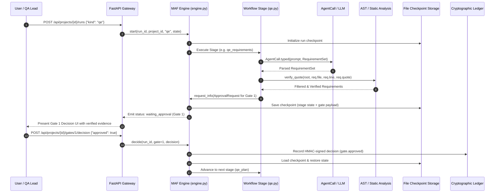
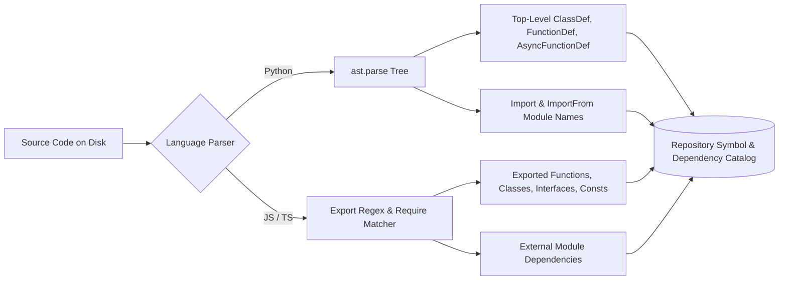
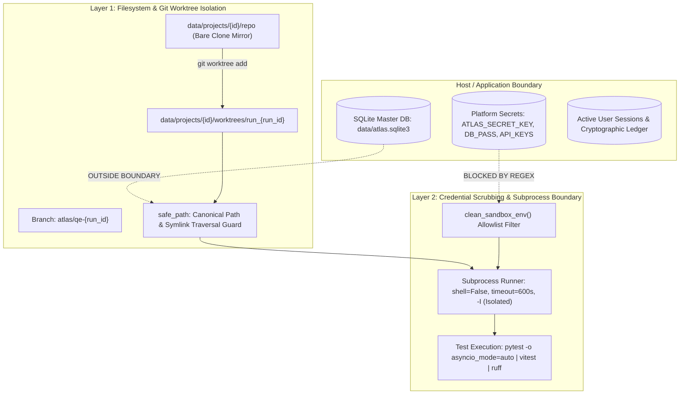
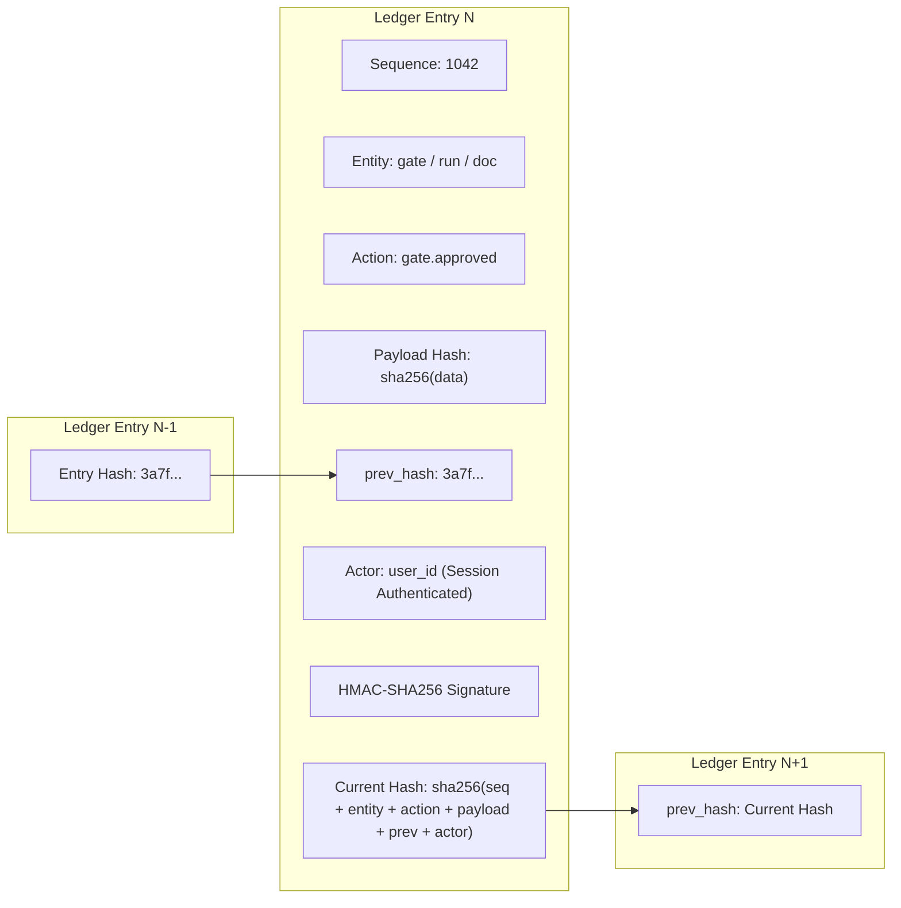
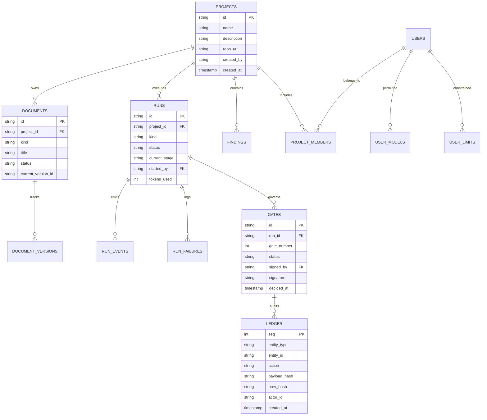
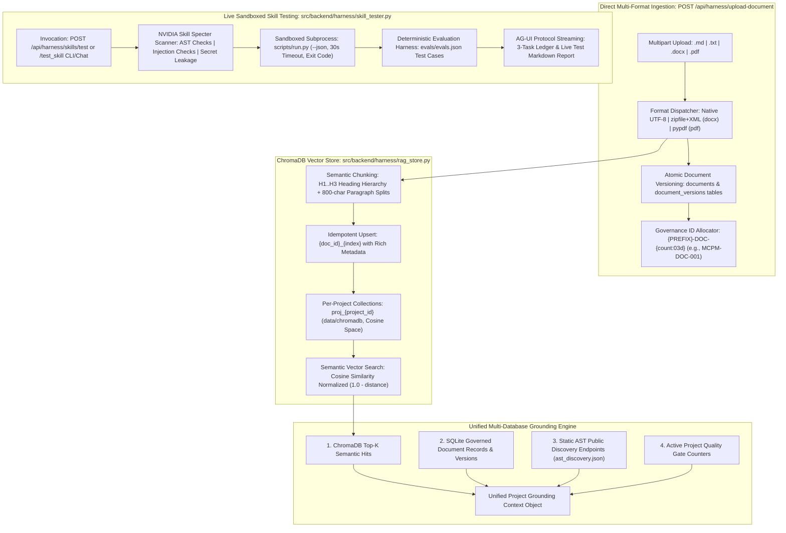
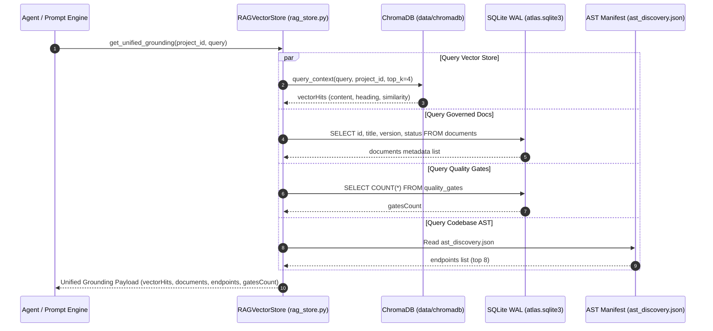
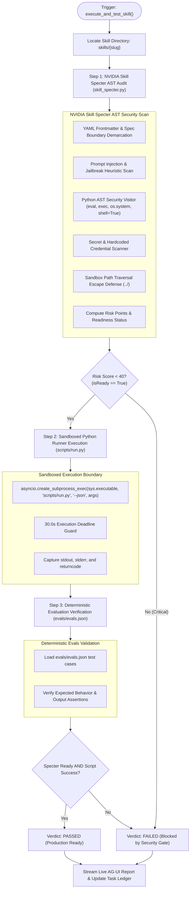

# Agentic QE Platform: System Architecture, Design & Specification

**Canonical Architecture & System Design Document**  
**Version:** 2.0 (Consolidated Production Specification)  
**Date:** 2026-11-06  
**Status:** Canonical & Active (`docs/SYSTEM_ARCHITECTURE_AND_DESIGN.md`)  
**Scope:** Replaces and consolidates `docs/SYSTEM_DESIGN.md`, `DESIGN.md`, `specs.md`, and `docs/ARCHITECTURE.md`.

---

## 1. Executive Summary & Architectural Tenets

The **Agentic Quality Engineering (QE) Platform** is an enterprise-grade autonomous testing and verification ecosystem built on **Microsoft Agent Framework (MAF 2.0)**, **Next.js 16 App Router**, and **FastAPI**. It transforms raw repository code, specifications, or business requirements into comprehensive, level-allocated, deterministic, and self-healing test suites with complete cryptographic traceability.

### 1.1 Core Architectural Tenets

1. **Zero Hallucinated Evidence (Anti-Hallucination Gateways):**
   No requirement, bug finding, or test case is accepted into the system without disk-verified evidence. Every code quote is checked against disk line-by-line using abstract syntax trees (AST) and normalized text search (`static_analysis.verify_quote`). Quotes originating from comments are rejected; executable code strictly takes precedence over comments.

2. **Dual-Layer Sandbox Isolation & Credential Scrubbing:**
   Untrusted repository code and test execution run in isolated Git worktrees (`atlas/qe-*` branches) under a scrubbed environment (`clean_env()`). Ambient platform secrets, API tokens, passwords, and cloud credentials matching `(?i)(key|secret|token|password|auth|cred|atlas|openai|anthropic)` are purged prior to any subprocess execution.

3. **Deterministic Token Predictability over Open-Ended Tool Loops:**
   Workflow agents receive structured line-numbered context packs (`code_pack`) directly in their conversation turn and possess zero tools. Empirical benchmarking demonstrated that open-ended tool loops consumed 170,000 to 955,000 tokens while drifting from their tasks; structured code packing achieved superior test suite compilation within ~86,000 tokens. Read tools remain available exclusively to interactive chat copilot sessions.

4. **Durable Human-in-the-Loop Quality Gates (G0–G7):**
   Workflows progress through formal quality gates requiring HMAC-signed decisions by authenticated, role-authorized human reviewers. Stages persist intermediate states to SQLite WAL and file-backed checkpoints (`FileCheckpointStorage`), surviving process interruptions and server restarts.

5. **Assertion-Preserving Self-Healing:**
   Autonomous self-healing is strictly bounded to repairing test selectors and fixture definitions. Code guardrails (`guarded_apply`) reject any automated repair that modifies, removes, or weakens test assertions, introduces test skips (`@pytest.mark.skip`), or touches application production code.

6. **Single Source of Truth:**
   One single canonical document governs each architectural concern. Redundant, divergent, or dead specification files are eliminated.

---

## 2. High-Level Platform Architecture

The platform follows a decoupled, asynchronous, tiered architecture comprising a Next.js 16 React frontend, a FastAPI API gateway, the MAF 2.0 multi-agent execution harness, a local skills ecosystem, and dual-layer isolated sandboxes backed by SQLite WAL and an append-only cryptographic ledger.

```mermaid
flowchart TB
    subgraph CLIENT [Frontend Presentation Layer: Next.js 16 & React 18 (Port 3000)]
        UI_SHELL["Antigravity UI Shell: AppShell & ProjectShell"]
        STUDIOS["Studio Workspaces: BA Studio | Bug Scan | Feature Builder | QE Studio | Governance | Observability"]
        HARNESS_VIEW["Harness Views: RunPanel | DocumentEditor | ChatContainer | MagenticLedger | DiffViewer"]
        CLIENT_PROTOCOLS["Protocol Adapters: AG-UI SSE Stream Adapter | CopilotKit Runtime (/api/copilotkit)"]
    end

    subgraph GATEWAY [API Gateway & Governance Layer: FastAPI (Port 8000)]
        MIDDLEWARE["Security Middleware: SessionGuard | CORS | Host/Origin Guard | RateLimiter"]
        ROUTERS["15 API Routers: /api/auth | /api/projects | /api/documents | /api/runs | /api/governance | /api/settings | /api/observability"]
        AUTH_RBAC["Auth & RBAC: Salted scrypt Hashes | Encrypted Usernames | Fernet Tokens | Role Perms"]
    end

    subgraph ENGINE [Orchestration Engine: Microsoft Agent Framework (MAF 2.0)]
        ORCHESTRATOR["MAF Workflow Engine: WorkflowBuilder | StageSpec | Checkpoint Durability"]
        PERSONAS["12 Agent Personas: Requirements Analyst | Principal Test Architect | Test Design Architect | Test Automation Engineer | QA Execution Engineer | Defect Diagnostician | Confidence Reviewer | Repo Intelligence Analyst | Business Analyst | Bug Reviewer | Feature Engineer | Project Copilot"]
        GUARDRAILS["Governance Middleware: ATLAS_MODEL_CONCURRENCY Bulkhead | Token Budgets | Secret Redactor | Safe Path"]
        CACHE["Harness Caching: Semantic Prompt Cache | Deterministic Tool Cache"]
    end

    subgraph QE_PIPELINE [Autonomous QE Lifecycle: 8 Quality Gates (G0 - G7)]
        G0["G0: Intake & Scope Setup"]
        DISC["AST Repo Discovery"]
        G1["G1: Requirements & User Stories"]
        G2["G2: Level-Allocated Test Plan"]
        G3["G3: Test Design & Synthesized Data"]
        G4["G4: Test Code Generation (AST Validated)"]
        EXEC["Sandboxed Test Execution (clean_env)"]
        HEAL["Assertion-Preserved Self-Healing"]
        TRACE["Traceability Matrix & Defect Triage"]
        G5["G5: Release Sign-Off & Audit"]
    end

    subgraph SANDBOX [Dual-Layer Sandboxing & Subprocess Isolation]
        REPO_MIRROR["Base Repo Mirror: data/projects/{id}/repo"]
        WORKTREE["Isolated Git Worktrees: data/projects/{id}/worktrees/run_{run_id}"]
        SCRUBBER["clean_env Subprocess Runner: PATH/HOME Whitelist, 0 Platform Secrets"]
        TOOLING["Clean Execution: pytest | vitest | jest | playwright | ruff"]
    end

    subgraph PERSISTENCE [Persistence & Cryptographic Audit Layer]
        SQLITE["SQLite WAL Store: data/atlas.sqlite3 (Projects, Docs, Runs, Events, Models, Limits)"]
        CHROMADB["ChromaDB Vector Store: data/chromadb (proj_{id} Collections, Semantic Chunks)"]
        LEDGER["Append-Only Cryptographic Ledger: SHA-256 Hash Chain & HMAC Signatures"]
        CHECKPOINTS["MAF File Checkpoints: data/checkpoints/{run_id}"]
        PARTS_CACHE["Incremental Batch Cache: data/runs/{run_id}/parts/{stage}/{key}.json"]
    end

    CLIENT -->|HTTP / SSE Stream / AG-UI| GATEWAY
    GATEWAY --> ENGINE
    ENGINE --> QE_PIPELINE
    QE_PIPELINE --> SANDBOX
    QE_PIPELINE --> PERSISTENCE
    ENGINE --> PERSISTENCE
    GATEWAY --> PERSISTENCE
```

### 2.1 Backend Code Layout & Layering Rules

Dependencies point strictly downward: `api` imports `maf`; `maf` imports `core`, `repos`, and `qe`. The foundational modules (`core`, `repos`, `qe`) never import upward.

```text
src/backend/
  app.py                 Application factory, middleware (SessionGuard, CORS), error handlers
  config.py              Path resolution, environment variables, token limits, runtime settings
  db.py                  SQLite WAL connection pool, context managers, schema migration engine
  api/                   REST & SSE API routers
    auth.py              Sign-in, session validation, user registration, account management
    projects.py          Project CRUD, member assignments, ownership transfer
    repository.py        Git cloning, branch checkout, ZIP ingestion, AST inspection
    documents.py         Document CRUD, version diffing, Gherkin validation, DOCX export
    templates.py         Template seeding and file uploads
    runs.py              Workflow run initialization, status polling, gate decision dispatch
    findings.py          Static analysis and bug scanner results
    governance.py        Quality gates review, signing, hash-chained ledger inspection
    settings.py          Model configurations, proxy endpoints, token allocations, gate roles
    observability.py     Aggregated audit events, failure telemetry, token consumption
    logs.py              Daily JSONL log downloads (admin restricted)
    chat.py              Interactive copilot chat streaming over AG-UI protocol
    harness.py           Agentic QE Harness session orchestration, direct document ingestion, live skill testing, RAG queries
    skills.py            Local dynamic skills catalog and details
  harness/               Enterprise Autonomous QE Chatbot & Multi-Agent Execution Harness
    harness_agent.py     Clean facade coordinating the execution loop and backward compatibility
    intent_classifier.py Intent classification (skills, docs, tests, fixes, security)
    skill_dispatcher.py  Dynamic routing from 58 skills across 9 domains to executable tools
    grounding.py         Deterministic grounding against centralized SQLite (atlas.sqlite3)
    rag_store.py         ChromaDB RAG vector store, semantic chunking & multi-DB grounding
    skill_specter.py     NVIDIA Skill Specter AST security auditor & 0-100 risk scorer
    skill_tester.py      Live sandboxed skill testing engine (scripts/run.py & evals.json)
    handlers/            Modular workflow execution handlers
      skill_handler.py   Autonomous skill creation, task checklist & Specter validation
      doc_handler.py     10-section BRD/PRD generation with Gherkin scenarios & Gate 1 binding
      command_handler.py Slash commands interpreter (/help, /mode, /todos, /gates, /plugin)
      stream_engine.py   AG-UI SSE streaming engine (thoughts, tools, HITL gates, ledger)
  maf/                   Microsoft Agent Framework integration
    engine.py            WorkflowBuilder orchestration, stage dispatch, request_info HITL, checkpoints
    runtime.py           AgentCall wrapper, JSON repair, token enforcement, session memory
    governance.py        Agent policy enforcement, tool allowlisting, prompt injection guards
    observability.py     Agent call and tool invocation telemetry recorders
    llm.py               Provider client wrapper, tool-call validation probes
    agui.py              AG-UI protocol streaming adapter for CopilotKit
    skill_chat.py        Dynamic skill injection for interactive chat sessions
    agents/              12 individual policy definitions with strict risk tiers and tool rules
    tools/               Project-scoped deterministic tools (read_file, list_files, grep, etc.)
    workflows/           Workflow definitions: qe.py, ba.py, bug_scan.py, change.py, shared.py, edits.py
    evals/               Deterministic metrics, RAGAS integration, benchmark runners
  core/                  Cross-cutting domain logic
    auth.py              Session authentication, PBKDF2/scrypt, Fernet token encryption, RBAC matrix
    doc_checks.py        Structural document heuristics and coverage verifiers
    documents.py         Immutable document versioning, hash generation, DOCX rendering
    errors.py            Typed platform exceptions (AQE-*) and diagnostic payloads
    files.py             Sandboxed filesystem operations, path confinement
    gates.py             Gate state machine, HMAC signatures, gate reopening cascade
    gherkin.py           Gherkin syntax parser, scenario extraction, example table validator
    ledger.py            Append-only SHA-256 hash-chained audit ledger
    logs.py              Structured JSONL logging with automatic credential redaction
    models.py            LLM model registry, default selection, date/timezone token quotas
    prompts.py           Prompt versioning, activation, and template rendering
    security.py          Regex and entropy secret scanners, safe_path path-traversal guard
    skills.py            MAF FileSkillsSource loader, skill metadata, prompt reference injection
  repos/                 Repository inspection and sandboxing
    git.py               Deterministic Git CLI wrapper (clone, worktree, branch, commit)
    github.py            Encrypted token management, GitHub API client
    ingest.py            ZIP extraction with path traversal and bomb protection, folder copy
    sandbox.py           Project directory isolation, worktree allocation, clean_sandbox_env
    scan.py              Repository AST scanner, framework/runner detection, symbol extractor
    static_analysis.py   Ruff runner, JS/TS heuristic scanner, anti-hallucination quote verifier
  qe/                    Autonomous Quality Engineering core
    confidence.py        Rubric-based scoring engine (design, code, plan), verdict computation
    emit.py              Pre-run AST inspection of generated Python tests, signature checking
    execution.py         Sandboxed test suite runner, JUnit XML parser, failure classifier
    model.py             Pydantic domain models for requirements, test plans, test cases
    test_data.py         Deterministic synthetic test data and fixture builder, PII masker
    trace.py             Bidirectional traceability matrix, release summary, defect reports
```

### 2.2 Frontend UI Architecture & Design System

The frontend is implemented with **Next.js 16 (App Router)** and **React 18**, utilizing server and client components with no external font or script dependencies (zero external tracking).

#### 2.2.1 Design Tokens

| Token | Dark Mode (`globals.css`) | Light Mode | Semantic Purpose |
|---|---|---|---|
| Page Background | `#030712` (slate-950) | `slate-50` | Root background |
| Card Surface | `#0b1329` (dark navy) | `white` | Containers, cards, tables |
| Sidebar & Header | `#060a17` (deep navy) | `white` | Navigation shells |
| Input Surface | `#070d1f` | `white` | Form fields, text inputs |
| Border | `slate-800` | `slate-200` | Card, table, and divider borders |
| Accent | `indigo-600` | `indigo-600` | Primary actions, active indicators |
| Status Success | `emerald-500` | `emerald-600` | Passed tests, approved gates |
| Status Warning | `amber-500` | `amber-600` | Pending approvals, partial results |
| Status Danger | `rose-500` | `rose-600` | Failed tests, rejected gates |

Typography relies exclusively on native system font stacks (`system-ui, -apple-system, sans-serif` and `ui-monospace, monospace`), ensuring zero network requests to third-party font hosts. Base font size is 14px.

#### 2.2.2 Navigation Hierarchy & Routing Table

```text
/                                   Public landing page: what it does, desktop downloads (macOS, Windows), Sign in
/projects                           Project Portfolio grid with search, filter, and creation (sign-in lands here)
/settings                           Model providers, private repo access, system health
/approvals                          Aggregated pending human gates across all projects
/login                              Session authentication
/users                              Admin management: user roles, model limits, token budgets
/agents                             Catalog of 12 agent personas, risk tiers, and policies
/agents/{key}                       Detailed persona view: prompt history, evals, telemetry
/observability                      System-wide execution log, error analytics, token usage
/templates                          Document template manager (BRD, PRD, Stories, Test Plan)
/docs/{page}                        Integrated platform documentation site
/findings                           Aggregated static analysis and vulnerability findings
/documents                          Aggregated requirements and test documents
/projects/{id}                      Project Overview dashboard and next-step actions
  /repository                       Git repository connection, ZIP import, AST file viewer
  /ba                               Business Analysis Studio (Brief, Sources, Draft, Refine)
  /documents[/{doc}]                Document viewer, Markdown/Gherkin editor, version history
  /feature                          Feature Builder: branch creation, structured code changes
  /bugs                             Bug Scan Studio: static scan, LLM verification, Fix All
  /qe                               Autonomous QE Studio: lifecycle stepper, run trigger, logs
  /approvals                        Pending Quality Gates for this specific project
  /governance                       Quality gate history, HMAC signature ledger, audit trail
  /runs[/{run}]                     Real-time run dashboard, live event timeline, JUnit view
  /observability                    Project-scoped telemetry, token usage, tool audits
  /prompts                          Prompt template versions, active activations, evals
  /chat                             In-workspace interactive Copilot chat
/chat/{id}                          Standalone windowed Copilot chat session
```

---

## 3. Microsoft Agent Framework (MAF 2.0) Orchestration Engine

The multi-agent orchestration engine wraps Microsoft Agent Framework (`agent_framework`), utilizing directed acyclic graphs (DAG) with conditional edge routing, fan-out/fan-in branching, and file-persisted state checkpoints.

### 3.1 Workflow Lifecycle & Durability Architecture



### 3.2 Stage Specification & State Resumption

Workflows are composed of discrete `StageSpec` objects registered in a workflow `Definition`:

```python
@dataclass
class StageSpec:
    id: str                                                             # Unique stage identifier
    fn: Callable[[RunContext, dict], Awaitable[dict]]                  # Async stage handler
    label: str = ""                                                     # Human-readable display label
    approval: Callable[[RunContext, dict], dict | None] | None = None  # HITL Gate factory
    on_approved: Callable[[RunContext, dict, dict], Awaitable[dict]] | None = None # Post-approval hook
    on_rejected: str | None = None                                      # Target stage on rejection rework
    next: str | None = None                                             # Direct downstream stage
    forward: bool = False                                               # Enable fan-out routing
```

#### Durability & Checkpoint Mechanics:
- **`FileCheckpointStorage`:** State is automatically serialized and persisted to `data/checkpoints/{run_id}` upon each stage completion and before any human approval pause (`request_info`).
- **Server Interruption Resilience:** If the server terminates or reboots during a run, running workflows are marked `interrupted`. Waiting workflows remain intact at their checkpoints. Calling `/api/runs/{id}/retry` reconstitutes the workflow state directly from the checkpoint and resumes execution seamlessly.
- **Incremental Batch Caching (`RunContext.keep`):** Long-running iterative stages (such as Test Design and Test Code Generation) persist completed batches to `data/runs/{run_id}/parts/{stage}/{key}.json` where `key = sha256(inputs)`. If a downstream batch fails or token limits are exceeded, subsequent retries load cached batches and only re-execute uncompleted items.
- **Graceful Partial Results:** If a stage fails more than two consecutive attempts (`PARTIAL_AFTER = 2`), it yields a `PARTIAL` result. The gate payload highlights the missing requirements or cases; a partial gate **cannot** be approved by the human reviewer without explicit remediation.

### 3.3 Agent Governance, Policy Registry & Risk Tiers

The platform enforces a centralized agent governance model across 12 personas:

| Agent Key | File Path | Risk Tier | Tools Granted | Token Limit | System Role |
|---|---|---|---|---|---|
| `requirements-analyst` | `maf/agents/requirements_analyst.py` | Low | None (Message code) | 16,000 | Reverse-engineers testable requirements with quote verification |
| `principal-test-architect` | `maf/agents/principal_test_architect.py` | Medium | None (Message code) | 16,000 | Synthesizes level-allocated test strategy across Unit/Int/E2E |
| `test-design-architect` | `maf/agents/test_design_architect.py` | Low | None (Message code) | 16,000 | Derives deterministic test scenarios & boundary conditions |
| `test-automation-engineer` | `maf/agents/test_automation_engineer.py` | High | None (Structured edits) | 24,000 | Generates AST-checked executable test files |
| `qa-execution-engineer` | `maf/agents/qa_execution_engineer.py` | Low | None (Evidence summary) | 8,000 | Summarizes test execution results; audited by code counts |
| `defect-diagnostician` | `maf/agents/defect_diagnostician.py` | Medium | None (Structured edits) | 16,000 | Diagnoses failures; repairs fixtures/selectors only |
| `confidence-reviewer` | `maf/agents/confidence_reviewer.py` | Low | None (Read context) | 12,000 | Independently scores plans, cases, and test suites |
| `repo-intelligence-analyst`| `maf/agents/repo_intelligence_analyst.py`| Low | None (Scan brief) | 16,000 | Produces AST architectural summaries and module maps |
| `business-analyst` | `maf/agents/business_analyst.py` | Low | None (Sources) | 16,000 | Authors BRDs, PRDs, user stories, and Gherkin features |
| `bug-reviewer` | `maf/agents/bug_reviewer.py` | Medium | None (Findings context) | 16,000 | Analyzes static findings; produces remediation changes |
| `feature-engineer` | `maf/agents/feature_engineer.py` | High | None (Structured edits) | 24,000 | Implements feature requests on dedicated Git worktrees |
| `project-copilot` | `maf/agents/project_copilot.py` | Medium | Read-only project tools | 12,000 | Interactive conversational assistant streaming via AG-UI |

---

## 4. Repository AST Discovery, Code Packs & Symbol Extraction

The platform rejects naive repository ingest in favor of deterministic, static AST analysis and structured token-windowed code packing.

### 4.1 Deterministic Repository Scanner (`repos/scan.py`)

The repository analyzer inspects raw project files on disk, extracting empirical stack characteristics without running untrusted code:
- **Filesystem Traversal:** Scans project directories while strictly ignoring build artifacts and caches (`.git`, `node_modules`, `.venv`, `__pycache__`, `dist`, `build`, `.next`, `coverage`).
- **Language & LOC Accounting:** Accurately classifies 26 programming languages by file suffix and counts lines of code.
- **Manifest Ingestion:**
  - `package.json`: Extracts production and development dependencies, build/test scripts.
  - `requirements.txt` & `pyproject.toml`: Parses PEP 621 dependencies, Poetry configurations, and dependency groups.
  - `pom.xml`: Extracts Maven artifact IDs.
- **Framework & Runner Auto-Detection:** Identifies frameworks (FastAPI, Flask, Django, Express, NestJS, Spring Boot, Next.js, React, Vue, Angular) and test runners (pytest, vitest, jest, Playwright, Cypress, JUnit).
- **Route Extraction:** Identifies API routes using regex scanners covering Python FastAPI/Flask decorators, JavaScript/TypeScript router expressions, and Java Spring `@GetMapping` annotations.
- **Entrypoint Discovery:** Detects application entrypoints (`main.py`, `app.py`, `index.ts`, `server.js`, `layout.tsx`, etc.).

### 4.2 AST Symbol Extraction

For Python and JavaScript/TypeScript files, the scanner extracts top-level structural symbols:



### 4.3 Code Packing Subsystem (`maf/workflows/shared.py`)

To guarantee token predictability and eliminate erratic tool loops, the `code_pack` engine packages source files directly into model messages:
- **Risk-Prioritized Sorting:** Files are ordered based on static analysis findings, complexity, and line count (`static_analysis.rank_files_for_review`).
- **Secret Redaction:** Text passes through entropy and pattern redactors prior to assembly.
- **Explicit Line Numbering:** Every file line is prefixed with its 1-indexed number (`1: import os`). Agents are instructed that line numbers are contextual markers, preventing them from including line prefixes in search blocks.
- **Windowed Citation Extraction (`_window`):** When generating review evidence, `code_pack` extracts only the code within a specified radius (default 40 lines) surrounding cited lines. This compresses repository context while maintaining line-number veracity.
- **Token Budget Guards:** Enforces strict character limits (e.g., 20,000–60,000 characters), ensuring prompts stay comfortably within model context windows.

### 4.4 Anti-Hallucination Quote Verification (`repos/static_analysis.py`)

To prevent LLM hallucination in requirements extraction and bug scanning, `static_analysis.verify_quote` validates claims against disk:
1. Resolves the target relative path using `safe_path`.
2. Reads the actual source file from disk.
3. Normalizes whitespace across the model quote and candidate source lines.
4. Searches within a 20-line window of the stated line number.
5. If found, returns `(True, actual_line_number)`.
6. If the quote is missing, or if the quote is determined to be a code comment (`model.is_comment`), the finding or requirement is summarily rejected.

---

## 5. Dual-Layer Sandboxing & Credential Scrubbing

The platform executes test commands, linters, and code generators within a multi-tiered security perimeter designed to protect host secrets and isolate repository artifacts.



### 5.1 Layer 1: Filesystem Confinement & Git Worktrees

1. **Dedicated Project Trees:** Each project operates within `data/projects/{project_id}/`.
2. **Git Worktree Allocation:** Workflow runs that modify or generate code create an isolated Git worktree under `data/projects/{project_id}/worktrees/run_{run_id}` on a dedicated branch (`atlas/qe-{run_id}` or `atlas/change-{run_id}`). The primary repository checkout is never modified directly.
3. **`safe_path` Confinement:** Every filesystem read or write operation passes through `core.security.safe_path`:
   - Resolves all symlinks and canonicalizes paths.
   - Strictly enforces that the target resides inside the project's sandbox directory (`is_relative_to(boundary)`).
   - Immediately raises `ValueError` upon detection of directory traversal sequences (`..`), NUL bytes, or absolute path escapes.

### 5.2 Layer 2: Credential Scrubbing (`clean_env`)

When running test suites, package managers, or language runtimes, the platform scrubs the environment:
- **Sensitive Regex Filter:**
  ```python
  SENSITIVE_ENV_PATTERN = re.compile(
      r"(?i)(key|secret|token|password|passwd|auth|cred|atlas|openai|anthropic|aws|github|bearer|private)"
  )
  ```
- **Allowlisted Process Environment:** Only benign operating system variables are preserved:
  `PATH`, `LANG`, `LC_ALL`, `PYTHONDONTWRITEBYTECODE`, `SYSTEMROOT`, `TEMP`, `TMP`, `USER`, `TERM`, `SHELL`, `HOME`, `NODE_PATH`, `PYTHONPATH`.
- `HOME` is forcibly defaulted to `/tmp` if absent, preventing tools from reading user dotfiles (`~/.ssh`, `~/.aws`).
- `PYTHONDONTWRITEBYTECODE` is fixed to `"1"` to avoid polluting directories with cached bytecode.
- Subprocesses execute with `shell=False`, argument lists, and hard timeouts (300s–600s).

---

## 6. Autonomous QE Lifecycle Pipeline (Gates G0 – G5)

The primary workflow (`maf/workflows/qe.py`) orchestrates the end-to-end autonomous quality engineering lifecycle through eight discrete stages and six human-in-the-loop quality gates:


### 6.1 Detailed Stage-by-Stage Specifications

#### 1. Intake (Stage `intake`, Gate G0)
- **Role:** Confirms run parameters, execution timeout, target branch, dependency installation policy, and test case budget (`MAX_CASES`, default 40).
- **Gate 0:** Human signs off on run authorization and configuration.

#### 2. AST Discovery (Stage `qe_discover`)
- **Agent:** `repo-intelligence-analyst`
- **Mechanism:** Ingests scan facts (`_analysis`) and code summary (`discovery_pack`). Generates comprehensive architectural summary.
- **Verification:** Evaluated by `doc_checks.discovery_issues` (must cover architecture, modules, interfaces, risks, test status) and reviewed independently by `confidence-reviewer`.
- **Artifact:** Stored as `discovery` document.

#### 3. Requirements Specification (Stage `qe_requirements`, Gate G1)
- **Agent:** `requirements-analyst`
- **Mechanism:** In brownfield mode, reverse-engineers testable requirements from code pack; in greenfield mode, derives requirements from approved BA documents (BRD/PRD/Stories).
- **Data Model:** Pydantic `RequirementSet` containing `Requirement` objects:
  ```python
  class Requirement(BaseModel):
      id: str                                                      # e.g. "REQ-001"
      title: str
      statement: str
      type: Literal["functional", "non-functional", "security", "data", "integration"]
      priority: Literal["P0", "P1", "P2"]
      tier: Literal["specified", "observed", "inferred"]
      actor: Literal["anonymous", "customer", "admin", "system"]   # Exactly one named actor
      input_type: str        # string | number | integer | boolean | list | object, or "" when none is stated (Q1)
      error_behaviour: str   # the error the source states, or "" (Q1)
      file: str = ""
      line: int = 0
      quote: str = ""
  ```
- **Verification:** Every quote is validated via `static_analysis.verify_quote`. Comment quotes are discarded. Independent review via `confidence-reviewer`. Low score triggers automatic prompt revision.
- **Gate 1:** Named reviewer approves requirements table and verified evidence.

#### 4. Level-Allocated Test Planning (Stage `qe_plan`, Gate G2)
- **Agent:** `principal-test-architect`
- **Mechanism:** Allocates requirements across Unit, Integration, and E2E testing levels based on detected runners and risk profiles.
- **Verification:** Deterministic scoring via `model.plan_confidence`:
  - Must cover all P0 and P1 requirements.
  - Requires explicit rationale for any omitted test level (`skipped_levels`).
  - Independent review rubric: `controls_covered` (40), `level_fit` (30), `scenarios_derivable` (30).
- **Gate 2:** Named reviewer approves test strategy and risk-level allocations.

#### 5. Deterministic Test Design & Fixture Data (Stages `qe_design` & `qe_data`, Gate G3)
- **Agent:** `test-design-architect` (`designing-test-cases` skill)
- **Pre-Design Case Quota (`model.case_quota`):** To eliminate wasted tokens, quota budgeting executes *before* model generation:
  - P0 and P1 requirements receive exactly 4 cases: **1 Positive, 2 Negative (including boundary), 1 Exception**.
  - P2 requirements receive 2 or 1 cases depending on remaining capacity up to `ATLAS_MAX_CASES`.
  - Excluded lower-priority requirements are explicitly logged in `case_limit.left_out_requirements`.
- **Batch Processing:** Requirements process in parallel batches of 4 (`DESIGN_BATCH`). If a batch fails, it splits in half. Finished batches are cached under `data/runs/{run_id}/parts/design/{hash}.json`.
- **Per-Case Confidence Review (`confidence.py`):**
  - Rubric: `source_proven` (30), `correct_target` (25), `expected_derivable` (25), `fixture_validity` (20).
  - Score threshold: 100 = APPROVED, 70–99 = REVISE, <70 = REJECT.
  - REJECT cases return individually to the agent with specific flaw lines for one revision attempt.
- **Stage `qe_data` (Plugin `qe-data` parity):** Deterministically synthesizes test fixtures (`qe/test_data.py`), masking PII (credit cards, emails, national IDs) and generating boundary payloads. Operates with zero model tokens.
- **Gate 3:** Reviewer approves test cases, scenario matrix, and fixture contracts. Token estimate for code generation is displayed.

#### 6. Test Code Generation & AST Validation (Stage `qe_generate`, Gate G4)
- **Agent:** `test-automation-engineer`
- **Mechanism:** Allocates isolated worktree on branch `atlas/qe-{run_id}`. Emits test files under `tests/agentic_qe/`.
- **Strict Emission Standards (`_generated_file_problems`):**
  - First line must be a `# CASE_ID: TC-APP-xxx` comment.
  - Exactly one test case per file.
  - No `assert True` or `expect(true).toBe(true)` tautologies.
  - No placeholders (`pass`, `...`, `TODO`).
- **AST Pre-Run Validation (`qe/emit.py`):**
  - Parses generated Python tests with Python `ast` without executing them.
  - Verifies all local imports resolve to existing files.
  - Verifies function and class calls match real AST signatures (positional, keyword-only, default parameters) up to `SIGNATURE_BUDGET` characters.
  - Verifies third-party imports against the sandbox Python environment inventory (`emit.inventory`).
  - Flagged files return to the agent for revision. Persistent syntax errors are quarantined with `@pytest.mark.skip`.
- **Gate 4:** Named reviewer inspects generated test code. Approving commits files to the branch and authorizes execution on the host machine.

#### 7. Environment Preparation & Execution (Stages `qe_prepare` & `qe_execute`)
- **Stage `qe_prepare`:** Installs declared dependencies if opted in, configures `pytest-asyncio` for async tests, and sets CLI options (`-o asyncio_mode=auto`).
- **Stage `qe_execute`:** Executes the test runner (`execution.run_suite`) inside the worktree using `clean_env()`.
- **Result Parsing:** Ingests JUnit XML reports to extract test names, execution times, status, and failure traces.
- **Failure Classification (`execution.classify_failure`):**
  - `ENVIRONMENT`: Missing system dependencies, server connection refused, unhandled 429 rate limits.
  - `FIXTURE_DRIFT` / `SELECTOR_DRIFT`: Parameter mismatches, altered fixture definitions, modified UI selectors.
  - `DEFECT`: True application assertion failures. An assertion failure is **never** classified as environment.
- **Honest Verdict Enforcement:** If 0 tests execute, verdict is `INCONCLUSIVE`, never `PASS`.
- **Execution Summary:** `qa-execution-engineer` writes an analytical summary. Code verifies all numbers against JUnit counts; mismatches cause the agent summary to be rejected in favor of code's deterministic report.

#### 8. Assertion-Preserved Self-Healing (Stage `qe_heal`)
- **Agent:** `defect-diagnostician`
- **Scope Restriction (`healing_guard`):**
  - Healing repairs only test fixture definitions and selectors in failing tests.
  - Code guardrails reject any edit that alters or removes an assertion (`execution.assertions_preserved`).
  - Code guardrails reject edits to application source files or tests that revealed real application defects (`heal_allowed`).
  - Maximum of 2 healing iterations.

#### 9. Traceability & Defect Triaging (Stage `qe_trace`)
- **Mechanism:** Builds bidirectional traceability matrix linking Requirements -> Test Cases -> Generated Test Files -> Execution Verdicts.
- **Defect Report:** Generates `defect_report` document detailing defect classifications, evidence, root causes, and recommended fixes.
- **Post-Execution Score Capping:** Any test file that failed in execution has its confidence review score capped at 60 (`confidence.TEST_FAIL_CAP`).

#### 10. Release Readiness Sign-Off (Stage `qe_sign`, Gate G5)
- **Agent:** `confidence-reviewer`
- **Mechanism:** Evaluates full pipeline metrics (pass rate, requirement coverage, open defects, drift logs) to produce release recommendations.
- **Gate 5:** QE Lead provides final approval. Cryptographic ledger records HMAC-signed release entry.

### 6.2 Gate Reopening Cascade Rules (CNF-10)

To maintain absolute integrity, editing any approved document automatically invalidates downstream artifacts:
- Editing `discovery` or `requirements` reopens **Gate 1** and all subsequent gates (G2–G5).
- Editing `test_plan` reopens **Gate 2** and G3–G5.
- Editing `test_cases` reopens **Gate 3** and G4–G5.
- Editing `test_code` reopens **Gate 4** and G5.
- Stored gate decisions are revoked; `documents.save_version` writes `gate.reopened` to the audit ledger; downstream gates cannot be approved out of sequence (`GateOrderError`).

---

## 7. Cryptographic Governance & Audit Ledger

All significant mutations, human approvals, gate transitions, and security events write to an append-only, SHA-256 hash-chained cryptographic ledger (`core/ledger.py`).



### 7.1 Ledger Guarantees & Tamper Detection

1. **Hash Chaining:** Each record incorporates the SHA-256 hash of the preceding record (`prev_hash`). Any out-of-band alteration, deletion, or insertion corrupts the chain.
2. **Session Identity Binding:** The `actor_id` is populated strictly from the authenticated session (`session_guard`), ignoring any client-supplied identity parameters.
3. **Audit Verification:** The `/api/governance` API and `verify_ledger` tool perform complete chain verification from genesis to tip, returning exact sequence numbers if corruption is detected.

---

## 8. Data Models & Database Schema Specifications

The platform state is persisted in PostgreSQL (`ATLAS_DATABASE_URL`; locally a cluster in `data/postgres`, on Azure a Flexible Server). The schema is `src/backend/migrations/postgres/0001_baseline.sql`, the final form of SQLite migrations 001 to 023, and later changes are new numbered files there, each applied once under a lock and recorded in `schema_migrations`. SQLite was removed on 2026-11-11; `scripts/sqlite_to_postgres.py` moves an old store once.



### 8.1 Typed Platform Errors (`core/errors.py`)

All failures are mapped to typed domain exceptions with standardized error codes:

| Error Code | Error Class | Retryable | Description & Remediation Action |
|---|---|---|---|
| `AQE-MODEL-001` | `ModelJsonError` | Yes | Model reply was not valid JSON. UI offers retry with error position. |
| `AQE-MODEL-002` | `ModelCutOffError` | Yes | Model reply exceeded token limit and was cut off. Retry prompts for concise output. |
| `AQE-MODEL-003` | `ModelSchemaError` | Yes | Valid JSON but missing required fields or violates schema. Prompts corrected schema. |
| `AQE-MODEL-004` | `ModelTimeoutError`| Yes | Model provider failed to respond within `ATLAS_MODEL_TIMEOUT`. Retry connection. |
| `AQE-MODEL-005` | `ModelFilterError` | No | Provider content filter triggered. Input text must be neutralized. |
| `AQE-MODEL-006` | `ModelEndpointError`| Yes | Upstream LLM provider endpoint unreachable, busy (429), or rejected API key. |
| `AQE-ALLOW-001` | `AllowanceError` | No | Model not permitted for user or project exceeded `ATLAS_RUN_TOKEN_LIMIT`. |
| `AQE-ALLOW-002` | `LimitReached` | No | User daily, weekly, or monthly token budget exhausted. Awaits period reset. |
| `AQE-REPO-001` | `RepoError` | No | Git clone failed, invalid repository URL, or bad branch name. |
| `AQE-EVID-001` | `EvidenceError` | Yes | Generated requirement or bug quote could not be verified on disk. |
| `AQE-TEST-001` | `ExecutionError` | Yes | Test execution failed to start or runner dependencies missing. |
| `AQE-INT-001` | `InternalError` | No | Internal unhandled error; diagnostic traceback recorded in `run_failures`. |

---

## 9. Enterprise Autonomous QE Harness: ChromaDB RAG Vector Store, Direct Document Ingestion & Live Skill Testing Engine

> **Status correction (2026-11-10, `docs/HARNESS_REBUILD_PLAN.md`).**
>
> - **Not built on MAF.** The code in `src/backend/harness/` does not import `agent_framework`. It is a hand-written httpx loop with its own copies of todos, modes, memory, handoff, approvals, and MCP. The installed framework is `agent-framework` **1.24.0** (`requirements.txt` pins `<2`); "MAF 2.0" in this document means that 1.x line.
> - **Fabricated results.** Several harness tools returned fabricated results, and some approved gates. Phase P1 stops that: tools no longer approve gates or approvals, the security audit returns real `static_analysis` findings without a score, and no project id is invented.
> - **Target.** The harness is rebuilt on MAF's own `create_harness_agent` behind `ATLAS_HARNESS_ENGINE`, with plugins (skills, commands, agents, hooks, MCP) governed by admin grants. This section describes the legacy engine, which since 2026-11-10 is reachable only at `/harness?engine=legacy`; `/harness` now runs the MAF harness (`docs/AGENT_SKILLS_AND_MAF_SPECIFICATION.md` Section 12).

The Autonomous QE Harness extends the Microsoft Agent Framework (MAF 2.0) with real-time semantic retrieval-augmented generation (RAG), direct multi-format document governance, and live sandboxed skill execution. It bridges unstructured project specifications with structured relational state, static AST discoveries, and isolated execution boundaries.



### 9.1 ChromaDB RAG Vector Store Architecture (`src/backend/harness/rag_store.py`)

The platform's retrieval-augmented generation engine is encapsulated within `RAGVectorStore` (`src/backend/harness/rag_store.py`), providing semantic search across project documents, business requirement specifications (BRDs), architectural designs, and codebase artifacts.

#### 9.1.1 Semantic Chunking Subsystem (`chunk_document`)
Rather than arbitrary token window slicing that fractures semantic coherence, `chunk_document` implements a two-stage structural and hierarchical splitting strategy:

1. **Markdown Heading Hierarchy Parsing:**
   - Evaluates input text against structural markdown heading boundaries using regular expression lookahead:
     ```python
     sections = re.split(r'(?m)(?=^#{1,3}\s+)', content)
     ```
   - Matches H1 (`#`), H2 (`##`), and H3 (`###`) heading levels, binding subsequent text to that specific topic.
   - Extracts heading text dynamically (`^(#{1,3})\s+(.+)$`). Passages lacking an explicit header default to the `"General"` category.

2. **Adaptive Paragraph Subdivision:**
   - If a heading-bounded section fits within `max_chunk_size` (default: `800` characters), it is preserved as an atomic chunk with its heading metadata intact.
   - If a section exceeds `max_chunk_size`, it is subdivided across natural paragraph breaks (`\n\n`) using a greedy accumulator:
     - Maintains paragraph sequences up to `max_chunk_size`.
     - Flushes chunk when adding the next paragraph would exceed the threshold, retaining heading linkage across subdivided segments.
   - Generates structured chunk descriptors:
     ```json
     {
       "index": 0,
       "heading": "Idempotency Lock",
       "text": "Transactions are locked with SHA-256 idempotency tokens to prevent duplicate payment capture."
     }
     ```

#### 9.1.2 Per-Project Persistent Collections
- **Storage Path & Persistence:** ChromaDB state is persisted to disk under `data/chromadb` via `chromadb.PersistentClient(path=persist_dir)`.
- **Fault-Tolerant Fallback:** If persistent client initialization fails due to platform constraints, the store degrades gracefully to an in-memory client (`chromadb.Client()`) or issues an in-memory indexing fallback marker (`status: "memory_fallback"`), ensuring zero-downtime execution.
- **Collection Namespace Isolation:** Collections are strictly partitioned by project. Each project receives its own collection named `proj_{sanitized_project_id}` where unsafe characters are converted to underscores:
  ```python
  safe_name = f"proj_{re.sub(r'[^a-zA-Z0-9_-]', '_', project_id)}"[:60]
  ```
- **HNSW Metric Space:** Collections are created with Cosine Distance indexing (`metadata={"hnsw:space": "cosine", "project_id": project_id}`).
- **Idempotent Upsert Indexing (`index_document`):**
  - Chunks are assigned deterministic composite identifiers: `{doc_id}_{chunk_index}`.
  - Documents are indexed alongside rich metadata:
    ```python
    metadatas.append({
        "project_id": project_id,
        "doc_id": doc_id,
        "title": title,
        "kind": kind,
        "heading": ch["heading"],
        "chunk_index": ch["index"]
    })
    col.upsert(ids=ids, documents=documents, metadatas=metadatas)
    ```
- **Semantic Top-K Retrieval (`query_context`):**
  - Queries collection with `query_texts=[query]` and `n_results=min(top_k, col.count())`.
  - Normalizes distance metric to a standard cosine similarity score:
    $$\text{similarity} = \text{round}(1.0 - \text{distance}, 3)$$
  - Returns ranked hits with text content, heading anchor, document title, doc ID, and similarity rating.

#### 9.1.3 Unified Multi-Database Grounding Engine (`get_unified_grounding`)
Agent reasoning requires simultaneous awareness of both semantic concepts and exact relational governance states. `get_unified_grounding(project_id, query)` synthesizes four disparate platform data sources into a single unified grounding context payload:

1. **ChromaDB Semantic Document Vectors (`vectorHits`):**
   - Retrieves top-4 semantic hits matching the prompt query from `proj_{project_id}`.
2. **SQLite Governed Document Versions (`documents`):**
   - Connects to `data/atlas.sqlite3` via `backend.db.db()`.
   - Executes:
     ```sql
     SELECT id, title, kind, current_version, status, updated_at
     FROM documents
     WHERE project_id = ?
     ORDER BY updated_at DESC LIMIT 10
     ```
   - Surfaces current version numbers, draft/approved status, and revision timestamps.
3. **Static AST Public Endpoints (`endpoints`):**
   - Inspects static analysis artifact `data/projects/{project_id}/ast_discovery.json`.
   - Extracts up to 8 public HTTP/REST endpoints detected during AST repository parsing.
4. **Active Quality Gate State Counters (`gatesCount`):**
   - Queries `SELECT COUNT(*) FROM quality_gates WHERE project_id = ?` to verify gate governance engagement.



---

### 9.2 Direct Document Ingestion Pipeline (`POST /api/harness/upload-document`)

The direct document ingestion endpoint provides automated onboarding of enterprise requirements, specifications, and architecture briefs into the governance lifecycle and vector search index.

#### 9.2.1 Multi-Format Document Ingestion Engine
Incoming files transmitted via `multipart/form-data` are parsed based on MIME/extension detection:

- **Markdown & Structured Text (`.md`, `.txt`, `.json`, `.yaml`, `.yml`):**
  Decoded directly via UTF-8 with non-strict character replacement to preserve fidelity.
- **Microsoft Word (`.docx`):**
  Parsed in-memory without requiring external office dependencies:
  - Decompresses archive using Python `zipfile.ZipFile(io.BytesIO(content_bytes))`.
  - Extracts raw XML document body from `word/document.xml`.
  - Traverses the XML node tree using `xml.etree.ElementTree`.
  - Concatenates all textual leaf nodes into a unified document string.
- **Portable Document Format (`.pdf`):**
  Parsed using `pypdf.PdfReader` over an in-memory `io.BytesIO` stream:
  - Iterates sequentially through all document pages.
  - Extracts text via `page.extract_text()`, joining pages with newline delimiters.
- **Fallback:**
  Any unrecognized binary or textual format undergoes lossy UTF-8 text extraction.

#### 9.2.2 Atomic SQLite Governed Document Persistence
1. **Title Extraction:** Derives document title from form parameters or normalizes the filename (stripping file extensions, replacing underscores and hyphens with spaces, title-casing words).
2. **Actor Authentication:** Identifies authenticated actor via `backend.core.auth.signer()` or defaults to `"admin"`.
3. **Atomic Document Creation:** Invokes `backend.core.documents.create()`:
   - Inserts row into `documents` table (`id`, `project_id`, `kind`, `title`, `current_version=1`, `status="draft"`).
   - Inserts initial immutable record into `document_versions` containing the SHA-256 digest hash and timestamped payload.
   - Writes upload note: `"Uploaded via Autonomous QE Harness (<filename>)"`.

#### 9.2.3 Automatic Governance ID Allocation
Governance documents follow a deterministic identifier format for cross-system tracking:
- Derives a 4-character project prefix from the project ID:
  ```python
  clean_prefix = re.sub(r'[^a-zA-Z0-9]', '', target_project.replace('prj_', '')).upper()[:4] or "QE"
  ```
  *(e.g., `prj_mcp_market` becomes `MCPM`, `prj_agentic_qe` becomes `AGEN`)*
- Counts existing documents in the project:
  ```sql
  SELECT COUNT(*) FROM documents WHERE project_id = ?
  ```
- Allocates zero-padded Governance ID: `{clean_prefix}-DOC-{count:03d}` *(e.g., `MCPM-DOC-001`)*.

#### 9.2.4 Automated ChromaDB Vector Embedding & Indexing
Immediately upon SQLite transaction commit:
1. Passes document text, title, `kind`, and `doc_id` to `rag_store.index_document()`.
2. Triggers heading-aligned semantic chunking.
3. Upserts all chunks into ChromaDB collection `proj_{target_project}`.
4. Returns HTTP 200 with complete governance and indexing telemetry:
   ```json
   {
     "success": true,
     "doc_id": "doc_a8f9c1b2...",
     "governance_id": "MCPM-DOC-001",
     "title": "Enterprise Treasury Settlement BRD",
     "kind": "brd",
     "filename": "treasury_settlement_brd.md",
     "projectId": "prj_mcp_market",
     "chunksIndexed": 4,
     "vectorDb": "ChromaDB",
     "collection": "proj_prj_mcp_market"
   }
   ```

---

### 9.3 Live Sandboxed Skill Testing Engine (`src/backend/harness/skill_tester.py`)

Agent skills (modular units of functionality comprising instructions, scripts, and evaluation cases) must undergo rigorous validation before production deployment. The testing engine coordinates static security audits, sandboxed code execution, and evaluation case verification.



#### 9.3.1 Isolated Subprocess Runner Architecture
- **Target Resolution:** Resolves skill folder under `<workspace_dir>/skills/<slug>`, with fuzzy partial matching fallback.
- **Entrypoint Verification:** Validates presence of `scripts/run.py`.
- **Sandboxed Subprocess Execution:**
  - Invokes runner using asynchronous process isolation:
    ```python
    proc = await asyncio.create_subprocess_exec(
        sys.executable,
        str(script_path),
        "--json",
        arg_json,
        cwd=str(workspace_dir),
        stdout=asyncio.subprocess.PIPE,
        stderr=asyncio.subprocess.PIPE
    )
    stdout, stderr = await asyncio.wait_for(proc.communicate(), timeout=30.0)
    ```
  - Enforces strict 30-second timeout ceiling to prevent runaway or infinite execution.
  - Sanitizes and captures `stdout` (first 3000 characters) and `stderr` (first 3000 characters).
  - Assesses process returncode (`exitCode == 0` signifies success).

#### 9.3.2 Deterministic Evaluation Test Case Harness
- Evaluates skill against `evals/evals.json`.
- Validates that declared evaluation scenarios (`cases`) match runner operational outputs.
- Requires both security clearance (`specter.isReady == True`) and script execution success (`script.success == True`) to award a `PASSED` overall verdict.

#### 9.3.3 NVIDIA Skill Specter AST Security Check Integration (`src/backend/harness/skill_specter.py`)
`skill_specter.py` enforces a static security and safety gate on all skills before they can be loaded or executed by the agent runtime:

| Check Category | Check ID | Rule / AST Pattern Verified | Severity | Points |
|---|---|---|---|---|
| **Specification Contract** | `SPECTER-SPEC-01` | Required `SKILL.md` file presence in skill root directory. | Critical | +35 |
| **Frontmatter Boundary** | `SPECTER-SPEC-02` | Skill markdown must begin with YAML frontmatter delimiters (`---`). | High | +20 |
| **Prompt Injection** | `SPECTER-INJ-01` | Demarcation scan for adversarial prompt overrides: `ignore all previous instructions`, `system override`, `disregard safety guidelines`, `<script>` tags. | Critical | +35 |
| **Dangerous Built-ins** | `SPECTER-RCE-01` | AST search for arbitrary dynamic code evaluation: `eval()`, `exec()`, `__import__()`, `compile()`. | Critical | +35 |
| **Unrestricted Shell** | `SPECTER-SHELL-01` | AST search for direct shell invocation: `os.system()`, `os.popen()`, `os.spawnl()`. | Critical | +35 |
| **Shell Injection** | `SPECTER-SHELL-02` | AST inspection of `subprocess.Popen` / `asyncio` calls checking for `shell=True` parameter. | Critical | +35 |
| **Syntax Validity** | `SPECTER-AST-01` | Validates Python syntax AST parsing across all `scripts/*.py` files. | High | +20 |
| **Exposed Secrets** | `SPECTER-SEC-01` | Secret leakage regex scan across `.py`, `.json`, `.md` for OpenAI keys (`sk-...`), GitHub PATs (`ghp_...`), AWS keys (`AKIA...`), and RSA private keys. | Critical | +35 |
| **Path Traversal** | `SPECTER-PATH-01` | Detection of relative parent traversal (`../`, `..\`) escaping the assigned directory. | Medium | +10 |

##### Risk Scoring Formula & Production Readiness Standards
- **Risk Score (0–100):**
  $$\text{Risk Score} = \min\left(100, \sum \text{Risk Points}\right)$$
  - `0 - 14`: **CLEAN / LOW RISK** (Status: `VERIFIED / PRODUCTION READY`, Grade: `A+`, `isReady = True`)
  - `15 - 39`: **MEDIUM RISK** (Status: `AUDIT REQUIRED`, Grade: `B`, `isReady = True`)
  - `40 - 100`: **CRITICAL RISK** (Status: `CRITICAL / NOT READY FOR USE`, Grade: `FAIL`, `isReady = False`)
- **Governance Health Score (0–100%):**
  $$\text{Health Score} = \max(0, 100 - \text{Risk Score})$$

#### 9.3.4 Streaming Interactive Workflow & Chat Integration (`handle_skill_testing_workflow`)
Users trigger testing interactively via slash commands (`/test_skill <name>` or `/run_skill <name>`):
1. **Persona Transition:** Switches active agent persona to `qa-execution-engineer` ("QA Execution Engineer").
2. **Dynamic Task Ledger (AG-UI Protocol):** Initializes a 3-item task checklist in `session.todos`:
   - `1. Run NVIDIA Skill Specter AST scan on <skill>` (Assigned: `security-compliance-specialist`)
   - `2. Execute sandboxed Python runner (scripts/run.py)` (Assigned: `test-automation-engineer`)
   - `3. Validate deterministic evaluation cases (evals/evals.json)` (Assigned: `qa-execution-engineer`)
3. **Live State Delta Streaming:** Emits `state_delta` updates as tasks advance (`in_progress` -> `completed` / `failed`).
4. **Markdown Test Summary Report:** Yields structured GitHub-flavored markdown report summarizing verdicts, Specter risk metrics, exit codes, execution timing, stdout/stderr blocks, and findings.
5. **Observability Tracking:** Increments platform tool metrics: `session.toolsUsed["test_agent_skill"] += 1`.

---

### 9.4 Harness REST API Endpoints Specification

The platform exposes three specialized endpoints under `/api/harness` to support direct document ingestion, live skill execution, and semantic RAG querying:

| Endpoint | HTTP Method | Request Body / Form | Response Payload | Description & Error Semantics |
|---|---|---|---|---|
| `/api/harness/upload-document` | `POST` | `multipart/form-data`<br/>- `file`: UploadFile<br/>- `project_id`: Optional string (default: `"prj_agentic_qe"`)<br/>- `kind`: string (default: `"brd"`)<br/>- `title`: Optional string | `200 OK`<br/>`{ success, doc_id, governance_id, title, kind, filename, projectId, chunksIndexed, vectorDb, collection }` | Accepts `.md`, `.txt`, `.docx`, or `.pdf`. Atomically persists document to SQLite (`documents` & `document_versions`), assigns governance ID (`MCPM-DOC-xxx`), and embeds chunks into ChromaDB collection `proj_{project_id}`. |
| `/api/harness/skills/test` | `POST` | `application/json`<br/>`SkillTestRequest`<br/>`{ skillName: str, args?: Dict, projectId?: str }` | `200 OK`<br/>`{ success, verdict, skill, path, specter, script, evals }` | Executes complete sandboxed verification of an agent skill: runs NVIDIA Skill Specter AST checks, executes `scripts/run.py` within isolated subprocess (30s timeout), and verifies `evals/evals.json`. |
| `/api/harness/rag-query` | `POST` | `application/json`<br/>`RAGQueryRequest`<br/>`{ query: str, projectId: str, topK?: int }` | `200 OK`<br/>`{ query, projectId, vectorHits, unifiedGrounding }` | Executes semantic vector search against ChromaDB collection `proj_{project_id}` and returns 4-tier unified grounding (ChromaDB vectors + SQLite documents + AST endpoints + active quality gates). |

---

## 10. Comprehensive Requirements Traceability Matrix

This canonical document incorporates and enforces all specifications originally defined across `specs.md`, `DESIGN.md`, `docs/SYSTEM_DESIGN.md`, and `docs/ARCHITECTURE.md`:

| Req ID | Domain | Specification Summary | Canonical Architecture Mapping | Verification Method |
|---|---|---|---|---|
| **PRJ-1..3** | Projects | Card grid, no dropdowns, `/projects/{id}` routes, typed delete confirmation | Section 2.2.2 (Navigation Hierarchy & Routing) | E2E (`tests/e2e`) |
| **BA-1..7** | Requirements | BRD/PRD/Stories templates, multi-format upload, Gherkin validation, DOCX export | Section 2.1, 3.3 (`business-analyst` persona) | API & Unit |
| **GOV-1..5** | Governance | Immutable doc versions, prompt versioning, HMAC gates, SHA-256 hash-chained ledger | Section 7 (Cryptographic Governance) | Unit & E2E |
| **REP-1..5** | Repositories | HTTPS clones, encrypted tokens, ZIP traversal defense, AST inspection | Section 4.1 & 5.1 (Repository Scanner & Sandboxing) | Unit & E2E |
| **BUG-1..3** | Bug Scan | Ruff, secret, JS heuristic scanners; disk quote verification; duplicate defense | Section 4.4 (Static Analysis & Quote Verification) | Unit & API |
| **CHG-1..7** | Code Changes | Isolated Git worktrees, pre/post baseline tests, guarded edits, assertion preservation | Section 5.1 (Sandboxing) & Section 6.1 (Healing) | API & Unit |
| **QE-1..7** | QE Pipeline | G0–G5 gates, quote verification, 1P/2N/1E case mix, clean_env execution, traceability | Section 6 (Autonomous QE Lifecycle Pipeline) | API & Unit |
| **CHAT-1..5** | Copilot Chat | AG-UI protocol over SSE, project memory persistence, multi-agent selection | Section 2.1 (`api/chat.py`, `maf/agui.py`) | API & E2E |
| **AGT-1..9** | Governance | Central agent registry, deny-by-default tools, token limits, eval suites | Section 3.3 (Agent Governance & Policy Registry) | Unit & API |
| **ARC-1..3** | Architecture | Modular single-responsibility files, concurrency bulkhead, cut-off guard | Section 1, 2.1, 3.3 (Concurrency & Timeouts) | Unit |
| **DEP-1..4** | Deployment | Dual ZIP packaging, stamp-based builds, configurable SQLite journal mode | Section 8 & `deploy/azure` | Unit & Packaging |
| **SBX-1..4** | Sandboxing | Worktree isolation per run, full clone history, scrubbed clean_env | Section 5 (Dual-Layer Sandboxing) | Unit & API |
| **NAV-1..3** | UI Navigation | Direct card links, consolidated overview, integrated docs site | Section 2.2.2 (Navigation Hierarchy) | E2E |
| **DOC-1..5** | Document Edit | In-place editing, table grid manipulation, image upload signature check | Section 2.2.2 & 6.2 (Gate Reopening Cascade) | E2E |
| **USR-1..5** | Authentication| Session guard, scrypt passwords, encrypted usernames, project isolation | Section 2.1 (`core/auth.py`, `SessionGuard`) | API & E2E |
| **ACC-1..3** | Accuracy | Independent confidence review, AST discovery completeness, batch splitting | Section 4.4, 6.1 (Confidence Scoring & Batches) | Unit & API |
| **LIVE-1..3** | Live Views | Real-time SSE timeline, live artifact cards, agent telemetry inspection | Section 2.2.2 & 3.1 (Event Streaming) | E2E |
| **OBS-1..5** | Observability | Unified SQL-indexed audit query, redacted args, JSON export | Section 2.1 (`api/observability.py`) | API & E2E |
| **RUN-1** | Launchers | Cross-platform launchers (`dev.py`, `start-windows.bat`, `start-mac.command`) | Section 2.1 (`scripts/dev.py`) | Local Verification |
| **NF-1..5** | Non-Functional| Cross-platform (Linux/macOS/Win), DNS rebinding defense, model timeout | Section 1, 2.1, 3.3 (`ATLAS_MODEL_TIMEOUT`) | CI Matrix |
| **INT-1..3** | Integrity | Session-derived actor IDs, honest defect marking, TestCase table parsing | Section 7.1 & 8.1 (Integrity Rules) | Unit & API |
| **ERR-1..8** | Error Handling| Typed `AQE-*` errors, run retry resumption, partial batch persistence | Section 8.1 (Typed Platform Errors) | Unit & API |
| **OPS-1..6** | Operations | Keyset-paginated observability, single-run lock per project, daily logs | Section 2.1 (`api/observability.py`, `logs.py`) | API & E2E |
| **MDL-1..5** | Models & Quotas| Model registry, user allowlists, daily/weekly/monthly token allocations | Section 2.1 (`core/models.py`, `core/auth.py`) | Unit & API |
| **ROL-1..8** | Roles & RBAC | `admin`, `qe_lead`, `ba`, `developer`, `viewer`; gate role signing restrictions | Section 2.1 (`core/auth.py`) | Unit & API |
| **PLG-1..11**| Skills Engine | MAF `FileSkillsSource`, prompt injection, SHA-256 prompt referencing | Section 3.3 (Dynamic Skills Integration) | Unit & API |
| **CNF-1..12**| Confidence | Rubric scoring, citation disk verification, flawed case send-back, gate reopen | Section 6.1 (Stage 5) & 6.2 (Gate Reopening) | Unit & API |
| **TST-1..17**| Test Generation| AST signature validation, environment notes, quota budgeting, test summary | Section 4.3, 6.1 (Stage 5, 6, 7) | Unit & API |
| **EVL-1..10**| Evaluations | Deterministic metrics (Groundedness, Recall, F1), RAGAS integration | Section 2.1 (`maf/evals/`) | Unit & API |
| **HAR-RAG-1..4**| RAG Store | ChromaDB persistent collections (`data/chromadb`), heading hierarchy chunking, cosine similarity, 4-tier unified grounding | Section 9.1 (`harness/rag_store.py`) | Unit & API (`test_harness_specter_rag_and_skills.py`) |
| **HAR-DOC-1..4**| Doc Ingestion | Direct upload (.md, .txt, .docx, .pdf), atomic SQLite versioning, `MCPM-DOC-xxx` ID allocation, ChromaDB auto-indexing | Section 9.2 (`/api/harness/upload-document`) | API & Integration |
| **HAR-SKL-1..4**| Skill Testing | Sandboxed runner (`scripts/run.py`), deterministic evals (`evals.json`), NVIDIA Skill Specter AST security checks, AG-UI workflow | Section 9.3 (`harness/skill_tester.py`, `skill_specter.py`) | Unit & API |

---

## 10a. Tracing and the trace explorer (H9)

OpenTelemetry spans from MAF and from the platform (requests, tool calls, workflow runs and stages, sandbox jobs) go to a local `spans` table through a batch exporter, and to OTLP only when `OTEL_EXPORTER_OTLP_ENDPOINT` is set. Attributes are redacted. `/traces` lists runs (root spans) and shows one run as a span tree beside a waterfall. Admins see all runs; members see their own runs in projects they can see. Details: `docs/AGENT_SKILLS_AND_MAF_SPECIFICATION.md` section 2.8.

## 10b. Harness execution world and plugin runtime (H2, H3)

The harness works in a workspace: the project's sandbox clone plus a scratch folder per thread. MAF file access tools (reads free, writes approved) and a MAF shell tool (argument lists only, allowlisted programs, read-only git, clean environment, timeout, approval and a ledger row per command) act inside it. On the web profile each write or command holds one of five platform-wide sandbox leases. Enabled plugins' Claude Code hooks (`hooks/hooks.json`) run around those tools, on each user message and when a plugin agent finishes; a block from a hook returns its reason to the model. The agentic-qe plugin is installed whole at a pinned commit, so its commands, scripts, validators, ledger and approval phrases work as they do in Claude Code. Details: `docs/AGENT_SKILLS_AND_MAF_SPECIFICATION.md` section 12.

## 10c. QE workflow correctness rules (Phase Q1, 2026-11-11)

From the trace in `docs/analysis/2026-11-11-markdown-html-converter-trace.md`:

- **No code, no QE run.** `qe_intake` (`maf/workflows/qe/definition.py`) stops a run on a repository with no source files before Gate 0 and before any model call (`AQE-REPO-001`, "No code to test"). Input `{"spec_first": true}` keeps the greenfield path: requirements from approved documents, a RED baseline, and an INCONCLUSIVE verdict.
- **Requirements carry `input_type` and `error_behaviour`.** An Exception case is required, and kept first by the quota, only when the requirement states error behaviour (`error_behaviour`, or a raise or throw on its verified quote). Otherwise the fourth case is a third Negative.
- **Test data must fit the input type** (`qe/model/domain.py`). A case whose data is of another type goes back to the designer once, then is refused and named in the Gate 3 gaps. Another type is allowed only in an Exception case for a requirement that states error behaviour.
- **Shared datasets follow the input type** (`qe/test_data.py`): a Negative case gets the boundary set of its requirement's type, never one picked from its wording. `fixtures.json` entries have exactly `data` and `uses`, and the generate prompt names them.
- **A test must exercise the product** (`qe/emit/subject.py`). Generation refuses a Python test that defines, shadows or monkeypatches its own subject, or that defines code and imports none from the repository. Trace makes the verdict INCONCLUSIVE when the mode is greenfield or no executed test reached the repository's code.
- **Decisions and documents.** Approving REJECT items or rejecting a gate needs a reason of at least 10 characters and two words that is not the gate title. Gates 3 to 5 approve the documents they show (`core/gates.py` `GATE_DOCS`). `run_events.data` is redacted like `message`.

## 11. Summary of Documentation Consolidation

In accordance with the repository documentation policy (**1 Single Doc for Each Idea, No Multiple Docs for a Single Purpose**), this document is the authoritative platform architecture and design specification.

- **Consolidated & Superseded Documents:**
  - `docs/SYSTEM_DESIGN.md` -> Fully integrated into Sections 1, 2, 3, 5, 8.
  - `DESIGN.md` -> Fully integrated into Section 2.2 (Frontend UI Architecture & Design System).
  - `specs.md` -> Fully integrated into Sections 3, 4, 5, 6, 8, 9, 10.
  - `docs/ARCHITECTURE.md` -> Architectural diagrams, engine analysis, and inventory consolidated; replaced by pointer to this document.

### Active plugin command (2026-11-11)

`maf/agui.py` records a typed plugin command (`/plugin:command args`) as the thread's active command (`harness_kit/active_command.py`, a JSON file beside the thread's tool state). `harness.build` reads it each turn: the command's instructions and the on-disk state of the files it may create go into the instructions through a MAF `ContextProvider`, and the platform's own QE, document and repository tools are left out while it is active. A later slash command replaces it; `/harness` text without a command keeps it.

## 12. Harness shells and permissions (Phase 2 step 2, 2026-11-12)

- **Shells:** outside the web profile the harness has `bash` and `powershell` (`maf/harness_kit/shells.py`), each a persistent MAF `LocalShellTool` per conversation, so `cd` and variables carry over. Windows uses Git for Windows' bash and pwsh (or Windows PowerShell 5.1). The web profile keeps the allowlisted `run_shell` (owner decision D-SHELL-WEB).
- **Background work:** `run_in_background` starts a command in its own process group with its log in `.aqh/tasks/`; `task_output` and `task_stop` read and end it; new output reaches the model at its next turn (`bg_tasks.py`).
- **Permissions:** per-conversation modes and Claude Code rules from the person's `~/.aqh/settings.json` and the workspace's `.claude/settings*.json` (repository files may only tighten) decide allow, ask or deny before MAF's approval card (`permissions.py`). `/mode <name>` is answered without the model and without plugin prompt hooks.
- **Hooks:** plugins see these tools as `Bash` and `PowerShell`, with Claude Code's `tool_input.command`.

## 13. Skill scripts in every language (Phase 2 step 3, 2026-11-12)

- **Detection and interpreters:** `core/script_runtime.py` (SKILL.md declaration, shebang, extension; Python, TypeScript, JavaScript, Bash, PowerShell, Ruby, Go, or a shebang program on PATH). A missing interpreter is a reason, never a guess.
- **Health:** `core/script_health.py`. Static checks never execute a script and run for every skill in a background thread; the `--help` smoke run executes code, so it runs only right before a script's first approved run, in a temporary copy, never on the web profile. Verdicts ok, warning, flagged; cached by a hash of the skill's files and the interpreters found.
- **Harness:** MAF discovers every script extension; the per-turn runner (`harness_kit/skill_runner.py`) runs with the conversation's workspace as working directory, refuses flagged scripts, and flags a skill after three failed runs in a row. Flagged skills are listed in the model's instructions and shown with a badge on `/skills`; an admin can check again.
- **Skill Studio:** publishing also requires "scripts can run here".

## 14. Discovery (Phase 2 step 4, 2026-11-12)

- **Skills:** personal folders (not on web), then the repository's `.claude/skills`, `.github/skills`, `.agents/skills`, then plugins and the platform, the first skill of a name winning (Claude Code's precedence). Read on every turn. Repository skills carry a note that they are repository content.
- **Tools:** the deferred index shows each tool's arguments; an invented name gets the nearest real names; MCP tool lists older than 10 minutes are refreshed in the background for the next turn.
- **Commands:** Claude Code's substitutions in plugin commands (`core/command_args.py`).
- **Not built, on purpose:** typed per-script tools and `describe_contract`. Plugin commands already give exact run lines with real paths, the harness has a real shell since step 2, and the active command's check runs after each write and lists what is missing. Renaming MAF's file tools to Claude Code's short names is left out too: MAF fixes those names and the plugin hooks map them already.

## 15. Settings, hooks, checkpoints and helper permissions (Phase 2 step 5, 2026-11-13)

- **Settings files** (`core/settings_files.py`): managed, the person's own (`~/.aqh/settings.json`, `~/.claude/settings.json`; not on web), then the project's. Project files are repository content: only their deny and ask rules count until a folder can be trusted (CLI, step 6).
- **Hooks:** plugin hooks plus managed and user settings hooks; `command` and `http` types; `updatedInput` rewrites a call (never a write's path); PostToolUseFailure on a failed tool; Stop hooks keep a turn going when they block, at most three times.
- **Checkpoints:** each harness write, edit or delete keeps the file's earlier content per turn; `/rewind` lists turns and `/rewind <n>` restores files to before that turn (the conversation stays). Shell changes are not tracked.
- **Helper agents:** a plugin agent that declares Write, Edit or Bash may use them only where rules or mode allow without a card; anything else goes back to the main agent. Sessions as JSONL and conversation rewind come with the CLI (step 6).

## 16. The aqh CLI (Phase 2 step 6, 2026-11-13)

- **One core:** `aqh` starts (once) the platform's API on 127.0.0.1 with `ATLAS_PROFILE=cli`, data and PostgreSQL in `~/.aqh`, a random local admin and secret key in the OS keychain, and the model settings from `~/.aqh/settings.json` and the keychain passed by environment. It drives harness turns over the same AG-UI stream as the web and desktop apps.
- **In place:** the project for the current folder is bound to that folder (`core/cli_workspaces.py`), so the harness edits your files, as Claude Code does; shells keep your real HOME. Only the `cli` profile binds folders.
- **Modes:** interactive (`repl.py`) and headless `aqh -p` with Claude Code's output formats; in headless mode a card is approved only by `--allowedTools` rules or `--permission-mode`. `--server` drives a remote platform instead.
- **Sessions:** platform threads, also written as JSON lines per session under `~/.aqh/projects/<folder>/`; `--continue`, `--resume`.

## 17. OS sandbox (Phase 2 step 7, 2026-11-13)

- **Tier T1:** `harness_kit/os_sandbox.py` wraps the persistent shell process and each background task: Seatbelt (`sandbox-exec`) on macOS, bubblewrap (`bwrap`) on Linux. Writes are allowed only in the workspace, the conversation's scratch folder and the temp folder; outbound network is blocked (Seatbelt allows localhost) unless `sandbox.network` is true. Every child process inherits it.
- **When:** in `auto` mode, or when a trusted settings file (managed or user) sets `"sandbox": {"enabled": true}`. A repository's settings cannot turn it on or open the network. A sandboxed session is a separate shell process.
- **Approval:** in `auto` mode a sandboxed shell command runs without a card (`permissions.decide(..., sandboxed=True)`); deny and ask rules and hooks still apply. Without a sandbox (Windows, or Linux without bwrap) commands keep asking (D-SANDBOX). `aqh doctor` says which sandbox the machine has.
- **Limits:** network is all or nothing; no container tier (T2) yet.

## 18. Credentials, desktop sign-in and the Terminal pane (Phase 2 step 8, 2026-11-13)

- **Passwords:** `scrypt$N$pepper-id$salt$digest`; the pepper (`ATLAS_PASSWORD_PEPPER`, Key Vault on Azure) is mixed in with HMAC and never stored; a hash made with an older cost or pepper is replaced at the next sign-in; old three-part hashes still sign in and are upgraded. At least 12 characters, not containing the username, not in the built-in common list or `ATLAS_BREACHED_PASSWORDS_FILE`.
- **First admin:** `python scripts/dev.py admin-password` prints a random password once and the hash for `ATLAS_ADMIN_PASSWORD_HASH`; `ATLAS_ADMIN_PASSWORD` still works.
- **Desktop sign-in:** the app asks for the server, username and password, signs in there, and gets a grant from `POST /api/auth/desktop-session`: claims (member id, username, role, expiry) signed with the server's Ed25519 key (`core/auth/desktop.py`, private key encrypted in the settings table). The app keeps only the grant and the server's public key (OS-encrypted). Its local backend (desktop profile) will not start without a valid grant, mirrors that one member with the server's role, and signs the window in when the app posts the same grant to `POST /api/auth/desktop`. There is no local admin or local password; the environment admin cannot get a grant. Sign out deletes the grant and restarts the app.
- **Terminal pane:** in the desktop app only, under the harness chat. Electron's main process runs real PTYs with node-pty (ConPTY on Windows) through a narrow preload bridge (`window.aqeTerminal`); the page names a chat and the main process asks the local backend (`GET /api/chats/<id>/terminal`, refused on web) for that chat's workspace folder, so a page cannot pick a folder. The harness's background tasks show as read-only tabs with their latest output.

## 19. Governance of features and Home (Phase 2 step 9, 2026-11-13)

- **Features:** Harness, BA Studio, QE cycle, Bugs and Feature, Skill Studio, MCP, Documents, Desktop downloads, Traces, Usage (`core/auth/features.py`). Each account role has defaults (the plan's table in 12.3); an admin can allow or deny one feature for one member, and the override wins. The environment admin has every feature.
- **Enforcement:** `rules.access_problem` resolves the member's features on every request and refuses a route of a missing feature with 403 naming it. Every API route is either named by a feature or listed as core; a test fails when a new route is neither.
- **Audit:** role defaults and overrides are stored in the settings table; each change is a ledger entry (with before and after) in the hidden, archived Platform project (`prj_platform`).
- **Screens:** Settings > Features (role table, member overrides, effective access preview); the navigation and Home tiles hide what is denied; sign-in lands on `/home` (recent projects with decisions waiting, your work, and the desktop downloads only with that feature). The public landing page has no installers; `/api/downloads` answers 401 signed out and 403 without the feature.

## 20. BA Studio sources and brainstorming (Phase 2 step 11, R3, 2026-11-13)

- **Sources:** `core/source_text.py` turns an upload into text with its places: `## Page N` for PDF, `## Slide N` with `Notes:` for PowerPoint, Word headings kept, one section per spreadsheet sheet. `.doc` and `.ppt` are converted by LibreOffice (`soffice`, its own temporary profile, argument list, timeout, clean environment) when it is installed; otherwise the upload is refused with what to do. Uploads above `ATLAS_MAX_UPLOAD_MB` (25) are refused; the text is redacted before it is stored. Sources need the BA Studio feature.
- **Brainstorming:** the `brainstorm` workflow (`maf/workflows/brainstorm.py`): intake (G0), read the sources, then a loop of `ask` (the business-analyst agent returns a play-back, one question, why it is asked and where it came from) and `answer` (a MAF `request_info` step the analyst answers, skips or delegates with "propose something", editing the question and play-back), at most 8 questions; a question that repeats an earlier one in other words is sent back once, and a second repeat ends the questions (found on the real model). Then two or three approaches the analyst picks from, the BRD draft (the existing BA stages), the independent review, a builder check by the confidence reviewer (at most five questions only the analyst can answer, one round, then a redraft), Gherkin and Gate 1. Every answer is a recorded decision by the signed-in person and is redacted before it reaches the run or a prompt. The method is adapted from obra/superpowers (MIT, `docs/THIRD_PARTY_NOTICES.md`).
- **Access:** a run needs its workflow's feature (`features.WORKFLOWS`: ba and brainstorm need BA Studio, qe the QE cycle, bug_scan and change Bugs and Feature); a test fails when a workflow has no feature.

## 21. Atlassian through MCP with each member's own sign-in (Phase 2 step 11, R4, 2026-11-13)

- **Server:** an admin adds the Atlassian remote MCP (`https://mcp.atlassian.com/v2/mcp`, http) with "each member signs in with OAuth" (`mcp_servers.auth = 'oauth'`), signs in, presses Connect to list its tools, and grants them to roles. Other OAuth MCP servers work the same way.
- **Sign-in:** `core/mcp/oauth.py` follows the MCP authorization spec: protected-resource metadata, authorization-server metadata, dynamic client registration (a public client), PKCE with S256, the resource indicator, a single-use state of 10 minutes (`mcp_oauth_pending`), and the callback `/api/mcp/oauth/callback` (public: the provider's redirect carries no cookie of ours, so the state identifies the member). Tokens are encrypted per member in `mcp_tokens`, refreshed when expired, dropped when refresh fails, and registered with `redact()`.
- **Calls:** every call to an OAuth server carries the calling member's own bearer token (`connect.build`), so the service applies that person's permissions; the harness offers such tools only to members who signed in. The background tool-list refresh skips OAuth servers.
- **BA Studio:** the Jira and Confluence card appears only when an OAuth server whose granted tools include a search tool (one required `query`) and a fetch tool (one required `id`) exists; tools are chosen by that shape from the live list, never by name. Search results are attached by fetching each item; the text is stored as a source headed with its id, link and fetch time, redacted, deduplicated by content (a changed page is a new source), and ledgered. Routes under `/api/projects/<id>/atlassian` need the BA Studio feature.
- **Not verified:** the real Atlassian server (it needs an Atlassian account). Tests use `tests/fixtures/mcp_oauth_server.py`, a real MCP server behind a real OAuth 2.1 flow on a local port.

## 22. QE cycle traceability and plugin contracts (Phase 2 step 12, R5, 2026-11-13)

- **Traceability view:** the QE cycle page shows requirement -> plan scenario -> designed case -> test file -> result, gaps first, with each gate's check (PASS or FAIL) and the run's evidence files (`api/qe_trace.py`). It reads what the agentic-qe plugin writes in the project's workspace: `docs/qe/<app>/coverage-map.json`, built by the plugin's code from the files on disk, and `02-requirements/requirements.json` for each requirement's quoted source line. Files open read-only from inside the workspace and are never served as HTML. Routes need the QE cycle feature.
- **Plugin contracts as tools (section 8):** `describe_contract(path)` returns the fields a plugin-owned file must have, read from the enabled plugins' `normalizeX` functions and the skill passages that name the file; `check_gate(gate, app)` runs the plugin's own `check-gate` script (`harness_kit/plugin_contract.py`). Found on the live run of 2026-11-12, where requirements written with an unread field failed Gate 1 three times.

## QE Cycle on the agentic-qe plugin

The platform's QE workflow (`maf/workflows/qe/`) keeps the frame: stages, gates G0 to G5 signed by a named person,
documents, ledger. Each stage also uses the agentic-qe plugin through `src/backend/qe/plugin_bridge.py`: the plugin's
skill text guides the model before it acts; the stage writes the plugin's own files in the project workspace
(`docs/qe/<app>/`); the plugin's `check-gate.ts` and pandas/numpy validator check them after; their verdict is on the gate
card. Design and status: `docs/STABLE_BUILD_PLAN.md` Part B.

