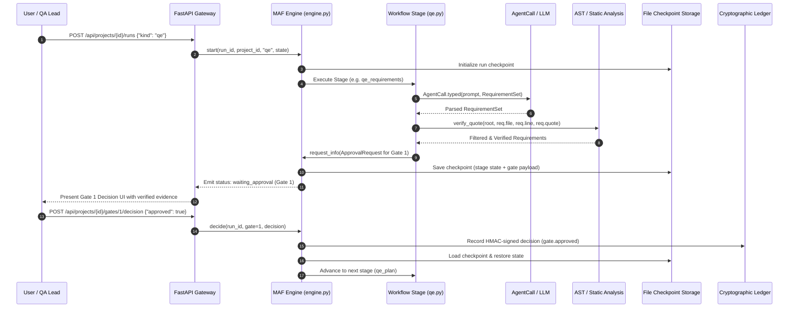
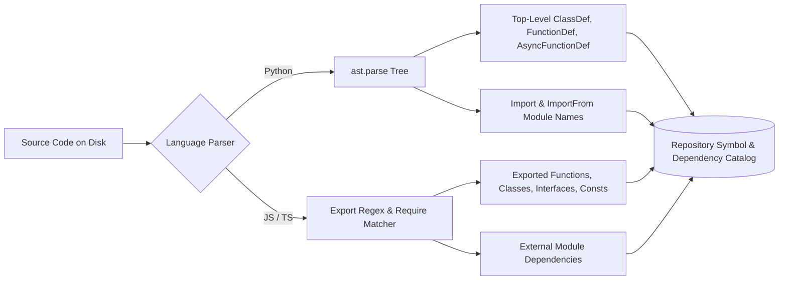
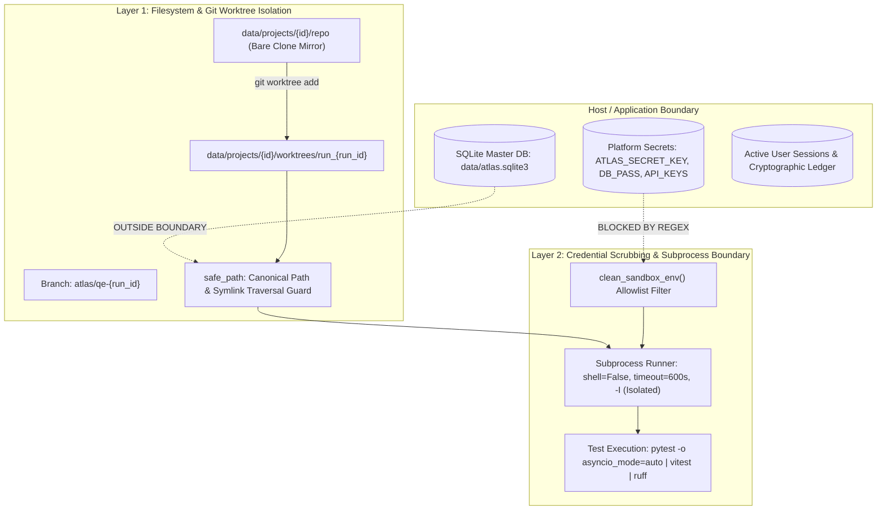
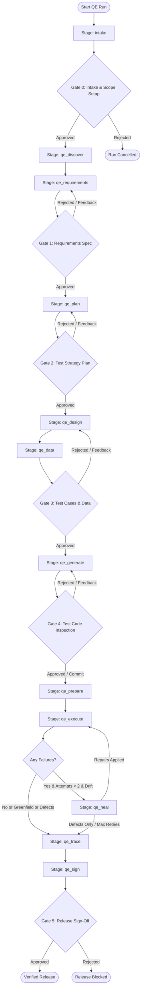
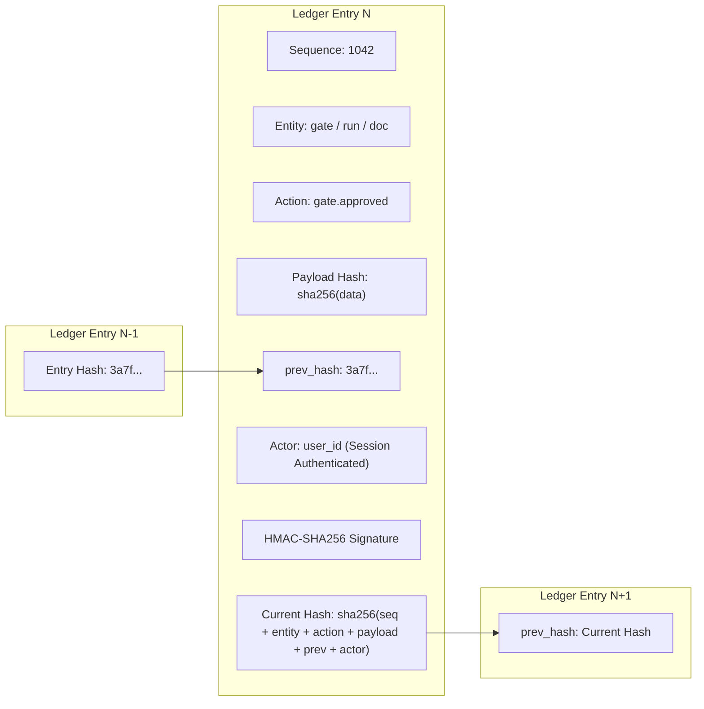
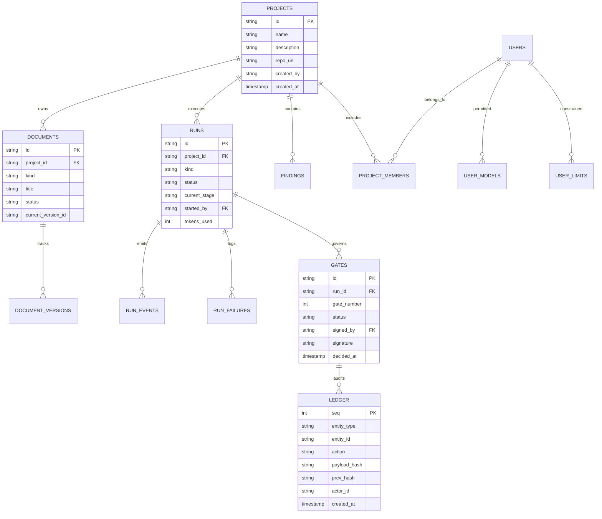

# Agentic QE Platform: System Architecture, Design & Specification

**Canonical Architecture & System Design Document**  
**Version:** 2.0 (Consolidated Production Specification)  
**Date:** 2026-11-06  
**Status:** Canonical & Active (`docs/SYSTEM_ARCHITECTURE_AND_DESIGN.md`)  
**Scope:** Replaces and consolidates `docs/SYSTEM_DESIGN.md`, `DESIGN.md`, `specs.md`, and `docs/ARCHITECTURE.md`.

---

## 1. Executive Summary & Architectural Tenets

The **Agentic Quality Engineering (QE) Platform** is an enterprise-grade autonomous testing and verification ecosystem built on **Microsoft Agent Framework (MAF 2.0)**, **Next.js 16 App Router**, and **FastAPI**. It transforms raw repository code, specifications, or business requirements into comprehensive, level-allocated, deterministic, and self-healing test suites with complete cryptographic traceability.

### 1.1 Core Architectural Tenets

1. **Zero Hallucinated Evidence (Anti-Hallucination Gateways):**
   No requirement, bug finding, or test case is accepted into the system without disk-verified evidence. Every code quote is checked against disk line-by-line using abstract syntax trees (AST) and normalized text search (`static_analysis.verify_quote`). Quotes originating from comments are rejected; executable code strictly takes precedence over comments.

2. **Dual-Layer Sandbox Isolation & Credential Scrubbing:**
   Untrusted repository code and test execution run in isolated Git worktrees (`atlas/qe-*` branches) under a scrubbed environment (`clean_env()`). Ambient platform secrets, API tokens, passwords, and cloud credentials matching `(?i)(key|secret|token|password|auth|cred|atlas|openai|anthropic)` are purged prior to any subprocess execution.

3. **Deterministic Token Predictability over Open-Ended Tool Loops:**
   Workflow agents receive structured line-numbered context packs (`code_pack`) directly in their conversation turn and possess zero tools. Empirical benchmarking demonstrated that open-ended tool loops consumed 170,000 to 955,000 tokens while drifting from their tasks; structured code packing achieved superior test suite compilation within ~86,000 tokens. Read tools remain available exclusively to interactive chat copilot sessions.

4. **Durable Human-in-the-Loop Quality Gates (G0–G7):**
   Workflows progress through formal quality gates requiring HMAC-signed decisions by authenticated, role-authorized human reviewers. Stages persist intermediate states to SQLite WAL and file-backed checkpoints (`FileCheckpointStorage`), surviving process interruptions and server restarts.

5. **Assertion-Preserving Self-Healing:**
   Autonomous self-healing is strictly bounded to repairing test selectors and fixture definitions. Code guardrails (`guarded_apply`) reject any automated repair that modifies, removes, or weakens test assertions, introduces test skips (`@pytest.mark.skip`), or touches application production code.

6. **Single Source of Truth:**
   One single canonical document governs each architectural concern. Redundant, divergent, or dead specification files are eliminated.

---

## 2. High-Level Platform Architecture

The platform follows a decoupled, asynchronous, tiered architecture comprising a Next.js 16 React frontend, a FastAPI API gateway, the MAF 2.0 multi-agent execution harness, a local skills ecosystem, and dual-layer isolated sandboxes backed by SQLite WAL and an append-only cryptographic ledger.

```mermaid
flowchart TB
    subgraph CLIENT [Frontend Presentation Layer: Next.js 16 & React 18 (Port 3000)]
        UI_SHELL["Antigravity UI Shell: AppShell & ProjectShell"]
        STUDIOS["Studio Workspaces: BA Studio | Bug Scan | Feature Builder | QE Studio | Governance | Observability"]
        HARNESS_VIEW["Harness Views: RunPanel | DocumentEditor | ChatContainer | MagenticLedger | DiffViewer"]
        CLIENT_PROTOCOLS["Protocol Adapters: AG-UI SSE Stream Adapter | CopilotKit Runtime (/api/copilotkit)"]
    end

    subgraph GATEWAY [API Gateway & Governance Layer: FastAPI (Port 8000)]
        MIDDLEWARE["Security Middleware: SessionGuard | CORS | Host/Origin Guard | RateLimiter"]
        ROUTERS["15 API Routers: /api/auth | /api/projects | /api/documents | /api/runs | /api/governance | /api/settings | /api/observability"]
        AUTH_RBAC["Auth & RBAC: Salted scrypt Hashes | Encrypted Usernames | Fernet Tokens | Role Perms"]
    end

    subgraph ENGINE [Orchestration Engine: Microsoft Agent Framework (MAF 2.0)]
        ORCHESTRATOR["MAF Workflow Engine: WorkflowBuilder | StageSpec | Checkpoint Durability"]
        PERSONAS["12 Agent Personas: Requirements Analyst | Principal Test Architect | Test Design Architect | Test Automation Engineer | QA Execution Engineer | Defect Diagnostician | Confidence Reviewer | Repo Intelligence Analyst | Business Analyst | Bug Reviewer | Feature Engineer | Project Copilot"]
        GUARDRAILS["Governance Middleware: ATLAS_MODEL_CONCURRENCY Bulkhead | Token Budgets | Secret Redactor | Safe Path"]
        CACHE["Harness Caching: Semantic Prompt Cache | Deterministic Tool Cache"]
    end

    subgraph QE_PIPELINE [Autonomous QE Lifecycle: 8 Quality Gates (G0 - G7)]
        G0["G0: Intake & Scope Setup"]
        DISC["AST Repo Discovery"]
        G1["G1: Requirements & User Stories"]
        G2["G2: Level-Allocated Test Plan"]
        G3["G3: Test Design & Synthesized Data"]
        G4["G4: Test Code Generation (AST Validated)"]
        EXEC["Sandboxed Test Execution (clean_env)"]
        HEAL["Assertion-Preserved Self-Healing"]
        TRACE["Traceability Matrix & Defect Triage"]
        G5["G5: Release Sign-Off & Audit"]
    end

    subgraph SANDBOX [Dual-Layer Sandboxing & Subprocess Isolation]
        REPO_MIRROR["Base Repo Mirror: data/projects/{id}/repo"]
        WORKTREE["Isolated Git Worktrees: data/projects/{id}/worktrees/run_{run_id}"]
        SCRUBBER["clean_env Subprocess Runner: PATH/HOME Whitelist, 0 Platform Secrets"]
        TOOLING["Clean Execution: pytest | vitest | jest | playwright | ruff"]
    end

    subgraph PERSISTENCE [Persistence & Cryptographic Audit Layer]
        SQLITE["SQLite WAL Store: data/atlas.sqlite3 (Projects, Docs, Runs, Events, Models, Limits)"]
        LEDGER["Append-Only Cryptographic Ledger: SHA-256 Hash Chain & HMAC Signatures"]
        CHECKPOINTS["MAF File Checkpoints: data/checkpoints/{run_id}"]
        PARTS_CACHE["Incremental Batch Cache: data/runs/{run_id}/parts/{stage}/{key}.json"]
    end

    CLIENT -->|HTTP / SSE Stream / AG-UI| GATEWAY
    GATEWAY --> ENGINE
    ENGINE --> QE_PIPELINE
    QE_PIPELINE --> SANDBOX
    QE_PIPELINE --> PERSISTENCE
    ENGINE --> PERSISTENCE
    GATEWAY --> PERSISTENCE
```

### 2.1 Backend Code Layout & Layering Rules

Dependencies point strictly downward: `api` imports `maf`; `maf` imports `core`, `repos`, and `qe`. The foundational modules (`core`, `repos`, `qe`) never import upward.

```text
src/backend/
  app.py                 Application factory, middleware (SessionGuard, CORS), error handlers
  config.py              Path resolution, environment variables, token limits, runtime settings
  db.py                  SQLite WAL connection pool, context managers, schema migration engine
  api/                   REST & SSE API routers
    auth.py              Sign-in, session validation, user registration, account management
    projects.py          Project CRUD, member assignments, ownership transfer
    repository.py        Git cloning, branch checkout, ZIP ingestion, AST inspection
    documents.py         Document CRUD, version diffing, Gherkin validation, DOCX export
    templates.py         Template seeding and file uploads
    runs.py              Workflow run initialization, status polling, gate decision dispatch
    findings.py          Static analysis and bug scanner results
    governance.py        Quality gates review, signing, hash-chained ledger inspection
    settings.py          Model configurations, proxy endpoints, token allocations, gate roles
    observability.py     Aggregated audit events, failure telemetry, token consumption
    logs.py              Daily JSONL log downloads (admin restricted)
    chat.py              Interactive copilot chat streaming over AG-UI protocol
    harness.py           Agentic QE Harness session orchestration, MCP client hooks
    skills.py            Local dynamic skills catalog and details
  maf/                   Microsoft Agent Framework integration
    engine.py            WorkflowBuilder orchestration, stage dispatch, request_info HITL, checkpoints
    runtime.py           AgentCall wrapper, JSON repair, token enforcement, session memory
    governance.py        Agent policy enforcement, tool allowlisting, prompt injection guards
    observability.py     Agent call and tool invocation telemetry recorders
    llm.py               Provider client wrapper, tool-call validation probes
    agui.py              AG-UI protocol streaming adapter for CopilotKit
    skill_chat.py        Dynamic skill injection for interactive chat sessions
    agents/              12 individual policy definitions with strict risk tiers and tool rules
    tools/               Project-scoped deterministic tools (read_file, list_files, grep, etc.)
    workflows/           Workflow definitions: qe.py, ba.py, bug_scan.py, change.py, shared.py, edits.py
    evals/               Deterministic metrics, RAGAS integration, benchmark runners
  core/                  Cross-cutting domain logic
    auth.py              Session authentication, PBKDF2/scrypt, Fernet token encryption, RBAC matrix
    doc_checks.py        Structural document heuristics and coverage verifiers
    documents.py         Immutable document versioning, hash generation, DOCX rendering
    errors.py            Typed platform exceptions (AQE-*) and diagnostic payloads
    files.py             Sandboxed filesystem operations, path confinement
    gates.py             Gate state machine, HMAC signatures, gate reopening cascade
    gherkin.py           Gherkin syntax parser, scenario extraction, example table validator
    ledger.py            Append-only SHA-256 hash-chained audit ledger
    logs.py              Structured JSONL logging with automatic credential redaction
    models.py            LLM model registry, default selection, date/timezone token quotas
    prompts.py           Prompt versioning, activation, and template rendering
    security.py          Regex and entropy secret scanners, safe_path path-traversal guard
    skills.py            MAF FileSkillsSource loader, skill metadata, prompt reference injection
  repos/                 Repository inspection and sandboxing
    git.py               Deterministic Git CLI wrapper (clone, worktree, branch, commit)
    github.py            Encrypted token management, GitHub API client
    ingest.py            ZIP extraction with path traversal and bomb protection, folder copy
    sandbox.py           Project directory isolation, worktree allocation, clean_sandbox_env
    scan.py              Repository AST scanner, framework/runner detection, symbol extractor
    static_analysis.py   Ruff runner, JS/TS heuristic scanner, anti-hallucination quote verifier
  qe/                    Autonomous Quality Engineering core
    confidence.py        Rubric-based scoring engine (design, code, plan), verdict computation
    emit.py              Pre-run AST inspection of generated Python tests, signature checking
    execution.py         Sandboxed test suite runner, JUnit XML parser, failure classifier
    model.py             Pydantic domain models for requirements, test plans, test cases
    test_data.py         Deterministic synthetic test data and fixture builder, PII masker
    trace.py             Bidirectional traceability matrix, release summary, defect reports
```

### 2.2 Frontend UI Architecture & Design System

The frontend is implemented with **Next.js 16 (App Router)** and **React 18**, utilizing server and client components with no external font or script dependencies (zero external tracking).

#### 2.2.1 Design Tokens

| Token | Dark Mode (`globals.css`) | Light Mode | Semantic Purpose |
|---|---|---|---|
| Page Background | `#030712` (slate-950) | `slate-50` | Root background |
| Card Surface | `#0b1329` (dark navy) | `white` | Containers, cards, tables |
| Sidebar & Header | `#060a17` (deep navy) | `white` | Navigation shells |
| Input Surface | `#070d1f` | `white` | Form fields, text inputs |
| Border | `slate-800` | `slate-200` | Card, table, and divider borders |
| Accent | `indigo-600` | `indigo-600` | Primary actions, active indicators |
| Status Success | `emerald-500` | `emerald-600` | Passed tests, approved gates |
| Status Warning | `amber-500` | `amber-600` | Pending approvals, partial results |
| Status Danger | `rose-500` | `rose-600` | Failed tests, rejected gates |

Typography relies exclusively on native system font stacks (`system-ui, -apple-system, sans-serif` and `ui-monospace, monospace`), ensuring zero network requests to third-party font hosts. Base font size is 14px.

#### 2.2.2 Navigation Hierarchy & Routing Table

```text
/                                   Project Portfolio grid with search, filter, and creation
/settings                           Model providers, private repo access, system health
/approvals                          Aggregated pending human gates across all projects
/login                              Session authentication
/users                              Admin management: user roles, model limits, token budgets
/agents                             Catalog of 12 agent personas, risk tiers, and policies
/agents/{key}                       Detailed persona view: prompt history, evals, telemetry
/observability                      System-wide execution log, error analytics, token usage
/templates                          Document template manager (BRD, PRD, Stories, Test Plan)
/docs/{page}                        Integrated platform documentation site
/findings                           Aggregated static analysis and vulnerability findings
/documents                          Aggregated requirements and test documents
/projects/{id}                      Project Overview dashboard and next-step actions
  /repository                       Git repository connection, ZIP import, AST file viewer
  /ba                               Business Analysis Studio (Brief, Sources, Draft, Refine)
  /documents[/{doc}]                Document viewer, Markdown/Gherkin editor, version history
  /feature                          Feature Builder: branch creation, structured code changes
  /bugs                             Bug Scan Studio: static scan, LLM verification, Fix All
  /qe                               Autonomous QE Studio: lifecycle stepper, run trigger, logs
  /approvals                        Pending Quality Gates for this specific project
  /governance                       Quality gate history, HMAC signature ledger, audit trail
  /runs[/{run}]                     Real-time run dashboard, live event timeline, JUnit view
  /observability                    Project-scoped telemetry, token usage, tool audits
  /prompts                          Prompt template versions, active activations, evals
  /chat                             In-workspace interactive Copilot chat
/chat/{id}                          Standalone windowed Copilot chat session
```

---

## 3. Microsoft Agent Framework (MAF 2.0) Orchestration Engine

The multi-agent orchestration engine wraps Microsoft Agent Framework (`agent_framework`), utilizing directed acyclic graphs (DAG) with conditional edge routing, fan-out/fan-in branching, and file-persisted state checkpoints.

### 3.1 Workflow Lifecycle & Durability Architecture



### 3.2 Stage Specification & State Resumption

Workflows are composed of discrete `StageSpec` objects registered in a workflow `Definition`:

```python
@dataclass
class StageSpec:
    id: str                                                             # Unique stage identifier
    fn: Callable[[RunContext, dict], Awaitable[dict]]                  # Async stage handler
    label: str = ""                                                     # Human-readable display label
    approval: Callable[[RunContext, dict], dict | None] | None = None  # HITL Gate factory
    on_approved: Callable[[RunContext, dict, dict], Awaitable[dict]] | None = None # Post-approval hook
    on_rejected: str | None = None                                      # Target stage on rejection rework
    next: str | None = None                                             # Direct downstream stage
    forward: bool = False                                               # Enable fan-out routing
```

#### Durability & Checkpoint Mechanics:
- **`FileCheckpointStorage`:** State is automatically serialized and persisted to `data/checkpoints/{run_id}` upon each stage completion and before any human approval pause (`request_info`).
- **Server Interruption Resilience:** If the server terminates or reboots during a run, running workflows are marked `interrupted`. Waiting workflows remain intact at their checkpoints. Calling `/api/runs/{id}/retry` reconstitutes the workflow state directly from the checkpoint and resumes execution seamlessly.
- **Incremental Batch Caching (`RunContext.keep`):** Long-running iterative stages (such as Test Design and Test Code Generation) persist completed batches to `data/runs/{run_id}/parts/{stage}/{key}.json` where `key = sha256(inputs)`. If a downstream batch fails or token limits are exceeded, subsequent retries load cached batches and only re-execute uncompleted items.
- **Graceful Partial Results:** If a stage fails more than two consecutive attempts (`PARTIAL_AFTER = 2`), it yields a `PARTIAL` result. The gate payload highlights the missing requirements or cases; a partial gate **cannot** be approved by the human reviewer without explicit remediation.

### 3.3 Agent Governance, Policy Registry & Risk Tiers

The platform enforces a centralized agent governance model across 12 personas:

| Agent Key | File Path | Risk Tier | Tools Granted | Token Limit | System Role |
|---|---|---|---|---|---|
| `requirements-analyst` | `maf/agents/requirements_analyst.py` | Low | None (Message code) | 16,000 | Reverse-engineers testable requirements with quote verification |
| `principal-test-architect` | `maf/agents/principal_test_architect.py` | Medium | None (Message code) | 16,000 | Synthesizes level-allocated test strategy across Unit/Int/E2E |
| `test-design-architect` | `maf/agents/test_design_architect.py` | Low | None (Message code) | 16,000 | Derives deterministic test scenarios & boundary conditions |
| `test-automation-engineer` | `maf/agents/test_automation_engineer.py` | High | None (Structured edits) | 24,000 | Generates AST-checked executable test files |
| `qa-execution-engineer` | `maf/agents/qa_execution_engineer.py` | Low | None (Evidence summary) | 8,000 | Summarizes test execution results; audited by code counts |
| `defect-diagnostician` | `maf/agents/defect_diagnostician.py` | Medium | None (Structured edits) | 16,000 | Diagnoses failures; repairs fixtures/selectors only |
| `confidence-reviewer` | `maf/agents/confidence_reviewer.py` | Low | None (Read context) | 12,000 | Independently scores plans, cases, and test suites |
| `repo-intelligence-analyst`| `maf/agents/repo_intelligence_analyst.py`| Low | None (Scan brief) | 16,000 | Produces AST architectural summaries and module maps |
| `business-analyst` | `maf/agents/business_analyst.py` | Low | None (Sources) | 16,000 | Authors BRDs, PRDs, user stories, and Gherkin features |
| `bug-reviewer` | `maf/agents/bug_reviewer.py` | Medium | None (Findings context) | 16,000 | Analyzes static findings; produces remediation changes |
| `feature-engineer` | `maf/agents/feature_engineer.py` | High | None (Structured edits) | 24,000 | Implements feature requests on dedicated Git worktrees |
| `project-copilot` | `maf/agents/project_copilot.py` | Medium | Read-only project tools | 12,000 | Interactive conversational assistant streaming via AG-UI |

---

## 4. Repository AST Discovery, Code Packs & Symbol Extraction

The platform rejects naive repository ingest in favor of deterministic, static AST analysis and structured token-windowed code packing.

### 4.1 Deterministic Repository Scanner (`repos/scan.py`)

The repository analyzer inspects raw project files on disk, extracting empirical stack characteristics without running untrusted code:
- **Filesystem Traversal:** Scans project directories while strictly ignoring build artifacts and caches (`.git`, `node_modules`, `.venv`, `__pycache__`, `dist`, `build`, `.next`, `coverage`).
- **Language & LOC Accounting:** Accurately classifies 26 programming languages by file suffix and counts lines of code.
- **Manifest Ingestion:**
  - `package.json`: Extracts production and development dependencies, build/test scripts.
  - `requirements.txt` & `pyproject.toml`: Parses PEP 621 dependencies, Poetry configurations, and dependency groups.
  - `pom.xml`: Extracts Maven artifact IDs.
- **Framework & Runner Auto-Detection:** Identifies frameworks (FastAPI, Flask, Django, Express, NestJS, Spring Boot, Next.js, React, Vue, Angular) and test runners (pytest, vitest, jest, Playwright, Cypress, JUnit).
- **Route Extraction:** Identifies API routes using regex scanners covering Python FastAPI/Flask decorators, JavaScript/TypeScript router expressions, and Java Spring `@GetMapping` annotations.
- **Entrypoint Discovery:** Detects application entrypoints (`main.py`, `app.py`, `index.ts`, `server.js`, `layout.tsx`, etc.).

### 4.2 AST Symbol Extraction

For Python and JavaScript/TypeScript files, the scanner extracts top-level structural symbols:



### 4.3 Code Packing Subsystem (`maf/workflows/shared.py`)

To guarantee token predictability and eliminate erratic tool loops, the `code_pack` engine packages source files directly into model messages:
- **Risk-Prioritized Sorting:** Files are ordered based on static analysis findings, complexity, and line count (`static_analysis.rank_files_for_review`).
- **Secret Redaction:** Text passes through entropy and pattern redactors prior to assembly.
- **Explicit Line Numbering:** Every file line is prefixed with its 1-indexed number (`1: import os`). Agents are instructed that line numbers are contextual markers, preventing them from including line prefixes in search blocks.
- **Windowed Citation Extraction (`_window`):** When generating review evidence, `code_pack` extracts only the code within a specified radius (default 40 lines) surrounding cited lines. This compresses repository context while maintaining line-number veracity.
- **Token Budget Guards:** Enforces strict character limits (e.g., 20,000–60,000 characters), ensuring prompts stay comfortably within model context windows.

### 4.4 Anti-Hallucination Quote Verification (`repos/static_analysis.py`)

To prevent LLM hallucination in requirements extraction and bug scanning, `static_analysis.verify_quote` validates claims against disk:
1. Resolves the target relative path using `safe_path`.
2. Reads the actual source file from disk.
3. Normalizes whitespace across the model quote and candidate source lines.
4. Searches within a 20-line window of the stated line number.
5. If found, returns `(True, actual_line_number)`.
6. If the quote is missing, or if the quote is determined to be a code comment (`model.is_comment`), the finding or requirement is summarily rejected.

---

## 5. Dual-Layer Sandboxing & Credential Scrubbing

The platform executes test commands, linters, and code generators within a multi-tiered security perimeter designed to protect host secrets and isolate repository artifacts.



### 5.1 Layer 1: Filesystem Confinement & Git Worktrees

1. **Dedicated Project Trees:** Each project operates within `data/projects/{project_id}/`.
2. **Git Worktree Allocation:** Workflow runs that modify or generate code create an isolated Git worktree under `data/projects/{project_id}/worktrees/run_{run_id}` on a dedicated branch (`atlas/qe-{run_id}` or `atlas/change-{run_id}`). The primary repository checkout is never modified directly.
3. **`safe_path` Confinement:** Every filesystem read or write operation passes through `core.security.safe_path`:
   - Resolves all symlinks and canonicalizes paths.
   - Strictly enforces that the target resides inside the project's sandbox directory (`is_relative_to(boundary)`).
   - Immediately raises `ValueError` upon detection of directory traversal sequences (`..`), NUL bytes, or absolute path escapes.

### 5.2 Layer 2: Credential Scrubbing (`clean_env`)

When running test suites, package managers, or language runtimes, the platform scrubs the environment:
- **Sensitive Regex Filter:**
  ```python
  SENSITIVE_ENV_PATTERN = re.compile(
      r"(?i)(key|secret|token|password|passwd|auth|cred|atlas|openai|anthropic|aws|github|bearer|private)"
  )
  ```
- **Allowlisted Process Environment:** Only benign operating system variables are preserved:
  `PATH`, `LANG`, `LC_ALL`, `PYTHONDONTWRITEBYTECODE`, `SYSTEMROOT`, `TEMP`, `TMP`, `USER`, `TERM`, `SHELL`, `HOME`, `NODE_PATH`, `PYTHONPATH`.
- `HOME` is forcibly defaulted to `/tmp` if absent, preventing tools from reading user dotfiles (`~/.ssh`, `~/.aws`).
- `PYTHONDONTWRITEBYTECODE` is fixed to `"1"` to avoid polluting directories with cached bytecode.
- Subprocesses execute with `shell=False`, argument lists, and hard timeouts (300s–600s).

---

## 6. Autonomous QE Lifecycle Pipeline (Gates G0 – G5)

The primary workflow (`maf/workflows/qe.py`) orchestrates the end-to-end autonomous quality engineering lifecycle through eight discrete stages and six human-in-the-loop quality gates:



### 6.1 Detailed Stage-by-Stage Specifications

#### 1. Intake (Stage `intake`, Gate G0)
- **Role:** Confirms run parameters, execution timeout, target branch, dependency installation policy, and test case budget (`MAX_CASES`, default 40).
- **Gate 0:** Human signs off on run authorization and configuration.

#### 2. AST Discovery (Stage `qe_discover`)
- **Agent:** `repo-intelligence-analyst`
- **Mechanism:** Ingests scan facts (`_analysis`) and code summary (`discovery_pack`). Generates comprehensive architectural summary.
- **Verification:** Evaluated by `doc_checks.discovery_issues` (must cover architecture, modules, interfaces, risks, test status) and reviewed independently by `confidence-reviewer`.
- **Artifact:** Stored as `discovery` document.

#### 3. Requirements Specification (Stage `qe_requirements`, Gate G1)
- **Agent:** `requirements-analyst`
- **Mechanism:** In brownfield mode, reverse-engineers testable requirements from code pack; in greenfield mode, derives requirements from approved BA documents (BRD/PRD/Stories).
- **Data Model:** Pydantic `RequirementSet` containing `Requirement` objects:
  ```python
  class Requirement(BaseModel):
      id: str                                                      # e.g. "REQ-001"
      title: str
      statement: str
      type: Literal["functional", "non-functional", "security", "data", "integration"]
      priority: Literal["P0", "P1", "P2"]
      tier: Literal["specified", "observed", "inferred"]
      actor: Literal["anonymous", "customer", "admin", "system"]   # Exactly one named actor
      file: str = ""
      line: int = 0
      quote: str = ""
  ```
- **Verification:** Every quote is validated via `static_analysis.verify_quote`. Comment quotes are discarded. Independent review via `confidence-reviewer`. Low score triggers automatic prompt revision.
- **Gate 1:** Named reviewer approves requirements table and verified evidence.

#### 4. Level-Allocated Test Planning (Stage `qe_plan`, Gate G2)
- **Agent:** `principal-test-architect`
- **Mechanism:** Allocates requirements across Unit, Integration, and E2E testing levels based on detected runners and risk profiles.
- **Verification:** Deterministic scoring via `model.plan_confidence`:
  - Must cover all P0 and P1 requirements.
  - Requires explicit rationale for any omitted test level (`skipped_levels`).
  - Independent review rubric: `controls_covered` (40), `level_fit` (30), `scenarios_derivable` (30).
- **Gate 2:** Named reviewer approves test strategy and risk-level allocations.

#### 5. Deterministic Test Design & Fixture Data (Stages `qe_design` & `qe_data`, Gate G3)
- **Agent:** `test-design-architect` (`designing-test-cases` skill)
- **Pre-Design Case Quota (`model.case_quota`):** To eliminate wasted tokens, quota budgeting executes *before* model generation:
  - P0 and P1 requirements receive exactly 4 cases: **1 Positive, 2 Negative (including boundary), 1 Exception**.
  - P2 requirements receive 2 or 1 cases depending on remaining capacity up to `ATLAS_MAX_CASES`.
  - Excluded lower-priority requirements are explicitly logged in `case_limit.left_out_requirements`.
- **Batch Processing:** Requirements process in parallel batches of 4 (`DESIGN_BATCH`). If a batch fails, it splits in half. Finished batches are cached under `data/runs/{run_id}/parts/design/{hash}.json`.
- **Per-Case Confidence Review (`confidence.py`):**
  - Rubric: `source_proven` (30), `correct_target` (25), `expected_derivable` (25), `fixture_validity` (20).
  - Score threshold: 100 = APPROVED, 70–99 = REVISE, <70 = REJECT.
  - REJECT cases return individually to the agent with specific flaw lines for one revision attempt.
- **Stage `qe_data` (Plugin `qe-data` parity):** Deterministically synthesizes test fixtures (`qe/test_data.py`), masking PII (credit cards, emails, national IDs) and generating boundary payloads. Operates with zero model tokens.
- **Gate 3:** Reviewer approves test cases, scenario matrix, and fixture contracts. Token estimate for code generation is displayed.

#### 6. Test Code Generation & AST Validation (Stage `qe_generate`, Gate G4)
- **Agent:** `test-automation-engineer`
- **Mechanism:** Allocates isolated worktree on branch `atlas/qe-{run_id}`. Emits test files under `tests/agentic_qe/`.
- **Strict Emission Standards (`_generated_file_problems`):**
  - First line must be a `# CASE_ID: TC-APP-xxx` comment.
  - Exactly one test case per file.
  - No `assert True` or `expect(true).toBe(true)` tautologies.
  - No placeholders (`pass`, `...`, `TODO`).
- **AST Pre-Run Validation (`qe/emit.py`):**
  - Parses generated Python tests with Python `ast` without executing them.
  - Verifies all local imports resolve to existing files.
  - Verifies function and class calls match real AST signatures (positional, keyword-only, default parameters) up to `SIGNATURE_BUDGET` characters.
  - Verifies third-party imports against the sandbox Python environment inventory (`emit.inventory`).
  - Flagged files return to the agent for revision. Persistent syntax errors are quarantined with `@pytest.mark.skip`.
- **Gate 4:** Named reviewer inspects generated test code. Approving commits files to the branch and authorizes execution on the host machine.

#### 7. Environment Preparation & Execution (Stages `qe_prepare` & `qe_execute`)
- **Stage `qe_prepare`:** Installs declared dependencies if opted in, configures `pytest-asyncio` for async tests, and sets CLI options (`-o asyncio_mode=auto`).
- **Stage `qe_execute`:** Executes the test runner (`execution.run_suite`) inside the worktree using `clean_env()`.
- **Result Parsing:** Ingests JUnit XML reports to extract test names, execution times, status, and failure traces.
- **Failure Classification (`execution.classify_failure`):**
  - `ENVIRONMENT`: Missing system dependencies, server connection refused, unhandled 429 rate limits.
  - `FIXTURE_DRIFT` / `SELECTOR_DRIFT`: Parameter mismatches, altered fixture definitions, modified UI selectors.
  - `DEFECT`: True application assertion failures. An assertion failure is **never** classified as environment.
- **Honest Verdict Enforcement:** If 0 tests execute, verdict is `INCONCLUSIVE`, never `PASS`.
- **Execution Summary:** `qa-execution-engineer` writes an analytical summary. Code verifies all numbers against JUnit counts; mismatches cause the agent summary to be rejected in favor of code's deterministic report.

#### 8. Assertion-Preserved Self-Healing (Stage `qe_heal`)
- **Agent:** `defect-diagnostician`
- **Scope Restriction (`healing_guard`):**
  - Healing repairs only test fixture definitions and selectors in failing tests.
  - Code guardrails reject any edit that alters or removes an assertion (`execution.assertions_preserved`).
  - Code guardrails reject edits to application source files or tests that revealed real application defects (`heal_allowed`).
  - Maximum of 2 healing iterations.

#### 9. Traceability & Defect Triaging (Stage `qe_trace`)
- **Mechanism:** Builds bidirectional traceability matrix linking Requirements -> Test Cases -> Generated Test Files -> Execution Verdicts.
- **Defect Report:** Generates `defect_report` document detailing defect classifications, evidence, root causes, and recommended fixes.
- **Post-Execution Score Capping:** Any test file that failed in execution has its confidence review score capped at 60 (`confidence.TEST_FAIL_CAP`).

#### 10. Release Readiness Sign-Off (Stage `qe_sign`, Gate G5)
- **Agent:** `confidence-reviewer`
- **Mechanism:** Evaluates full pipeline metrics (pass rate, requirement coverage, open defects, drift logs) to produce release recommendations.
- **Gate 5:** QE Lead provides final approval. Cryptographic ledger records HMAC-signed release entry.

### 6.2 Gate Reopening Cascade Rules (CNF-10)

To maintain absolute integrity, editing any approved document automatically invalidates downstream artifacts:
- Editing `discovery` or `requirements` reopens **Gate 1** and all subsequent gates (G2–G5).
- Editing `test_plan` reopens **Gate 2** and G3–G5.
- Editing `test_cases` reopens **Gate 3** and G4–G5.
- Editing `test_code` reopens **Gate 4** and G5.
- Stored gate decisions are revoked; `documents.save_version` writes `gate.reopened` to the audit ledger; downstream gates cannot be approved out of sequence (`GateOrderError`).

---

## 7. Cryptographic Governance & Audit Ledger

All significant mutations, human approvals, gate transitions, and security events write to an append-only, SHA-256 hash-chained cryptographic ledger (`core/ledger.py`).



### 7.1 Ledger Guarantees & Tamper Detection

1. **Hash Chaining:** Each record incorporates the SHA-256 hash of the preceding record (`prev_hash`). Any out-of-band alteration, deletion, or insertion corrupts the chain.
2. **Session Identity Binding:** The `actor_id` is populated strictly from the authenticated session (`session_guard`), ignoring any client-supplied identity parameters.
3. **Audit Verification:** The `/api/governance` API and `verify_ledger` tool perform complete chain verification from genesis to tip, returning exact sequence numbers if corruption is detected.

---

## 8. Data Models & Database Schema Specifications

The platform state is persisted in SQLite WAL mode (`data/atlas.sqlite3`). Schema evolution is managed via sequential migrations (`src/backend/migrations/001` through `012`).



### 8.1 Typed Platform Errors (`core/errors.py`)

All failures are mapped to typed domain exceptions with standardized error codes:

| Error Code | Error Class | Retryable | Description & Remediation Action |
|---|---|---|---|
| `AQE-MODEL-001` | `ModelJsonError` | Yes | Model reply was not valid JSON. UI offers retry with error position. |
| `AQE-MODEL-002` | `ModelCutOffError` | Yes | Model reply exceeded token limit and was cut off. Retry prompts for concise output. |
| `AQE-MODEL-003` | `ModelSchemaError` | Yes | Valid JSON but missing required fields or violates schema. Prompts corrected schema. |
| `AQE-MODEL-004` | `ModelTimeoutError`| Yes | Model provider failed to respond within `ATLAS_MODEL_TIMEOUT`. Retry connection. |
| `AQE-MODEL-005` | `ModelFilterError` | No | Provider content filter triggered. Input text must be neutralized. |
| `AQE-MODEL-006` | `ModelEndpointError`| Yes | Upstream LLM provider endpoint unreachable, busy (429), or rejected API key. |
| `AQE-ALLOW-001` | `AllowanceError` | No | Model not permitted for user or project exceeded `ATLAS_RUN_TOKEN_LIMIT`. |
| `AQE-ALLOW-002` | `LimitReached` | No | User daily, weekly, or monthly token budget exhausted. Awaits period reset. |
| `AQE-REPO-001` | `RepoError` | No | Git clone failed, invalid repository URL, or bad branch name. |
| `AQE-EVID-001` | `EvidenceError` | Yes | Generated requirement or bug quote could not be verified on disk. |
| `AQE-TEST-001` | `ExecutionError` | Yes | Test execution failed to start or runner dependencies missing. |
| `AQE-INT-001` | `InternalError` | No | Internal unhandled error; diagnostic traceback recorded in `run_failures`. |

---

## 9. Comprehensive Requirements Traceability Matrix

This canonical document incorporates and enforces all specifications originally defined across `specs.md`, `DESIGN.md`, `docs/SYSTEM_DESIGN.md`, and `docs/ARCHITECTURE.md`:

| Req ID | Domain | Specification Summary | Canonical Architecture Mapping | Verification Method |
|---|---|---|---|---|
| **PRJ-1..3** | Projects | Card grid, no dropdowns, `/projects/{id}` routes, typed delete confirmation | Section 2.2.2 (Navigation Hierarchy & Routing) | E2E (`tests/e2e`) |
| **BA-1..7** | Requirements | BRD/PRD/Stories templates, multi-format upload, Gherkin validation, DOCX export | Section 2.1, 3.3 (`business-analyst` persona) | API & Unit |
| **GOV-1..5** | Governance | Immutable doc versions, prompt versioning, HMAC gates, SHA-256 hash-chained ledger | Section 7 (Cryptographic Governance) | Unit & E2E |
| **REP-1..5** | Repositories | HTTPS clones, encrypted tokens, ZIP traversal defense, AST inspection | Section 4.1 & 5.1 (Repository Scanner & Sandboxing) | Unit & E2E |
| **BUG-1..3** | Bug Scan | Ruff, secret, JS heuristic scanners; disk quote verification; duplicate defense | Section 4.4 (Static Analysis & Quote Verification) | Unit & API |
| **CHG-1..7** | Code Changes | Isolated Git worktrees, pre/post baseline tests, guarded edits, assertion preservation | Section 5.1 (Sandboxing) & Section 6.1 (Healing) | API & Unit |
| **QE-1..7** | QE Pipeline | G0–G5 gates, quote verification, 1P/2N/1E case mix, clean_env execution, traceability | Section 6 (Autonomous QE Lifecycle Pipeline) | API & Unit |
| **CHAT-1..5** | Copilot Chat | AG-UI protocol over SSE, project memory persistence, multi-agent selection | Section 2.1 (`api/chat.py`, `maf/agui.py`) | API & E2E |
| **AGT-1..9** | Governance | Central agent registry, deny-by-default tools, token limits, eval suites | Section 3.3 (Agent Governance & Policy Registry) | Unit & API |
| **ARC-1..3** | Architecture | Modular single-responsibility files, concurrency bulkhead, cut-off guard | Section 1, 2.1, 3.3 (Concurrency & Timeouts) | Unit |
| **DEP-1..4** | Deployment | Dual ZIP packaging, stamp-based builds, configurable SQLite journal mode | Section 8 & `deploy/azure` | Unit & Packaging |
| **SBX-1..4** | Sandboxing | Worktree isolation per run, full clone history, scrubbed clean_env | Section 5 (Dual-Layer Sandboxing) | Unit & API |
| **NAV-1..3** | UI Navigation | Direct card links, consolidated overview, integrated docs site | Section 2.2.2 (Navigation Hierarchy) | E2E |
| **DOC-1..5** | Document Edit | In-place editing, table grid manipulation, image upload signature check | Section 2.2.2 & 6.2 (Gate Reopening Cascade) | E2E |
| **USR-1..5** | Authentication| Session guard, scrypt passwords, encrypted usernames, project isolation | Section 2.1 (`core/auth.py`, `SessionGuard`) | API & E2E |
| **ACC-1..3** | Accuracy | Independent confidence review, AST discovery completeness, batch splitting | Section 4.4, 6.1 (Confidence Scoring & Batches) | Unit & API |
| **LIVE-1..3** | Live Views | Real-time SSE timeline, live artifact cards, agent telemetry inspection | Section 2.2.2 & 3.1 (Event Streaming) | E2E |
| **OBS-1..5** | Observability | Unified SQL-indexed audit query, redacted args, JSON export | Section 2.1 (`api/observability.py`) | API & E2E |
| **RUN-1** | Launchers | Cross-platform launchers (`dev.py`, `start-windows.bat`, `start-mac.command`) | Section 2.1 (`scripts/dev.py`) | Local Verification |
| **NF-1..5** | Non-Functional| Cross-platform (Linux/macOS/Win), DNS rebinding defense, model timeout | Section 1, 2.1, 3.3 (`ATLAS_MODEL_TIMEOUT`) | CI Matrix |
| **INT-1..3** | Integrity | Session-derived actor IDs, honest defect marking, TestCase table parsing | Section 7.1 & 8.1 (Integrity Rules) | Unit & API |
| **ERR-1..8** | Error Handling| Typed `AQE-*` errors, run retry resumption, partial batch persistence | Section 8.1 (Typed Platform Errors) | Unit & API |
| **OPS-1..6** | Operations | Keyset-paginated observability, single-run lock per project, daily logs | Section 2.1 (`api/observability.py`, `logs.py`) | API & E2E |
| **MDL-1..5** | Models & Quotas| Model registry, user allowlists, daily/weekly/monthly token allocations | Section 2.1 (`core/models.py`, `core/auth.py`) | Unit & API |
| **ROL-1..8** | Roles & RBAC | `admin`, `qe_lead`, `ba`, `developer`, `viewer`; gate role signing restrictions | Section 2.1 (`core/auth.py`) | Unit & API |
| **PLG-1..11**| Skills Engine | MAF `FileSkillsSource`, prompt injection, SHA-256 prompt referencing | Section 3.3 (Dynamic Skills Integration) | Unit & API |
| **CNF-1..12**| Confidence | Rubric scoring, citation disk verification, flawed case send-back, gate reopen | Section 6.1 (Stage 5) & 6.2 (Gate Reopening) | Unit & API |
| **TST-1..17**| Test Generation| AST signature validation, environment notes, quota budgeting, test summary | Section 4.3, 6.1 (Stage 5, 6, 7) | Unit & API |
| **EVL-1..10**| Evaluations | Deterministic metrics (Groundedness, Recall, F1), RAGAS integration | Section 2.1 (`maf/evals/`) | Unit & API |

---

## 10. Summary of Documentation Consolidation

In accordance with the repository documentation policy (**1 Single Doc for Each Idea, No Multiple Docs for a Single Purpose**), this document is the authoritative platform architecture and design specification.

- **Consolidated & Superseded Documents:**
  - `docs/SYSTEM_DESIGN.md` -> Fully integrated into Sections 1, 2, 3, 5, 8.
  - `DESIGN.md` -> Fully integrated into Section 2.2 (Frontend UI Architecture & Design System).
  - `specs.md` -> Fully integrated into Sections 3, 4, 5, 6, 8, 9.
  - `docs/ARCHITECTURE.md` -> Architectural diagrams, engine analysis, and inventory consolidated; replaced by pointer to this document.
